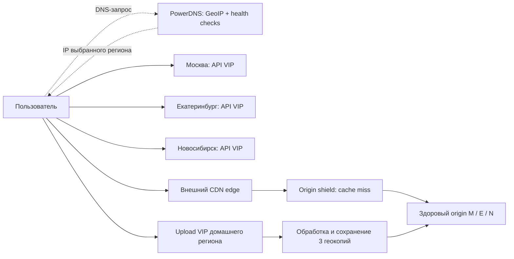
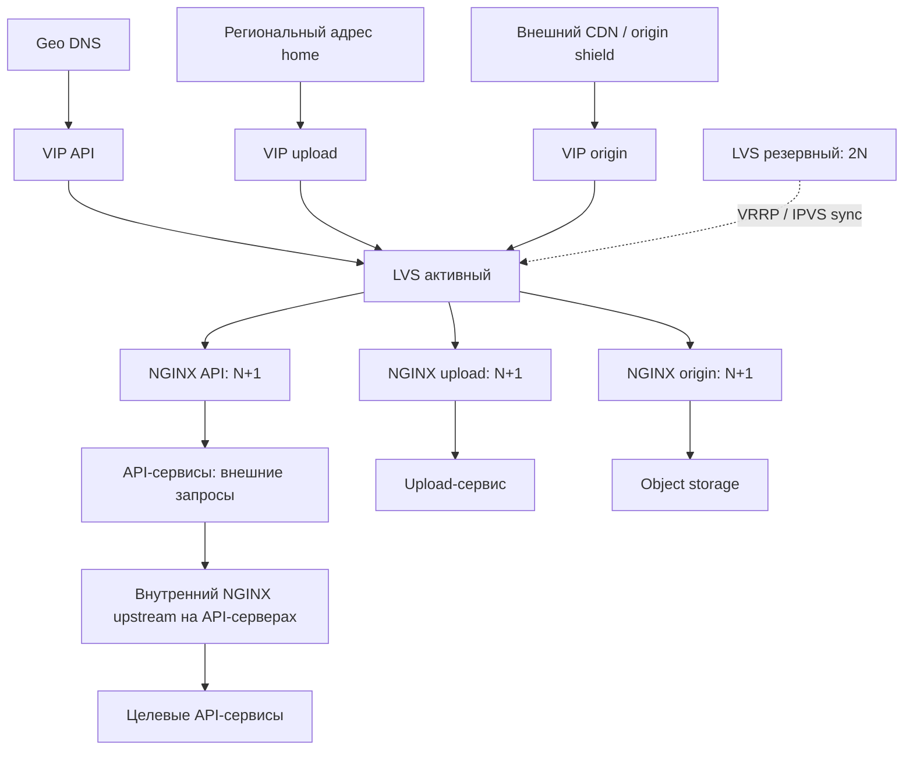

# Высоконагруженный сервис коротких вертикальных видео

## 1. Тема, аудитория и функционал

Сервис коротких вертикальных видео для пользователей России от 12 лет. Аналог — TikTok: более 1 млрд MAU в мире на сентябрь 2021 года [1]. Расчетная аудитория в России — **56,5 млн MAU и 27,7 млн DAU** [2].

MVP включает пять функций:

1. Загрузка и публикация готового видео длительностью до 3 минут.
2. Просмотр персонализированной ленты по истории и длительности просмотров.
3. Лайки и комментарии.
4. Поиск видео по автору, тегу и названию.
5. Регистрация и авторизация пользователей.

Сервис хранит видео в трех вариантах качества: 480p, 720p и 1080p. После подтверждения лайк сразу виден пользователю, который его поставил. Публичные счетчики могут обновляться с задержкой до минуты. Ролик становится доступен после обработки и сохранения копий во всех регионах. В MVP не входят трансляции, сообщения, реклама и видеоредактор.

## 2. Расчет нагрузки

### 2.1. Исходные параметры

Единицы десятичные: `1 KB = 10³ B`, `1 MB = 10⁶ B`, `1 GB = 10⁹ B`, `1 TB = 10¹² B`, `1 PB = 10¹⁵ B`; `1 B = 8 bit`. Расчеты выполняются до округления.

| Параметр | Значение | Основание |
| --- | ---: | --- |
| MAU / DAU | 56,5 / 27,7 млн | Целевая аудитория|
| Все зарегистрированные аккаунты | 113 млн | Допущение: 2 × MAU; неактивные аккаунты сохраняются |
| Воспроизведение на DAU в сутки | 60 мин | Mediascope: 73 мин использования TikTok среди пользователей, Россия 12+, январь–июль 2024 [9]. Из этого времени в модели отводим 60 мин на видео, остальное на другие действия |
| Длительность ролика / средний просмотр | 30 / 20 с | Допущения. Pew приводит среднюю длину 21 и 39 с для разных групп авторов [10]; это ориентир, а не среднее по платформе. 20 с просмотра источником не подтверждены |
| Авторы среди DAU / публикаций на автора в сутки | 2 % / 0,2 | Допущения: 554 тыс. авторов, в среднем один ролик за пять дней на автора. 2 % — доля авторов в аудитории, а не доля опубликовавших ролик именно сегодня |
| Оригинал, 30 с | 46,44 MB | Входной профиль 1080p60: 12 Mbit/s видео + 0,384 Mbit/s стереоаудио по рекомендации YouTube [3]; `(12 + 0,384) × 30 / 8`. Выбор этого профиля для среднего оригинала — допущение |
| Варианты 480p / 720p / 1080p | 0,75 / 1,5 / 3 Mbit/s | Проектные полные битрейты, включая аудио; три файла занимают 2,8125 / 5,625 / 11,25 MB |
| Производные варианты вместе | 19,6875 MB | `30 × (0,75 + 1,5 + 3) / 8` |
| Средний битрейт доставки | 1,5 Mbit/s | Допущение о долях времени 480p/720p/1080p — 40/40/20 %: `0,4 × 0,75 + 0,4 × 1,5 + 0,2 × 3` |
| Возраст каталога / срок хранения оригинала | 5 лет / до 1 суток | Для каталога — 1 825 дней постоянной нагрузки. Оригинал удаляем после успешной обработки и сохранения вариантов; сутки — расчетное окно временного буфера |
| Сырые события просмотра / история | 30 дней / последние 100 просмотров | Проектные ограничения хранения |
| Срок сессии | 10 дней | Допущение для расчета авторизации и временного хранения сессий |
| Репликация | 3 копии | По одной в Москве, Екатеринбурге и Новосибирске |
| CDN byte hit ratio | 98 % базовый; 90 % для мощности origin | Допущения о доле байтов, отданных из кэша; не статистика провайдера [4] |

Доля авторов 2 % не подтверждена источником: показатель Pew «52 % когда-либо публиковали видео» относится к взрослым пользователям США, а не к DAU [11]. Частота 0,2 публикации в сутки — допущение; ориентир Pew — от одного до нескольких постов в неделю у разных групп авторов [10].

Три готовых файла занимают 42,4 % оригинала: при перекодировании суммарный битрейт снижается с 12,384 до 5,25 Mbit/s. Принцип подбора вариантов описан в AWS MediaConvert [12]; качество выбранной лестницы нужно проверить пробным кодированием.

`Просмотры/DAU = 60 × 60 / 20 = 180`; `просмотры/сутки = 27,7 млн × 180 = 4 986 000 000`.
`Публикации/сутки = 27,7 млн × 0,02 × 0,2 = 110 800`.

| Действие | На одного DAU в сутки | Основание |
| --- | ---: | --- |
| Просмотр | 180 | 60 мин воспроизведения / 20 с |
| Получение страницы ленты | 9 | Допущение: 20 роликов на страницу |
| Открытие списка комментариев | 18 | В 10 % просмотров |
| Лайк | 18 | Допущение: в 10 % просмотров |
| Комментарий | 1,8 | Допущение: в 1 % просмотров |
| Поиск по автору, тегу или названию | 3 | Допущение: суммарно три запроса поиска, по 20 результатов |
| Авторизация | 0,1 | Допущение: один вход с созданием сессии за 10 дней для ежедневно активного пользователя |
| Регистрация | 0,001 | Допущение: 27 700 новых аккаунтов в сутки, около 10,1 млн за год |
| Публикация | 0,004 | 2 % авторов × 0,2 публикации |

Коэффициенты лайков и комментариев не подтверждены репрезентативными данными. Регистрации нормированы на DAU только для расчета нагрузки.

### 2.2. RPS

`RPS_средний = операций/сутки / 86 400`.
`RPS_пик = RPS_средний × K_пик`.
`RPS_с_запасом = RPS_пик × K_запас`, где `K_запас = 2`.

Принимаем обычный суточный пик ×2 для чтения, поиска, регистрации и авторизации, ×3 для реакций, ×4 для публикаций: в пиковый час приходится 1/12, 1/8 и 1/6 суточных операций. Запас ×2 покрывает всплеск сверх обычного пика. Это допущения; пики считаем одновременными, суточные объемы — по среднему.

| Метод / поток | Операций/сутки | Средний RPS | K_пик | Пиковый RPS | RPS с запасом ×2 |
| --- | ---: | ---: | ---: | ---: | ---: |
| Получение ленты | 249 300 000 | 2 885,42 | 2 | 5 770,83 | 11 541,67 |
| Чтение комментариев | 498 600 000 | 5 770,83 | 2 | 11 541,67 | 23 083,33 |
| Просмотр | 4 986 000 000 | 57 708,33 | 2 | 115 416,67 | 230 833,33 |
| Лайк | 498 600 000 | 5 770,83 | 3 | 17 312,50 | 34 625,00 |
| Комментарий | 49 860 000 | 577,08 | 3 | 1 731,25 | 3 462,50 |
| Поиск | 83 100 000 | 961,81 | 2 | 1 923,61 | 3 847,22 |
| Авторизация | 2 770 000 | 32,06 | 2 | 64,12 | 128,24 |
| Регистрация | 27 700 | 0,32 | 2 | 0,64 | 1,28 |
| Инициализация загрузки | 110 800 | 1,28 | 4 | 5,13 | 10,26 |
| Завершение загрузки | 110 800 | 1,28 | 4 | 5,13 | 10,26 |
| **Внешний API, всего** | **6 368 479 300** | **73 709,25** | — | **153 771,55** | **307 543,10** |
| Части оригинала, upload | 1 329 600 | 15,39 | 4 | 61,56 | 123,11 |
| Сегменты видео, CDN | 24 930 000 000 | 288 541,67 | 2 | 577 083,33 | 1 154 166,67 |

«Просмотр» — один API-запрос с результатом просмотра для рекомендаций; видео передается через CDN. Поиск объединяет все три признака. Проверка сессии внутри API-запроса не считается отдельным входом.

Одна публикация создает два API-запроса и `ceil(46,44 / 4) = 12` upload-частей. На просмотр приходится `20 / 4 = 5` сегментов по 4 с. Четыре групповых чтения на страницу ленты дают `11 541,67 / 23 083,33 / 46 166,67` внутренних операций в секунду (среднее / пик / с запасом). Перекодирование в три качества — `332 400` задач в сутки, или `3,85 / 15,39 / 30,78` задач в секунду.

### 2.3. Сеть

`Объем_сутки = операций/сутки × байт/операцию`.
`Поток_средний = объем_сутки × 8 / 86 400`; `поток_пик = поток_средний × K_пик`.

Средняя одновременная аудитория: `27,7 млн × 3 600 / 86 400 = 1 154 166,67`. Средняя выдача видео — `1 731,25 Gbit/s`, пиковая — `3 462,5 Gbit/s`. За сутки: `4 986 000 000 × 20 × 1,5 / 8 = 18 697 500 000 MB = 18 697 500 GB`. Коэффициенты пика и запаса в суточный объем не входят.

| Направление | Пик, Gbit/s | С запасом ×2, Gbit/s | Объем, GB/сутки |
| --- | ---: | ---: | ---: |
| CDN → зрители, видео | 3 462,50 | 6 925,00 | 18 697 500 |
| Origin → CDN, 98 % попаданий | 69,25 | 138,50 | 373 950 |
| Origin → CDN, 90 % попаданий | 346,25 | 692,50 | 1 869 750 |
| Клиенты → upload, оригиналы | 1,906 | 3,812 | 5 145,552 |
| Внешний API, запросы + ответы | 4,522 | 9,045 | 23 872,359 |
| Между ЦОДами: две дополнительные копии медиа | 5,427 | 10,855 | 14 653,854 |
| Между ЦОДами: две дополнительные копии сырых событий | 0,369 | 0,739 | 1 994,400 |

Размер API-запроса с ответом, включая HTTP-заголовки: лента и поиск — 31 KB, список комментариев — 15 KB, просмотр — 1 KB, остальные операции — 2 KB. Суточный трафик — сумма `операций × размер`, пиковый — сумма `RPS_пик × размер × 8` с коэффициентом каждого метода. Сетевые накладные расходы и повторы покрываются запасом.

Снижение byte hit ratio на один процентный пункт добавляет origin `34,625 Gbit/s` на пике. При допущении 10 % request miss: `577 083,33 × 0,1 = 57 708,33 RPS`, с запасом — `115 416,67`. Совпадение долей промахов по байтам и запросам — допущение. Эффект origin shield не учитывается.

Репликация медиа: `2 × 110 800 × (46,44 + 19,6875) MB = 14 653,854 GB/сутки`, пик ×4; оригинал копируется временно. Репликация сырых событий: `2 × 4 986 000 000 × 200 B = 1 994,4 GB/сутки`, пик ×2. Репликация профилей, реакций и метаданных в эти строки не включена.

### 2.4. Хранение

Каталог рассчитан за пять лет постоянной нагрузки: `S₀ = объектов/сутки × 1 825 × размер × 3 копии`, `Δгод = объектов/сутки × 365 × размер × 3`. Для временных данных вместо 1 825 дней используем окно хранения.

Оригиналы удаляются после успешной обработки и сохранения копий всех вариантов. Их суточный буфер: `110 800 × 46,44 MB × 3 = 15,437 TB`; всплески загрузок и задержки обработки требуют дополнительной емкости.

| Данные сейчас | Объектов до репликации | Размер объекта, B | S₀, TB, 3 копии | Прирост за год, TB, 3 копии |
| --- | ---: | ---: | ---: | ---: |
| Три варианта, отдельные файлы, 5 лет | 606 630 000 | 6 562 500 в среднем | 11 943,028 | 2 388,606 |
| Метаданные роликов, включая название и теги, 5 лет | 202 210 000 | 2 000 | 1,213 | 0,243 |
| Поисковый индекс роликов, 5 лет | 202 210 000 | 1 000 | 0,607 | 0,121 |
| Лайки, 5 лет | 909 945 000 000 | 16 | 43,677 | 8,735 |
| Комментарии, 5 лет | 90 994 500 000 | 512 | 139,768 | 27,954 |
| Сырые события просмотра, окно 30 дней | 149 580 000 000 | 200 | 89,748 | 0 |
| Учетные записи и профили | 113 000 000 | 1 000 | 0,339 | 0,030 |
| История, до 100 записей на аккаунт | 11 300 000 000 | 16 | 0,542 | 0,049 |
| Дневная активность, окно 365 дней | 10 110 500 000 | 64 | 1,941 | 0 |
| Сессии, окно 10 дней | 27 700 000 | 256 | 0,021 | 0 |
| **Итого, без временных оригиналов** | — | — | **12 220,885** | **2 425,737** |

Оценен полезный объем без служебных расходов СУБД, журналов и резервных копий. При постоянных DAU и частотах действий число аккаунтов растет на `27 700 × 365 = 10 110 500` в год: увеличиваются профили и емкость истории. Объемы событий, дневной активности и сессий ограничены окнами хранения. Сессии: `2 770 000 входов/сутки × 10 дней`.

Каталог / текущий MAU, без реплик; это доля общего каталога, а не собственные публикации пользователя:

| Данные на одного MAU | Объектов | GB |
| --- | ---: | ---: |
| Готовые видео, файлы трех качеств | 10,737 | 0,070460 |
| Метаданные роликов | 3,579 | 0,00000716 |
| Поисковый индекс роликов | 3,579 | 0,00000358 |
| Лайки | 16 105,221 | 0,00025768 |
| Комментарии | 1 610,522 | 0,00082459 |

Общий объем с тремя копиями, без временных оригиналов: **12 220,885 TB сейчас** и **14 646,622 TB через год**. Из них готовые видео занимают **11 943,028 / 14 331,634 TB**. С учетом суточного буфера оригиналов текущая оценка — **12 236,321 TB**.

## 3. Глобальная балансировка

### 3.1. Размещение и маршруты

ЦОДы размещаем в **Москве, Екатеринбурге и Новосибирске**. При отказе одного данные сохраняются в двух других. Распределение спроса **50/25/25 %** между западом России, Уралом и зоной «Сибирь и Дальний Восток» — допущение. Сравниваем с одним ЦОДом в Москве по четырем условным городам; долю восточной зоны делим поровну между Красноярском и Хабаровском:

| Точка сценария | Доля | До Москвы, км | До выбранного ЦОДа, км |
| --- | ---: | ---: | ---: |
| Нижний Новгород | 50 % | 400 | 400, Москва |
| Челябинск | 25 % | 1 490 | 190, Екатеринбург |
| Красноярск | 12,5 % | 3 350 | 640, Новосибирск |
| Хабаровск | 12,5 % | 6 140 | 3 580, Новосибирск |

Среднее расстояние с учетом долей аудитории уменьшается с **1 760 до 775 км (~56 %)**. Это расстояния по поверхности Земли, а не сетевые задержки: их нужно измерять отдельно. Видео отдается через ближайшие узлы CDN, API — через наши ЦОДы.

GeoDNS настроим на PowerDNS [8]: по одному DNS-серверу в регионе, с GeoIP и картой зон для выбора виртуального IP-адреса (VIP) API. HTTP-проверки отмечают недоступные адреса. Зоны и веса меняются оператором по задержке и загрузке и распространяются на DNS-серверы. Геолокация DNS-резолвера приблизительна.

| Домен | Назначение | Маршрут |
| --- | --- | --- |
| `api.service.example` | Лента, взаимодействия, события, управление upload | GeoDNS → региональный API VIP |
| `upload.service.example` | Передача частей оригинала | Подписанный URL с региональным именем `upload-m/e/n.service.example` → домашний регион автора |
| `video.service.example` | Сегменты и манифесты | CDN edge → при miss shield → origin выбранного здорового региона |
| `static.service.example` | Версионированная статика | CDN |

Метаданные и пользовательские записи копируются в два других региона с задержкой. Запрос подтверждается после записи в домашнем регионе (home). Если этот регион откажет, последние изменения могут быть потеряны (RPO > 0). Ролик публикуется только после того, как оригинал и варианты сохранены во всех трех регионах. Если один регион недоступен, публикация ждет его восстановления.

Для API и upload не используем BGP Anycast: такую схему сложнее сопровождать, а смена маршрута может оборвать активное соединение. Маршрут запросов к CDN выбирает сама CDN-платформа. Обычный DNS round-robin распределяет запросы по очереди и не учитывает ни местоположение пользователя, ни доступность приложения.

### 3.2. Распределение нагрузки

`RPS_региона = RPS_глобальный × доля региона`.

| Метод / поток | Москва, средний / пик RPS | Екатеринбург, средний / пик RPS | Новосибирск, средний / пик RPS |
| --- | ---: | ---: | ---: |
| Получение ленты | 1 442 / 2 885 | 721 / 1 442 | 721 / 1 442 |
| Чтение комментариев | 2 885 / 5 770 | 1 442 / 2 885 | 1 442 / 2 885 |
| Событие просмотра | 28 854 / 57 708 | 14 427 / 28 854 | 14 427 / 28 854 |
| Лайк | 961 / 2 885 | 480 / 1 442 | 480 / 1 442 |
| Комментарий | 32,0 / 96,1 | 16,0 / 48,0 | 16,0 / 48,0 |
| Инициализация загрузки | 0,32 / 1,2 | 0,16 / 0,64 | 0,16 / 0,64 |
| Завершение загрузки | 0,32 / 1,2 | 0,16 / 0,64 | 0,16 / 0,64 |
| Части оригинала | 3,8 / 15,3 | 1,9 / 7,6 | 1,9 / 7,6 |
| Сегменты видео, CDN | 144 270 / 288 541 | 72 135 / 144 270 | 72 135 / 144 270 |
| Внутренние групповые чтения ленты | 5 770 / 11 541 | 2 885 / 5 770 | 2 885 / 5 770 |

В обычном режиме пиковый поток API для Москвы, Екатеринбурга и Новосибирска (M/E/N) составляет `1,9 / 0,95 / 0,95 Gbit/s`, а upload — `0,46 / 0,23 / 0,23 Gbit/s`. Для origin при 90 % попаданий CDN по объему данных значения равны `173 / 86,5 / 86,5 Gbit/s`. CDN отдает зрителям `1 731 / 865 / 865 Gbit/s` в тех же регионах. Этот трафик распределен по географии аудитории и не проходит через наши API-серверы.

### 3.3. Отказы и регулирование

| Состояние | Входящий API M/E/N | Origin miss M/E/N | Upload |
| --- | --- | --- | --- |
| Штатно | 50/25/25 % | 50/25/25 % | В home |
| Отказ M | 0/50/50 % | 0/50/50 % | Upload home M приостановлен |
| Отказ E | 65/0/35 % | 50/0/50 % | Upload home E приостановлен |
| Отказ N | 60/40/0 % | 50/50/0 % | Upload home N приостановлен |

API-нагрузка отказавшей Москвы делится поровну; Екатеринбурга — между Москвой и Новосибирском в пропорции 60/40; Новосибирска — между Москвой и Екатеринбургом в пропорции 40/60. Максимальные доли — **65/50/50 %**. Каждый из двух оставшихся origin должен выдерживать **50 %** общего потока при 90 % попаданий CDN. Upload остается в домашнем регионе.

TTL DNS-записи — 30 с; кэши DNS и открытые соединения могут задержать переключение. Проверки оценивают готовность региона к чтению, а CDN отдельно исключает недоступный origin. Восстановленный регион возвращается в работу постепенно.

При отказе домашнего региона чтение продолжается с доступных копий, а запись лайков, комментариев и управление публикацией приостанавливаются до восстановления или контролируемой смены региона записи. Автоматической смены владельца нет. В остальных регионах запись продолжается, но новые ролики ждут третьей копии; опубликованные доступны через CDN и оставшиеся origin.

## 4. Локальная балансировка

### 4.1. Схема и резервирование

В каждом регионе работают физические Linux-серверы и пара LVS с Keepalived. Они обслуживают три VIP — для API, upload и origin. Один LVS активен, второй резервный (**2N при N = 1**); каждый рассчитан на весь входящий поток региона. IPVS выбирает пул NGINX по адресу назначения и порту. Пулы разделены, чтобы передача видео не отнимала ресурсы API.

В Direct Routing LVS меняет MAC-адрес назначения и направляет новое TCP-соединение на NGINX с наименьшим числом активных соединений (`least connections`). Метод учитывает длительность соединений, но не выравнивает точно загрузку CPU и объем трафика. LVS и NGINX должны находиться в одной L2-сети. VIP назначается loopback-интерфейсу, ARP-ответы для него подавляются. Запросы и TCP ACK проходят через LVS, ответы с VIP идут от NGINX напрямую, поэтому сетевые фильтры должны разрешать эту схему. Keepalived переносит VIP по VRRP и проверяет пул. Синхронизация IPVS может сохранить часть соединений при переключении, но не гарантирует их сохранность.

NGINX завершает TLS и распределяет HTTP-запросы через `least_conn` по числу активных соединений. Upstream-соединения переиспользуются. Состояние пользователя и загрузки хранится отдельно от API-сервера, поэтому sticky sessions не нужны.

На API-серверах внутренний NGINX направляет запросы к нужному сервису напрямую. Каждый сервис запущен как минимум в двух экземплярах на разных машинах. Точное количество определят нагрузочные испытания.

HTTP-проверки Keepalived убирают неисправный NGINX из пула LVS. Перед обновлением узел исключают из конфигурации и ждут завершения текущих запросов. После отказа одного узла остаются N серверов. Если переключился директор, клиент повторяет только безопасные запросы.

### 4.2. Производительность одного NGINX

Ориентир — тест 2019 года [5]: NGINX Ingress на Xeon Platinum 8168, 8 задействованных CPU, OpenSSL 1.1.0g. Отдельно измерены HTTPS RPS (ответ 1 KB), TLS TPS нового соединения (пустой ответ, без HT) и throughput (объекты 1 MB). Тест 2017 года [6] использует другую конфигурацию и также разделяет CPS и RPS.

| Ограничение | Ориентир [5] | 70 % для расчета |
| --- | ---: | ---: |
| HTTPS RPS | 236 703 | 165 692,1 |
| TLS CPS (SSL TPS), без HT | 31 485 | 22 039,5 |
| Поток | 8,6 Gbit/s | 6,048 Gbit/s |

На каждом узле — 8 физических ядер сопоставимой производительности, 32 GB RAM и отдельные интерфейсы 10GbE для клиентских и внутренних подключений. Предел 6,048 Gbit/s относится к каждому интерфейсу, но узким местом может стать общий канал. Память и допустимое число соединений нужно проверить испытаниями.

Запросы, TLS-соединения и сетевой поток одновременно нагружают процессор, поэтому их проверяют одним тестом с запасом 30 %. Консервативно принимаем `TLS_CPS = внешний RPS` (новое соединение на запрос); keep-alive и HTTP/2 снижают фактический CPS.

### 4.3. Число серверов

`N = ceil(max(RPS / 165 692,1; TLS_CPS / 22 039,5; Gbit/s / 6,048))`.
В пуле устанавливаем `N+1` серверов, чтобы оставшиеся N выдерживали расчетный поток после отказа узла. Максимумы регионов относятся к разным авариям; их одновременный учет создает запас мощности.

| Пул / регион | Расчетный пик RPS = CPS | Поток, Gbit/s | N по RPS / TLS / сети | Установлено N+1 |
| --- | ---: | ---: | --- | ---: |
| API, Москва | 90 153 | 2,4 | 1 / 5 / 1 | 6 |
| API, Екатеринбург | 69 348 | 1,9 | 1 / 4 / 1 | 5 |
| API, Новосибирск | 69 348 | 1,9 | 1 / 4 / 1 | 5 |
| Upload, Москва | 15,3 | 0,46 | 1 / 1 / 1 | 2 |
| Upload, Екатеринбург | 7,6 | 0,23 | 1 / 1 / 1 | 2 |
| Upload, Новосибирск | 7,6 | 0,23 | 1 / 1 / 1 | 2 |
| Origin, Москва | 28 854 | 173 | 1 / 2 / 29 | 30 |
| Origin, Екатеринбург | 28 854 | 173 | 1 / 2 / 29 | 30 |
| Origin, Новосибирск | 28 854 | 173 | 1 / 2 / 29 | 30 |

Пулам NGINX требуется **38 / 37 / 37** серверов в M/E/N (**112** всего), LVS — **2 на регион** (**6** всего). DNS, приложения, хранилище, транскодирование и CDN не включены. Origin ограничен сетью: `ceil(173 / 6,048) = 29` серверов; после отказа одного узла оставшиеся обеспечат `29 × 6,048 = 175 Gbit/s`. API также выдержит пик после отказа сервера: Москва — `110 197,5 CPS > 90 153`, Екатеринбург и Новосибирск — `88 158 CPS > 69 348`.

Входящий трафик origin оценивается как 10 % ответного потока для ACK и TLS/заголовков плюс 1 500 B на запрос: `17,3 + 0,34 = 17,6 Gbit/s`. Он идет в обратном направлении полнодуплексного канала и не суммируется с исходящими 173 Gbit/s; 29 интерфейсов его выдерживают. Расчет покрывает только прокси. Каналы регионов и хранилище нужно отдельно проверить на этот поток при отказе региона.

### 4.4. Проверка L4 и условий отказа

У каждого LVS отдельные 100GbE front/back подключения с проектным пределом 70 Gbit/s на интерфейс и около 50 млн pps.

Для верхней оценки M складываем двунаправленный API (хотя ответы обходят LVS), upload и входящий origin:
`2,4 + 0,46 + 17,3 + 0,34 = 20,6 Gbit/s`.
Для E/N верхняя оценка — `19,8 Gbit/s`; округляем до **21 Gbit/s**, что ниже 70. При размере пакета 64 B это `21 × 10⁹ / (64 × 8) = 41,0 млн pps`, меньше целевых 50 млн.

CPS M: `90 153 + 15,3 + 28 854 = 119 022`; E/N — около `98 210`. Тест пары при выключенном директоре должен подтвердить **120 тыс. новых соединений/с**, до **21 Gbit/s / 50 млн pps**, с проверкой IPVS, памяти, задержек и ошибок. Если целевые параметры не достигнуты, конфигурацию меняют: 100GbE само по себе не гарантирует pps/CPS.

Схема рассчитана на отказ одного региона и одного NGINX в каждом оставшемся пуле либо на отказ одного LVS при исправной локальной сети. Два отказа в одном пуле уже превышают резерв N+1.

### 4.5. Таймауты и повторы

Для API заданы connect timeout 0,5 с и read timeout 2 с. Чтение повторяется не более раза на другом upstream, общий лимит — 3 с. Загрузка прерывается после 60 с без прогресса; повтор части использует прежние upload ID и номер. Для origin заданы connect timeout 1 с и read inactivity 10 с; при ошибке CDN повторяет GET к другой копии. Значения уточнят по измеренным квантилям времени ответа.

Если ответ на POST лайка, комментария или завершения загрузки не пришел, клиент повторяет запрос с тем же ключом идемпотентности: приложение возвращает сохраненный результат, не создавая дубль. ID события позволяет отбросить повтор. События обрабатываются отдельно от формирования ответа ленты.

## 5. Логическая схема БД

Первая схема показывает основные таблицы, вторая — файлы, кэши и буферы. User и Video во второй схеме ссылаются на таблицы первой. `PK` — первичный ключ, `FK` — внешний. Типы данных логические и не привязаны к СУБД.

**Основные данные**

**Файлы, кэши и буферы**

Во время обработки у ролика может быть от 0 до 3 готовых вариантов. Публикация разрешена после подготовки всех трех вариантов и их копий во всех регионах. Сегменты относятся к VideoVariant, манифест строится по данным Video.

### 5.1. Допущения и перевод нагрузки в QPS

Средний QPS — число операций в сутки / 86 400; пик учитывает суточную неравномерность. Единицы таблицы — строки, страницы или файлы. Просмотр, лайк и комментарий создают по одной строке; переход статуса считается отдельно. Выдача ленты читает данные до 20 роликов, их лайки и счетчики, 100 записей истории и до 100 кандидатов. При лимите 20 комментариев пик чтения — `11 541 × 20 = 230 833 строк/с`. Для очередей указаны строки или задачи, а не пакеты. Значения округлены.

User и Profile связаны отношением 1:1. Для 113 млн пар заложено по 1 000 B: 64 B на User и 936 B на Profile. Video (2 000 B) включает метаданные и ссылки; OriginalMedia и VideoVariant учитывают только файлы. Объем постоянных данных и IdempotencyRecord указан для одной копии, для трех копий его умножают на 3. Временные данные посчитаны без репликации.

При просмотре User обновляет указатель на последнее событие; изменения профилей в MVP не учитываются. Video проходит состояния загрузки, обработки и публикации. Профили авторов читаются с лентой и комментариями. Обработчик читает оригинал один раз, затем зрителям отдаются готовые варианты. Попадания кэша не уменьшают расчетную нагрузку.

### 5.2. Сущности, объемы и нагрузка

**Постоянные данные и файлы**

| Сущность / назначение | Записей × размер | Логический объем | Чтение, среднее / пик | Запись, среднее / пик |
| --- | --- | ---: | ---: | ---: |
| User (учетная запись) + Profile (данные автора), 1:1 | 113 млн × (64 + 936) B | User 7,2 GB + Profile 105 GB = 113 GB | User 0; Profile 173 125 / 346 250 строк/с | User 57 708 / 115 417 обновлений/с; Profile 0 |
| Video (метаданные) | 101 млн × 2 000 B | 202 GB | 57 708 / 115 417 строк/с | 1,9 / 7,6 переходов статуса/с |
| OriginalMedia (оригинал) | 101 млн × 45 MB | 4 549 TB | 0,64 / 2,5 чтений/с | 0,64 / 2,5 записей/с; 2 493 GB/сутки |
| VideoVariant (480p/720p/1080p) | 303 млн × 6,5 MB | 1 990 TB | ~28 854 / 57 708 origin-запросов/с при 10% request miss | 1,9 / 7,6 вариантов/с; 1 090 GB/сутки |
| Like (User ID + Video ID, 16 B) | 303 млрд | 4,8 TB | 57 708 / 115 417 проверок/с | 1 924 / 5 771/с |
| Comment | 10,1 млрд × 512 B | 5,1 TB | 115 417 / 230 833 строк/с | 64,1 / 192/с |
| ViewEvent (сырые события, 30 дней) | 149 млрд × 200 B | 29,9 TB | 57 708 / 115 417 событий/с | 57 708 / 115 417 вставок/с + отметки обработки |
| PlaybackHistory (100 последних событий на аккаунт) | 11,3 млрд × 40 B | 452 GB (на 271,2 GB больше §2) | 288 542 / 577 083 строк/с | 57 708 / 115 417 замен слота/с |
| DailyActivity (агрегаты, 365 дней) | 10,1 млрд × 64 B | 647 GB | 0 | До 57 708 / 115 417 обновлений/с |
| VideoCounter (публичные счетчики) | 101 млн × 32 B | 3,2 GB | 57 708 / 115 417 строк/с | До 59 696 / 121 380 дельт/с |

**Временные и служебные данные**

| Сущность / назначение | Записей × размер | Бюджет | Чтение, среднее / пик | Запись, среднее / пик |
| --- | --- | ---: | ---: | ---: |
| CandidatePool (100 кандидатов) | 100 × 32 B | 3,2 KB на снимок, обновление раз в 15 с | 2 885 / 5 771 чтений/с (до 100 строк на выдачу) | 0,067 снимка/с; до 59 696 / 121 380 изменений счетчиков/с при построении |
| FeedCache (до 20 ID на страницу) | `5 770 × 15 × 224 B` | ~19,4 MB; TTL 15 с | 2 885 / 5 771 страниц/с | 2 885 / 5 771 страниц/с |
| UploadSession + staging частей | 55 400 × 256 B; до 12 частей по 4 MB | ~14 MB метаданных; 2 493 GB файлов/сутки, TTL 24 ч и cap 55 400 загрузок/сутки | 8,3 / 33,3 проверок/с | 8,9 / 35,9 обновлений/с; части 7,6 / 30,7 записей/с |
| TranscodeTaskQueue (3 качества) | `7,6 × 3 600 = 27 698` задач × 256 B | ~7 MB; TTL 1 ч | 1,9 / 7,6 задач/с | 1,9 / 7,6 задач/с |
| ViewEventBuffer | `115 417 × 60 × 200 B` | ~1,3 GB; TTL 60 с | 57 708 / 115 417 событий/с | 57 708 / 115 417 событий/с |
| CounterBuffer | `121 380 × 60 × 64 B` | ≤466 MB; TTL 60 с | 59 696 / 121 380 сообщений/с | 59 696 / 121 380 сообщений/с |
| IdempotencyRecord (результат операции) | `171 млн/сутки × 256 B`; TTL 24 ч | ~43,9 GB на копию | 1 988 / 5 966 проверок/с | 1 988 / 5 966 записей/с |

После обработки ViewEvent и сообщения CounterBuffer обновляется их статус. Из популярных роликов CandidatePool формируется лента с учетом истории и длительности просмотров.

История ДЗ2 учитывала пару User ID + Video ID (16 B). Для последних 100 просмотров нужны также `slot`, время и длительность: запись занимает 40 B, общий объем увеличивается на `24 B × 11,3 млрд = 271,2 GB`. Буферы рассчитаны как поток операций × TTL; их бюджеты приведены в таблице. При лимите 55 400 загрузок за сутки staging частей занимает `55 400 × 45 MB = 2 493 GB`. Очереди хранят задачи и ссылки, не копии видео. Для часовой обработки оригиналов нужно до `2,5 × 3 600 × 45 MB ≈ 415,5 GB`. Это полезный объем без индексов и служебных расходов.

### 5.3. Консистентность и перекосы

После успешного ответа лайк и комментарий сразу видны автору; повтор с тем же ключом не создает дубль. Лента и счетчики обновляются с задержкой до минуты: обработка события занимает до 5 с, пересчет счетчика — до 25 с, обновление CandidatePool — до 15 с, затем кэша — еще до 15 с. Повторные события отбрасываются. История может отставать до 5 с, профиль и дневная активность — до минуты. При сбое необработанные сообщения нельзя удалять без проверки TTL и статуса.

Расчет предполагает равномерное распределение User ID. Популярный ролик или профиль автора может перегрузить соответствующий Video ID или ключ профиля. CDN сокращает чтение файлов, но не записи лайков и комментариев. Реплики ускоряют чтение, могут отставать от основной копии и не распределяют запись. Размер рабочего набора (активные профили, история, кэш ленты, популярные ролики и счетчики) зависит от активности и индексов.

## Источники

1. TikTok Newsroom. «Thanks a billion!», 27.09.2021: [официальное сообщение](https://newsroom.tiktok.com/1-billion-people-on-tiktok-my?lang=en-MY).
2. Mediascope Cross Web. [Рейтинги и правила описания измерений](https://mediascope.net/data/)
3. YouTube Help. [Recommended upload encoding settings](https://support.google.com/youtube/answer/1722171?hl=en).
4. Google Cloud. [Logs and metrics for caching](https://docs.cloud.google.com/cdn/docs/logging)
5. NGINX, 11.04.2019. [Testing the Performance of NGINX Ingress Controller for Kubernetes](https://blog.nginx.org/blog/testing-performance-nginx-ingress-controller-kubernetes).
6. NGINX, 24.08.2017. [Testing the Performance of NGINX and NGINX Plus Web Servers](https://blog.nginx.org/blog/testing-the-performance-of-nginx-and-nginx-plus-web-servers).
7. NGINX. [Upstream module](https://nginx.org/en/docs/http/ngx_http_upstream_module.html): least_conn, keepalive, max_fails/fail_timeout; активные health checks имеют отдельные условия доступности.
8. PowerDNS Authoritative. [Lua records](https://doc.powerdns.com/authoritative/lua-records/index.html), [HTTP API](https://doc.powerdns.com/authoritative/http-api/index.html): GeoIP, динамические ответы, фоновые проверки и управление конфигурацией.
9. Mediascope. [Медиапотребление 2024, 27.08.2024, слайд 11](https://mediascope.net/upload/iblock/f33/ual5i70kf7n9df7qzkq0gf238bidh3xv/%D0%9C%D0%B5%D0%B4%D0%B8%D0%B0%D0%BF%D0%BE%D1%82%D1%80%D0%B5%D0%B1%D0%BB%D0%B5%D0%BD%D0%B8%D0%B5%202024_%D0%9D%D0%90%D0%A2_27.08.2024.pdf): Cross Web, Россия 12+, desktop и mobile, январь–июль 2024.
10. Pew Research Center, 18.02.2025. [What we know about TikTok content creators](https://www.pewresearch.org/short-reads/2025/02/18/what-we-know-about-tiktok-content-creators/): авторы, на которых подписаны взрослые пользователи США.
11. Pew Research Center, 22.02.2024. [How U.S. Adults Use TikTok](https://www.pewresearch.org/internet/2024/02/22/how-u-s-adults-use-tiktok/): опрос взрослых пользователей США в августе 2023.
12. AWS MediaConvert. [Automated ABR](https://docs.aws.amazon.com/mediaconvert/latest/ug/auto-abr.html): подбор вариантов по исходному видео и качеству.
