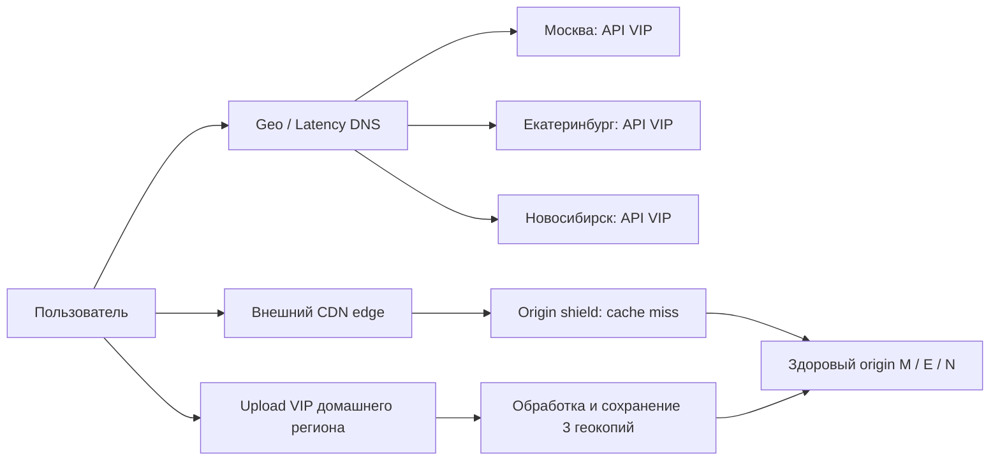
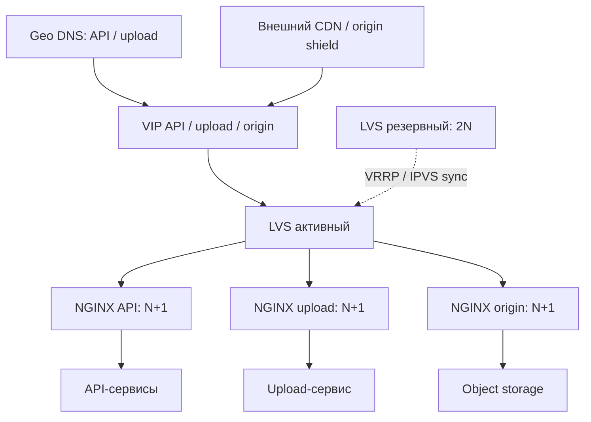

# Высоконагруженный сервис коротких вертикальных видео

## 1. Тема, аудитория и функционал

Проектируем сервис коротких вертикальных видео для пользователей России 12+. TikTok сообщил о более 1 млрд пользователей в месяц в сентябре 2021 года [1]. Это подтверждает массовость формата, но не размер российской аудитории.

Модель: **56,5 млн MAU и 27,7 млн DAU**. Это целевые, не подтверждённые статистикой значения [2]; DAU выше минимума методички в 1 млн.

MVP включает три функции:

1. Загрузка и публикация готового видео длительностью до 3 минут.
2. Просмотр персонализированной ленты по истории и длительности просмотров.
3. Лайки, комментарии и счётчики просмотров.

Видео кодируется в 480p, 720p и 1080p. Подтверждённый лайк сразу виден поставившему его пользователю; публичные счётчики могут отставать до минуты. Публикация открывается после обработки и сохранения всех геокопий. Стримов, сообщений, рекламы и редактора в MVP нет.

## 2. Расчёт нагрузки

### 2.1. Исходные параметры

Показатели поведения — допущения, не измерения аудитории аналога. Единицы десятичные: `1 KB = 10³ B`, `1 MB = 10⁶ B`, `1 GB = 10⁹ B`, `1 TB = 10¹² B`, `1 PB = 10¹⁵ B`; `1 B = 8 bit`. Пики методов считаются одновременными.

| Параметр | Значение | Основание |
| --- | ---: | --- |
| MAU / DAU | 56,5 / 27,7 млн | Целевая нагрузка; DAU/MAU = 49 % |
| Воспроизведение на DAU в сутки | 60 мин | Нагрузочный сценарий |
| Средний просмотр / длительность оригинала | 20 / 30 с | Просмотр может завершиться до конца ролика |
| Средний битрейт доставки | 1,5 Mbit/s | Допущение о смеси качеств, включая аудио |
| Авторы среди DAU / публикаций на автора в сутки | 1 % / 0,2 | Допущения о создании контента |
| Оригинал | 45 MB | 30 с × 12 Mbit/s / 8; 12 Mbit/s — ориентир по порядку величины из [3], в модели полный поток |
| Производные варианты вместе | 19,6875 MB | 30 с × (0,75 + 1,5 + 3) Mbit/s / 8; проектная лестница полного битрейта |
| Срок расчёта медиа, лайков, комментариев | 5 лет = 1 825 дней | Без роста аудитории и вычитания удалений |
| Сырые события просмотра / история | 30 дней / последние 100 просмотров | Ограниченные сроки и размеры |
| Репликация учитываемых данных | 3 копии | По одной в Москве, Екатеринбурге и Новосибирске |
| CDN byte hit ratio | 98 % базовый; 90 % для мощности origin | Допущения; измеряется по байтам [4] |

`Просмотры/DAU = 60 × 60 / 20 = 180`.
`Просмотры/сутки = 27,7 млн × 180 = 4,986 млрд`.
`Публикации/сутки = 27,7 млн × 0,01 × 0,2 = 55 400`.

| Действие одного DAU | В сутки |
| --- | ---: |
| Просмотр | 180 |
| Получение страницы ленты | 9 |
| Открытие списка комментариев | 18 |
| Отправка события просмотра | 180 |
| Лайк | 6 |
| Комментарий | 0,2 |
| Публикация | 0,002 |

### 2.2. RPS

`RPS_средний = операций/сутки / 86 400`; `RPS_пик = RPS_средний × коэффициент пика`.

| Метод / поток | Операций/сутки | Средний RPS | Пик/среднее | Пиковый RPS | Пояснение |
| --- | ---: | ---: | ---: | ---: | --- |
| Получение ленты | 249 300 000 | 2 885,417 | 2 | 5 770,833 | 20 роликов на страницу |
| Чтение комментариев | 498 600 000 | 5 770,833 | 2 | 11 541,667 | Открывают в 10 % просмотров |
| Событие просмотра | 4 986 000 000 | 57 708,333 | 2 | 115 416,667 | Одно событие на просмотр |
| Лайк | 166 200 000 | 1 923,611 | 3 | 5 770,833 | 6 на DAU |
| Комментарий | 5 540 000 | 64,12 | 3 | 192,361 | 0,2 на DAU |
| Инициализация загрузки | 55 400 | 0,641 | 4 | 2,565 | Выдача подписанного URL |
| Завершение загрузки | 55 400 | 0,641 | 4 | 2,565 | Фиксация оригинала и запуск обработки |
| Части оригинала | 664 800 | 7,694 | 4 | 30,778 | ceil(45 MB / 4 MB) = 12, отдельный upload |
| Сегменты видео, CDN | 24 930 000 000 | 288 541,667 | 2 | 577 083,333 | 5 сегментов по 4 с на просмотр |

Внешний API получает **68 353,597 RPS в среднем и 138 697,491 RPS в пике**. Upload-части и CDN-сегменты идут отдельно. Манифесты, статика и повторы не посчитаны; для них заложен запас; реальную смесь запросов нужно проверить (раздел 4).

Для страницы ленты нужны четыре групповых чтения: рекомендации, метаданные видео, счётчики и лайки. Получаем `11 541,667` внутренних операций/с в среднем и `23 083,333` в пике; к внешнему RPS их не прибавляем. Три качества требуют `166 200` задач транскодирования/сутки (`1,924` в среднем, `7,694` в пике); число обработчиков здесь не рассчитывается.

### 2.3. Сеть

Средняя одновременная аудитория: `27,7 млн × 3 600 / 86 400 = 1 154 166,667`, пик — вдвое выше. Поэтому пиковая выдача видео: `2 308 333,333 × 1,5 Mbit/s = 3 462,5 Gbit/s`. Суточная выдача по времени просмотра: `4,986 млрд × 20 × 1,5 Mbit/s / 8 = 18,6975 PB`.

| Направление | Пик, Gbit/s | Объём, GB/сутки | Основание |
| --- | ---: | ---: | --- |
| CDN → зрители, видео | 3 462,5 | 18 697 500 | Просмотры × длительность × битрейт |
| Origin → CDN, 98 % попаданий | 69,25 | 373 950 | 2 % от видеотрафика |
| Origin → CDN, 90 % попаданий | 346,25 | 1 869 750 | Сценарий выбора мощности, 10 % от видеотрафика |
| Клиенты → upload, оригиналы | 0,923 | 2 493 | 55 400 × 45 MB; пик ×4 |
| Внешний API, запросы + ответы | 3,835 | 20 537,002 | Размеры ниже |

Принятый размер запроса с ответом: лента — 31 KB (из них 30 KB ответ), список комментариев — 15 KB, событие просмотра — 1 KB (200 B данных), прочие API-операции — 2 KB. Это оценки с HTTP-заголовками; накладные расходы TCP/TLS/Ethernet и повторы учитываются в запасе мощности.

Каждый процентный пункт снижения byte hit ratio добавляет origin `34,625 Gbit/s`. Request miss принят отдельно: при сегменте `4 с × 1,5 Mbit/s / 8 = 0,75 MB` получаем `577 083,333 × 0,1 = 57 708,333 RPS`. Совпадение miss-долей — допущение для проверки по логам; origin shield не учитывается.

Для двух удалённых копий медиа передаётся `2 × (2,493 + 1,0906875) = 7,167375 TB/сутки` (`0,664 Gbit/s`), для сырых событий — ещё `1,9944 TB/сутки` (`0,185 Gbit/s`). Это внутренний трафик, не CDN-выдача и не новый логический объём. Прирост медиа на регион — `3,5836875 TB/сутки`; каналы, БД и диски требуют отдельного расчёта.

### 2.4. Хранение

`Объём = объектов/сутки × срок × размер × 3 копии`. Профили и ограниченная история считаются как снимки, не как сумма обновлений.

| Данные | Объектов за срок, до репликации | Размер объекта | Логический прирост, GB/сутки | Хранение с 3 копиями, TB |
| --- | ---: | ---: | ---: | ---: |
| Оригиналы, 5 лет | 101 105 000 | 45 000 000 B | 2 493 | 13 649,175 |
| Три варианта, 5 лет | 303 315 000 | 6 562 500 B | 1 090,688 | 5 971,514 |
| Метаданные роликов, 5 лет | 101 105 000 | 2 000 B | 0,111 | 0,607 |
| Лайки, 5 лет | 303 315 000 000 | 16 B | 2,659 | 14,559 |
| Комментарии, 5 лет | 10 110 500 000 | 512 B | 2,836 | 15,53 |
| Сырые события, 30 дней | 149 580 000 000 | 200 B | 997,2 | 89,748 |
| Профили, снимок MAU | 56 500 000 | 1 000 B | Снимок | 0,17 |
| История, до 100 записей на MAU | 5 650 000 000 | 16 B | Снимок | 0,271 |
| Активность пользователя за день, 365 дней | 10 110 500 000 | 64 B | 1,773 | 1,941 |

Средние пользовательские объёмы за пять лет, без репликации:

| Данные на одного MAU | Объектов | GB |
| --- | ---: | ---: |
| Оригиналы | 1,789 | 0,0805261 |
| Три варианта | 5,368 | 0,0352302 |
| Метаданные роликов | 1,789 | 0,0000036 |
| Лайки | 5 368,407 | 0,0000859 |
| Комментарии | 178,947 | 0,0000916 |

Пятилетний медиакаталог занимает **19 620,689 TB (19,621 PB)** с репликацией. Лайк (16 B) и комментарий (512 B) — минимальные оценки записи. Индексы, служебные поля, резервные копии и свободное место не учтены; MAU лишь оценивает число профилей. Полная схема БД и расчёт счётчиков/кэшей — в следующих ДЗ.

## 3. Глобальная балансировка

### 3.1. Размещение и маршруты

**Москва, Екатеринбург и Новосибирск** покрывают запад, Урал и Сибирь и разносят копии данных. Минимальный RTT не доказан; для Дальнего Востока Новосибирск может быть далёк. Выбор площадок требует замеров RTT/p95, потерь и времени первого кадра.

Распределение **50/25/25 %** — расчётное допущение, не статистика населения. Geo/Latency DNS направляет запрос в здоровый регион с учётом зоны и задержки, но не гарантирует точные доли: оператор меняет веса, а DNS-сервер оператора может находиться далеко от клиента.

| Домен | Назначение | Маршрут |
| --- | --- | --- |
| `api.service.example` | Лента, взаимодействия, события, управление upload | Geo/Latency DNS → региональный API VIP |
| `upload.service.example` | Передача частей оригинала | Подписанный URL с региональным именем `upload-m/e/n.service.example` → домашний регион автора |
| `video.service.example` | Сегменты и манифесты | CDN edge → при miss shield → origin выбранного здорового региона |
| `static.service.example` | Версионированная статика | CDN |

Метаданные асинхронно копируются в два региона: подтверждение означает запись в home, поэтому его потеря может лишить последних изменений (RPO > 0). Публикация видео требует оригинал и варианты во всех трёх регионах; при отказе одного публикация ждёт.

BGP Anycast для API/upload не выбран из-за сложности эксплуатации и риска смены маршрута активного соединения. CDN управляет маршрутизацией сам; обычный DNS round-robin не учитывает географию и здоровье приложения.

### 3.2. Распределение нагрузки

`RPS_региона = RPS_глобальный × доля`. В таблице значения округлены до тысячных; мощность рассчитана по точным.

| Метод / поток | Москва, средний / пик RPS | Екатеринбург, средний / пик RPS | Новосибирск, средний / пик RPS |
| --- | ---: | ---: | ---: |
| Получение ленты | 1 442,708 / 2 885,417 | 721,354 / 1 442,708 | 721,354 / 1 442,708 |
| Чтение комментариев | 2 885,417 / 5 770,833 | 1 442,708 / 2 885,417 | 1 442,708 / 2 885,417 |
| Событие просмотра | 28 854,167 / 57 708,333 | 14 427,083 / 28 854,167 | 14 427,083 / 28 854,167 |
| Лайк | 961,806 / 2 885,417 | 480,903 / 1 442,708 | 480,903 / 1 442,708 |
| Комментарий | 32,06 / 96,181 | 16,03 / 48,09 | 16,03 / 48,09 |
| Инициализация загрузки | 0,321 / 1,282 | 0,16 / 0,641 | 0,16 / 0,641 |
| Завершение загрузки | 0,321 / 1,282 | 0,16 / 0,641 | 0,16 / 0,641 |
| Части оригинала | 3,847 / 15,389 | 1,924 / 7,694 | 1,924 / 7,694 |
| Сегменты видео, CDN | 144 270,833 / 288 541,667 | 72 135,417 / 144 270,833 | 72 135,417 / 144 270,833 |
| Внутренние групповые чтения ленты | 5 770,833 / 11 541,667 | 2 885,417 / 5 770,833 | 2 885,417 / 5 770,833 |

Штатные пиковые потоки M/E/N: API — `1,917 / 0,959 / 0,959 Gbit/s`, upload — `0,462 / 0,231 / 0,231 Gbit/s`, origin при 90 % попаданий по байтам — `173,125 / 86,563 / 86,563 Gbit/s`. CDN выдаёт зрителям `1 731,25 / 865,625 / 865,625 Gbit/s`; это география спроса, а не нагрузка наших API-серверов.

### 3.3. Отказы и регулирование

| Состояние | Входящий API M/E/N | Origin miss M/E/N | Upload |
| --- | --- | --- | --- |
| Штатно | 50/25/25 % | 50/25/25 % | В home |
| Отказ M | 0/50/50 % | 0/50/50 % | Upload home M приостановлен |
| Отказ E | 65/0/35 % | 50/0/50 % | Upload home E приостановлен |
| Отказ N | 60/40/0 % | 50/50/0 % | Upload home N приостановлен |

API должен выдержать **65/50/50 %** глобального пика, каждый origin — **50 %** нагрузки при 90 % попаданий CDN по байтам. Upload не переносится: его ёмкость рассчитывается для штатных 50/25/25 %.

Health checks проверяют готовность принимать чтение: при деградации вес снижается, при отказе регион исключается. TTL DNS — 30 с, но кэши и открытые соединения могут задержать переключение. CDN отдельно исключает origin; восстановленный регион возвращается постепенно.

При отказе home публичные данные читаются с доступных реплик, а лайки, комментарии и управление публикацией приостанавливаются до восстановления или контролируемого переноса владельца. Второй писатель автоматически не назначается. Записи здоровых home продолжаются; публикации ждут третью копию. Уже опубликованные видео доступны через CDN и оставшиеся origin.

## 4. Локальная балансировка

### 4.1. Схема и резервирование

В каждом регионе — физические Linux-серверы; Kubernetes не обязателен. Пара LVS с Keepalived обслуживает VIP API, upload и origin: активный и резервный директор (**2N при N = 1**), каждый рассчитан на полный региональный входящий поток. Пулы NGINX для API, upload и origin разделены, чтобы медиатрафик не занимал ресурсы API; каждый резервируется по **N+1**. Резервируются питание и подключения; отказ всей сети/L2-домена считается отказом региона.

В режиме **Direct Routing** LVS меняет MAC назначения и выбирает NGINX для нового TCP-соединения по least connections. Директоры и NGINX должны быть в одной L2-сети; VIP назначен loopback с подавлением ARP, ответ идёт напрямую от VIP, фильтры должны разрешать схему. Запросы и ACK проходят через директор, ответы — напрямую. Keepalived переносит VIP по VRRP и проверяет пул. Синхронизация IPVS снижает потери соединений, но не гарантирует их сохранность.

NGINX завершает TLS и направляет HTTP-запросы к приложениям через `least_conn`, сохраняя keep-alive к upstream. API stateless, поэтому sticky sessions не нужны. Состояние загрузки и ID части хранятся вне экземпляра. Хранилище остаётся stateful; маршрутизация его ключей и реплик относится к следующим ДЗ.

Внутренние HTTP-вызовы идут через NGINX upstream на API-серверах; адреса хранятся в конфигурации Ansible и обновляются graceful reload. Отдельный внутренний VIP не нужен; у каждого сервиса минимум два экземпляра на разных машинах. Межрегиональный gateway обращается к внутреннему адресу home без внешнего TLS handshake. Количество приложений определяется отдельно нагрузочными тестами.

Readiness проверяет готовность принимать запросы; HTTP-проверки Keepalived исключают неисправный NGINX из LVS. NGINX Open Source пассивно исключает upstream по `max_fails`/`fail_timeout` [7]; при выкладке узел удаляют из конфигурации и дают завершиться запросам. После отказа узла остаётся N серверов; при переключении директора клиент повторяет безопасные запросы по правилам раздела 4.5.

### 4.2. Производительность одного NGINX

Ориентир — тест 2019 года [5]: NGINX Ingress на Xeon Platinum 8168, 8 задействованных CPU, OpenSSL 1.1.0g, ECDHE-RSA-AES256-GCM-SHA384/RSA-2048. Отдельно измерены HTTPS RPS (ответ 1 KB), TLS TPS для нового соединения (пустой ответ, без HT) и throughput (объекты 1 MB). Тест 2017 года [6] тоже разделяет CPS и RPS, но использует другую конфигурацию.

| Ограничение | Ориентир [5] | 70 % для расчёта |
| --- | ---: | ---: |
| HTTPS RPS | 236 703 | 165 692,1 |
| TLS CPS (SSL TPS), без HT | 31 485 | 22 039,5 |
| Поток | 8,64 Gbit/s | 6,048 Gbit/s |

Проектный узел: 8 физических ядер сопоставимого класса, 32 GB RAM и отдельные 10GbE front/back интерфейсы. Предел 6,048 Gbit/s относится к каждому интерфейсу: proxy передаёт данные по обоим, один общий интерфейс может стать ограничением. Память и конкурентные соединения требуют проверки.

Запас 30 % не гарантирует итоговую производительность: отдельные пределы могут конкурировать за CPU. Узлы нужно проверить совместным тестом RPS, TLS handshakes и трафика. В расчёте `TLS_CPS = внешний RPS` (новое соединение на запрос); keep-alive/HTTP2 снизят реальный CPS.

### 4.3. Число серверов

`N = ceil(max(RPS / 165 692,1; TLS_CPS / 22 039,5; Gbit/s / 6,048))`.
`Установлено = N+1`: после отказа одного узла оставшиеся N держат расчётный поток. Региональные максимумы могут относиться к разным авариям; вместе они дают консервативную оценку.

| Пул / регион | Расчётный пик RPS = CPS | Поток, Gbit/s | N по RPS / TLS / сети | Установлено N+1 |
| --- | ---: | ---: | --- | ---: |
| API, Москва | 90 153,369 | 2,493 | 1 / 5 / 1 | 6 |
| API, Екатеринбург | 69 348,745 | 1,917 | 1 / 4 / 1 | 5 |
| API, Новосибирск | 69 348,745 | 1,917 | 1 / 4 / 1 | 5 |
| Upload, Москва | 15,389 | 0,462 | 1 / 1 / 1 | 2 |
| Upload, Екатеринбург | 7,694 | 0,231 | 1 / 1 / 1 | 2 |
| Upload, Новосибирск | 7,694 | 0,231 | 1 / 1 / 1 | 2 |
| Origin, Москва | 28 854,167 | 173,125 | 1 / 2 / 29 | 30 |
| Origin, Екатеринбург | 28 854,167 | 173,125 | 1 / 2 / 29 | 30 |
| Origin, Новосибирск | 28 854,167 | 173,125 | 1 / 2 / 29 | 30 |

Итого NGINX — **38 / 37 / 37** в M/E/N (**112**), LVS — **2 на регион** (**6**). Приложения, хранение, транскодирование и CDN сюда не входят. В origin ограничивает сеть: `ceil(173,125 / 6,048) = 29`; после отказа узла остаётся `29 × 6,048 = 175,392 Gbit/s`. API после потери узла выдерживает пик: M — `110 197,5 CPS > 90 153,369`, E/N — `88 158 CPS > 69 348,745`.

Для origin входящий front-поток оцениваем как 10 % ответного потока на ACK/TLS/заголовки плюс 1 500 B на запрос: `17,3125 + 0,34625 = 17,65875 Gbit/s`. Это встречное направление full-duplex, а не добавка к исходящим 173,125 Gbit/s; оно ниже мощности 29 интерфейсов. Основная нагрузка backend — ответы хранилища 173,125 Gbit/s. Региональные каналы и storage должны выдержать её при отказе региона; расчёт proxy этого не доказывает.

### 4.4. Проверка L4 и условий отказа

У каждого LVS отдельные 100GbE front/back подключения с проектным пределом 70 Gbit/s на интерфейс. Приёмочный тест должен подтвердить минимум **50 млн пакетов/с** и расчётный темп новых соединений; это целевые параметры, не измерение Linux/LVS.

Для верхней оценки M складываем двунаправленный API (хотя ответы обходят LVS), upload и входящий origin:
`2,492746 + 0,461667 + 17,3125 + 0,34625 = 20,613162 Gbit/s`.
Для E/N верхняя оценка — `19,80658 Gbit/s`; округляем до **21 Gbit/s**, что ниже 70. При размере пакета 64 B это `21 × 10⁹ / (64 × 8) = 41,016 млн pps`, меньше целевых 50 млн. Размер 64 B — расчётное допущение, не замер; Ethernet overhead нужно проверить стендом. Запас полосы учитывает и неточность оценки.

CPS M: `90 153,369 + 15,389 + 28 854,167 = 119 022,925`; E/N — около `98 210,606`. Тест пары при выключенном директоре должен подтвердить **120 тыс. новых соединений/с**, до **21 Gbit/s / 50 млн pps**, с проверкой IPVS, памяти, задержек и ошибок. Если целевые параметры не достигнуты, конфигурацию меняют: 100GbE само по себе не гарантирует pps/CPS. Коммутаторы и выход origin отдельно должны пропускать свыше 173,125 Gbit/s на регион.

Расчёт покрывает отказ одного региона и ещё одного NGINX в каждом оставшемся пуле либо одного LVS при исправной локальной сети. `N+1` не выдержит два отказа в одном пуле. VRRP и DNS не гарантируют сохранение активных соединений.

### 4.5. Таймауты и повторы

Таймаут API: connect 0,5 с, read 2 с; не более одного повтора чтения на другом upstream в общем бюджете 3 с. Upload прерывается после 60 с без прогресса, а не по длительности ролика; повтор части использует прежние upload ID и номер. Origin: connect 1 с, read inactivity 10 с; CDN повторяет GET на другой копии. Значения — начальные, их уточняют по квантилям ответа.

POST лайка, комментария и завершения загрузки нельзя слепо повторять после неопределённого ответа. Клиент использует прежний ключ идемпотентности, а приложение возвращает сохранённый результат без дубля. События имеют ID для дедупликации и обрабатываются отдельно от ответа ленты.

## Источники

1. TikTok Newsroom. «Thanks a billion!», 27.09.2021: [официальное сообщение](https://newsroom.tiktok.com/1-billion-people-on-tiktok-my?lang=en-MY).
2. Mediascope Cross Web. [Рейтинги и правила описания измерений](https://mediascope.net/data/). Повторная проверка 30.09.2026 не раскрыла строку с прежними MAU/DAU; они используются как проектные параметры.
3. YouTube Help. [Recommended upload encoding settings](https://support.google.com/youtube/answer/1722171?hl=en): ориентир 12 Mbit/s для видео 1080p SDR high frame rate, не полный пресет нашего сервиса.
4. Google Cloud. [Logs and metrics for caching](https://docs.cloud.google.com/cdn/docs/logging): cache hit/miss и cache fill; значения 98/90 % не взяты из документации.
5. NGINX, 11.04.2019. [Testing the Performance of NGINX Ingress Controller for Kubernetes](https://blog.nginx.org/blog/testing-performance-nginx-ingress-controller-kubernetes): ориентир производительности, разные тесты RPS/TPS/throughput.
6. NGINX, 24.08.2017. [Testing the Performance of NGINX and NGINX Plus Web Servers](https://blog.nginx.org/blog/testing-the-performance-of-nginx-and-nginx-plus-web-servers): методика и различие RPS/CPS.
7. NGINX. [Upstream module](https://nginx.org/en/docs/http/ngx_http_upstream_module.html): least_conn, keepalive, max_fails/fail_timeout; активные health checks имеют отдельные условия доступности.
