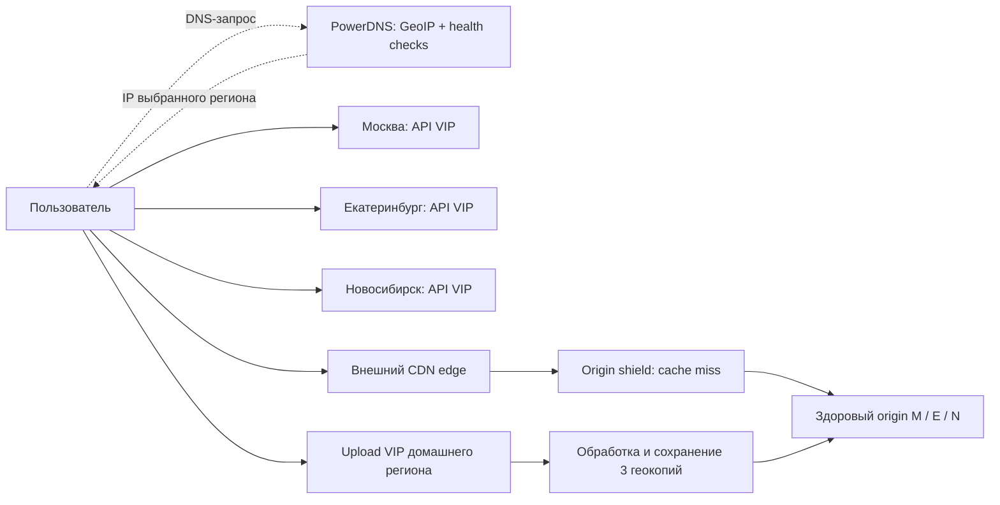
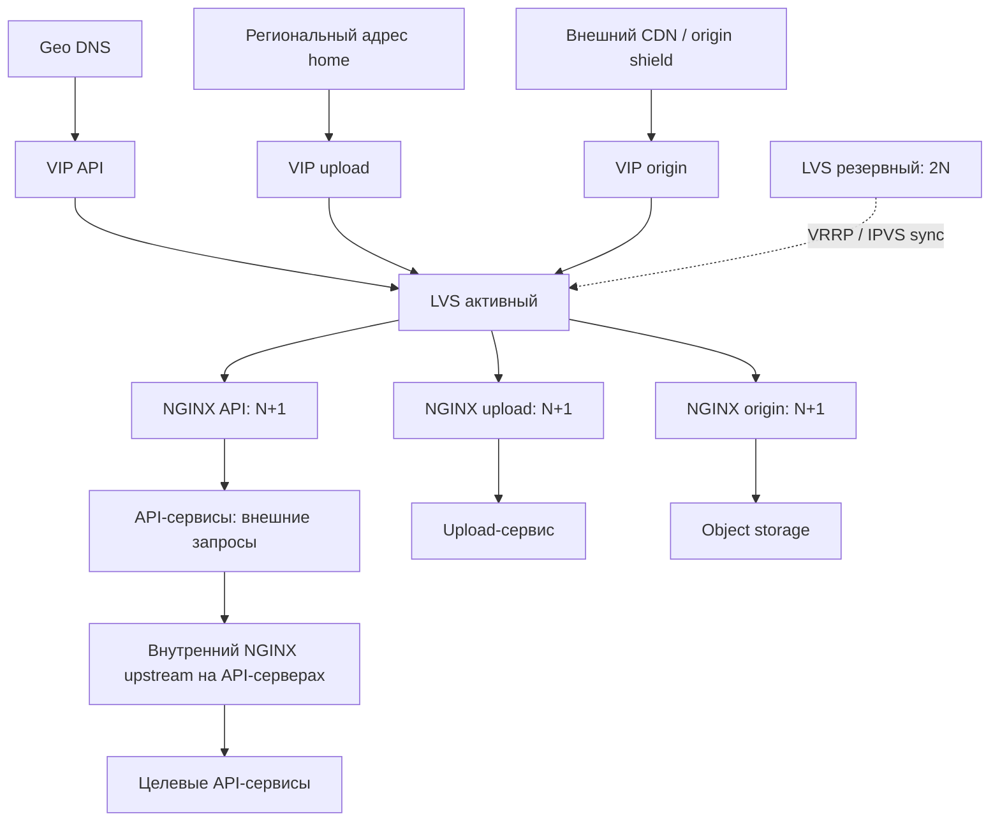
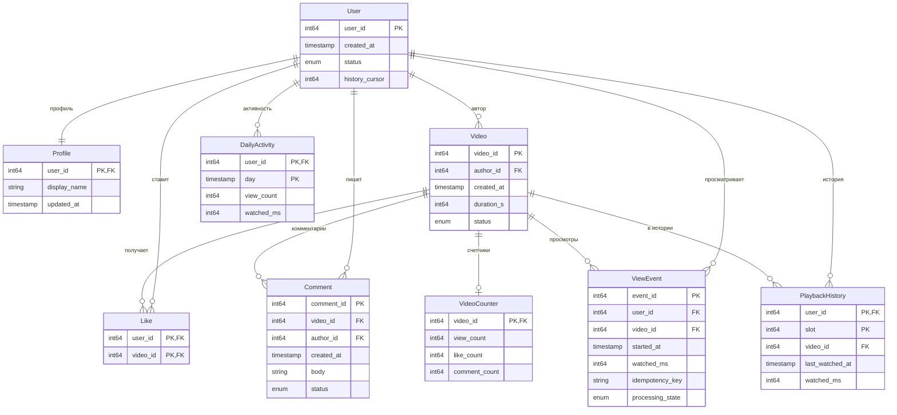

# Высоконагруженный сервис коротких вертикальных видео

## 1. Тема, аудитория и функционал

Проектируем сервис коротких вертикальных видео для пользователей России от 12 лет. TikTok сообщил, что его месячная аудитория превысила 1 млрд пользователей в сентябре 2021 года [1]. Эта цифра показывает популярность формата, но ничего не говорит о размере российской аудитории.

Для расчета берем **56,5 млн MAU и 27,7 млн DAU** [2]. Это выше минимального требования в 1 млн DAU.

MVP включает три функции:

1. Загрузка и публикация готового видео длительностью до 3 минут.
2. Просмотр персонализированной ленты по истории и длительности просмотров.
3. Лайки, комментарии и счетчики просмотров.

Сервис хранит видео в трех вариантах качества: 480p, 720p и 1080p. После подтверждения лайк сразу виден пользователю, который его поставил. Публичные счетчики могут обновляться с задержкой до минуты. Ролик становится доступен после обработки и сохранения копий во всех регионах. В MVP не входят трансляции, сообщения, реклама и видеоредактор.

## 2. Расчет нагрузки

### 2.1. Исходные параметры

Показатели поведения ниже — расчетные допущения, а не данные измерений аудитории другого сервиса. Единицы десятичные: `1 KB = 10³ B`, `1 MB = 10⁶ B`, `1 GB = 10⁹ B`, `1 TB = 10¹² B`, `1 PB = 10¹⁵ B`; `1 B = 8 bit`. Пики методов считаются одновременными.

| Параметр | Значение | Основание |
| --- | ---: | --- |
| MAU / DAU | 56,5 / 27,7 млн | Целевая нагрузка; DAU/MAU = 49 % |
| Все зарегистрированные профили | 113 млн | Сценарий: половина аккаунтов активна за месяц; неактивные не удаляются |
| Воспроизведение на DAU в сутки | 60 мин | Сценарий: три сеанса по 20 мин |
| Средний просмотр / длительность оригинала | 20 / 30 с | Просмотр может завершиться до конца ролика |
| Средний битрейт доставки | 1,5 Mbit/s | Доли времени 480p/720p/1080p — 40/40/20 %: 0,4 × 0,75 + 0,4 × 1,5 + 0,2 × 3; включая аудио |
| Авторы среди DAU / публикаций на автора в сутки | 1 % / 0,2 | Сценарий: 99 % только смотрят, автор публикует в среднем 6 роликов за 30 дней |
| Оригинал | 45 MB | 30 с × 12 Mbit/s / 8; 12 Mbit/s — ориентир по порядку величины из [3], в модели полный поток |
| Производные варианты вместе | 19,6 MB | 30 с × (0,75 + 1,5 + 3) Mbit/s / 8; проектная лестница полного битрейта |
| Возраст текущего каталога | 5 лет = 1 825 дней | Модель зрелого сервиса при постоянной нагрузке, без вычитания удалений |
| Сырые события просмотра / история | 30 дней / последние 100 просмотров | Ограниченные сроки и размеры |
| Репликация учитываемых данных | 3 копии | По одной в Москве, Екатеринбурге и Новосибирске |
| CDN byte hit ratio | 98 % базовый; 90 % для мощности origin | Допущения; измеряется по байтам [4] |

`Просмотры/DAU = 60 × 60 / 20 = 180`.
`Просмотры/сутки = 27,7 млн × 180 = 4,9 млрд`.
`Публикации/сутки = 27,7 млн × 0,01 × 0,2 = 55 400`.

| Действие одного DAU | В сутки |
| --- | ---: |
| Просмотр | 180 |
| Получение страницы ленты | 9 |
| Открытие списка комментариев | 18 |
| Отправка события просмотра | 180 |
| Лайк | 6 |
| Комментарий | 0,2 |
| Публикация | 0,002 |

### 2.2. RPS

`RPS_средний = операций/сутки / 86 400`; `RPS_пик = RPS_средний × коэффициент пика`. В расчетном пиковом часе происходит 1/12 суточных просмотров, 1/8 реакций и 1/6 публикаций. Поэтому для этих потоков используем коэффициенты 2/3/4: просмотры распределены в течение дня, а реакции и публикации сильнее сосредоточены вечером.

| Метод / поток | Операций/сутки | Средний RPS | Пик/среднее | Пиковый RPS | Пояснение |
| --- | ---: | ---: | ---: | ---: | --- |
| Получение ленты | 249 300 000 | 2 885 | 2 | 5 770 | 20 роликов на страницу |
| Чтение комментариев | 498 600 000 | 5 770 | 2 | 11 541 | Открывают в 10 % просмотров |
| Событие просмотра | 4 986 000 000 | 57 708 | 2 | 115 416 | Одно событие на просмотр |
| Лайк | 166 200 000 | 1 923 | 3 | 5 770 | 6 на DAU |
| Комментарий | 5 540 000 | 64,1 | 3 | 192 | 0,2 на DAU |
| Инициализация загрузки | 55 400 | 0,64 | 4 | 2,5 | Выдача подписанного URL |
| Завершение загрузки | 55 400 | 0,64 | 4 | 2,5 | Фиксация оригинала и запуск обработки |
| Части оригинала | 664 800 | 7,6 | 4 | 30,7 | ceil(45 MB / 4 MB) = 12, отдельный upload |
| Сегменты видео, CDN | 24 930 000 000 | 288 541 | 2 | 577 083 | 5 сегментов по 4 с на просмотр |

Внешний API: **68 353 среднего / 138 697 пикового RPS**, без upload-частей и CDN.

На одну страницу ленты приходятся четыре групповых чтения: рекомендаций, метаданных, счетчиков и лайков. Всего это `11 541 / 23 083` внутренних операций в секунду. Они считаются отдельно от внешнего RPS. Для трех вариантов качества требуется `166 200` задач транскодирования в сутки, или `1,9 / 7,6` задач в секунду.

### 2.3. Сеть

Средняя одновременная аудитория: `27,7 млн × 3 600 / 86 400 = 1 154 166`, пик — вдвое выше. Поэтому пиковая выдача видео: `2 308 333 × 1,5 Mbit/s = 3 462,5 Gbit/s`. Суточная выдача по времени просмотра: `4,9 млрд × 20 × 1,5 Mbit/s / 8 = 18,6 PB`.

| Направление | Пик, Gbit/s | Объем, GB/сутки | Основание |
| --- | ---: | ---: | --- |
| CDN → зрители, видео | 3 462,5 | 18 697 500 | Просмотры × длительность × битрейт |
| Origin → CDN, 98 % попаданий | 69,2 | 373 950 | 2 % от видеотрафика |
| Origin → CDN, 90 % попаданий | 346 | 1 869 750 | Сценарий выбора мощности, 10 % от видеотрафика |
| Клиенты → upload, оригиналы | 0,92 | 2 493 | 55 400 × 45 MB; пик ×4 |
| Внешний API, запросы + ответы | 3,8 | 20 537 | Размеры ниже |

Принятый размер запроса с ответом: лента — 31 KB (из них 30 KB ответ), список комментариев — 15 KB, событие просмотра — 1 KB (200 B данных), прочие API-операции — 2 KB. Это оценки с HTTP-заголовками; накладные расходы TCP/TLS/Ethernet и повторы учитываются в запасе мощности.

Каждый процентный пункт снижения byte hit ratio добавляет origin `34,6 Gbit/s`. Request miss принят отдельно: при сегменте `4 с × 1,5 Mbit/s / 8 = 0,75 MB` получаем `577 083 × 0,1 = 57 708 RPS`. Совпадение miss-долей — допущение для проверки по логам; origin shield не учитывается.

Для двух удаленных копий медиа передается `2 × (2,4 + 1,0) = 7,1 TB/сутки` (`0,66 Gbit/s`), для сырых событий — еще `1,9 TB/сутки` (`0,18 Gbit/s`). Это внутренний трафик, не CDN-выдача и не новый логический объем. Прирост медиа на регион — `3,5 TB/сутки`; каналы, БД и диски требуют отдельного расчета.

### 2.4. Хранение

Здесь смоделирован сервис после пяти лет работы при постоянной нагрузке. Это расчетный сценарий, а не данные о фактической базе TikTok. `S₀ = объектов/сутки × срок × размер × 3 копии`; через год `S₁ = S₀ + Δгод`. В прогнозе нагрузка и число профилей постоянны. Медиа, лайки и комментарии накапливаются; события удаляются через 30 дней, дневная активность — через 365 дней, история заменяется в пределах 100 записей на аккаунт.

| Данные сейчас | Объектов, до репликации | Размер объекта | Новые данные, GB/сутки, без копий | S₀, TB, 3 копии | Прирост за год, TB, 3 копии |
| --- | ---: | ---: | ---: | ---: | ---: |
| Оригиналы, 5 лет | 101 105 000 | 45 000 000 B | 2 493 | 13 649 | 2 729 |
| Три варианта, 5 лет | 303 315 000 | 6 562 500 B | 1 090 | 5 971 | 1 194 |
| Метаданные роликов, 5 лет | 101 105 000 | 2 000 B | 0,11 | 0,60 | 0,12 |
| Лайки, 5 лет | 303 315 000 000 | 16 B | 2,6 | 14,5 | 2,9 |
| Комментарии, 5 лет | 10 110 500 000 | 512 B | 2,8 | 15,5 | 3,1 |
| Сырые события, окно 30 дней | 149 580 000 000 | 200 B | 997,2 | 89,7 | 0 |
| Профили, все аккаунты | 113 000 000 | 1 000 B | Прирост не задан | 0,33 | 0 |
| История, до 100 записей на аккаунт | 11 300 000 000 | 16 B | Обновление без роста объема | 0,54 | 0 |
| Дневная активность, окно 365 дней | 10 110 500 000 | 64 B | 1,7 | 1,9 | 0 |
| **Итого** | — | — | — | **19 743** | **3 930** |

Объем всего каталога за пять лет, пересчитанный на одного пользователя из текущей месячной аудитории (MAU). Это средняя доля каталога на одного пользователя, а не объем его собственных публикаций. Значения приведены без реплик:

| Данные на одного MAU | Объектов | GB |
| --- | ---: | ---: |
| Оригиналы | 1,7 | 0,080 |
| Три варианта | 5,3 | 0,035 |
| Метаданные роликов | 1,7 | 0,0000036 |
| Лайки | 5 368 | 0,000085 |
| Комментарии | 178 | 0,000091 |

Сейчас общий объем с учетом репликации составляет **19 743 TB**. При тех же темпах через год он вырастет до **23 674 TB**; на медиа приходится **19 620 / 23 544 TB** соответственно. Данные с ограниченным сроком хранения постоянно обновляются, поэтому их объем не растет. Размеры лайка (16 B) и комментария (512 B) взяты по минимальной оценке.

## 3. Глобальная балансировка

### 3.1. Размещение и маршруты

Размещаем площадки в **Москве, Екатеринбурге и Новосибирске**. Запросы из западной части страны обслуживает Москва, а пользователи Урала и восточных регионов получают более близкую точку входа. При отказе одной площадки две другие сохраняют копии данных. Для расчета принимаем распределение спроса **50/25/25 %** между тремя зонами: западом, Уралом и объединенной зоной «Сибирь и Дальний Восток». Это сценарное допущение, а не статистика населения. Сравним его с вариантом, где единственная площадка находится в Москве. Для сравнения выбраны четыре условных города; зону «Сибирь и Дальний Восток» разделили поровну между двумя точками:

| Точка сценария | Доля | До Москвы, км | До выбранного ЦОДа, км |
| --- | ---: | ---: | ---: |
| Нижний Новгород | 50 % | 400 | 400, Москва |
| Челябинск | 25 % | 1 490 | 190, Екатеринбург |
| Красноярск | 12,5 % | 3 350 | 640, Новосибирск |
| Хабаровск | 12,5 % | 6 140 | 3 580, Новосибирск |

В таблице указаны приблизительные расстояния между центрами городов по поверхности Земли. Реальные сетевые маршруты могут быть длиннее. С учетом долей аудитории среднее расстояние до обслуживающего ЦОДа уменьшается с **1 760 до 775 км (~56 %)**. Размещение серверов ближе к пользователям должно сократить задержку API, но по расстоянию нельзя определить, насколько именно: это зависит и от маршрутов, и от качества связи. Для Дальнего Востока даже Новосибирск остается далеко. Видео пользователи получают через ближайшие узлы CDN, а API-запросы идут в наши ЦОДы.

GeoDNS настроим на PowerDNS [8], разместив по одному DNS-серверу в каждом регионе и используя GeoIP. По карте зон DNS выберет виртуальный IP-адрес (VIP) регионального API. Фоновые HTTP-проверки отмечают недоступные адреса. Оператор сможет менять зоны и веса, ориентируясь на задержку и загрузку, после чего конфигурация распространится на DNS-серверы. Местоположение DNS-резолвера, определяется приблизительно.

| Домен | Назначение | Маршрут |
| --- | --- | --- |
| `api.service.example` | Лента, взаимодействия, события, управление upload | GeoDNS → региональный API VIP |
| `upload.service.example` | Передача частей оригинала | Подписанный URL с региональным именем `upload-m/e/n.service.example` → домашний регион автора |
| `video.service.example` | Сегменты и манифесты | CDN edge → при miss shield → origin выбранного здорового региона |
| `static.service.example` | Версионированная статика | CDN |

Метаданные и пользовательские записи копируются в два других региона с задержкой. Запрос подтверждается после записи в домашнем регионе (home). Если этот регион откажет, последние изменения могут быть потеряны (RPO > 0). Ролик публикуется только после того, как оригинал и варианты сохранены во всех трех регионах. Если один регион недоступен, публикация ждет его восстановления.

Для API и upload не используем BGP Anycast: такую схему сложнее сопровождать, а смена маршрута может оборвать активное соединение. Маршрут запросов к CDN выбирает сама CDN-платформа. Обычный DNS round-robin распределяет запросы по очереди и не учитывает ни местоположение пользователя, ни доступность приложения.

### 3.2. Распределение нагрузки

Нагрузка региона рассчитывается как глобальный RPS, умноженный на долю региона: `RPS_региона = RPS_глобальный × доля`.

| Метод / поток | Москва, средний / пик RPS | Екатеринбург, средний / пик RPS | Новосибирск, средний / пик RPS |
| --- | ---: | ---: | ---: |
| Получение ленты | 1 442 / 2 885 | 721 / 1 442 | 721 / 1 442 |
| Чтение комментариев | 2 885 / 5 770 | 1 442 / 2 885 | 1 442 / 2 885 |
| Событие просмотра | 28 854 / 57 708 | 14 427 / 28 854 | 14 427 / 28 854 |
| Лайк | 961 / 2 885 | 480 / 1 442 | 480 / 1 442 |
| Комментарий | 32,0 / 96,1 | 16,0 / 48,0 | 16,0 / 48,0 |
| Инициализация загрузки | 0,32 / 1,2 | 0,16 / 0,64 | 0,16 / 0,64 |
| Завершение загрузки | 0,32 / 1,2 | 0,16 / 0,64 | 0,16 / 0,64 |
| Части оригинала | 3,8 / 15,3 | 1,9 / 7,6 | 1,9 / 7,6 |
| Сегменты видео, CDN | 144 270 / 288 541 | 72 135 / 144 270 | 72 135 / 144 270 |
| Внутренние групповые чтения ленты | 5 770 / 11 541 | 2 885 / 5 770 | 2 885 / 5 770 |

В обычном режиме пиковый поток API для Москвы, Екатеринбурга и Новосибирска (M/E/N) составляет `1,9 / 0,95 / 0,95 Gbit/s`, а upload — `0,46 / 0,23 / 0,23 Gbit/s`. Для origin при 90 % попаданий CDN по объему данных значения равны `173 / 86,5 / 86,5 Gbit/s`. CDN отдает зрителям `1 731 / 865 / 865 Gbit/s` в тех же регионах. Этот трафик распределен по географии аудитории и не проходит через наши API-серверы.

### 3.3. Отказы и регулирование

| Состояние | Входящий API M/E/N | Origin miss M/E/N | Upload |
| --- | --- | --- | --- |
| Штатно | 50/25/25 % | 50/25/25 % | В home |
| Отказ M | 0/50/50 % | 0/50/50 % | Upload home M приостановлен |
| Отказ E | 65/0/35 % | 50/0/50 % | Upload home E приостановлен |
| Отказ N | 60/40/0 % | 50/50/0 % | Upload home N приостановлен |

При отказе одного региона его API-нагрузку перенаправляем в оставшиеся. Если недоступна Москва, ее 50 % делятся поровну между Екатеринбургом и Новосибирском. При отказе Екатеринбурга его 25 % распределяются между Москвой и Новосибирском в пропорции 60/40; при отказе Новосибирска его 25 % делятся между Москвой и Екатеринбургом в пропорции 40/60. Так получаются максимальные доли **65/50/50 %**. Запросы к origin поровну переходят в два оставшихся региона; каждый должен выдерживать до **50 %** общего потока при 90 % попаданий CDN. Upload продолжает работать в домашнем регионе по обычным долям 50/25/25 %.

Время жизни DNS-записи (TTL) — 30 с. DNS-кэши и уже открытые соединения могут замедлить переключение. Проверки определяют, готов ли регион обслуживать запросы на чтение. CDN независимо исключает недоступный origin. После восстановления регион возвращается в работу постепенно.

Если домашний регион недоступен, публичные данные продолжают читаться с доступных копий. Запись лайков и комментариев, а также управление публикацией приостанавливаются до восстановления региона или контролируемой смены региона записи. Другой регион автоматически не становится владельцем записей. В остальных домашних регионах запись продолжается, а публикация новых видео ждет создания третьей копии. Уже опубликованные ролики доступны через CDN и оставшиеся origin.

## 4. Локальная балансировка

### 4.1. Схема и резервирование

В каждом регионе работают физические серверы под Linux. Пара узлов LVS с Keepalived обслуживают три виртуальных IP-адреса (VIP): отдельно для API, upload и origin. Один узел активен, второй резервный (**2N при N = 1**); оба рассчитаны на весь входящий поток региона. По адресу назначения и порту IPVS выбирает подходящий пул NGINX. Пулы API, upload и origin разделены, чтобы передача видео не отнимала ресурсы у API.

В режиме Direct Routing LVS меняет MAC-адрес назначения и направляет новое TCP-соединение на NGINX с наименьшим числом активных соединений (least connections). Этот способ учитывает, что соединения могут длиться разное время, но не выравнивает точно загрузку процессоров и объем передаваемых данных. LVS и NGINX должны находиться в одной L2-сети. VIP назначается loopback-интерфейсу, а ARP-ответы для него подавляются. Ответный трафик уходит напрямую от NGINX с этого VIP, поэтому сетевые фильтры должны разрешать такую схему. Запросы и подтверждения TCP (ACK) проходят через LVS, ответы идут напрямую. Keepalived переносит VIP с помощью VRRP и проверяет состояние пула. Синхронизация IPVS помогает сохранить часть соединений при переключении, но полной сохранности не гарантирует.

NGINX завершает TLS-соединение и распределяет HTTP-запросы между серверами пула с помощью `least_conn`; повторное использование соединений upstream уменьшает число новых подключений. Такой выбор учитывает занятость соединений и разную длительность запросов. API не хранит состояние пользователя на конкретном сервере. Состояние загрузки сохраняется отдельно, поэтому закреплять пользователя за одним экземпляром (sticky sessions) не требуется.

На API-серверах внутренний NGINX направляет запросы к нужному сервису напрямую. Каждый сервис запущен как минимум в двух экземплярах на разных машинах. Точное количество определят нагрузочные испытания.

HTTP-проверки Keepalived убирают неисправный NGINX из пула LVS. Перед обновлением узел исключают из конфигурации и ждут завершения текущих запросов. После отказа одного узла остаются N серверов. Если переключился директор, клиент повторяет только безопасные запросы.

### 4.2. Производительность одного NGINX

Ориентир — тест 2019 года [5]: NGINX Ingress на Xeon Platinum 8168, 8 задействованных CPU, OpenSSL 1.1.0g. Отдельно измерены HTTPS RPS (ответ 1 KB), TLS TPS для нового соединения (пустой ответ, без HT) и throughput (объекты 1 MB). Тест 2017 года [6] тоже разделяет CPS и RPS, но использует другую конфигурацию.

| Ограничение | Ориентир [5] | 70 % для расчета |
| --- | ---: | ---: |
| HTTPS RPS | 236 703 | 165 692,1 |
| TLS CPS (SSL TPS), без HT | 31 485 | 22 039,5 |
| Поток | 8,6 Gbit/s | 6,048 Gbit/s |

Для каждого узла закладываем 8 физических ядер сопоставимой производительности, 32 GB RAM и отдельные сетевые интерфейсы 10GbE для подключений со стороны клиентов и со стороны внутренних сервисов. Предел 6,048 Gbit/s относится к каждому интерфейсу; общий канал также может стать узким местом. Достаточность памяти и допустимое число соединений нужно проверить испытаниями.

Запросы, TLS-соединения и сетевой поток одновременно используют процессор, поэтому их нужно проверять в одном тесте с запасом 30 %. Для консервативного расчета принимаем `TLS_CPS = внешний RPS`, то есть каждому запросу соответствует новое соединение. Keep-alive и HTTP2 уменьшают фактическое число новых соединений в секунду (CPS).

### 4.3. Число серверов

`N = ceil(max(RPS / 165 692,1; TLS_CPS / 22 039,5; Gbit/s / 6,048))`.
В каждом пуле устанавливаем `N+1` серверов. После отказа одного узла оставшиеся N должны выдерживать расчетный поток. Максимальные нагрузки по регионам могут возникать при разных авариях; их одновременный учет дает запас по мощности.

| Пул / регион | Расчетный пик RPS = CPS | Поток, Gbit/s | N по RPS / TLS / сети | Установлено N+1 |
| --- | ---: | ---: | --- | ---: |
| API, Москва | 90 153 | 2,4 | 1 / 5 / 1 | 6 |
| API, Екатеринбург | 69 348 | 1,9 | 1 / 4 / 1 | 5 |
| API, Новосибирск | 69 348 | 1,9 | 1 / 4 / 1 | 5 |
| Upload, Москва | 15,3 | 0,46 | 1 / 1 / 1 | 2 |
| Upload, Екатеринбург | 7,6 | 0,23 | 1 / 1 / 1 | 2 |
| Upload, Новосибирск | 7,6 | 0,23 | 1 / 1 / 1 | 2 |
| Origin, Москва | 28 854 | 173 | 1 / 2 / 29 | 30 |
| Origin, Екатеринбург | 28 854 | 173 | 1 / 2 / 29 | 30 |
| Origin, Новосибирск | 28 854 | 173 | 1 / 2 / 29 | 30 |

Для пулов NGINX требуется **38 / 37 / 37** серверов в M/E/N (**112** всего), а для LVS — **2 на регион** (**6** всего). В расчет не включены три DNS-сервера, приложения, хранилище, транскодирование и CDN. Для origin ограничением становится пропускная способность сети: `ceil(173 / 6,048) = 29` серверов. Даже после отказа одного узла оставшиеся обеспечат `29 × 6,048 = 175 Gbit/s`. API также выдержит пиковую нагрузку после отказа одного сервера: в Москве — `110 197,5 CPS > 90 153`, в Екатеринбурге и Новосибирске — `88 158 CPS > 69 348`.

Для origin отдельно оцениваем входящий трафик: подтверждения ACK и данные TLS/заголовков составляют около 10 % от ответного потока, к ним добавляется по 1 500 B на запрос. Получаем `17,3 + 0,34 = 17,6 Gbit/s`. Это трафик в обратном направлении полнодуплексного канала; он не прибавляется к исходящим 173 Gbit/s и укладывается в возможности 29 интерфейсов. Основной поток идет от хранилища к клиентам и составляет 173 Gbit/s. Приведенный расчет оценивает только прокси-серверы. Отдельно нужно проверить, что региональные каналы и хранилище выдержат этот поток при отказе региона.

### 4.4. Проверка L4 и условий отказа

У каждого LVS отдельные 100GbE front/back подключения с проектным пределом 70 Gbit/s на интерфейс и около 50 млн pps.

Для верхней оценки M складываем двунаправленный API (хотя ответы обходят LVS), upload и входящий origin:
`2,4 + 0,46 + 17,3 + 0,34 = 20,6 Gbit/s`.
Для E/N верхняя оценка — `19,8 Gbit/s`; округляем до **21 Gbit/s**, что ниже 70. При размере пакета 64 B это `21 × 10⁹ / (64 × 8) = 41,0 млн pps`, меньше целевых 50 млн.

CPS M: `90 153 + 15,3 + 28 854 = 119 022`; E/N — около `98 210`. Тест пары при выключенном директоре должен подтвердить **120 тыс. новых соединений/с**, до **21 Gbit/s / 50 млн pps**, с проверкой IPVS, памяти, задержек и ошибок. Если целевые параметры не достигнуты, конфигурацию меняют: 100GbE само по себе не гарантирует pps/CPS.

Схема рассчитана на отказ одного региона и одного NGINX в каждом оставшемся пуле либо на отказ одного LVS при исправной локальной сети. Два отказа в одном пуле уже превышают резерв N+1.

### 4.5. Таймауты и повторы

Для API задаются connect timeout 0,5 с и read timeout 2 с. Чтение можно повторить не более одного раза на другом upstream; общий лимит — 3 с. Загрузка прерывается, если прогресса нет 60 с. При повторной отправке части используются прежние upload ID и номер части. Для origin задаются connect timeout 1 с и read inactivity 10 с; при ошибке CDN повторяет GET-запрос к другой копии. Это начальные значения, их уточнят по измеренным квантилям времени ответа.

Если ответ на POST-запрос о лайке, комментарии или завершении загрузки не пришел, нельзя просто отправлять операцию заново: запись могла сохраниться. Клиент повторяет запрос с тем же ключом идемпотентности, и приложение возвращает ранее сохраненный результат, не создавая дубль. У каждого события есть ID, по которому повторы отбрасываются. События обрабатываются независимо от формирования ответа ленты.

## 5. Логическая схема БД

Сначала показаны основные таблицы, затем — файлы, кэши и буферы. Во второй схеме User и Video приведены без полей: это ссылки на таблицы из первой схемы, а не новые сущности. `PK` обозначает первичный ключ, `FK` — внешний ключ. Типы данных указаны логически и не зависят от конкретной СУБД.

**Основные данные**

**Файлы, кэши и буферы**

```mermaid
erDiagram
    OriginalMedia {
        int64 video_id PK, FK
        string object_ref
        int64 size_bytes
        string checksum
        int64[] region_copies
    }
    VideoVariant {
        int64 video_id PK, FK
        enum quality PK
        string object_ref
        int64 size_bytes
        enum status
        int64[] region_copies
        blob segment_ranges
    }
    UploadSession {
        int64 upload_id PK
        int64 user_id FK
        int64 video_id FK
        timestamp created_at
        timestamp expires_at
        enum state
        string part_refs
        blob staging_payload
    }
    TranscodeTaskQueue {
        int64 task_id PK
        int64 video_id FK
        enum quality
        timestamp created_at
        int64 attempt
        timestamp expires_at
    }
    ViewEventBuffer {
        int64 event_id PK
        int64 user_id FK
        int64 video_id FK
        timestamp occurred_at
        int64 watched_ms
        timestamp expires_at
    }
    CounterBuffer {
        string source_event_id PK
        int64 video_id FK
        enum counter_kind
        int64 delta
        timestamp created_at
        timestamp expires_at
        enum applied_state
    }
    CandidatePool {
        int64 video_id PK, FK
        int64 view_count
        int64 duration_s
        timestamp generated_at
    }
    FeedCache {
        int64 user_id PK, FK
        int64 page_no PK
        int64[] video_ids
        timestamp created_at
        timestamp expires_at
    }
    IdempotencyRecord {
        int64 user_id PK, FK
        string operation_id PK
        enum operation
        string result_ref
        timestamp created_at
        timestamp expires_at
    }

    Video ||--|| OriginalMedia : "оригинал"
    Video ||--o{ VideoVariant : "до трех качеств"
    User ||--o{ UploadSession : "загружает"
    Video ||--o| UploadSession : "получает"
    Video ||--o{ TranscodeTaskQueue : "задачи обработки"
    User ||--o{ ViewEventBuffer : "просматривает"
    Video ||--o{ ViewEventBuffer : "просмотры"
    Video ||--o{ CounterBuffer : "изменения счетчиков"
    Video ||--o| CandidatePool : "кандидат ленты"
    User ||--o{ FeedCache : "страницы ленты"
    Video }o--o{ FeedCache : "ролики страницы"
    User ||--o{ IdempotencyRecord : "защита от повторов"
```

Пока ролик обрабатывается, у него может быть от 0 до 3 готовых вариантов. Публикация разрешена, когда готовы все три варианта и их копии во всех регионах. Сегменты относятся к VideoVariant, а манифест формируется по данным Video. Выбор конкретной СУБД и размещение данных рассматриваются в следующем задании.

### 5.1. Допущения и перевод нагрузки в QPS

Средний QPS получаем, разделив суточное число операций из ДЗ2 на 86 400; пиковое значение рассчитываем с тем же коэффициентом, что и ранее. Таблица показывает обращения к данным: отдельно строки, страницы или файлы. Просмотр, лайк и комментарий создают по одной строке; переход статуса учитывается отдельно. При выдаче ленты читаются данные до 20 роликов, их лайки и счетчики, 100 записей истории и до 100 кандидатов. Список комментариев содержит до 20 строк, поэтому пиковая нагрузка составляет `11 541 × 20 = 230 833 строк/с`. Для очередей указан поток создаваемых строк или задач, даже если обработчик принимает их пачками. Все значения округлены.

User и Profile — отдельные связанные сущности в отношении 1:1. Для 113 млн пар заложено по 1 000 B: 64 B для User и 936 B для Profile. В размер Video (2 000 B) входят метаданные и ссылки на файлы; OriginalMedia и VideoVariant учитывают только сами файлы. Для постоянных данных и IdempotencyRecord показан объем одной копии. Для трех копий его нужно умножить на 3. Временные данные посчитаны без репликации. Размеры файлов соответствуют параметрам из ДЗ2.

При просмотре User обновляет указатель на последнее событие. Изменения профилей в MVP не учитываются. Для Video предусмотрены три состояния: загрузка, обработка и публикация. Профили авторов читаются вместе с лентой и комментариями. Обработчик читает оригинал один раз, после чего зрителям отдаются готовые варианты. В расчете кэша не учитывается снижение нагрузки за счет попаданий, чтобы оценка оставалась консервативной.

### 5.2. Сущности, объемы и нагрузка

**Постоянные данные и файлы**

| Сущность / назначение | Записей × размер | Логический объем | Чтение, среднее / пик | Запись, среднее / пик |
| --- | --- | ---: | ---: | ---: |
| User (учетная запись) + Profile (данные автора), 1:1 | 113 млн × (64 + 936) B | User 7,2 GB + Profile 105 GB = 113 GB | User 0; Profile 173 125 / 346 250 строк/с | User 57 708 / 115 417 обновлений/с; Profile 0 |
| Video (метаданные) | 101 млн × 2 000 B | 202 GB | 57 708 / 115 417 строк/с | 1,9 / 7,6 переходов статуса/с |
| OriginalMedia (оригинал) | 101 млн × 45 MB | 4 549 TB | 0,64 / 2,5 чтений/с | 0,64 / 2,5 записей/с; 2 493 GB/сутки |
| VideoVariant (480p/720p/1080p) | 303 млн × 6,5 MB | 1 990 TB | ~28 854 / 57 708 origin-запросов/с при 10% request miss | 1,9 / 7,6 вариантов/с; 1 090 GB/сутки |
| Like (User ID + Video ID, 16 B) | 303 млрд | 4,8 TB | 57 708 / 115 417 проверок/с | 1 924 / 5 771/с |
| Comment | 10,1 млрд × 512 B | 5,1 TB | 115 417 / 230 833 строк/с | 64,1 / 192/с |
| ViewEvent (сырые события, 30 дней) | 149 млрд × 200 B | 29,9 TB | 57 708 / 115 417 событий/с | 57 708 / 115 417 вставок/с + отметки обработки |
| PlaybackHistory (100 последних событий на аккаунт) | 11,3 млрд × 40 B | 452 GB (на 271,2 GB больше §2) | 288 542 / 577 083 строк/с | 57 708 / 115 417 замен слота/с |
| DailyActivity (агрегаты, 365 дней) | 10,1 млрд × 64 B | 647 GB | 0 | До 57 708 / 115 417 обновлений/с |
| VideoCounter (публичные счетчики) | 101 млн × 32 B | 3,2 GB | 57 708 / 115 417 строк/с | До 59 696 / 121 380 дельт/с |

**Временные и служебные данные**

| Сущность / назначение | Записей × размер | Бюджет | Чтение, среднее / пик | Запись, среднее / пик |
| --- | --- | ---: | ---: | ---: |
| CandidatePool (100 кандидатов) | 100 × 32 B | 3,2 KB на снимок, обновление раз в 15 с | 2 885 / 5 771 чтений/с (до 100 строк на выдачу) | 0,067 снимка/с; до 59 696 / 121 380 изменений счетчиков/с при построении |
| FeedCache (до 20 ID на страницу) | `5 770 × 15 × 224 B` | ~19,4 MB; TTL 15 с | 2 885 / 5 771 страниц/с | 2 885 / 5 771 страниц/с |
| UploadSession + staging частей | 55 400 × 256 B; до 12 частей по 4 MB | ~14 MB метаданных; 2 493 GB файлов/сутки, TTL 24 ч и cap 55 400 загрузок/сутки | 8,3 / 33,3 проверок/с | 8,9 / 35,9 обновлений/с; части 7,6 / 30,7 записей/с |
| TranscodeTaskQueue (3 качества) | `7,6 × 3 600 = 27 698` задач × 256 B | ~7 MB; TTL 1 ч | 1,9 / 7,6 задач/с | 1,9 / 7,6 задач/с |
| ViewEventBuffer | `115 417 × 60 × 200 B` | ~1,3 GB; TTL 60 с | 57 708 / 115 417 событий/с | 57 708 / 115 417 событий/с |
| CounterBuffer | `121 380 × 60 × 64 B` | ≤466 MB; TTL 60 с | 59 696 / 121 380 сообщений/с | 59 696 / 121 380 сообщений/с |
| IdempotencyRecord (результат операции) | `171 млн/сутки × 256 B`; TTL 24 ч | ~43,9 GB на копию | 1 988 / 5 966 проверок/с | 1 988 / 5 966 записей/с |

После обработки каждого ViewEvent и сообщения CounterBuffer обновляется отметка о его статусе. CandidatePool содержит популярные ролики, из которых формируется персональная лента с учетом истории и длительности просмотров.

В ДЗ2 история оценивалась как пара User ID + Video ID размером 16 B. Для хранения последних 100 просмотров нужны также `slot`, время и длительность просмотра. Поэтому размер записи увеличивается до 40 B, а общий логический объем — на `24 B × 11,3 млрд = 271,2 GB`. Объем служебных данных оценивается как поток операций, умноженный на TTL: FeedCache — `5 770 × 15 × 224 B ≈ 19,4 MB`; ViewEventBuffer — `115 416 × 60 × 200 B ≈ 1,3 GB`; CounterBuffer — `121 380 × 60 × 64 B ≈ 466 MB`. Загрузка ограничена 55 400 роликами за 24 часа, поэтому временное хранилище частей составит `55 400 × 45 MB = 2 493 GB`. Очереди содержат задачи и ссылки на файлы, а не копии видео. Для обработки оригиналов при часовом окне требуется до `2,5 × 3 600 × 45 MB ≈ 415,5 GB` временного места. Это полезный объем без учета индексов и служебных расходов.

### 5.3. Консистентность и перекосы

После успешного ответа поставленный лайк и добавленный комментарий сразу видны их автору. Повтор операции с тем же ключом не создает дубликат. Лента и счетчики могут обновляться с задержкой до минуты: событие обрабатывается до 5 с, счетчик пересчитывается до 25 с, CandidatePool обновляется до 15 с, а кэш — еще до 15 с. Ролик появляется в ленте после обработки и создания трех копий файлов. Повторно доставленные события отбрасываются, чтобы не увеличить счетчик дважды. История может отставать до 5 с, профиль и дневная активность — до минуты. TTL задает срок хранения; при сбое необработанные сообщения нельзя удалять без проверки.

Предполагается, что User ID распределены равномерно. Популярный ролик может создать чрезмерную нагрузку на один Video ID; похожий перекос возможен для профиля автора. CDN уменьшает число чтений файлов, но не число записей лайков и комментариев. Реплики ускоряют чтение, однако могут отставать от основной копии и не распределяют между собой запись. В рабочий набор чтения входят активные профили, история, кэш ленты и данные популярных роликов и счетчиков. Его точный размер зависит от активности пользователей и индексов.

## Источники

1. TikTok Newsroom. «Thanks a billion!», 27.09.2021: [официальное сообщение](https://newsroom.tiktok.com/1-billion-people-on-tiktok-my?lang=en-MY).
2. Mediascope Cross Web. [Рейтинги и правила описания измерений](https://mediascope.net/data/)
3. YouTube Help. [Recommended upload encoding settings](https://support.google.com/youtube/answer/1722171?hl=en): ориентир 12 Mbit/s для видео 1080p SDR high frame rate, не полный пресет нашего сервиса.
4. Google Cloud. [Logs and metrics for caching](https://docs.cloud.google.com/cdn/docs/logging)
5. NGINX, 11.04.2019. [Testing the Performance of NGINX Ingress Controller for Kubernetes](https://blog.nginx.org/blog/testing-performance-nginx-ingress-controller-kubernetes): ориентир производительности, разные тесты RPS/TPS/throughput.
6. NGINX, 24.08.2017. [Testing the Performance of NGINX and NGINX Plus Web Servers](https://blog.nginx.org/blog/testing-the-performance-of-nginx-and-nginx-plus-web-servers): методика и различие RPS/CPS.
7. NGINX. [Upstream module](https://nginx.org/en/docs/http/ngx_http_upstream_module.html): least_conn, keepalive, max_fails/fail_timeout; активные health checks имеют отдельные условия доступности.
8. PowerDNS Authoritative. [Lua records](https://doc.powerdns.com/authoritative/lua-records/index.html), [HTTP API](https://doc.powerdns.com/authoritative/http-api/index.html): GeoIP, динамические ответы, фоновые проверки и управление конфигурацией. Карта зон и веса — решения проекта.
