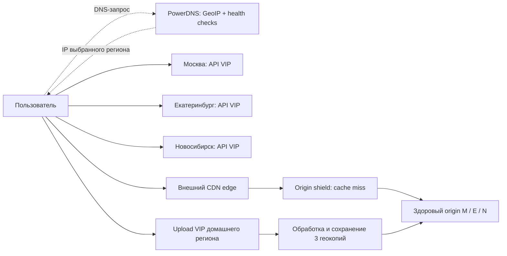
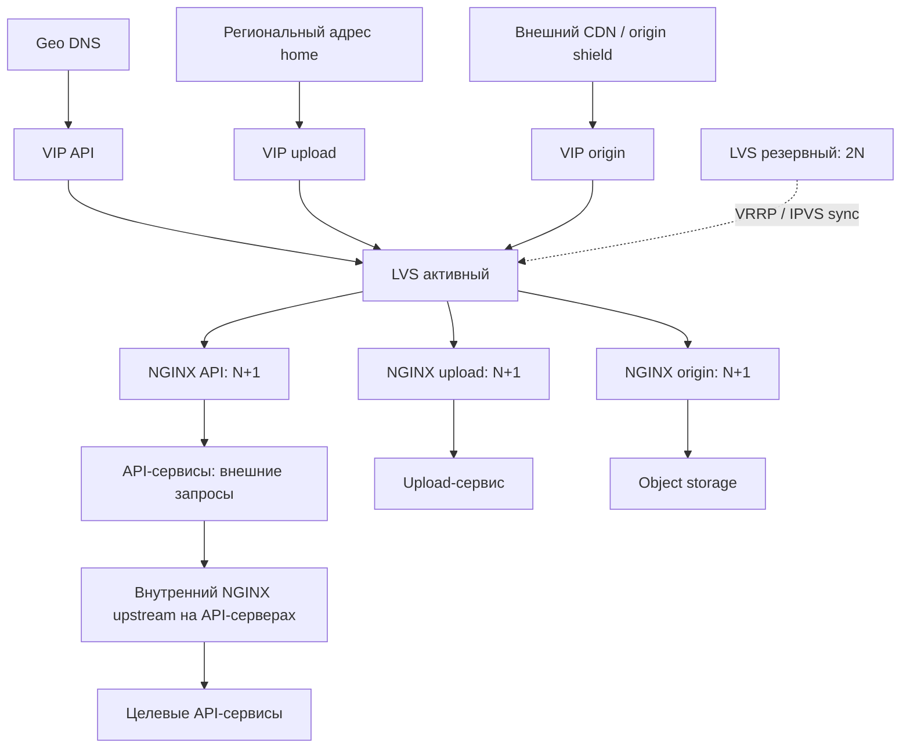
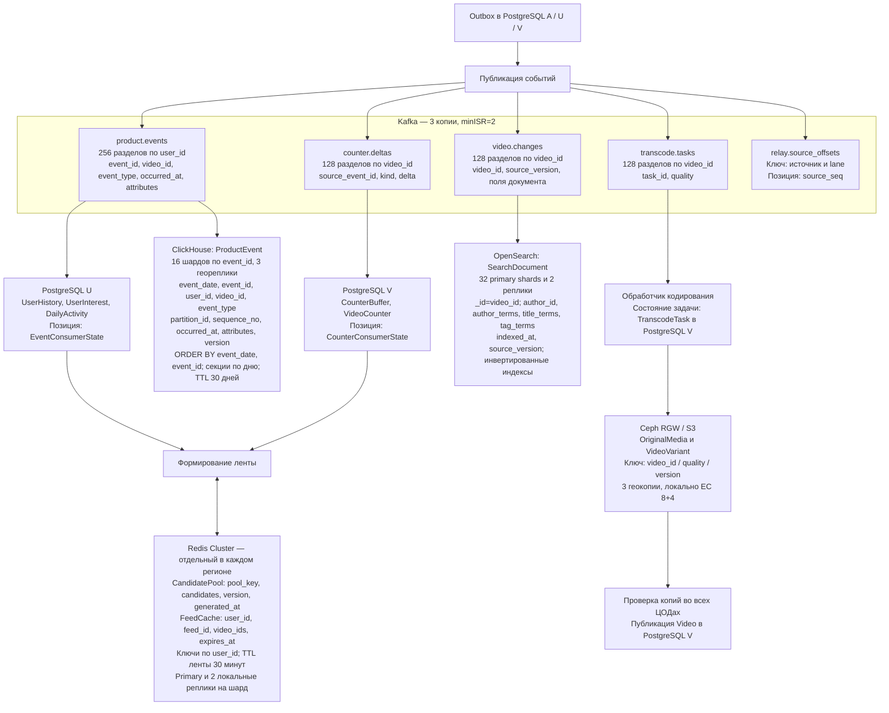

# Высоконагруженный сервис коротких вертикальных видео

## 1. Тема, аудитория и функционал

Сервис коротких вертикальных видео для пользователей России от 12 лет. Аналог — TikTok: более 1 млрд MAU в мире на сентябрь 2021 года [1]. Расчетная аудитория в России — **56,5 млн MAU и 27,7 млн DAU** [2].

MVP включает пять функций:

1. Загрузка и публикация готового видео длительностью до 3 минут.
2. Просмотр персонализированной ленты по истории и длительности просмотров.
3. Лайки и комментарии.
4. Поиск видео по автору, тегу и названию.
5. Регистрация и авторизация пользователей.

Сервис хранит видео в трех вариантах качества: 480p, 720p и 1080p. После подтверждения лайк сразу виден пользователю, который его поставил. Публичные счетчики могут обновляться с задержкой до минуты. Ролик становится доступен после обработки и сохранения копий во всех регионах. В MVP не входят трансляции, сообщения, реклама и видеоредактор.

## 2. Расчет нагрузки

### 2.1. Исходные параметры

Единицы десятичные: `1 KB = 10³ B`, `1 MB = 10⁶ B`, `1 GB = 10⁹ B`, `1 TB = 10¹² B`, `1 PB = 10¹⁵ B`; `1 B = 8 bit`. Расчеты выполняются до округления.

| Параметр | Значение | Основание |
| --- | ---: | --- |
| MAU / DAU | 56,5 / 27,7 млн | Целевая аудитория|
| Все зарегистрированные аккаунты | 113 млн | Допущение: 2 × MAU; неактивные аккаунты сохраняются |
| Воспроизведение на DAU в сутки | 60 мин | Mediascope: 73 мин использования TikTok среди пользователей, Россия 12+, январь–июль 2024 [9]. Из этого времени в модели отводим 60 мин на видео, остальное на другие действия |
| Длительность ролика / средний просмотр | 30 / 20 с | Допущения. Pew приводит среднюю длину 21 и 39 с для разных групп авторов [10]; это ориентир, а не среднее по платформе. 20 с просмотра источником не подтверждены |
| Авторы среди DAU / публикаций на автора в сутки | 2 % / 0,2 | Допущения: 554 тыс. авторов, в среднем один ролик за пять дней на автора. 2 % — доля авторов в аудитории, а не доля опубликовавших ролик именно сегодня |
| Оригинал, 30 с | 46,44 MB | Входной профиль 1080p60: 12 Mbit/s видео + 0,384 Mbit/s стереоаудио по рекомендации YouTube [3]; `(12 + 0,384) × 30 / 8`. Выбор этого профиля для среднего оригинала — допущение |
| Варианты 480p / 720p / 1080p | 0,75 / 1,5 / 3 Mbit/s | Проектные полные битрейты, включая аудио; три файла занимают 2,8125 / 5,625 / 11,25 MB |
| Производные варианты вместе | 19,6875 MB | `30 × (0,75 + 1,5 + 3) / 8` |
| Средний битрейт доставки | 1,5 Mbit/s | Допущение о долях времени 480p/720p/1080p — 40/40/20 %: `0,4 × 0,75 + 0,4 × 1,5 + 0,2 × 3` |
| Возраст каталога / срок хранения оригинала | 5 лет / до 1 суток | Для каталога — 1 825 дней постоянной нагрузки. Оригинал удаляем после успешной обработки и сохранения вариантов; сутки — расчетное окно временного буфера |
| Сырые продуктовые события / история | 30 дней / последние 100 просмотров | Общая аналитика действий MVP; история хранится списком по пользователю |
| Срок сессии | 10 дней | Допущение для расчета авторизации и временного хранения сессий |
| Репликация | 3 копии | По одной в Москве, Екатеринбурге и Новосибирске |
| CDN byte hit ratio | 98 % базовый; 90 % для мощности origin | Допущения о доле байтов, отданных из кэша; не статистика провайдера [4] |

Доля авторов 2 % не подтверждена источником: показатель Pew «52 % когда-либо публиковали видео» относится к взрослым пользователям США, а не к DAU [11]. Частота 0,2 публикации в сутки — допущение; ориентир Pew — от одного до нескольких постов в неделю у разных групп авторов [10].

Три готовых файла занимают 42,4 % оригинала: при перекодировании суммарный битрейт снижается с 12,384 до 5,25 Mbit/s. Принцип подбора вариантов описан в AWS MediaConvert [12]; качество выбранной лестницы нужно проверить пробным кодированием.

`Просмотры/DAU = 60 × 60 / 20 = 180`; `просмотры/сутки = 27,7 млн × 180 = 4 986 000 000`.
`Публикации/сутки = 27,7 млн × 0,02 × 0,2 = 110 800`.

| Действие | На одного DAU в сутки | Основание |
| --- | ---: | --- |
| Просмотр | 180 | 60 мин воспроизведения / 20 с |
| Получение страницы ленты | 9 | Допущение: 20 роликов на страницу |
| Открытие списка комментариев | 18 | В 10 % просмотров |
| Лайк | 18 | Допущение: в 10 % просмотров |
| Комментарий | 1,8 | Допущение: в 1 % просмотров |
| Поиск по автору, тегу или названию | 3 | Допущение: суммарно три запроса поиска, по 20 результатов |
| Авторизация | 0,1 | Допущение: один вход с созданием сессии за 10 дней для ежедневно активного пользователя |
| Регистрация | 0,001 | Допущение: 27 700 новых аккаунтов в сутки, около 10,1 млн за год |
| Публикация | 0,004 | 2 % авторов × 0,2 публикации |

Коэффициенты лайков и комментариев не подтверждены репрезентативными данными. Регистрации нормированы на DAU только для расчета нагрузки.

### 2.2. RPS

`RPS_средний = операций/сутки / 86 400`.
`RPS_пик = RPS_средний × K_пик`.
`RPS_с_запасом = RPS_пик × K_запас`, где `K_запас = 2`.

Принимаем обычный суточный пик ×2 для чтения, поиска, регистрации и авторизации, ×3 для реакций, ×4 для публикаций: в пиковый час приходится 1/12, 1/8 и 1/6 суточных операций. Запас ×2 покрывает всплеск сверх обычного пика. Это допущения; пики считаем одновременными, суточные объемы — по среднему.

| Метод / поток | Операций/сутки | Средний RPS | K_пик | Пиковый RPS | RPS с запасом ×2 |
| --- | ---: | ---: | ---: | ---: | ---: |
| Получение ленты | 249 300 000 | 2 885,42 | 2 | 5 770,83 | 11 541,67 |
| Чтение комментариев | 498 600 000 | 5 770,83 | 2 | 11 541,67 | 23 083,33 |
| Просмотр | 4 986 000 000 | 57 708,33 | 2 | 115 416,67 | 230 833,33 |
| Лайк | 498 600 000 | 5 770,83 | 3 | 17 312,50 | 34 625,00 |
| Комментарий | 49 860 000 | 577,08 | 3 | 1 731,25 | 3 462,50 |
| Поиск | 83 100 000 | 961,81 | 2 | 1 923,61 | 3 847,22 |
| Авторизация | 2 770 000 | 32,06 | 2 | 64,12 | 128,24 |
| Регистрация | 27 700 | 0,32 | 2 | 0,64 | 1,28 |
| Инициализация загрузки | 110 800 | 1,28 | 4 | 5,13 | 10,26 |
| Завершение загрузки | 110 800 | 1,28 | 4 | 5,13 | 10,26 |
| **Внешний API, всего** | **6 368 479 300** | **73 709,25** | — | **153 771,55** | **307 543,10** |
| Части оригинала, upload | 1 329 600 | 15,39 | 4 | 61,56 | 123,11 |
| Сегменты видео, CDN | 24 930 000 000 | 288 541,67 | 2 | 577 083,33 | 1 154 166,67 |

«Просмотр» — один API-запрос с результатом просмотра для рекомендаций; видео передается через CDN. Поиск объединяет все три признака. Проверка сессии внутри API-запроса не считается отдельным входом.

Одна публикация создает два API-запроса и `ceil(46,44 / 4) = 12` upload-частей. На просмотр приходится `20 / 4 = 5` сегментов по 4 с. Четыре групповых чтения на страницу ленты дают `11 541,67 / 23 083,33 / 46 166,67` внутренних операций в секунду (среднее / пик / с запасом). Перекодирование в три качества — `332 400` задач в сутки, или `3,85 / 15,39 / 30,78` задач в секунду.

### 2.3. Сеть

`Объем_сутки = операций/сутки × байт/операцию`.
`Поток_средний = объем_сутки × 8 / 86 400`; `поток_пик = поток_средний × K_пик`.

Средняя одновременная аудитория: `27,7 млн × 3 600 / 86 400 = 1 154 166,67`. Средняя выдача видео — `1 731,25 Gbit/s`, пиковая — `3 462,5 Gbit/s`. За сутки: `4 986 000 000 × 20 × 1,5 / 8 = 18 697 500 000 MB = 18 697 500 GB`. Коэффициенты пика и запаса в суточный объем не входят.

| Направление | Пик, Gbit/s | С запасом ×2, Gbit/s | Объем, GB/сутки |
| --- | ---: | ---: | ---: |
| CDN → зрители, видео | 3 462,50 | 6 925,00 | 18 697 500 |
| Origin → CDN, 98 % попаданий | 69,25 | 138,50 | 373 950 |
| Origin → CDN, 90 % попаданий | 346,25 | 692,50 | 1 869 750 |
| Клиенты → upload, оригиналы | 1,906 | 3,812 | 5 145,552 |
| Внешний API, запросы + ответы | 4,522 | 9,045 | 23 872,359 |
| Между ЦОДами: две дополнительные копии медиа | 5,427 | 10,855 | 14 653,854 |
| Между ЦОДами: две дополнительные копии продуктовых событий | 0,492 | 0,984 | 2 547,347 |

Размер API-запроса с ответом, включая HTTP-заголовки: лента и поиск — 31 KB, список комментариев — 15 KB, просмотр — 1 KB, остальные операции — 2 KB. Суточный трафик — сумма `операций × размер`, пиковый — сумма `RPS_пик × размер × 8` с коэффициентом каждого метода. Сетевые накладные расходы и повторы покрываются запасом.

Снижение byte hit ratio на один процентный пункт добавляет origin `34,625 Gbit/s` на пике. При допущении 10 % request miss: `577 083,33 × 0,1 = 57 708,33 RPS`, с запасом — `115 416,67`. Совпадение долей промахов по байтам и запросам — допущение. Эффект origin shield не учитывается.

Репликация медиа: `2 × 110 800 × (46,44 + 19,6875) MB = 14 653,854 GB/сутки`, пик ×4; оригинал копируется временно. Репликация продуктовых событий: `2 × 6 368 368 500 × 200 B = 2 547,3474 GB/сутки`; пик — сумма потоков событий с коэффициентами их действий (см. ДЗ5). Репликация профилей, реакций и метаданных в эти строки не включена.

### 2.4. Хранение

Каталог рассчитан за пять лет постоянной нагрузки: `S₀ = объектов/сутки × 1 825 × размер × 3 копии`, `Δгод = объектов/сутки × 365 × размер × 3`. Для временных данных вместо 1 825 дней используем окно хранения.

Оригиналы удаляются после успешной обработки и сохранения копий всех вариантов. Их суточный буфер: `110 800 × 46,44 MB × 3 = 15,437 TB`; всплески загрузок и задержки обработки требуют дополнительной емкости.

| Данные сейчас | Объектов до репликации | Размер объекта, B | S₀, TB, 3 копии | Прирост за год, TB, 3 копии |
| --- | ---: | ---: | ---: | ---: |
| Три варианта, отдельные файлы, 5 лет | 606 630 000 | 6 562 500 в среднем | 11 943,028 | 2 388,606 |
| Метаданные роликов, включая название и теги, 5 лет | 202 210 000 | 2 000 | 1,213 | 0,243 |
| Поисковый индекс роликов, 5 лет | 202 210 000 | 1 000 | 0,607 | 0,121 |
| Лайки, наборы по пользователю, 5 лет | До 113 000 000 наборов; 909 945 000 000 ID | 8 B/ID + 32 B/набор | 21,850 | 4,369 |
| Комментарии, 5 лет | 90 994 500 000 | 512 | 139,768 | 27,954 |
| Продуктовые события, окно 30 дней | 191 051 055 000 | 200 | 114,631 | 0 |
| Учетные записи и профили | 113 000 000 | 1 000 | 0,339 | 0,030 |
| История, список до 100 просмотров на аккаунт | 113 000 000 списков | 3 232 | 1,096 | 0,098 |
| Интересы к тегам, активные за 30 дней | До 56 500 000 | 672 | 0,114 | 0 |
| Дневная активность, окно 365 дней | 10 110 500 000 | 64 | 1,941 | 0 |
| Сессии, окно 10 дней | 27 700 000 | 256 | 0,021 | 0 |
| **Итого, без временных оригиналов** | — | — | **12 224,607** | **2 421,420** |

Оценен полезный объем без служебных расходов СУБД, физического разбиения наборов на блоки, журналов и резервных копий. При постоянных DAU и частотах действий число аккаунтов растет на `27 700 × 365 = 10 110 500` в год: увеличиваются профили и емкость истории. Объемы событий, дневной активности, интересов и сессий ограничены окнами хранения. Сессии: `2 770 000 входов/сутки × 10 дней`. Для верхней оценки хранения лайков все 18 изменений в сутки считаются новыми добавлениями; снятие лайков не уменьшает прогноз.

Каталог / текущий MAU, без реплик; это доля общего каталога, а не собственные публикации пользователя:

| Данные на одного MAU | Объектов | GB |
| --- | ---: | ---: |
| Готовые видео, файлы трех качеств | 10,737 | 0,070460 |
| Метаданные роликов | 3,579 | 0,00000716 |
| Поисковый индекс роликов | 3,579 | 0,00000358 |
| Лайки, ID в пользовательских наборах | 16 105,221 | 0,00012891 |
| Комментарии | 1 610,522 | 0,00082459 |

Общий объем с тремя копиями, без временных оригиналов: **12 224,607 TB сейчас** и **14 646,027 TB через год**. Из них готовые видео занимают **11 943,028 / 14 331,634 TB**. С учетом суточного буфера оригиналов текущая оценка — **12 240,043 TB**.

## 3. Глобальная балансировка

### 3.1. Размещение и маршруты

ЦОДы размещаем в **Москве, Екатеринбурге и Новосибирске**. При отказе одного данные сохраняются в двух других. Распределение спроса **50/25/25 %** между западом России, Уралом и зоной «Сибирь и Дальний Восток» — допущение. Сравниваем с одним ЦОДом в Москве по четырем условным городам; долю восточной зоны делим поровну между Красноярском и Хабаровском:

| Точка сценария | Доля | До Москвы, км | До выбранного ЦОДа, км |
| --- | ---: | ---: | ---: |
| Нижний Новгород | 50 % | 400 | 400, Москва |
| Челябинск | 25 % | 1 490 | 190, Екатеринбург |
| Красноярск | 12,5 % | 3 350 | 640, Новосибирск |
| Хабаровск | 12,5 % | 6 140 | 3 580, Новосибирск |

Среднее расстояние с учетом долей аудитории уменьшается с **1 760 до 775 км (~56 %)**. Это расстояния по поверхности Земли, а не сетевые задержки: их нужно измерять отдельно. Видео отдается через ближайшие узлы CDN, API — через наши ЦОДы.

GeoDNS настроим на PowerDNS [8]: по одному DNS-серверу в регионе, с GeoIP и картой зон для выбора виртуального IP-адреса (VIP) API. HTTP-проверки отмечают недоступные адреса. Зоны и веса меняются оператором по задержке и загрузке и распространяются на DNS-серверы. Геолокация DNS-резолвера приблизительна.

| Домен | Назначение | Маршрут |
| --- | --- | --- |
| `api.service.example` | Лента, взаимодействия, события, управление upload | GeoDNS → региональный API VIP |
| `upload.service.example` | Передача частей оригинала | Подписанный URL с региональным именем `upload-m/e/n.service.example` → домашний регион автора |
| `video.service.example` | Сегменты и манифесты | CDN edge → при miss shield → origin выбранного здорового региона |
| `static.service.example` | Версионированная статика | CDN |

Метаданные и пользовательские записи копируются в два других региона с задержкой. Запрос подтверждается после записи в домашнем регионе (home). Если этот регион откажет, последние изменения могут быть потеряны (RPO > 0). Ролик публикуется только после того, как оригинал и варианты сохранены во всех трех регионах. Если один регион недоступен, публикация ждет его восстановления.

Для API и upload не используем BGP Anycast: такую схему сложнее сопровождать, а смена маршрута может оборвать активное соединение. Маршрут запросов к CDN выбирает сама CDN-платформа. Обычный DNS round-robin распределяет запросы по очереди и не учитывает ни местоположение пользователя, ни доступность приложения.

### 3.2. Распределение нагрузки

`RPS_региона = RPS_глобальный × доля региона`.

| Метод / поток | Москва, средний / пик RPS | Екатеринбург, средний / пик RPS | Новосибирск, средний / пик RPS |
| --- | ---: | ---: | ---: |
| Получение ленты | 1 442 / 2 885 | 721 / 1 442 | 721 / 1 442 |
| Чтение комментариев | 2 885 / 5 770 | 1 442 / 2 885 | 1 442 / 2 885 |
| Событие просмотра | 28 854 / 57 708 | 14 427 / 28 854 | 14 427 / 28 854 |
| Лайк | 961 / 2 885 | 480 / 1 442 | 480 / 1 442 |
| Комментарий | 32,0 / 96,1 | 16,0 / 48,0 | 16,0 / 48,0 |
| Инициализация загрузки | 0,32 / 1,2 | 0,16 / 0,64 | 0,16 / 0,64 |
| Завершение загрузки | 0,32 / 1,2 | 0,16 / 0,64 | 0,16 / 0,64 |
| Части оригинала | 3,8 / 15,3 | 1,9 / 7,6 | 1,9 / 7,6 |
| Сегменты видео, CDN | 144 270 / 288 541 | 72 135 / 144 270 | 72 135 / 144 270 |
| Внутренние групповые чтения ленты | 5 770 / 11 541 | 2 885 / 5 770 | 2 885 / 5 770 |

В обычном режиме пиковый поток API для Москвы, Екатеринбурга и Новосибирска (M/E/N) составляет `1,9 / 0,95 / 0,95 Gbit/s`, а upload — `0,46 / 0,23 / 0,23 Gbit/s`. Для origin при 90 % попаданий CDN по объему данных значения равны `173 / 86,5 / 86,5 Gbit/s`. CDN отдает зрителям `1 731 / 865 / 865 Gbit/s` в тех же регионах. Этот трафик распределен по географии аудитории и не проходит через наши API-серверы.

### 3.3. Отказы и регулирование

| Состояние | Входящий API M/E/N | Origin miss M/E/N | Upload |
| --- | --- | --- | --- |
| Штатно | 50/25/25 % | 50/25/25 % | В home |
| Отказ M | 0/50/50 % | 0/50/50 % | Upload home M приостановлен |
| Отказ E | 65/0/35 % | 50/0/50 % | Upload home E приостановлен |
| Отказ N | 60/40/0 % | 50/50/0 % | Upload home N приостановлен |

API-нагрузка отказавшей Москвы делится поровну; Екатеринбурга — между Москвой и Новосибирском в пропорции 60/40; Новосибирска — между Москвой и Екатеринбургом в пропорции 40/60. Максимальные доли — **65/50/50 %**. Каждый из двух оставшихся origin должен выдерживать **50 %** общего потока при 90 % попаданий CDN. Upload остается в домашнем регионе.

TTL DNS-записи — 30 с; кэши DNS и открытые соединения могут задержать переключение. Проверки оценивают готовность региона к чтению, а CDN отдельно исключает недоступный origin. Восстановленный регион возвращается в работу постепенно.

При отказе домашнего региона чтение продолжается с доступных копий, а запись лайков, комментариев и управление публикацией приостанавливаются до восстановления или контролируемой смены региона записи. Автоматической смены владельца нет. В остальных регионах запись продолжается, но новые ролики ждут третьей копии; опубликованные доступны через CDN и оставшиеся origin.

## 4. Локальная балансировка

### 4.1. Схема и резервирование

В каждом регионе работают физические Linux-серверы и пара LVS с Keepalived. Они обслуживают три VIP — для API, upload и origin. Один LVS активен, второй резервный (**2N при N = 1**); каждый рассчитан на весь входящий поток региона. IPVS выбирает пул NGINX по адресу назначения и порту. Пулы разделены, чтобы передача видео не отнимала ресурсы API.

В Direct Routing LVS меняет MAC-адрес назначения и направляет новое TCP-соединение на NGINX с наименьшим числом активных соединений (`least connections`). Метод учитывает длительность соединений, но не выравнивает точно загрузку CPU и объем трафика. LVS и NGINX должны находиться в одной L2-сети. VIP назначается loopback-интерфейсу, ARP-ответы для него подавляются. Запросы и TCP ACK проходят через LVS, ответы с VIP идут от NGINX напрямую, поэтому сетевые фильтры должны разрешать эту схему. Keepalived переносит VIP по VRRP и проверяет пул. Синхронизация IPVS может сохранить часть соединений при переключении, но не гарантирует их сохранность.

NGINX завершает TLS и распределяет HTTP-запросы через `least_conn` по числу активных соединений. Upstream-соединения переиспользуются. Состояние пользователя и загрузки хранится отдельно от API-сервера, поэтому sticky sessions не нужны.

На API-серверах внутренний NGINX направляет запросы к нужному сервису напрямую. Каждый сервис запущен как минимум в двух экземплярах на разных машинах. Точное количество определят нагрузочные испытания.

HTTP-проверки Keepalived убирают неисправный NGINX из пула LVS. Перед обновлением узел исключают из конфигурации и ждут завершения текущих запросов. После отказа одного узла остаются N серверов. Если переключился директор, клиент повторяет только безопасные запросы.

### 4.2. Производительность одного NGINX

Ориентир — тест 2019 года [5]: NGINX Ingress на Xeon Platinum 8168, 8 задействованных CPU, OpenSSL 1.1.0g. Отдельно измерены HTTPS RPS (ответ 1 KB), TLS TPS нового соединения (пустой ответ, без HT) и throughput (объекты 1 MB). Тест 2017 года [6] использует другую конфигурацию и также разделяет CPS и RPS.

| Ограничение | Ориентир [5] | 70 % для расчета |
| --- | ---: | ---: |
| HTTPS RPS | 236 703 | 165 692,1 |
| TLS CPS (SSL TPS), без HT | 31 485 | 22 039,5 |
| Поток | 8,6 Gbit/s | 6,048 Gbit/s |

На каждом узле — 8 физических ядер сопоставимой производительности, 32 GB RAM и отдельные интерфейсы 10GbE для клиентских и внутренних подключений. Предел 6,048 Gbit/s относится к каждому интерфейсу, но узким местом может стать общий канал. Память и допустимое число соединений нужно проверить испытаниями.

Запросы, TLS-соединения и сетевой поток одновременно нагружают процессор, поэтому их проверяют одним тестом с запасом 30 %. Консервативно принимаем `TLS_CPS = внешний RPS` (новое соединение на запрос); keep-alive и HTTP/2 снижают фактический CPS.

### 4.3. Число серверов

`N = ceil(max(RPS / 165 692,1; TLS_CPS / 22 039,5; Gbit/s / 6,048))`.
В пуле устанавливаем `N+1` серверов, чтобы оставшиеся N выдерживали расчетный поток после отказа узла. Максимумы регионов относятся к разным авариям; их одновременный учет создает запас мощности.

| Пул / регион | Расчетный пик RPS = CPS | Поток, Gbit/s | N по RPS / TLS / сети | Установлено N+1 |
| --- | ---: | ---: | --- | ---: |
| API, Москва | 90 153 | 2,4 | 1 / 5 / 1 | 6 |
| API, Екатеринбург | 69 348 | 1,9 | 1 / 4 / 1 | 5 |
| API, Новосибирск | 69 348 | 1,9 | 1 / 4 / 1 | 5 |
| Upload, Москва | 15,3 | 0,46 | 1 / 1 / 1 | 2 |
| Upload, Екатеринбург | 7,6 | 0,23 | 1 / 1 / 1 | 2 |
| Upload, Новосибирск | 7,6 | 0,23 | 1 / 1 / 1 | 2 |
| Origin, Москва | 28 854 | 173 | 1 / 2 / 29 | 30 |
| Origin, Екатеринбург | 28 854 | 173 | 1 / 2 / 29 | 30 |
| Origin, Новосибирск | 28 854 | 173 | 1 / 2 / 29 | 30 |

Пулам NGINX требуется **38 / 37 / 37** серверов в M/E/N (**112** всего), LVS — **2 на регион** (**6** всего). DNS, приложения, хранилище, транскодирование и CDN не включены. Origin ограничен сетью: `ceil(173 / 6,048) = 29` серверов; после отказа одного узла оставшиеся обеспечат `29 × 6,048 = 175 Gbit/s`. API также выдержит пик после отказа сервера: Москва — `110 197,5 CPS > 90 153`, Екатеринбург и Новосибирск — `88 158 CPS > 69 348`.

Входящий трафик origin оценивается как 10 % ответного потока для ACK и TLS/заголовков плюс 1 500 B на запрос: `17,3 + 0,34 = 17,6 Gbit/s`. Он идет в обратном направлении полнодуплексного канала и не суммируется с исходящими 173 Gbit/s; 29 интерфейсов его выдерживают. Расчет покрывает только прокси. Каналы регионов и хранилище нужно отдельно проверить на этот поток при отказе региона.

### 4.4. Проверка L4 и условий отказа

У каждого LVS отдельные 100GbE front/back подключения с проектным пределом 70 Gbit/s на интерфейс и около 50 млн pps.

Для верхней оценки M складываем двунаправленный API (хотя ответы обходят LVS), upload и входящий origin:
`2,4 + 0,46 + 17,3 + 0,34 = 20,6 Gbit/s`.
Для E/N верхняя оценка — `19,8 Gbit/s`; округляем до **21 Gbit/s**, что ниже 70. При размере пакета 64 B это `21 × 10⁹ / (64 × 8) = 41,0 млн pps`, меньше целевых 50 млн.

CPS M: `90 153 + 15,3 + 28 854 = 119 022`; E/N — около `98 210`. Тест пары при выключенном директоре должен подтвердить **120 тыс. новых соединений/с**, до **21 Gbit/s / 50 млн pps**, с проверкой IPVS, памяти, задержек и ошибок. Если целевые параметры не достигнуты, конфигурацию меняют: 100GbE само по себе не гарантирует pps/CPS.

Схема рассчитана на отказ одного региона и одного NGINX в каждом оставшемся пуле либо на отказ одного LVS при исправной локальной сети. Два отказа в одном пуле уже превышают резерв N+1.

### 4.5. Таймауты и повторы

Для API заданы connect timeout 0,5 с и read timeout 2 с. Чтение повторяется не более раза на другом upstream, общий лимит — 3 с. Загрузка прерывается после 60 с без прогресса; повтор части использует прежние upload ID и номер. Для origin заданы connect timeout 1 с и read inactivity 10 с; при ошибке CDN повторяет GET к другой копии. Значения уточнят по измеренным квантилям времени ответа.

Если ответ на POST лайка, комментария или завершения загрузки не пришел, клиент повторяет запрос с тем же ключом идемпотентности: приложение возвращает сохраненный результат, не создавая дубль. ID события позволяет отбросить повтор. События обрабатываются отдельно от формирования ответа ленты.

## 5. Логическая схема БД

Схемы показывают сущности, поля и логические связи без привязки к СУБД и шардингу. `PK`, `FK`, `UK` — первичный, внешний и уникальный ключи.

**Аккаунты, контент, поиск и состояние**

```mermaid
erDiagram
    User {
        int64 user_id PK
        timestamp created_at
        enum status
    }
    Profile {
        int64 user_id PK, FK
        string display_name
        timestamp updated_at
    }
    AuthCredential {
        int64 user_id PK, FK
        string login UK
        string password_hash
        timestamp updated_at
    }
    AuthSession {
        string token_hash PK
        int64 user_id FK
        timestamp created_at
        timestamp expires_at
        enum status
    }
    Video {
        int64 video_id PK
        int64 author_id FK
        string title
        string[] tags
        timestamp created_at
        int64 duration_s
        enum status
    }
    SearchDocument {
        int64 video_id PK, FK
        int64 author_id FK
        string[] author_terms
        string[] title_terms
        string[] tag_terms
        timestamp indexed_at
    }
    UserLikes {
        int64 user_id PK, FK
        int64 version
        timestamp updated_at
        int64 count
        int64[] video_ids
    }
    Comment {
        int64 comment_id PK
        int64 video_id FK
        int64 author_id FK
        timestamp created_at
        string body
        enum status
    }
    ProductEvent {
        int64 event_id PK
        int64 user_id FK
        int64 video_id FK "nullable"
        enum event_type
        int64 partition_id
        int64 sequence_no
        timestamp occurred_at
        json attributes
    }
    UserHistory {
        int64 user_id PK, FK
        int64 head
        int64 version
        timestamp updated_at
        HistoryEntry[] recent_views
    }
    UserInterest {
        int64 user_id PK, FK
        TagWeight[] tag_weights
        int64 version
        timestamp updated_at
        timestamp expires_at
    }
    EventConsumerState {
        string consumer_name PK
        int64 partition_id PK
        int64 last_sequence
        timestamp updated_at
    }
    DailyActivity {
        int64 user_id PK, FK
        timestamp day PK
        int64 view_count
        int64 watched_ms
    }
    VideoCounter {
        int64 video_id PK, FK
        int64 view_count
        int64 like_count
        int64 comment_count
    }

    User ||--|| Profile : "профиль"
    User ||--|| AuthCredential : "учетные данные"
    User ||--o{ AuthSession : "сессии"
    User ||--o{ Video : "автор"
    Video ||--o| SearchDocument : "индекс опубликованного ролика"
    User ||--o{ SearchDocument : "поиск по автору"
    User ||--o| UserLikes : "набор лайков"
    Video }o--o{ UserLikes : "ID в наборах"
    User ||--o{ Comment : "пишет"
    Video ||--o{ Comment : "комментарии"
    User ||--o{ ProductEvent : "действия"
    Video |o--o{ ProductEvent : "объект действия"
    User ||--o| UserHistory : "ограниченная история"
    Video }o--o{ UserHistory : "ID в истории"
    User ||--o| UserInterest : "интересы"
    User ||--o{ DailyActivity : "активность"
    Video ||--o| VideoCounter : "метрики и счетчики реакций"
```

**Файлы, кэши и буферы**

```mermaid
erDiagram
    OriginalMedia {
        int64 video_id PK, FK
        string object_ref
        int64 size_bytes
        string checksum
        int64[] region_copies
        timestamp created_at
        timestamp expires_at
    }
    VideoVariant {
        int64 video_id PK, FK
        enum quality PK
        string object_ref
        int64 size_bytes
        enum status
        int64[] region_copies
        blob segment_ranges
    }
    UploadSession {
        int64 upload_id PK
        int64 user_id FK
        int64 video_id FK
        timestamp created_at
        timestamp expires_at
        enum state
        string staging_ref
        blob received_parts
    }
    TranscodeTaskQueue {
        int64 task_id PK
        int64 video_id FK
        enum quality
        timestamp created_at
        int64 attempt
        enum state
        timestamp expires_at
    }
    ProductEventBuffer {
        int64 event_id PK
        int64 user_id FK
        int64 video_id FK "nullable"
        enum event_type
        timestamp occurred_at
        json attributes
        enum state
        timestamp expires_at
    }
    CounterBuffer {
        string source_event_id PK
        int64 video_id FK
        enum counter_kind
        int64 delta
        timestamp created_at
        timestamp expires_at
        enum applied_state
    }
    CandidatePool {
        string pool_key PK
        CandidateEntry[] candidates
        int64 version
        timestamp generated_at
    }
    FeedCache {
        int64 user_id PK, FK
        int64 feed_id PK
        int64[] video_ids
        timestamp created_at
        timestamp expires_at
    }
    IdempotencyRecord {
        string operation_id PK
        int64 user_id FK
        enum operation
        string result_ref
        timestamp created_at
        timestamp expires_at
    }

    Video ||--o| OriginalMedia : "временный оригинал"
    Video ||--o{ VideoVariant : "до трех качеств"
    User ||--o{ UploadSession : "загружает"
    Video ||--o| UploadSession : "получает"
    Video ||--o{ TranscodeTaskQueue : "задачи обработки"
    User ||--o{ ProductEventBuffer : "действия"
    Video |o--o{ ProductEventBuffer : "объект действия"
    Video ||--o{ CounterBuffer : "изменения метрик"
    Video }o--o{ CandidatePool : "ID в списке кандидатов"
    User ||--o{ FeedCache : "страницы ленты"
    Video }o--o{ FeedCache : "ролики страницы"
    User ||--o{ IdempotencyRecord : "результат операции"
```

### 5.1. Назначение данных и потоков

`Video` хранит название и теги; `SearchDocument` — перестраиваемую копию для поиска по ролику и автору. По просмотрам обновляются история и дневная активность, по просмотрам и реакциям — интересы и счетчики. `UserLikes` — набор ID по пользователю, а счетчики хранятся в `VideoCounter`.

`UserHistory` — кольцевой список до 100 просмотров; `UserInterest` хранит до 20 пар тег–вес. `CandidatePool` содержит 1 000 популярных опубликованных роликов и обновляется раз в 15 с; персональная лента исключает последние просмотры и ранжирует кандидатов по весам тегов и популярности. `FeedCache` хранит неизменяемый список до 1 000 ID на 30 минут; продолжение выдачи использует тот же `feed_id` и смещение.

`ProductEvent` хранит сырые события действий MVP за 30 дней. Поток до записи в DWH также читают обработчики рекомендаций; отдельных внешних запросов это не создает.

Файлы хранятся как объекты по `object_ref`; staging содержит части загрузки. После сборки объем оригинала учитывается один раз. Оригинал удаляется после готовности вариантов и их региональных копий; штатное окно — до 24 ч. `segment_ranges` описывает диапазоны внутри варианта видео.

### 5.2. Объемы и нагрузка

Объемы указаны для одной копии, без индексов и расходов СУБД. QPS — обычный пик; запас ×2 применяется отдельно. Это логические обращения: чтение карточек считается по строкам, история и лента — по спискам, проверка лайков — пакетом до 20 ID. Для временных данных объем равен пиковому потоку новых объектов × срок хранения × размер.

**Постоянные данные и онлайн-состояние**

| Сущность / данные | Количество / размер | Объем одной копии | Чтение, пик | Запись, пик |
| --- | --- | ---: | --- | --- |
| User | 113 млн × 64 B | 7,232 GB | 64,12 строк/с | 0,64 вставок/с |
| Profile | 113 млн × 424 B | 47,912 GB | 384 722,22 строк/с | 0,64 вставок/с |
| AuthCredential | 113 млн × 512 B | 57,856 GB | 64,76 проверок/с | 0,64 вставок/с |
| Video | 202,21 млн × 2 000 B | 404,420 GB | 288 415,97 строк/с | 15,39 вставок и смен статуса/с |
| SearchDocument | 202,21 млн × 1 000 B | 202,210 GB | 1 923,61 запросов индекса/с | 5,13 документов/с |
| VideoVariant | 606,63 млн × 6,5625 MB в среднем | 3 981,009 TB | 57 708,33 origin-запросов/с | 15,39 файлов/с |
| UserLikes | До 113 млн наборов; 909,945 млрд ID × 8 B + 32 B/набор | 7,283 TB | 7 694,44 пакетных проверок до 20 ID/с | 17 312,50 изменений элемента/с |
| Comment | 90,9945 млрд × 512 B | 46,589 TB | 230 833,33 строк/с | 1 731,25 вставок/с |
| ProductEvent, сырой DWH, 30 дней | 191,051055 млрд × 200 B | 38,210 TB | 134 460,42 событий/с для онлайн-состояния | 153 766,42 вставок/с |
| UserHistory, список до 100 просмотров | 113 млн × 3 232 B | 365,216 GB | 5 770,83 агрегатов/с | 115 416,67 изменений элемента/с |
| UserInterest, окно активности 30 дней | До 56,5 млн × 672 B | 37,968 GB | 140 231,25 агрегатов/с | 134 460,42 обновлений/с |
| DailyActivity, 365 дней | 10,1105 млрд × 64 B | 647,072 GB | 0 в данном сценарии | 115 416,67 обновлений/с |
| VideoCounter | 202,21 млн × 32 B | 6,471 GB | 153 955,56 строк/с | 134 465,55 обновлений и вставок/с |
| EventConsumerState | 256 позиций × 64 B | 16,384 KB | До 256 позиций/с | До 256 фиксаций/с |

**Временные данные, файлы, кэши и очереди**

| Сущность / данные | Окно / размер | Объем одной копии на пике | Чтение, пик | Запись, пик |
| --- | --- | ---: | --- | --- |
| AuthSession | 10 дней / 256 B | 14,182 GB | 153 706,79 проверок/с | 64,12 вставок/с |
| OriginalMedia и staging, общий бюджет | 24 ч / 46,44 MB | 20,582 TB | 15,39 чтений оригинала/с | 61,56 частей/с |
| UploadSession, метаданные | 24 ч / 256 B | 113,459 MB | 66,69 проверок/с | 71,81 операций/с |
| TranscodeTaskQueue | 1 ч / 256 B | 14,182 MB | 15,39 задач/с | 30,78 операций/с |
| ProductEventBuffer | 60 с / 200 B | 1,845 GB | 153 766,42 сообщений/с | 307 532,84 операций/с |
| CounterBuffer | 60 с / 64 B | 516,328 MB | 134 460,42 сообщений/с | 268 920,83 операций/с |
| CandidatePool, один агрегированный снимок global | 1 000 × 192 B + 32 B; обновление раз в 15 с | 192,032 KB на снимок | 5 770,83 снимков/с | 0,067 снимка/с |
| FeedCache | TTL 30 мин / 8 064 B, до 1 000 ID | 83,765 GB | 5 770,83 списков/с | 5 770,83 списков/с |
| IdempotencyRecord | 24 ч / 256 B | 421,458 GB | 19 054,65 проверок/с | 19 054,65 вставок/с |

Для очередей запись включает добавление и подтверждение сообщения. Их окна — штатное время обработки: при отставании объем растет. Число лайков оценено сверху: каждое действие считается новым добавлением.

### 5.3. Консистентность и распределение нагрузки

- Регистрация атомарно создает `User`, `Profile`, `AuthCredential` и результат операции; логин уникален. Токены хранятся в виде хеша, сессия действует до истечения срока или отзыва.
- Изменение лайка/комментария, результат идемпотентной операции, событие и исходящая дельта фиксируются согласованно. Повтор `operation_id` в течение 24 ч возвращает сохраненный результат; повтор события не создает вторую дельту.
- Обработчик применяет события по порядку раздела. Изменения пользовательских агрегатов, позиция `EventConsumerState` и дельта просмотра сохраняются атомарно; сообщение подтверждается после записи состояния.
- Просмотры/реакции могут обновлять горячие агрегаты пользователя и счетчики популярных роликов. Счетчики не вычисляются сканированием лайков; чтение медиа обслуживается CDN. Ключи `user_id` и `video_id` могут иметь перекос из-за активных пользователей и популярных роликов.
- Состояние рекомендаций обновляется до 5 с, счетчики — до 25 с, пул — до 15 с; поисковый индекс может отставать до минуты. Готовая страница ленты сохраняет снимок до 30 минут. При отставании используются последние состояния и готовый кэш; оригинал нельзя удалять до готовности вариантов.

## 6. Физическая схема БД

### 6.1. Размещение данных

Транзакционные данные хранятся в PostgreSQL: нужны точечные чтения, индексы и атомарная запись изменения вместе с исходящим событием. Выделены три группы данных:

- **A — аккаунты:** User, Profile, AuthCredential. Без шардинга: около 113 GB данных и небольшой поток регистрации; уникальность логина проверяется в одной БД.
- **U — данные пользователя:** 256 логических шардов по `hash(user_id) % 256`. Вместе хранятся лайки, сессии, история, интересы и позиции обработчика событий.
- **V — данные видео:** 128 логических шардов по `hash(video_id) % 128`. Вместе хранятся ролик, комментарии, счетчики и метаданные файлов.

Шарды размещаются на группах серверов по нагрузке. Приложение использует общую карту размещения и стабильную hash-функцию. В каждой группе PostgreSQL один primary и две асинхронные реплики в других ЦОДах. При потере primary возможна потеря последних записей, как принято в разделе 3 [21].

**Таблицы PostgreSQL**

```mermaid
flowchart TB
  subgraph A["PostgreSQL A — без шардинга"]
    A_User["User<br/>user_id BIGINT · PK<br/>created_at, status"]
    A_Profile["Profile<br/>user_id · PK, FK → User<br/>display_name, updated_at"]
    A_Credential["AuthCredential<br/>user_id · PK, FK → User<br/>login_norm · UNIQUE<br/>password_hash, updated_at"]
    A_Idem["IdempotencyRecord · registration<br/>owner_id, operation_id · PK<br/>request_hash, operation, result_ref<br/>created_at, expires_at"]
    A_Outbox["Outbox · локальная копия<br/>source_lane, source_seq · PK<br/>event_id, output_kind · UNIQUE<br/>user_id, event_type, payload, created_at"]
    A_Head["SourceLaneHead · локальная копия<br/>source_lane · PK<br/>last_seq"]
    A_User --> A_Profile
    A_User --> A_Credential
    A_Head --> A_Outbox
  end

  subgraph U["PostgreSQL U — hash(user_id) % 256"]
    U_Gate["AuthGate<br/>user_id · PK<br/>auth_epoch, blocked"]
    U_Session["AuthSession<br/>token_hash · PK<br/>user_id, auth_epoch, status, created_at, expires_at<br/>INDEX(user_id), INDEX(expires_at)"]
    U_LikeSet["LikeSet<br/>user_id · PK<br/>version, count, updated_at"]
    U_LikeBlock["LikeBlock<br/>user_id, min_video_id · PK<br/>FK(user_id) → LikeSet<br/>max_video_id, video_ids · до 512"]
    U_History["UserHistory<br/>user_id · PK<br/>head, version, updated_at, recent_views · до 100"]
    U_Interest["UserInterest<br/>user_id · PK<br/>tag_weights · до 20, version, updated_at<br/>expires_at"]
    U_Activity["DailyActivity<br/>user_id, day · PK<br/>PARTITION BY day<br/>view_count, watched_ms"]
    U_Consumer["EventConsumerState<br/>consumer_name, partition_id · PK<br/>last_sequence, updated_at"]
    U_Receipt["EventReceipt<br/>user_id, event_id · PK<br/>request_hash, expires_at<br/>INDEX(expires_at)"]
    U_Idem["IdempotencyRecord<br/>owner_id, operation_id · PK<br/>request_hash, operation, result_ref<br/>created_at, expires_at"]
    U_Outbox["Outbox · локальная копия<br/>source_lane, source_seq · PK<br/>event_id, output_kind · UNIQUE<br/>user_id, video_id, event_type, payload, counter_delta, created_at"]
    U_Head["SourceLaneHead · локальная копия<br/>source_lane · PK<br/>last_seq"]
    U_LikeSet --> U_LikeBlock
    U_Head --> U_Outbox
  end

  subgraph V["PostgreSQL V — hash(video_id) % 128"]
    V_Video["Video<br/>video_id · PK<br/>author_id, title, tags, status<br/>created_at, duration_s"]
    V_Comment["Comment<br/>video_id, created_at, comment_id · PK<br/>FK(video_id) → Video<br/>author_id, body, status"]
    V_Counter["VideoCounter<br/>video_id · PK, FK → Video<br/>view_count, like_count, comment_count<br/>INDEX(view_count DESC, video_id)"]
    V_Upload["UploadSession<br/>upload_id · PK<br/>video_id · FK → Video; user_id, state<br/>staging_ref, received_parts, created_at, expires_at"]
    V_Original["OriginalMedia<br/>video_id · PK, FK → Video<br/>object_ref, size_bytes, checksum<br/>region_copies, expires_at"]
    V_Variant["VideoVariant<br/>video_id, quality · PK, FK → Video<br/>object_ref, size_bytes, status<br/>region_copies, segment_ranges"]
    V_Task["TranscodeTask<br/>task_id · PK; video_id, quality, attempt<br/>UNIQUE(video_id, quality)<br/>state, lease_until · INDEX ready tasks"]
    V_Buffer["CounterBuffer<br/>partition_id, sequence_no · PK<br/>source_event_id, video_id, kind, delta<br/>applied_state, created_at"]
    V_Consumer["CounterConsumerState<br/>partition_id · PK<br/>last_sequence"]
    V_Idem["IdempotencyRecord · comment/upload<br/>owner_id, operation_id · PK<br/>request_hash, operation, result_ref<br/>created_at, expires_at"]
    V_Outbox["Outbox · локальная копия<br/>source_lane, source_seq · PK<br/>event_id, output_kind · UNIQUE<br/>user_id, video_id, event_type, payload, counter_delta, created_at"]
    V_Head["SourceLaneHead · локальная копия<br/>source_lane · PK<br/>last_seq"]
    V_Video --> V_Comment
    V_Video --> V_Counter
    V_Video --> V_Upload
    V_Video --> V_Original
    V_Video --> V_Variant
    V_Video --> V_Task
    V_Buffer --> V_Consumer
    V_Head --> V_Outbox
  end

  A_User -. "логическая ссылка: user_id" .-> U_Gate
  U_LikeBlock -. "логическая ссылка: video_id" .-> V_Video
  V_Video -. "логическая ссылка: author_id" .-> A_User
```

**Потоки и остальные хранилища**

### 6.2. Таблицы PostgreSQL и индексы

В таблице A/U/V обозначают размещение из §6.1; для всех таблиц действует указанная там репликация. PK/UK — B-tree. Межшардовые ссылки проверяет приложение; транзакции выполняются внутри одной группы PostgreSQL.

| Сущность | Группа | Ключи и индексы | Особенности |
| --- | --- | --- | --- |
| User | A | PK(user_id) | Состояние аккаунта |
| Profile | A | PK(user_id), FK → User | Имя автора; горячие профили кэшируются |
| AuthCredential | A | PK(user_id), UNIQUE(login_norm), FK → User | Нормализованный логин, хеш пароля с солью |
| AuthSession | U | PK(token_hash); user_id; expires_at | Проверка срока и отзыва на primary; user_id в подписанном токене задает маршрут |
| UserLikes → LikeSet / LikeBlock | U | PK(user_id); PK(user_id,min_video_id) | Набор разбит на отсортированные блоки до 512 ID; меняется нужный блок, а не весь набор |
| UserHistory | U | PK(user_id) | Кольцевой список до 100 просмотров |
| UserInterest | U | PK(user_id); expires_at | До 20 пар тег–вес, срок активности 30 дней |
| DailyActivity | U | PK(user_id,day); секции по day | Удаление секций старше 365 дней |
| EventConsumerState | U | PK(consumer_name,partition_id) | Позиция обработчика сохраняется вместе с изменением состояния |
| Video | V | PK(video_id) | Название, теги, автор и статус публикации |
| Comment | V | PK(video_id,created_at,comment_id) | Обратный проход по индексу, выдача по курсору до 20 строк |
| VideoCounter | V | PK(video_id); (view_count DESC,video_id) | Счетчики и отбор популярных роликов |
| UploadSession | V | PK(upload_id); expires_at | Метаданные загрузки; подписанный upload ID содержит video_id |
| OriginalMedia, метаданные | V | PK(video_id), FK → Video | Ссылка, размер, checksum, готовность региональных копий |
| VideoVariant, метаданные | V | PK(video_id,quality), FK → Video | Ссылка на файл и диапазоны сегментов |
| TranscodeTaskQueue → TranscodeTask | V | PK(task_id); UNIQUE(video_id,quality); индекс незавершенных задач по lease_until | Статус и аренда задачи кодирования |
| CounterBuffer / CounterConsumerState | V | PK(partition_id,sequence_no); PK(partition_id) | Примененные дельты и последняя обработанная позиция |
| IdempotencyRecord | A/U/V, рядом с операцией | PK(owner_id,operation_id); expires_at | Результат повтора запроса за 24 ч; для регистрации A, лайка U, комментария и upload V |
| ProductEventBuffer → Outbox / SourceLaneHead | A/U/V, рядом с операцией | PK(source_lane,source_seq); UNIQUE(event_id,output_kind); PK(source_lane) | Исходящие события и порядок их доставки |
| AuthGate | U | PK(user_id) | blocked/auth_epoch: выпуск и отзыв сессии сериализуются в одной БД |
| EventReceipt | U | PK(user_id,event_id); expires_at | Подавление повторного API-события просмотра в течение 24 ч |

Данные с истекшим сроком удаляются пакетами по expires_at. Таблицы идемпотентности не секционируются по времени, чтобы ключ оставался уникальным независимо от даты [13]. Необработанные события и задачи по TTL не удаляются.

### 6.3. Остальные хранилища

| Хранилище | Что храним | Зачем | Разделение и копии |
| --- | --- | --- | --- |
| Kafka | События, изменения счетчиков и задания обработки: ProductEventBuffer, CounterBuffer, TranscodeTaskQueue | Передавать работу фоновым обработчикам и повторять чтение после сбоя | События: 256 разделов по user_id; дельты и задания: 128 по video_id. Три копии по ЦОДам [15] |
| ClickHouse | ProductEvent — архив действий пользователей | Считать аналитику по большому числу событий | 16 шардов по event_id, три копии каждого; хранение 30 дней [16] |
| OpenSearch | SearchDocument — название, автор и теги ролика для поиска | Быстро находить ролики по тексту и тегам | 32 шарда по video_id, основная копия и две реплики [20] |
| Ceph | Файлы OriginalMedia, VideoVariant и временные части загрузки | Хранить и выдавать видео | Объекты по ключу файла, три геокопии [18] |
| Redis | CandidatePool, FeedCache и кэш профилей, роликов и счетчиков | Быстро получать готовые списки и часто читаемые данные | Распределение по ключу объекта; три копии на шард в каждом регионе [17] |

- **Kafka:** сообщения хранятся 24 часа, позиции отправки — постоянно. Запись требует не менее двух синхронизированных копий.
- **ClickHouse:** события разбиты по дням; порядок хранения — `(event_date, event_id)`. Повторы объединяет ReplicatedReplacingMergeTree; для выборок без дублей используется FINAL.
- **OpenSearch:** инвертированный индекс связывает слова с подходящими роликами; теги индексируются точными значениями.
- **Ceph:** S3 API используется для загрузки частями и чтения диапазонов видеофайла. Внутри региона применяется EC 8+4 — восемь фрагментов данных и четыре избыточности.
- **Redis:** общий пул обновляется раз в 15 секунд и хранится до 60 секунд; готовая лента — 30 минут. Потерянный кэш можно построить заново.

### 6.4. Денормализация и консистентность

SearchDocument дублирует название, теги и имя автора для поиска. VideoCounter хранит готовые счетчики, UserHistory/UserInterest — состояние рекомендаций, FeedCache — снимок выдачи. Это исключает подсчет реакций и сбор всей истории при каждом запросе ленты.

Регистрация атомарно создает аккаунт, профиль и учетные данные в A. Лайк или комментарий, результат операции и outbox записываются одной транзакцией соответствующего шарда. Relay публикует события и свою позицию одной Kafka-транзакцией; потребитель сохраняет изменения и checkpoint одной SQL-транзакцией. Так повтор доставки не добавляет вторую реакцию. Для дельты просмотра и исходного события различается output_kind.

Позиции relay хранятся постоянно; transactional.id сохраняется при смене владельца, прежний издатель останавливается. После восстановления сверяются SQL-позиции и Kafka: SourceLaneHead не может быть меньше опубликованной позиции. Архивные события переигрываются в отдельные восстанавливаемые таблицы с исходными checkpoints [15].

Проверка сессии читает AuthSession и AuthGate с primary U; блокировка меняет auth_epoch и сразу отзывает старые сессии. Собственный лайк также читается с primary. Пользовательское состояние обновляется из Kafka независимо от записи аналитики в ClickHouse.

Горячие Profile/Video читаются из кэша. Дельты счетчиков группируются за секунду, чтобы популярное видео не требовало UPDATE на каждый просмотр. Глобальный пул собирается из top-1000 каждого V-шарда, затем выбирается общая тысяча. Реплики разгружают чтение; запись одного горячего ключа остается на его primary.

Ролик публикуется после проверки копий оригинала и трех вариантов во всех ЦОДах. Метаданные готовности фиксируются в V; оригинал удаляется после завершения обработки. При потере FeedCache клиент начинает новую ленту с новым feed_id.

### 6.5. Клиенты и балансировка запросов

Для серверной части на Go:

| Хранилище | Клиент | Подключения и маршрутизация |
| --- | --- | --- |
| PostgreSQL | pgx/v5 | Приложение выбирает шард; HAProxy направляет к primary/реплике, PgBouncer переиспользует подключения в transaction pooling. Primary определяется через Patroni |
| Kafka | franz-go | Клиент получает адрес лидера раздела; consumer group распределяет разделы между обработчиками |
| ClickHouse | clickhouse-go/v2 | Пакетная запись, Distributed-таблица для выборок, балансировка между здоровыми репликами |
| OpenSearch | opensearch-go | Bulk API для индексации; coordinating nodes распределяют поиск |
| Redis | go-redis/v9 | Cluster client направляет запрос в нужный hash slot |
| Ceph RGW | AWS SDK for Go v2 | Региональный S3 endpoint через L7-балансировщик к RGW |

Запись и чтение после изменения идут на primary; отложенное чтение профилей допускается с реплик. Пулы ограничены общим лимитом подключений к группе. При transaction pooling приложение не рассчитывает на состояние SQL-сессии между транзакциями [14]. Переключение primary выполняется с запретом записи старому владельцу.

### 6.6. Резервное копирование

Резервные копии хранятся отдельно от рабочих реплик, с отдельными правами доступа.

| Данные | Копирование и восстановление |
| --- | --- |
| PostgreSQL A/U/V | pgBackRest: полный backup еженедельно, differential ежедневно, непрерывный архив WAL; хранение 4 недели. PITR восстанавливает данные вместе с outbox и checkpoints [19] |
| ClickHouse | Ежедневный backup в отдельное S3-хранилище, 7 дней. После восстановления догружается доступный хвост Kafka с дедупликацией [22] |
| Kafka | Архив committed-сообщений с исходными partition/offset и позиций relay каждые 5 мин, хранение 7 дней. Восстановление согласуется с SQL-checkpoints |
| OpenSearch | Ежедневный snapshot, хранение 7 дней; индекс также можно перестроить из Video/Profile |
| Готовые видео | Независимая копия неизменяемых объектов и каталога checksum; удаленные версии сохраняются 30 дней. Оригинал удерживается до подтверждения копирования вариантов |
| Redis | Отдельный backup не требуется: пул и метаданные восстанавливаются, для ленты создается новый снимок |

Восстановление регулярно проверяется в отдельном окружении. Объемы ДЗ5 — полезные данные: индексы, WAL, реплики и backup учитываются дополнительно при расчете оборудования.

## Источники

1. TikTok Newsroom. «Thanks a billion!», 27.09.2021: [официальное сообщение](https://newsroom.tiktok.com/1-billion-people-on-tiktok-my?lang=en-MY).
2. Mediascope Cross Web. [Рейтинги и правила описания измерений](https://mediascope.net/data/)
3. YouTube Help. [Recommended upload encoding settings](https://support.google.com/youtube/answer/1722171?hl=en).
4. Google Cloud. [Logs and metrics for caching](https://docs.cloud.google.com/cdn/docs/logging)
5. NGINX, 11.04.2019. [Testing the Performance of NGINX Ingress Controller for Kubernetes](https://blog.nginx.org/blog/testing-performance-nginx-ingress-controller-kubernetes).
6. NGINX, 24.08.2017. [Testing the Performance of NGINX and NGINX Plus Web Servers](https://blog.nginx.org/blog/testing-the-performance-of-nginx-and-nginx-plus-web-servers).
7. NGINX. [Upstream module](https://nginx.org/en/docs/http/ngx_http_upstream_module.html): least_conn, keepalive, max_fails/fail_timeout; активные health checks имеют отдельные условия доступности.
8. PowerDNS Authoritative. [Lua records](https://doc.powerdns.com/authoritative/lua-records/index.html), [HTTP API](https://doc.powerdns.com/authoritative/http-api/index.html): GeoIP, динамические ответы, фоновые проверки и управление конфигурацией.
9. Mediascope. [Медиапотребление 2024, 27.08.2024, слайд 11](https://mediascope.net/upload/iblock/f33/ual5i70kf7n9df7qzkq0gf238bidh3xv/%D0%9C%D0%B5%D0%B4%D0%B8%D0%B0%D0%BF%D0%BE%D1%82%D1%80%D0%B5%D0%B1%D0%BB%D0%B5%D0%BD%D0%B8%D0%B5%202024_%D0%9D%D0%90%D0%A2_27.08.2024.pdf): Cross Web, Россия 12+, desktop и mobile, январь–июль 2024.
10. Pew Research Center, 18.02.2025. [What we know about TikTok content creators](https://www.pewresearch.org/short-reads/2025/02/18/what-we-know-about-tiktok-content-creators/): авторы, на которых подписаны взрослые пользователи США.
11. Pew Research Center, 22.02.2024. [How U.S. Adults Use TikTok](https://www.pewresearch.org/internet/2024/02/22/how-u-s-adults-use-tiktok/): опрос взрослых пользователей США в августе 2023.
12. AWS MediaConvert. [Automated ABR](https://docs.aws.amazon.com/mediaconvert/latest/ug/auto-abr.html): подбор вариантов по исходному видео и качеству.
13. PostgreSQL. [Table Partitioning](https://www.postgresql.org/docs/18/ddl-partitioning.html): секции, индексы и ограничения уникальности.
14. PgBouncer. [Features](https://www.pgbouncer.org/features.html), [Configuration](https://www.pgbouncer.org/config): transaction pooling и prepared statements.
15. Apache Kafka. [Design: Message Delivery Semantics](https://kafka.apache.org/42/design/design/), [Producer Configs](https://kafka.apache.org/42/configuration/producer-configs/): транзакции, idempotence, offsets и ограничения при внешних приемниках.
16. ClickHouse. [ReplacingMergeTree](https://clickhouse.com/docs/reference/engines/table-engines/mergetree-family/replacingmergetree), [ReplacingMergeTree guide](https://clickhouse.com/docs/guides/replacing-merge-tree): фоновая дедупликация и FINAL.
17. Redis. [Replication](https://redis.io/docs/latest/operate/oss_and_stack/management/replication/): асинхронность репликации и ограничения WAIT.
18. Ceph. [RGW Multisite](https://docs.ceph.com/en/latest/radosgw/multisite/), [S3 bucket operations](https://docs.ceph.com/en/latest/radosgw/s3/bucketops/), [Erasure coding](https://docs.ceph.com/en/latest/rados/operations/erasure-code/): геосинхронизация, versioning и избыточность. Страницы latest сверяются с выбранным стабильным релизом перед внедрением.
19. pgBackRest. [User Guide](https://pgbackrest.org/user-guide.html): full/differential backup, WAL archive, PITR и restore.
20. OpenSearch. [Creating a cluster: shard allocation awareness](https://docs.opensearch.org/latest/tuning-your-cluster/): primary/replica shards и размещение по зонам.
21. PostgreSQL. [Log-Shipping Standby Servers](https://www.postgresql.org/docs/18/warm-standby.html): streaming replication и риск потери данных при асинхронном failover.
22. ClickHouse. [Backup and restore](https://clickhouse.com/docs/concepts/features/backup-restore/overview): независимые резервные копии и восстановление.
