# Высоконагруженный сервис коротких вертикальных видео

## 1. Тема, аудитория и функционал

Сервис коротких вертикальных видео для пользователей России от 12 лет. Аналог — TikTok: более 1 млрд MAU в мире на сентябрь 2021 года [1]. Расчетная аудитория в России — **56,5 млн MAU и 27,7 млн DAU** [2].

MVP включает пять функций:

1. Загрузка и публикация готового видео длительностью до 3 минут.
2. Просмотр персонализированной ленты по истории и длительности просмотров.
3. Лайки и комментарии.
4. Поиск видео по автору, тегу и названию.
5. Регистрация и авторизация пользователей.

Сервис хранит видео в трех вариантах качества: 480p, 720p и 1080p. После подтверждения лайк сразу виден пользователю, который его поставил. Публичные счетчики могут обновляться с задержкой до минуты. Ролик становится доступен после обработки и сохранения копий во всех регионах. В MVP не входят трансляции, сообщения, реклама и видеоредактор.

## 2. Расчет нагрузки

### 2.1. Исходные параметры

Единицы десятичные: `1 KB = 10³ B`, `1 MB = 10⁶ B`, `1 GB = 10⁹ B`, `1 TB = 10¹² B`, `1 PB = 10¹⁵ B`; `1 B = 8 bit`. Расчеты выполняются до округления.

| Параметр | Значение | Основание |
| --- | ---: | --- |
| MAU / DAU | 56,5 / 27,7 млн | Целевая аудитория|
| Все зарегистрированные аккаунты | 113 млн | Допущение: 2 × MAU; неактивные аккаунты сохраняются |
| Воспроизведение на DAU в сутки | 60 мин | Mediascope: 73 мин использования TikTok среди пользователей, Россия 12+, январь–июль 2024 [9]. Из этого времени в модели отводим 60 мин на видео, остальное на другие действия |
| Длительность ролика / средний просмотр | 30 / 20 с | Допущения. Pew приводит среднюю длину 21 и 39 с для разных групп авторов [10]; это ориентир, а не среднее по платформе. 20 с просмотра источником не подтверждены |
| Авторы среди DAU / публикаций на автора в сутки | 2 % / 0,2 | Допущения: 554 тыс. авторов, в среднем один ролик за пять дней на автора. 2 % — доля авторов в аудитории, а не доля опубликовавших ролик именно сегодня |
| Оригинал, 30 с | 46,44 MB | Входной профиль 1080p60: 12 Mbit/s видео + 0,384 Mbit/s стереоаудио по рекомендации YouTube [3]; `(12 + 0,384) × 30 / 8`. Выбор этого профиля для среднего оригинала — допущение |
| Варианты 480p / 720p / 1080p | 0,75 / 1,5 / 3 Mbit/s | Проектные полные битрейты, включая аудио; три файла занимают 2,8125 / 5,625 / 11,25 MB |
| Производные варианты вместе | 19,6875 MB | `30 × (0,75 + 1,5 + 3) / 8` |
| Средний битрейт доставки | 1,5 Mbit/s | Допущение о долях времени 480p/720p/1080p — 40/40/20 %: `0,4 × 0,75 + 0,4 × 1,5 + 0,2 × 3` |
| Возраст каталога / срок хранения оригинала | 5 лет / до 1 суток | Для каталога — 1 825 дней постоянной нагрузки. Оригинал удаляем после успешной обработки и сохранения вариантов; сутки — расчетное окно временного буфера |
| Сырые продуктовые события / история | 30 дней / последние 100 просмотров | Общая аналитика действий MVP хранится в архиве; последние просмотры — списком по пользователю |
| Срок сессии | 10 дней | Допущение для расчета авторизации и временного хранения сессий |
| Репликация | 3 копии | По одной в Москве, Екатеринбурге и Новосибирске |
| CDN byte hit ratio | 98 % базовый; 90 % для мощности origin | Допущения о доле байтов, отданных из кэша; не статистика провайдера [4] |

Доля авторов 2 % не подтверждена источником: показатель Pew «52 % когда-либо публиковали видео» относится к взрослым пользователям США, а не к DAU [11]. Частота 0,2 публикации в сутки — допущение; ориентир Pew — от одного до нескольких постов в неделю у разных групп авторов [10].

Три готовых файла занимают 42,4 % оригинала: при перекодировании суммарный битрейт снижается с 12,384 до 5,25 Mbit/s. Принцип подбора вариантов описан в AWS MediaConvert [12]; качество выбранной лестницы нужно проверить пробным кодированием.

`Просмотры/DAU = 60 × 60 / 20 = 180`; `просмотры/сутки = 27,7 млн × 180 = 4 986 000 000`.
`Публикации/сутки = 27,7 млн × 0,02 × 0,2 = 110 800`.

| Действие | На одного DAU в сутки | Основание |
| --- | ---: | --- |
| Просмотр | 180 | 60 мин воспроизведения / 20 с |
| Получение страницы ленты | 9 | Допущение: 20 роликов на страницу |
| Открытие списка комментариев | 18 | В 10 % просмотров |
| Лайк | 18 | Допущение: в 10 % просмотров |
| Комментарий | 1,8 | Допущение: в 1 % просмотров |
| Поиск по автору, тегу или названию | 3 | Допущение: суммарно три запроса поиска, по 20 результатов |
| Авторизация | 0,1 | Допущение: один вход с созданием сессии за 10 дней для ежедневно активного пользователя |
| Регистрация | 0,001 | Допущение: 27 700 новых аккаунтов в сутки, около 10,1 млн за год |
| Публикация | 0,004 | 2 % авторов × 0,2 публикации |

Коэффициенты лайков и комментариев не подтверждены репрезентативными данными. Регистрации нормированы на DAU только для расчета нагрузки.

### 2.2. RPS

`RPS_средний = операций/сутки / 86 400`.
`RPS_пик = RPS_средний × K_пик`.
`RPS_с_запасом = RPS_пик × K_запас`, где `K_запас = 2`.

Принимаем обычный суточный пик ×2 для чтения, поиска, регистрации и авторизации, ×3 для реакций, ×4 для публикаций: в пиковый час приходится 1/12, 1/8 и 1/6 суточных операций. Запас ×2 покрывает всплеск сверх обычного пика. Это допущения; пики считаем одновременными, суточные объемы — по среднему.

| Метод / поток | Операций/сутки | Средний RPS | K_пик | Пиковый RPS | RPS с запасом ×2 |
| --- | ---: | ---: | ---: | ---: | ---: |
| Получение ленты | 249 300 000 | 2 885,42 | 2 | 5 770,83 | 11 541,67 |
| Чтение комментариев | 498 600 000 | 5 770,83 | 2 | 11 541,67 | 23 083,33 |
| Просмотр | 4 986 000 000 | 57 708,33 | 2 | 115 416,67 | 230 833,33 |
| Лайк | 498 600 000 | 5 770,83 | 3 | 17 312,50 | 34 625,00 |
| Комментарий | 49 860 000 | 577,08 | 3 | 1 731,25 | 3 462,50 |
| Поиск | 83 100 000 | 961,81 | 2 | 1 923,61 | 3 847,22 |
| Авторизация | 2 770 000 | 32,06 | 2 | 64,12 | 128,24 |
| Регистрация | 27 700 | 0,32 | 2 | 0,64 | 1,28 |
| Инициализация загрузки | 110 800 | 1,28 | 4 | 5,13 | 10,26 |
| Завершение загрузки | 110 800 | 1,28 | 4 | 5,13 | 10,26 |
| **Внешний API, всего** | **6 368 479 300** | **73 709,25** | — | **153 771,55** | **307 543,10** |
| Части оригинала, upload | 1 329 600 | 15,39 | 4 | 61,56 | 123,11 |
| Сегменты видео, CDN | 24 930 000 000 | 288 541,67 | 2 | 577 083,33 | 1 154 166,67 |

«Просмотр» — один API-запрос с результатом просмотра для рекомендаций; видео передается через CDN. Поиск объединяет все три признака. Проверка сессии внутри API-запроса не считается отдельным входом.

Одна публикация создает два API-запроса и `ceil(46,44 / 4) = 12` upload-частей. На просмотр приходится `20 / 4 = 5` сегментов по 4 с. При промахе FeedCache запрос читает готовый профиль, недавнюю историю и ограниченные списки кандидатов; метаданные соседей запрашиваются пакетом. Повторные страницы используют готовую ленту. Перекодирование в три качества — `332 400` задач в сутки, или `3,85 / 15,39 / 30,78` задач в секунду.

### 2.3. Сеть

`Объем_сутки = операций/сутки × байт/операцию`.
`Поток_средний = объем_сутки × 8 / 86 400`; `поток_пик = поток_средний × K_пик`.

Средняя одновременная аудитория: `27,7 млн × 3 600 / 86 400 = 1 154 166,67`. Средняя выдача видео — `1 731,25 Gbit/s`, пиковая — `3 462,5 Gbit/s`. За сутки: `4 986 000 000 × 20 × 1,5 / 8 = 18 697 500 000 MB = 18 697 500 GB`. Коэффициенты пика и запаса в суточный объем не входят.

| Направление | Пик, Gbit/s | С запасом ×2, Gbit/s | Объем, GB/сутки |
| --- | ---: | ---: | ---: |
| CDN -> зрители, видео | 3 462,50 | 6 925,00 | 18 697 500 |
| Origin -> CDN, 98 % попаданий | 69,25 | 138,50 | 373 950 |
| Origin -> CDN, 90 % попаданий | 346,25 | 692,50 | 1 869 750 |
| Клиенты -> upload, оригиналы | 1,906 | 3,812 | 5 145,552 |
| Внешний API, запросы + ответы | 4,522 | 9,045 | 23 872,359 |
| Между ЦОДами: две дополнительные копии медиа | 5,427 | 10,855 | 14 653,854 |
| Между ЦОДами: две дополнительные копии продуктовых событий | 0,492 | 0,984 | 2 547,347 |

Размер API-запроса с ответом, включая HTTP-заголовки: лента и поиск — 31 KB, список комментариев — 15 KB, просмотр — 1 KB, остальные операции — 2 KB. Суточный трафик — сумма `операций × размер`, пиковый — сумма `RPS_пик × размер × 8` с коэффициентом каждого метода. Сетевые накладные расходы и повторы покрываются запасом.

Снижение byte hit ratio на один процентный пункт добавляет origin `34,625 Gbit/s` на пике. При допущении 10 % request miss: `577 083,33 × 0,1 = 57 708,33 RPS`, с запасом — `115 416,67`. Совпадение долей промахов по байтам и запросам — допущение. Эффект origin shield не учитывается.

Репликация медиа: `2 × 110 800 × (46,44 + 19,6875) MB = 14 653,854 GB/сутки`, пик ×4; оригинал копируется временно. Репликация продуктовых событий: `2 × 6 368 368 500 × 200 B = 2 547,3474 GB/сутки`; пик — сумма потоков событий с коэффициентами их действий (см. ДЗ5). Репликация профилей, реакций и метаданных в эти строки не включена.

### 2.4. Хранение

Каталог рассчитан за пять лет постоянной нагрузки: `S₀ = объектов/сутки × 1 825 × размер × 3 копии`, `Δгод = объектов/сутки × 365 × размер × 3`. Для временных данных вместо 1 825 дней используем окно хранения.

Оригиналы удаляются после успешной обработки и сохранения копий всех вариантов. Их суточный буфер: `110 800 × 46,44 MB × 3 = 15,437 TB`; всплески загрузок и задержки обработки требуют дополнительной емкости.

| Данные сейчас | Объектов до репликации | Размер объекта, B | S₀, TB, 3 копии | Прирост за год, TB, 3 копии |
| --- | ---: | ---: | ---: | ---: |
| Три варианта, отдельные файлы, 5 лет | 606 630 000 | 6 562 500 в среднем | 11 943,028 | 2 388,606 |
| Метаданные роликов, включая название и теги, 5 лет | 202 210 000 | 2 000 | 1,213 | 0,243 |
| Поисковый индекс роликов, 5 лет | 202 210 000 | 1 000 | 0,607 | 0,121 |
| UserActivity: последние просмотры и полный набор лайков, 5 лет | До 113 000 000 строк; 909 945 000 000 ID лайков | 8 B/ID + 3 232 B на строку (32 B заголовок + 100 × 32 B просмотры) | 22,934 | 4,466 |
| Комментарии, 5 лет | 90 994 500 000 | 512 | 139,768 | 27,954 |
| Продуктовые события, окно 30 дней | 191 051 055 000 | 200 | 114,631 | 0 |
| Учетные записи и учетные данные | 113 000 000 | 1 000 | 0,339 | 0,030 |
| Сессии, окно 10 дней | 27 700 000 | 256 | 0,021 | 0 |
| Публичные счетчики видео, 5 лет | 202 210 000 | 40 | 0,024 | 0,005 |
| **Итого базового каталога, без временных оригиналов и производных рекомендаций** | — | — | **12 222,565** | **2 421,424** |

Профили интересов и индекс похожих видео — производные данные; их хранение указано в ДЗ 5.2. Оценен полезный объем без служебных расходов СУБД, физических ключей и представлений, журналов и резервных копий. Для `UserActivity` объем одной копии равен `909,945 млрд × 8 B + 113 млн × 3 232 B = 7,644776 TB`; три копии дают 22,934 TB. Бюджет 32 B на `user_id` и служебные поля истории сохранен для сопоставимости логической оценки; физические ключи и версии записей лайков в эти 8 B/ID не входят и рассчитываются отдельно в ДЗ6. При постоянных DAU и частотах действий число аккаунтов растет на `27 700 × 365 = 10 110 500` в год: увеличиваются строки User и емкость истории. Объемы событий и сессий ограничены окнами хранения. Сессии: `2 770 000 входов/сутки × 10 дней`. Для верхней оценки хранения лайков все 18 изменений в сутки считаются новыми добавлениями; снятие лайков не уменьшает прогноз.

Каталог / текущий MAU, без реплик; это доля общего каталога, а не собственные публикации пользователя. Для хранения лайков здесь учитываются только ID, без 32 B заголовка и недавней истории `UserActivity`:

| Данные на одного MAU | Объектов | GB |
| --- | ---: | ---: |
| Готовые видео, файлы трех качеств | 10,737 | 0,070460 |
| Метаданные роликов | 3,579 | 0,00000716 |
| Поисковый индекс роликов | 3,579 | 0,00000358 |
| Лайки, ID в пользовательских наборах | 16 105,221 | 0,00012891 |
| Комментарии | 1 610,522 | 0,00082459 |

Общий объем базовых данных с тремя копиями, без временных оригиналов: **12 222,565 TB сейчас** и **14 643,989 TB через год**. Из них готовые видео занимают **11 943,028 / 14 331,634 TB**. С учетом суточного буфера оригиналов текущая оценка — **12 238,002 TB**.

## 3. Глобальная балансировка

### 3.1. Размещение и маршруты

ЦОДы размещаем в **Москве, Екатеринбурге и Новосибирске**. При отказе одного данные сохраняются в двух других. Распределение спроса **50/25/25 %** между западом России, Уралом и зоной «Сибирь и Дальний Восток» — допущение. Сравниваем с одним ЦОДом в Москве по четырем условным городам; долю восточной зоны делим поровну между Красноярском и Хабаровском:

| Точка сценария | Доля | До Москвы, км | До выбранного ЦОДа, км |
| --- | ---: | ---: | ---: |
| Нижний Новгород | 50 % | 400 | 400, Москва |
| Челябинск | 25 % | 1 490 | 190, Екатеринбург |
| Красноярск | 12,5 % | 3 350 | 640, Новосибирск |
| Хабаровск | 12,5 % | 6 140 | 3 580, Новосибирск |

Среднее расстояние с учетом долей аудитории уменьшается с **1 760 до 775 км (~56 %)**. Это расстояния по поверхности Земли, а не сетевые задержки: их нужно измерять отдельно. Видео отдается через ближайшие узлы CDN, API — через наши ЦОДы.

GeoDNS настроим на PowerDNS [8]: по одному DNS-серверу в регионе, с GeoIP и картой зон для выбора виртуального IP-адреса (VIP) API. HTTP-проверки отмечают недоступные адреса. Зоны и веса меняются оператором по задержке и загрузке и распространяются на DNS-серверы. Геолокация DNS-резолвера приблизительна.

| Домен | Назначение | Маршрут |
| --- | --- | --- |
| `api.service.example` | Лента, взаимодействия, события, управление upload | GeoDNS -> региональный API VIP |
| `upload.service.example` | Передача частей оригинала | Подписанный URL с региональным именем `upload-m/e/n.service.example` -> домашний регион автора |
| `video.service.example` | Сегменты и манифесты | CDN edge -> при miss shield -> origin выбранного здорового региона |
| `static.service.example` | Версионированная статика | CDN |

Метаданные и пользовательские записи ScyllaDB имеют три копии — по одной в каждом ЦОДе. Запись подтверждается двумя копиями (QUORUM); подтвержденные изменения переживают отказ одного ЦОДа, RPO=0 для этого сценария. Запросы к метаданным выполняются из ближайшего здорового региона и требуют межрегионального обмена. Домашний регион (home) используется для загрузки файла. Ролик публикуется только после готовности оригинала и вариантов во всех трех регионах; если один недоступен, публикация ждет [21].

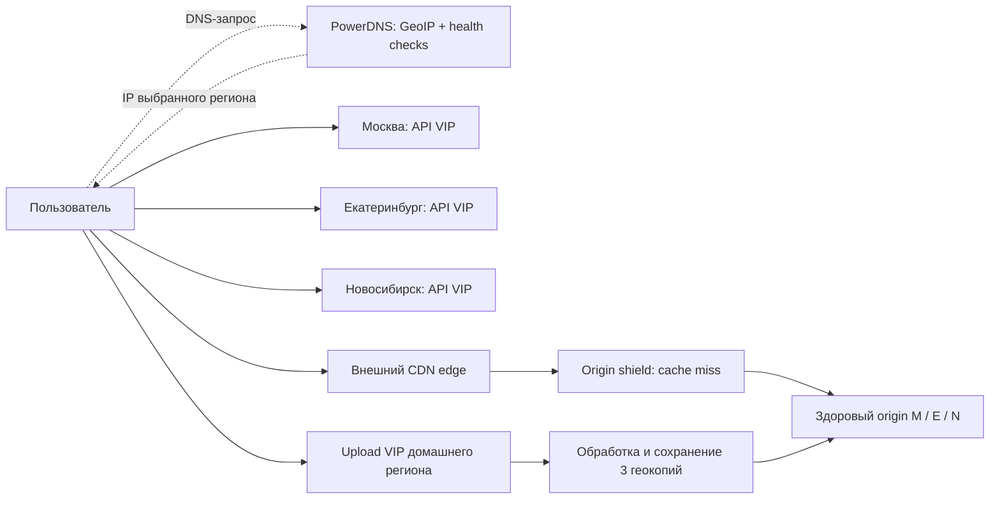

Для API и upload не используем BGP Anycast: такую схему сложнее сопровождать, а смена маршрута может оборвать активное соединение. Маршрут запросов к CDN выбирает сама CDN-платформа. Обычный DNS round-robin распределяет запросы по очереди и не учитывает ни местоположение пользователя, ни доступность приложения.

### 3.2. Распределение нагрузки

`RPS_региона = RPS_глобальный × доля региона`.

| Метод / поток | Москва, средний / пик RPS | Екатеринбург, средний / пик RPS | Новосибирск, средний / пик RPS |
| --- | ---: | ---: | ---: |
| Получение ленты | 1 442,71 / 2 885,42 | 721,35 / 1 442,71 | 721,35 / 1 442,71 |
| Чтение комментариев | 2 885,42 / 5 770,83 | 1 442,71 / 2 885,42 | 1 442,71 / 2 885,42 |
| Событие просмотра | 28 854,17 / 57 708,33 | 14 427,08 / 28 854,17 | 14 427,08 / 28 854,17 |
| Лайк | 2 885,42 / 8 656,25 | 1 442,71 / 4 328,12 | 1 442,71 / 4 328,12 |
| Комментарий | 288,54 / 865,62 | 144,27 / 432,81 | 144,27 / 432,81 |
| Поиск | 480,90 / 961,81 | 240,45 / 480,90 | 240,45 / 480,90 |
| Авторизация | 16,03 / 32,06 | 8,02 / 16,03 | 8,02 / 16,03 |
| Регистрация | 0,16 / 0,32 | 0,08 / 0,16 | 0,08 / 0,16 |
| Инициализация загрузки | 0,64 / 2,56 | 0,32 / 1,28 | 0,32 / 1,28 |
| Завершение загрузки | 0,64 / 2,56 | 0,32 / 1,28 | 0,32 / 1,28 |
| Части оригинала | 7,69 / 30,78 | 3,85 / 15,39 | 3,85 / 15,39 |
| Сегменты видео, CDN | 144 270,83 / 288 541,67 | 72 135,42 / 144 270,83 | 72 135,42 / 144 270,83 |

Таблица показывает средний поток и обычный суточный пик без коэффициента запаса. В ДЗ 4 мощность рассчитывается на этот пик **с запасом ×2** из ДЗ 2.2 и с аварийными долями ДЗ 3.3. Внутренние обращения ленты считаются отдельно по профилю ДЗ 5–7 и не суммируются с внешним ingress.

В обычном режиме пиковый поток API (запросы + ответы) для M/E/N составляет `2,261 / 1,131 / 1,131 Gbit/s`, upload — `0,953 / 0,477 / 0,477 Gbit/s`. Для origin при 90% попаданий CDN по объему — `173,125 / 86,563 / 86,563 Gbit/s`. CDN отдает зрителям `1 731,25 / 865,625 / 865,625 Gbit/s`; этот поток не проходит через API. Для выбора оборудования все эти пики дополнительно умножаются на 2; суточный трафик остается прежним.

### 3.3. Отказы и регулирование

| Состояние | Входящий API M/E/N | Origin miss M/E/N | Upload |
| --- | --- | --- | --- |
| Штатно | 50/25/25 % | 50/25/25 % | В home |
| Отказ M | 0/50/50 % | 0/50/50 % | Upload home M приостановлен |
| Отказ E | 65/0/35 % | 50/0/50 % | Upload home E приостановлен |
| Отказ N | 60/40/0 % | 50/50/0 % | Upload home N приостановлен |

API-нагрузка отказавшей Москвы делится поровну; Екатеринбурга — между Москвой и Новосибирском в пропорции 60/40; Новосибирска — между Москвой и Екатеринбургом в пропорции 40/60. Максимальные доли — **65/50/50 %**. Каждый из двух оставшихся origin должен выдерживать **50 %** общего потока при 90 % попаданий CDN. Upload остается в домашнем регионе.

TTL DNS-записи — 30 с; кэши DNS и открытые соединения могут задержать переключение. Проверки оценивают готовность API работать с кворумом ScyllaDB, а CDN отдельно исключает недоступный origin. Восстановленный регион возвращается в работу постепенно.

При отказе одного ЦОДа API переключается на здоровые регионы. Две оставшиеся копии ScyllaDB образуют кворум: чтение и запись метаданных продолжаются. Изолированный ЦОД без кворума не обслуживает авторитетные операции. Загрузка в отказавший home приостановлена, новые публикации ждут третьей копии файлов; уже опубликованные видео доступны через CDN и оставшиеся origin.

## 4. Локальная балансировка

### 4.1. Схема и резервирование

В каждом регионе работают физические Linux-серверы и пара LVS с Keepalived. Они обслуживают три VIP — для API, upload и origin. Один LVS активен, второй резервный (**2N при N = 1**); каждый рассчитан на весь входящий поток региона. IPVS выбирает пул NGINX по адресу назначения и порту. Пулы разделены, чтобы передача видео не отнимала ресурсы API.

В Direct Routing LVS меняет MAC-адрес назначения и направляет новое TCP-соединение на NGINX с наименьшим числом активных соединений (`least connections`). Метод учитывает длительность соединений, но не выравнивает точно загрузку CPU и объем трафика. LVS и NGINX должны находиться в одной L2-сети. VIP назначается loopback-интерфейсу, ARP-ответы для него подавляются. Запросы и TCP ACK проходят через LVS, ответы с VIP идут от NGINX напрямую, поэтому сетевые фильтры должны разрешать эту схему. Keepalived переносит VIP по VRRP и проверяет пул. Синхронизация IPVS может сохранить часть соединений при переключении, но не гарантирует их сохранность.

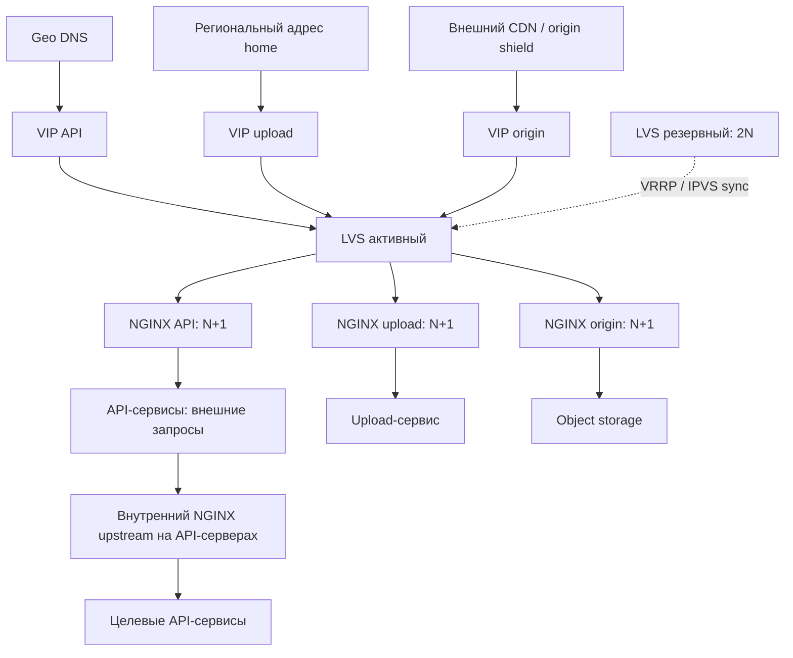

NGINX завершает TLS и распределяет HTTP-запросы через `least_conn` по числу активных соединений. Upstream-соединения переиспользуются. Состояние пользователя и загрузки хранится отдельно от API-сервера, поэтому sticky sessions не нужны.

На API-серверах внутренний NGINX направляет запросы к нужному сервису напрямую. Каждый сервис запущен как минимум в двух экземплярах на разных машинах. Точное количество определят нагрузочные испытания.

HTTP-проверки Keepalived убирают неисправный NGINX из пула LVS. Перед обновлением узел исключают из конфигурации и ждут завершения текущих запросов. После отказа одного узла остаются N серверов. Если переключился директор, клиент повторяет только безопасные запросы.

### 4.2. Производительность одного NGINX

Ориентир — тест 2019 года [5]: NGINX Ingress на Xeon Platinum 8168, 8 задействованных CPU, OpenSSL 1.1.0g. Отдельно измерены HTTPS RPS (ответ 1 KB), TLS TPS нового соединения (пустой ответ, без HT) и throughput (объекты 1 MB). Тест 2017 года [6] использует другую конфигурацию и также разделяет CPS и RPS.

| Ограничение | Ориентир [5] | 70 % для расчета |
| --- | ---: | ---: |
| HTTPS RPS | 236 703 | 165 692,1 |
| TLS CPS (SSL TPS), без HT | 31 485 | 22 039,5 |
| Поток | 8,6 Gbit/s | 6,048 Gbit/s |

На каждом узле — 8 физических ядер сопоставимой производительности, 32 GB RAM и отдельные интерфейсы 10GbE для клиентских и внутренних подключений. Предел 6,048 Gbit/s относится к каждому интерфейсу, но узким местом может стать общий канал. Память и допустимое число соединений нужно проверить испытаниями.

Запросы, TLS-соединения и сетевой поток одновременно нагружают процессор, поэтому их проверяют одним тестом с запасом 30 %. Консервативно принимаем `TLS_CPS = внешний RPS` (новое соединение на запрос); keep-alive и HTTP/2 снижают фактический CPS.

### 4.3. Число серверов

`N = ceil(max(RPS / 165 692,1; TLS_CPS / 22 039,5; Gbit/s / 6,048))`.
Здесь RPS/CPS и Gbit/s уже включают запас ×2 относительно пика ДЗ 2 и максимальные доли при отказе региона: API — 65/50/50%, origin — 50/50/50%, upload — штатные 50/25/25% без переноса из home. Запас 30% в производительности узла и дополнительный узел N+1 имеют другие назначения: ограничение загрузки и замена отказавшего узла.
В пуле устанавливаем `N+1` серверов, чтобы оставшиеся N выдерживали расчетный поток после отказа узла. Максимумы регионов относятся к разным авариям; их одновременный учет создает запас мощности.

| Пул / регион | Расчетный RPS = CPS, пик ×2 | Поток, Gbit/s, пик ×2 | N по RPS / TLS / сети | Установлено N+1 |
| --- | ---: | ---: | --- | ---: |
| API, Москва | 199 903,01 | 5,879 | 2 / 10 / 1 | 11 |
| API, Екатеринбург | 153 771,55 | 4,522 | 1 / 7 / 1 | 8 |
| API, Новосибирск | 153 771,55 | 4,522 | 1 / 7 / 1 | 8 |
| Upload, Москва | 61,56 | 1,906 | 1 / 1 / 1 | 2 |
| Upload, Екатеринбург | 30,78 | 0,953 | 1 / 1 / 1 | 2 |
| Upload, Новосибирск | 30,78 | 0,953 | 1 / 1 / 1 | 2 |
| Origin, Москва | 57 708,33 | 346,250 | 1 / 3 / 58 | 59 |
| Origin, Екатеринбург | 57 708,33 | 346,250 | 1 / 3 / 58 | 59 |
| Origin, Новосибирск | 57 708,33 | 346,250 | 1 / 3 / 58 | 59 |

Пулам NGINX требуется **72 / 69 / 69** серверов в M/E/N (**210** всего), LVS — **2 на регион** (**6** всего). DNS, приложения, хранилище, транскодирование и CDN сюда не включены. Origin ограничен сетью: `ceil(346,25 / 6,048) = 58`; после отказа одного узла остаются `58 × 6,048 = 350,784 Gbit/s`. Для API после отказа узла M дает `10 × 22 039,5 = 220 395 CPS > 199 903,02`, E/N — `7 × 22 039,5 = 154 276,5 CPS > 153 771,55`.

Входящий поток origin оценивается как 10% ответного для ACK и TLS/заголовков плюс 1 500 B на запрос: `34,625 + 57 708,33 × 1 500 × 8 / 10⁹ = 35,3175 Gbit/s`. Это обратное направление полнодуплексного канала; оно не складывается с исходящими 346,25 Gbit/s для проверки одного направления. Расчет покрывает прокси: региональные каналы и хранилище также должны выдержать этот поток плюс репликацию, repair и остальные сервисы.

### 4.4. Проверка L4 и условий отказа

У каждого LVS отдельные 100GbE front/back подключения с проектным пределом **70 Gbit/s на интерфейс и 100 млн pps**. Это требования к стенду, а не производительность, гарантируемая маркировкой сетевой карты.

Для верхней оценки M учитываем весь двунаправленный API из ДЗ 2.3, хотя ответы обходят LVS, upload и входящий origin: `5,8786 + 1,906 + 35,3175 = 43,1021 Gbit/s`. Для E/N — `4,522 + 0,953 + 35,3175 = 40,7925 Gbit/s`. Округляем до **44 Gbit/s**, ниже 70. При размере пакета 64 B верхняя оценка — `44 × 10⁹ / (64 × 8) = 85,9375 млн pps`; цель **100 млн pps** покрывает ее. Физические накладные расходы Ethernet проверяются на стенде отдельно.

CPS M: `199 903,02 + 61,56 + 57 708,33 = 257 672,91`; E/N — `153 771,55 + 30,78 + 57 708,33 = 211 510,66`. Тест пары при выключенном директоре должен подтвердить **260 тыс. новых соединений/с**, до **44 Gbit/s / 100 млн pps**, с проверкой IPVS, памяти, задержек и ошибок. Эти пределы проверяются одновременно на смешанном профиле; если цель не достигается, нужно разбить VIP между дополнительными независимыми парами или изменить конфигурацию и повторить расчет.

Схема рассчитана на отказ одного региона и одного NGINX в каждом оставшемся пуле либо на отказ одного LVS при исправной локальной сети. Два отказа в одном пуле превышают резерв N+1. Количество приложений и узлов хранения определяется отдельно, поэтому расчет балансировщиков не доказывает мощность всей системы.

### 4.5. Таймауты и повторы

Для API заданы connect timeout 0,5 с и read timeout 2 с. Чтение повторяется не более раза на другом upstream, общий лимит — 3 с. Загрузка прерывается после 60 с без прогресса; повтор части использует прежние upload ID и номер. Для origin заданы connect timeout 1 с и read inactivity 10 с; при ошибке CDN повторяет GET к другой копии. Значения уточнят по измеренным квантилям времени ответа.

Если ответ на POST лайка, комментария или завершения загрузки не пришел, клиент повторяет запрос с тем же ключом идемпотентности: приложение возвращает сохраненный результат, не создавая дубль. ID события позволяет отбросить повтор. События обрабатываются отдельно от формирования ответа ленты.

## 5. Логическая схема БД

Схемы показывают сущности, поля и логические связи без привязки к СУБД и шардингу. `PK`, `FK`, `UK` — первичный, внешний и уникальный ключи. Состав бизнес-данных отделен от физического представления в разделе 6; технические гарантии обработки уточнены при переходе на ScyllaDB.

**Аккаунты, контент, поиск и состояние**

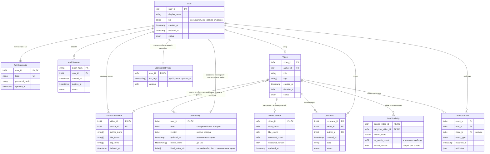

**Файлы, кэши и буферы**

```mermaid
erDiagram
    OriginalMedia {
        int64 video_id PK, FK
        string object_ref
        int64 size_bytes
        string checksum
        int64[] region_copies
        timestamp created_at
        timestamp expires_at
    }
    VideoVariant {
        int64 video_id PK, FK
        enum quality PK
        string object_ref
        int64 size_bytes
        enum status
        int64[] region_copies
        blob segment_ranges
    }
    UploadSession {
        int64 upload_id PK
        int64 user_id FK
        int64 video_id FK
        timestamp created_at
        timestamp expires_at
        enum state
        string staging_ref
        blob received_parts
    }
    TranscodeTaskQueue {
        int64 task_id PK
        int64 video_id FK
        enum quality
        timestamp created_at
        int64 attempt
        enum state
        timestamp expires_at
    }
    ProductEventBuffer {
        int64 event_id PK
        int64 user_id FK
        int64 video_id FK "nullable"
        enum event_type
        timestamp occurred_at
        json attributes
        enum state
        timestamp expires_at
    }
    CounterBuffer {
        string source_event_id PK
        int64 video_id FK
        enum counter_kind
        int64 delta
        timestamp created_at
        timestamp expires_at
        enum applied_state
    }
    CandidateEntry {
        int64 video_id FK
        string[] tags
        int64 popularity
        int32 duration_s
        timestamp published_at
        string eligibility "регион, возраст, модерация"
    }
    CandidatePool {
        string pool_key PK
        CandidateEntry[] candidates
        int64 version
        timestamp generated_at
    }
    FeedCache {
        int64 user_id PK, FK
        int64 feed_id PK
        int64[] video_ids
        timestamp created_at
        timestamp expires_at
    }
    IdempotencyRecord {
        int64 user_id PK, FK
        enum operation PK
        string target_ref PK
        string operation_id PK
        string request_hash
        string result_ref
        timestamp created_at
        timestamp expires_at
    }

    Video ||--o| OriginalMedia : "временный оригинал"
    Video ||--o{ VideoVariant : "до трех качеств"
    User ||--o{ UploadSession : "загружает"
    Video ||--o| UploadSession : "получает"
    Video ||--o{ TranscodeTaskQueue : "задачи обработки"
    User ||--o{ ProductEventBuffer : "действия"
    Video |o--o{ ProductEventBuffer : "объект действия"
    Video ||--o{ CounterBuffer : "изменения метрик"
    CandidatePool ||--o{ CandidateEntry : "теговые, популярные и свежие списки"
    Video ||--o{ CandidateEntry : "источник снимка ID и тегов"
    VideoCounter ||--o{ CandidateEntry : "источник популярности"
    UserInterestProfile ||--o{ FeedCache : "вход для генерации и ранжирования"
    User ||--o{ FeedCache : "страницы ленты"
    Video }o--o{ FeedCache : "ролики страницы"
    User ||--o{ IdempotencyRecord : "результат операции"
```

### 5.1. Назначение данных и потоков

`CandidateEntry` — вложенное значение снимка `CandidatePool`, а не самостоятельная таблица или сущность физического хранения. Связи с `Video` и `VideoCounter` обозначают логические ссылки и источники данных; физическая проверка FK здесь не задается. `video_id` копируется из `Video`, `tags` содержит его теги без повторов, `popularity` — снимок `VideoCounter.view_count`. При сборке пула пропускаются удаленные и неопубликованные ролики; копируемые в CandidateEntry поля eligibility позволяют фильтровать контент по региону, возрасту и модерации без отдельного чтения Video на каждого кандидата.

`Video` хранит название, теги и длительность; `SearchDocument` — перестраиваемую копию для поиска по ролику и автору. Обработчик просмотров обновляет историю в `UserActivity` и дельту счетчика; лайк сразу меняет полный набор лайков и асинхронно обновляет счетчик. Публичные счетчики хранятся в `VideoCounter`.

`UserActivity.recent_views` — кольцевой список до 100 просмотров, а `liked_video_ids` сохраняется полностью и независимо от лимита истории. Логическое состояние возникает при первом просмотре или лайке; отсутствие истории означает пустой список, отсутствие лайка — отсутствие ID в наборе. `head`, `version` и `updated_at` описывают только недавнюю историю; общей атомарной версии истории и всего набора лайков нет. Количество лайков отдельно не хранится. Физическое представление определено в разделе 6.

В истории хранятся до 100 просмотров: ID ролика, время обработки, длительность просмотра и ролика, отметка уже учтенного лайка. Бюджет одной записи — 32 B.

`UserInterestProfile` хранит до 20 тегов с весами интереса. Обработчик событий обновляет профиль по просмотрам и лайкам; старые интересы постепенно затухают. Запрос ленты читает готовый профиль, а не пересчитывает его из истории.

`ItemSimilarity` хранит до 100 похожих видео на ролик. Сходство рассчитывается offline по совместным просмотрам. `CandidatePool` содержит общие списки по тегам, популярности и новизне. Генераторы читают эти данные по ключам; алгоритмы и порядок выдачи описаны в ДЗ 7.1.

`ProductEvent` хранит сырые события действий MVP за 30 дней для аналитики; более старую пользовательскую статистику MVP не обещает. Обработчик истории читает поток событий независимо от загрузки в DWH; онлайн-сборка ленты не сканирует `ProductEvent` в ClickHouse и не отправляет туда запросы за историей пользователя.

Публикация — отдельное состояние `VideoProcessingState`: готовность трех качеств и их копий по регионам не выводится из наличия одного объекта. До отметки `PUBLISHED` видео не попадает в поиск и CandidatePool.

Файлы хранятся как объекты по `object_ref`; staging содержит части загрузки. После сборки объем оригинала учитывается один раз. Оригинал удаляется после готовности вариантов и их региональных копий; штатное окно — до 24 ч. `segment_ranges` описывает диапазоны внутри варианта видео.

### 5.2. Объемы и нагрузка

Объемы — для одной копии, без расходов СУБД. Нагрузка — пик без запаса ×2. Чтение считается по строкам, кроме запросов поиска, списков истории/ленты и пакетов лайков до 20 ID. Запись — логические изменения, для очередей — добавление и подтверждение сообщений.

**Постоянные данные**

| Данные | Количество × размер | Объем | Чтение/с | Запись/с |
| --- | --- | ---: | --- | --- |
| User | 113 млн × 488 B | 55,144 GB | 384 786,34 | 0,64 |
| AuthCredential | 113 млн × 512 B | 57,856 GB | 64,76 | 0,64 |
| Video | 202,21 млн × 2 000 B | 404,420 GB | 288 415,97 + до 1 731 250 для соседей + 115 416,67 проверок страницы | 15,39 |
| SearchDocument | 202,21 млн × 1 000 B | 202,210 GB | 1 923,61 запросов | 5,13 |
| VideoVariant, файлы | 606,63 млн × 6,5625 MB | 3 981,009 TB | 57 708,33 origin-запросов | 15,39 файлов |
| UserHistory + UserVideoState | 113 млн × 3 232 B + 909,945 млрд × 8 B | 7,645 TB | 5 770,83 чтения истории при cache miss ленты + 17 312,50 для обработки лайков | 115 416,67 просмотров; 17 312,50 лайков |
| Comment | 90,9945 млрд × 512 B | 46,589 TB | 230 833,33 | 1 731,25 |
| ProductEvent, 30 дней | 191,051055 млрд × 200 B | 38,210 TB | Аналитика отдельно | 153 766,42 |
| VideoCounterById | 202,21 млн × 40 B | 8,088 GB | 153 955,56 | Пакетные snapshots; частота зависит от числа активных видео и интервала, не равна числу входных событий |

User — средний бюджет 488 B, включая имя и bio. UserHistory: 32 B заголовка + 100 × 32 B просмотров на аккаунт; лайки учитываются по 8 B/ID, без отдельного счетчика. Оценка предполагает заполненную историю у всех аккаунтов и считает каждый лайк новым добавлением. Счетчики хранятся снимками по 40 B; их запись пакетная и определяется числом активных видео и периодом сброса, а не количеством событий.

При промахе кэша лента читает профиль, недавние просмотры, готовые списки кандидатов и метаданные найденных соседей. Проверять лайки для каждого из 100 просмотров больше не требуется. Повторные страницы читаются из FeedCache; перед показом проверяется доступность роликов.

**Временные данные и кэши**

| Данные | Окно / размер | Объем на пике | Чтение/с | Запись/с |
| --- | --- | ---: | ---: | ---: |
| AuthSession | 10 дней / 256 B | 14,182 GB | 153 706,79 | 64,12 |
| OriginalMedia и staging | 24 ч / 46,44 MB | 20,582 TB | 15,39 оригиналов | 61,56 частей |
| UploadSession | 24 ч / 256 B | 113,459 MB | 66,69 | 71,81 |
| TranscodeTaskQueue | 1 ч / 256 B | 14,182 MB | 15,39 | 30,78 |
| ProductEventBuffer | 60 с / 200 B | 1,845 GB | 153 766,42 | 307 532,84 |
| CounterBuffer / входной журнал | 60 с / 64 B | 516,328 MB | 134 460,42 | 268 920,83 дельта-сообщений: прием + подтверждение |
| CandidatePool: списки кандидатов | 60 с / 100 записей на тег, по 500 в popular/recent | `(19 232 × K + 192 064) B` | До 40 395,83 чтений ключей | `(K + 2) / 15` |
| UserInterestProfile | до 20 тегов, 672 B на профиль | до 75,936 GB на копию | 5 770,83 при сборке списка | до 132 729,17 просмотровых и лайковых обновлений |
| ItemSimilarityByVideo | до 100 соседей на исходное видео | `N × (32 + 100 × 16) B` | до трех списков на создание ленты | пакетный пересчет раз в сутки |
| FeedCache | 30 мин / 864 B, до 100 ID | 8,970 GB | 5 770,83 | 5 770,83 |
| IdempotencyRecord | 24 ч / 256 B | 421,458 GB | 19 054,65 | 19 054,65 |

CandidatePool содержит `K` теговых списков и два общих. Запрос читает до пяти теговых списков и двух общих; item-to-item добавляет до трех списков соседей. В оценке ItemSimilarity `N` — число видео с рассчитанными соседями, 16 B — ID и оценка соседа, 32 B — заголовок списка. Профили и индекс учитываются отдельно от базового каталога; при замене индекса временно хранятся старая и новая версии. Служебное состояние обработчиков и обучение модели требуют дополнительной емкости. Объем очередей зависит от скорости поступления и времени обработки; незавершенные записи по TTL не удаляются.

Дополнительная [сверка поиска](#102-асинхронные-потоки): в среднем 2 340,4 карточки/с из каталога и столько же проверяемых документов OpenSearch, лимит 5 000 карточек/с. Это логические карточки, не CQL QPS; при обходе физической таблицы учитываются также служебные строки. Записи — только при расхождении. Телеметрические данные ДЗ 8.2 хранятся в отдельном кластере и не входят в приведенные продуктовые объемы.

### 5.3. Консистентность и распределение нагрузки

- Логин уникален; незавершенная регистрация не дает права входа. Регистрация имеет восстанавливаемое состояние: повтор продолжает ту же операцию, успех возвращается после готовности аккаунта и учетных данных. Одновременная атомарная запись разных сущностей не требуется. Токены хранятся в виде хеша; сессия действует до истечения срока или отзыва.
- Изменение лайка/комментария согласовано с результатом операции и исходящим событием. Ключ идемпотентности имеет область `(user_id, operation, target_ref, operation_id)`, где `target_ref` обозначает целевой объект; повтор с теми же параметрами в течение 24 ч возвращает сохраненный результат, с другим содержимым — конфликт. Повторная доставка события не создает вторую дельту в пределах поддерживаемого окна повторов.
- История и профиль интересов обновляются одним обработчиком по user_id. Повторы событий отсекаются по event_id. Состояние и позиция обработки сохраняются согласованно; в ScyllaDB передаются версионированные снимки, поэтому повтор записи не начисляет интерес заново.
- Счетчики группируются по `video_id`: один Kafka partition key направляет события видео одному последовательному обработчику. Обработчик складывает дельты и пакетно публикует абсолютный снимок с возрастающей версией; принимающая сторона применяет только версию новее сохраненной. Повтор снимка не прибавляет счетчик второй раз. События и состояние не разносятся по полосам одного видео. Чтение медиа обслуживает CDN.
- Обработчик обновляет историю и профиль интересов с целевой задержкой до 5 с; счетчики — до 25 с, CandidatePool — до 15 с; поисковый индекс может отставать до минуты. ItemSimilarity пересчитывается offline по 30-дневному окну; допустимое отставание и расписание — проектные параметры, качество требует проверки. FeedCache хранит готовый список до 30 минут. При недоступности профиля применяются общие генераторы popular/recent; при пустой истории — те же генераторы. При отставании используются последние версии профиля, индекса и списка.

## 6. Физическая схема БД

### 6.1. Выбор хранилищ

ScyllaDB хранит оперативные данные: аккаунты, лайки, историю, карточки видео и комментарии. Основные запросы обращаются по известному ключу, поэтому таблицы строятся под эти запросы. LWT — условная атомарная запись — объединяет изменения только внутри одной таблицы и партиции [13]. Используется версия с поддержкой LWT и CDC для tablets [25].

Kafka передает события и задания, ClickHouse хранит аналитику, OpenSearch обслуживает поиск, Ceph — видеофайлы, Redis — восстанавливаемый кэш. В ScyllaDB находятся метаданные файлов и ссылки на объекты.

### 6.2. Таблицы и ключи ScyllaDB

Схема показывает таблицы и их связи; ключи приведены ниже. Связи проверяет приложение.

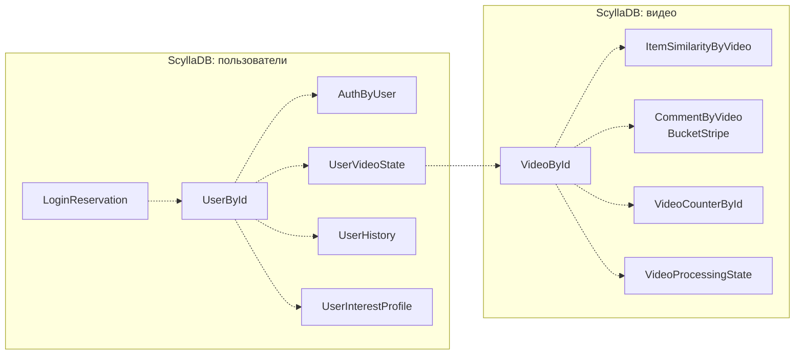

PK — ключ партиции; CK — порядок строк внутри нее. row_kind различает состояние, результат операции и исходящее событие.

| Таблица | PK | CK |
| --- | --- | --- |
| UserById | user_id | row_kind, row_id |
| LoginReservation | login_norm | — |
| AuthByUser | user_id | row_kind, token_hash |
| UserVideoState | user_id, video_id | row_kind, row_id |
| UserHistory | user_id | row_kind, row_id |
| VideoById | video_id | row_kind, item_id |
| VideoCounterById | video_id | row_kind (текущий снимок; snapshot_version — поле) |
| UserInterestProfile | user_id | row_kind (текущий профиль; profile_version — поле) |
| ItemSimilarityByVideo | index_version, source_video_id | score DESC, neighbor_video_id |
| CommentByVideoBucketStripe | video_id, time_bucket, stripe | row_kind, created_at DESC, comment_id DESC, row_id |
| VideoProcessingState | video_id | row_kind, item_id |

Бизнес-поля описаны в ДЗ5. Дополнительно хранятся версии, request_hash, результат операции и состояние доставки события. Незавершенные события не удаляются по TTL.

UserActivity физически состоит из истории до 100 просмотров и независимых лайков; head/version относятся только к истории. VideoById объединяет карточку, метаданные оригинала и качеств, каталог интервалов комментариев. UserInterestProfile хранит до 20 тегов и версию, ItemSimilarityByVideo — до 100 offline соседей на видео. VideoProcessingState хранит загрузку и задания обработки; сами файлы находятся в Ceph.

### 6.3. Запись, повторы и производные данные

- **Регистрация:** LWT резервирует нормализованный логин, затем создается аккаунт PENDING, активируется резерв и аккаунт. Незавершенный шаг можно продолжить; вход разрешен только после завершения. Хеш пароля хранится в LoginReservation.
- **Лайк и комментарий:** состояние, результат запроса и исходящее событие сохраняются одной LWT в своей таблице и партиции. Ключ повтора — `(user_id, operation, target_ref, operation_id)`, срок — 24 ч. Другой payload с тем же ключом отклоняется. Подписанный operation_id комментария закрепляет его ID, время, интервал и полосу: повтор не меняет маршрут.
- **Просмотры:** API отправляет событие непосредственно в Kafka и подтверждает прием после `acks=all`; при повторе сохраняется event_id. Отдельная авторитетная запись просмотра в ScyllaDB до Kafka не создается; историю/интересы обновляет потребитель с дедупликацией.
- **История и профиль:** события дедуплицируются по event_id, затем обрабатываются по user_id. Kafka Streams согласованно сохраняет состояние, выходные снимки и позицию чтения. ScyllaDB принимает только более новую версию снимка; общая транзакция Kafka–ScyllaDB не требуется [26].
- **Счетчики:** ключ Kafka — video_id. Один обработчик последовательно суммирует события ролика и раз в несколько секунд записывает абсолютный итог с версией. Повторы событий отсекаются, повторная запись того же снимка итог не увеличивает. После сбоя обработчик восстанавливается из журнала. Это сокращает записи в БД; пропускную способность на самом популярном видео нужно проверить отдельно.
- **Публикация и поиск:** переход карточки в PUBLISHED и outbox-событие фиксируются одной LWT в партиции VideoById; индексатор читает Kafka и проверяет каждый результат Bulk. Фоновая сверка и версионированные tombstone описаны в [§10.2](#102-асинхронные-потоки).
- **Доставка:** CDC читает исходящие записи с QUORUM и передает их в Kafka. Возможны повторы; потребители проверяют event_id. При отставании за пределы хранения CDC отдельная задача повторно отправляет неподтвержденные исходящие записи. Единой транзакции ScyllaDB–Kafka нет [15], [19].
- **Авторизация:** сессии и auth_epoch находятся в одной пользовательской партиции. Выпуск и отзыв используют LWT; проверки, начатые после подтвержденного отзыва, читают актуальное состояние с QUORUM. При неопределенном результате LWT выполняется SERIAL-чтение и повтор по исходному ключу.

`UserInterestProfile` и `UserHistory` хранят текущие снимки, а не все версии. `ItemSimilarityByVideo` пересчитывается offline и публикуется целиком под новой index_version; после переключения запросы используют один согласованный выпуск индекса. Старый выпуск удаляется после истечения связанных кэшей.

`CandidatePool` обновляется отдельным обработчиком изменений каталога и счетчиков. Раз в 15 с он публикует в Redis top-100 по каждому тегу, общий top-500 популярных и 500 свежих роликов. Состояние каталога и теговый индекс восстанавливаются из снимка актуального каталога и доступного хвоста журнала; 24-часовой журнал не содержит весь многолетний каталог. Удаленные и неопубликованные видео в списки не включаются; запрос ленты каталог не сканирует.

### 6.4. Репликация и отказ ЦОДа

NetworkTopologyStrategy задает число копий отдельно по ЦОДам: `M: 1, E: 1, N: 1` (Москва, Екатеринбург, Новосибирск). Итого три копии каждой партиции, по одной в каждом ЦОДе. Запись и авторитетное чтение используют QUORUM — две копии из трех. LWT использует глобальный SERIAL и фиксацию QUORUM [21]. Кэш применяется для карточек с допустимым отставанием, но не заменяет проверку собственного лайка или сессии.

При отказе одного ЦОДа оставшиеся два продолжают чтение и запись. Изолированный ЦОД не может подтвердить запись в одиночку. Подтвержденные данные переживают потерю одного ЦОДа (RPO=0 для этого сценария); при таймауте исход операции проверяется по ее ID. Для отказного режима в оставшихся ЦОДах предусматривается запас ресурсов. Межрегиональный кворум добавляет задержку и служебный трафик — это цена выбранной сохранности.

Домашний регион сохраняется для загрузки файлов. Новые ролики публикуются после готовности файлов во всех трех ЦОДах; при недоступности одного публикация ждет. Уже опубликованные видео доступны через CDN и оставшиеся origin.

### 6.5. Разбиение данных и расширение

Маршрут: **ключ партиции -> token -> tablet -> узлы с копиями**. Tablets — переносимые диапазоны таблицы, а не серверы [14].

Полезный объем на копию: аккаунты — 113 GB, метаданные видео — 404 GB, история и лайки — 7,64 TB, комментарии — 46,59 TB. Для каждой таблицы отдельно учитываем ключи, версии, квитанции за 8 суток и рост, затем три копии, журналы, backup и резерв при отказе/переносе. Число диапазонов зависит от объема и нагрузки; число узлов — от емкости и производительности оборудования.

Комментарии делятся на суточные интервалы и полосы; чтение объединяет результаты по времени и курсору. Счетчики хранятся одной записью на видео и обновляются пакетно одним обработчиком. События одного видео между независимыми потоками не распределяются.

**Добавление серверов:** ScyllaDB копирует выбранные tablets, догоняет изменения и переключает карту размещения; затем освобождает старые копии. Запросы продолжаются через драйвер, хеш ID не меняется. Прерванный перенос повторяется с сохранением действующих реплик и согласованной карты.

**Изменение ключей:** новая раскладка комментариев вводится со следующего интервала; старые читаются по прежней версии. Смена числа Kafka-разделов выполняется с сохранением порядка ключа и позиции обработки; опубликованные снимки сохраняют монотонную версию. Приемник игнорирует устаревшие повторы. Число Kafka-разделов меняется отдельно, с сохранением порядка событий по ключу.

### 6.6. Остальные системы, клиенты и backup

| Система | Разделение и копии | Доступ и хранение |
| --- | --- | --- |
| Kafka | 256 разделов пользовательских событий по user_id; разделы счетчиков по `video_id`; задания публикации по `video_id`; RF=3, по реплике в M/E/N через rack-aware placement | acks=all, min.insync.replicas=2; сообщения 24 ч, позиции групп; compacted changelog [15]. Число разделов — проектный параметр; нагрузку одного горячего video_id проверить измерением |
| ClickHouse | 16 шардов по event_id, по реплике каждого шарда в M/E/N | Секции по дням; ORDER BY (event_date,event_id); 30 дней; ReplicatedReplacingMergeTree + FINAL [16], [29]; репликация асинхронная |
| OpenSearch | 32 primary shards по video_id, две реплики; три копии каждого шарда разнесены по M/E/N через allocation awareness | Поиск по автору, названию и тегам; обновление по версии [20] |
| Ceph | Три геокопии; EC 8+4 внутри региона | S3 multipart upload и чтение диапазонов [18] |
| Redis | Cluster в каждом регионе: минимум три primary для разных hash slots, у каждого две реплики на других хостах | Карточки, CandidatePool (60 с), FeedCache (30 мин) [17] |

На шард ClickHouse приходится около 2,39 TB полезных событий, OpenSearch — 6,32 GB документов. Это начальная оценка; их расширение не связано с tablets ScyllaDB.

| Система | Go-клиент | Маршрутизация |
| --- | --- | --- |
| ScyllaDB | gocql | Partition key и карта кластера, shard-aware routing [23] |
| Kafka: API и доставка | franz-go | Лидер раздела; commit после сохранения состояния; ключ счетчика — video_id; один раздел имеет одного последовательного владельца |
| Kafka Streams: агрегация | Java Streams API | exactly_once_v2; state/changelog и output topics в одной транзакции |
| ClickHouse | clickhouse-go/v2 | Пакетная запись и распределенные выборки |
| OpenSearch | opensearch-go | Bulk API и coordinating nodes |
| Redis | go-redis/v9 | По hash slot |
| Ceph RGW | AWS SDK for Go v2 | Региональный S3 endpoint |

Кворумы служебных компонентов и параметры локального резервирования приведены в [§10.1](#101-резервирование-компонентов). Драйверы переиспользуют ограниченное число соединений; приложение ограничивает параллелизм пакетных чтений.

**Backup:** ежедневные снимки ScyllaDB Manager за 4 недели [24]; архив Kafka/CDC с позициями — 7 дней; ежедневные backup/snapshot ClickHouse и OpenSearch — 7 дней. Видео имеет независимую копию и checksum, удаленные версии сохраняются 30 дней. Redis пересобирается.

Восстановление идет в отдельный кластер: проверка позиций, версий и квитанций, затем доступный хвост журнала. Снимки не дают общей атомарной точки всех таблиц; непокрытый журналом разрыв восстановить до последнего события нельзя. Производительность и время восстановления требуют проверки на оборудовании.

## 7. Алгоритмы

### 7.1. Персональная лента

**Задача.** По действиям пользователя выбрать подходящие ролики и выдавать их страницами по 20. Подготовка признаков и индексов выполняется вне пользовательского запроса; online используются готовые данные. Лента строится при обращении активного пользователя, а не пересчитывается по расписанию для всей аудитории.

**Подготовка данных.**

- **Интересы пользователя.** Обработчик просмотров и лайков обновляет `UserInterestProfile`: до 20 тегов с весами. Вклад просмотра — `min(1, watched_ms / (1000 × duration_s))`. Лайк добавляет такой же бонус для соответствующих просмотров из недавней истории; отметка в записи защищает от повторного начисления. Снятие лайка не отменяет исторический сигнал. Старые веса затухают по `exp(-Δt / 14 дней)`. Интересы обновляются по событиям, без повторного обхода всей истории.
- **Похожие видео — item-to-item.** Раз в сутки пакетная задача берет просмотры за 30 дней: выборку 1 % пользователей и до 20 последних уникальных видео на пользователя. Быстрые пропуски с долей просмотра меньше 0,1 исключаются. Для каждой пары считаются число совместных зрителей `c(i,j)` и число зрителей каждого видео `n(i)`. Сходство: `c(i,j) / sqrt(n(i) × n(j))`. В `ItemSimilarityByVideo` сохраняются 100 ближайших соседей каждого ролика. Пары и счетчики считаются пакетно; индивидуальные ленты всех пользователей не строятся.
- **Общие списки.** Обработчик каталога поддерживает `CandidatePool`: списки по тегам, популярности и времени публикации. Они обновляются раз в 15 с и доступны по ключам в Redis.

**Генераторы кандидатов.** При отсутствии готовой ленты Feed API читает профиль и последние 100 просмотров. Из независимых источников собирается до 1 000 кандидатов:

| Источник | Как выбираются ролики | Лимит |
| --- | --- | ---: |
| Item-to-item | Соседи трех последних видео с долей просмотра не ниже 0,1; чтение по video_id | 300 |
| По интересам | Списки пяти наиболее весомых тегов; отбор по кругу между списками | 300 |
| Популярные | Ролики из общего списка по числу просмотров | 200 |
| Новые | Ролики по времени публикации | 200 |

Дубликаты, последние просмотренные и недоступные видео удаляются. Для соседей метаданные читаются пакетом из `VideoById`, для остальных они вложены в `CandidateEntry`. Новый пользователь получает популярные и новые ролики; новое видео попадает через новизну и теги, не ожидая накопления совместных просмотров.

**Ранжирование.** L1 отбирает до 100 кандидатов по кругу из непустых источников, сохраняя их внутренний порядок: по сходству для item-to-item, весу тега для интересов, просмотрам для популярных и дате для новых. L2 — отдельный CatBoost-классификатор [27]: по сходству с просмотренными, совпадению тегов, популярности, свежести и длительности ролика оценивает содержательный просмотр относительно быстрого пропуска. Кандидаты сортируются по оценке; при равенстве — по video_id. Вес тегов здесь является пользовательским признаком, а не всем алгоритмом рекомендаций.

Модель обучается offline на выборке просмотров: просмотр не менее половины ролика — положительный пример, менее 10 % — отрицательный. Признаки сохраняются до просмотра, чтобы результат просмотра не попал во входы модели. Проверка проводится на более позднем периоде; влияние на качество ленты оценивается экспериментом. При недоступности модели используется порядок L1.

**Выдача и кэш.** До 100 ID сохраняются в `FeedCache` на 30 минут. Страницы используют общий `feed_id` и смещение. При промахе лента строится по готовому профилю и индексам, без пересчёта истории. При отказе одного источника кандидатов используются остальные, пока доступен Redis. Перед выдачей Video API проверяет ролики. Пути на случай отказа L2 и Redis описаны в [§10.3](#103-деградация-ленты-при-отказах).

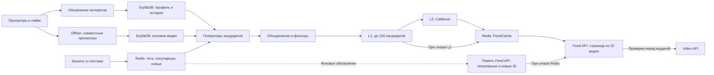

**Выбор и нагрузка.** Item-to-item дает персональные кандидаты через короткие списки соседей; теги дополняют его там, где совместных просмотров мало. L1 ограничивает стоимость L2, а CatBoost учитывает сочетания признаков вместо одной суммы весов. Offline считаются только пары внутри ограниченной выборки, online нет перебора каталога или всей аудитории.

### 7.2. Возобновляемая публикация видео

**Блок и задача.** Pipeline принимает готовый ролик до трех минут, создает варианты 480p, 720p и 1080p и делает его видимым только после сохранения копий во всех трех регионах. Вход — завершенная multipart-загрузка, `video_id`, checksum и версия публикации. Выход — подтвержденные метаданные и девять сочетаний «качество × регион», после которых статус видео становится `PUBLISHED`.

**Последовательность.**

1. После завершения загрузки сохранить неизменный `publication_id` и три идемпотентных задания транскодирования. Повтор завершения с тем же ID возвращает текущее состояние той же публикации.
2. Для каждого качества выполнить транскодирование и сохранить объект с `object_ref`, checksum, размером и статусом. Попытки получают отдельные неизменяемые object key; актуальность результата определяется сохраненным номером попытки, чтобы опоздавшая попытка не заменила выбранный объект.
3. Проверить результат и скопировать готовые варианты в два остальных региона. `VideoProcessingState` хранит состояние каждого качества и каждой из девяти копий; ошибка или таймаут повторяет только незавершенный шаг. При недоступности региона публикация ожидает его восстановления.
4. Когда готовы все девять копий вариантов и проверены временные копии оригинала во всех трех регионах, зафиксировать READY-манифест. Затем одним conditional batch в партиции `VideoById(video_id)` сохранить переход в `PUBLISHED`, новую версию и outbox-событие для поиска и пула; доставка в Kafka выполняется через CDC. Если процесс упал между этими шагами, повтор продолжает его по сохраненному состоянию. Оригинал удаляется только после подтверждения готовности производных объектов и их копий.

**Структуры и связь с БД.** `UploadSession` и staging хранят состояние приема частей; `VideoProcessingState` — задания, версии попыток, статусы и копии; `VideoById` — пользовательскую карточку, ссылки и статус публикации. Сами файлы находятся в Ceph. Общей транзакции между ScyllaDB и Ceph нет: идемпотентные шаги и сохраненное состояние позволяют повторить незаконченные действия. До `PUBLISHED` видео не включается в поиск и `CandidatePool`.

**Альтернативы и выбор.** Синхронно транскодировать и копировать внутри запроса клиента означало бы держать соединение на время нескольких тяжелых операций, а сбой потребовал бы начать сценарий заново. Асинхронная цепочка разделяет шаги на задания и сохраняет результаты каждого; поэтому можно повторить конкретный незавершенный шаг. Публикация после готовности всех региональных копий следует принятому требованию доступности во всех регионах, хотя при сетевом сбое увеличивает время ожидания. Идемпотентность и immutable object keys предотвращают конфликт от повторных или запоздавших попыток.

## 8. Технологии

### 8.1. Выбор инструментов

Таблица фиксирует выбранные технологии и их роли. Альтернативы сравниваются на одном уровне; производительность проверяется на расчетном профиле нагрузки.

| Технология | Область применения | Обоснование выбора |
| --- | --- | --- |
| PowerDNS Authoritative, GeoIP, health checks | GeoDNS для API (ДЗ 3) | Управляет региональными ответами с учетом доступности API; TTL и кэши ограничивают скорость переключения. |
| Linux IPVS/LVS, Keepalived, NGINX | L4, перенос VIP, TLS и HTTP-балансировка (ДЗ 4) | LVS распределяет трафик, Keepalived переносит VIP, NGINX направляет HTTP-запросы в отдельные пулы. |
| Go, `net/http`, gRPC; HTTP/JSON | Клиентский API на HTTP/JSON; внутренние синхронные вызовы на gRPC | Один язык для сетевых сервисов; gRPC задает типизированные контракты между сервисами, HTTP/JSON — простой формат клиентского API. |
| ScyllaDB | Авторитетные записи по ключу | Таблицы и партиции соответствуют запросам; LWT обеспечивает условные переходы внутри партиции (ДЗ 6). |
| Kafka, Kafka Streams | Журнал событий, задания и потоковые агрегации | Повторное чтение событий поддерживает восстановление обработки; внешние БД обновляются отдельно. |
| ClickHouse | Продуктовая аналитика и отдельное хранилище телеметрии | Пакетная запись и запросы по временным диапазонам подходят аналитике; кластеры продукта и телеметрии изолированы. |
| OpenSearch | Поиск по автору, названию и тегам | Полнотекстовый индекс отделен от авторитетного каталога и восстанавливается из него. |
| Ceph RGW, S3 API | Видеообъекты и multipart upload | Крупные файлы масштабируются отдельно от метаданных; поддерживаются range-чтения, EC и геокопии. |
| Redis Cluster | FeedCache, CandidatePool, кэш карточек | TTL и структуры данных подходят коротким спискам; подтвержденные изменения хранятся вне кэша. |
| FFmpeg | Фоновые задания трех качеств видео | Кодирование запускается отдельно от HTTP-запроса; шаги повторяются по сохраненному состоянию (ДЗ 7.2). |
| CatBoost; Python и SQL ClickHouse | L2-ранжирование и offline-подготовка | Модель оценивает до 100 кандидатов, обучение и похожие видео рассчитываются вне online-пути (ДЗ 7.1). |
| Внешний CDN с origin shield | Доставка видео зрителям | Edge обслуживает основной поток, origin — запросы при промахе кэша; емкость сверяется с расчетом ДЗ 2.3. |
| systemd, Ansible | Запуск и обновление процессов | Соответствуют выбранным физическим серверам: локальный перезапуск и применение конфигурации по одному узлу с drain. |
| Git, GitHub Actions, Go testing, k6 | Версии, CI, функциональные и нагрузочные проверки | CI собирает артефакт и проверяет обработчики; k6 проверяет задержки и ошибки на расчетной нагрузке [40]. |
| Prometheus, Grafana, Alertmanager, OpenTelemetry Collector | Метрики, трассы, логи и оповещения | Разделяют сбор, хранение, просмотр и доставку оповещений; пути телеметрии приведены в ДЗ 8.2 [33], [35]–[39]. |

### 8.2. Наблюдаемость: от сбора до просмотра

| Данные | Путь | Проектный срок хранения |
| --- | --- | --- |
| Метрики | Приложения и exporters -> Prometheus (сбор и хранение) -> Grafana; правила -> Alertmanager | 35 дней, чтобы покрыть 30-дневное окно SLO [35] |
| Трассы | OpenTelemetry SDK -> Collector -> отдельный ClickHouse -> Grafana | 3 дня; выборка 1% запросов [36], [38], [39] |
| Логи | Структурированные логи приложения -> Collector с локальным буфером -> отдельный ClickHouse -> Grafana | 7 дней [36]–[39] |

При переполнении буфера диагностические данные могут теряться; это не задерживает ответ API. Бизнес-события и outbox идут отдельным надежным путем. В метках метрик не используются user_id/video_id.

Prometheus работает на резервируемых узлах региона. Глобальный SLI считается по суммам числителей и знаменателей регионов, без усреднения региональных процентов; пробел сбора отмечается как отсутствие данных. Телеметрический ClickHouse изолирован от продуктовой аналитики по ресурсам.

## 9. Схема проекта

### 9.1. Обзор сервисов

На входе в регион LVS распределяет соединения по пулам NGINX для API, загрузки и origin. Публичные вызовы API идут по HTTPS с JSON, внутренние вызовы сервисов — по gRPC через внутренние upstream NGINX (§4.1, §8.1). Внутренний NGINX выбирает экземпляр целевого сервиса. На схемах каждый такой вызов показан одной стрелкой. Владельцы данных показаны рядом с сервисами по принципу Database per Service из лекции 9 (слайды 14, 16, 18, 20).

**Легенда.** Рамка объединяет компоненты одного сервиса. Сплошная стрелка показывает вызов, операцию с хранилищем или следующий шаг обработки. Пунктир показывает доставку событий, фоновых заданий и результатов пакетных расчётов. Если ответ API ждёт подтверждения записи в Kafka, это указано на стрелке. R — чтение, W — запись, R/W — оба действия. Стрелки к хранилищу направлены от вызывающего компонента. Фоновые компоненты помечены словом «фон». Kafka, Ceph и области данных с одинаковыми именами на разных схемах обозначают одни и те же ресурсы.

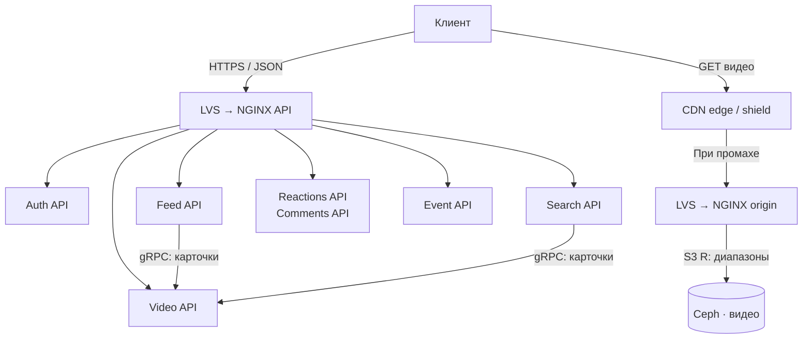

**Вход и регистрация.** Auth API проверяет учётные данные и сессии. Создание и активацию аккаунта выполняет Users API.

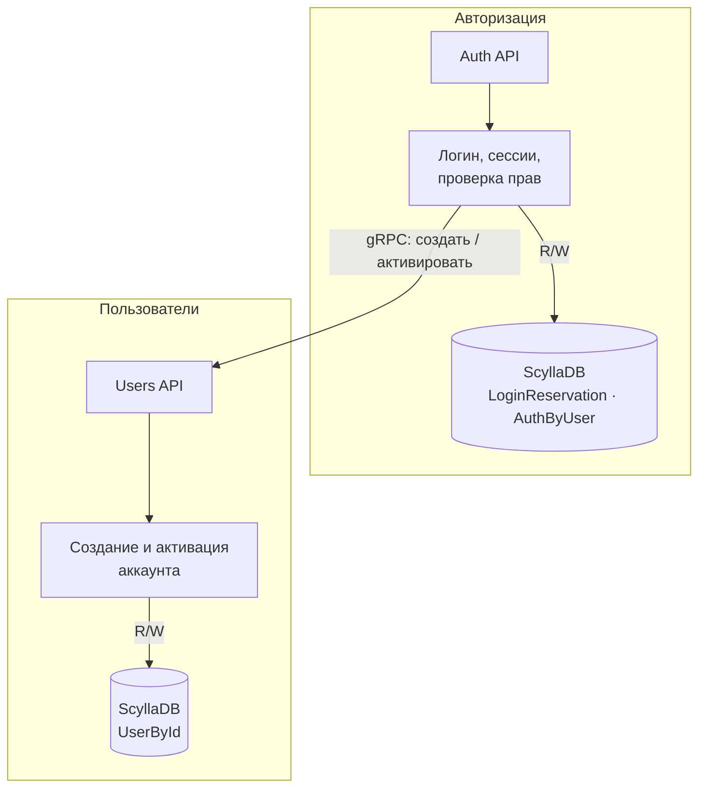

Reactions API и Comments API — отдельные точки входа. Они сгруппированы на обзоре, их обработчики показаны в §9.5. Там же показаны связи с Kafka, статистикой и DWH. Для защищённых операций API запрашивает проверку сессии в Auth API. Эти однотипные вызовы описаны здесь один раз. Видео выдаётся через CDN по ссылке из карточки. Байтами управляют origin и видеохранилище, а факт просмотра сообщает клиент отдельным запросом в Event API.

При регистрации Auth резервирует нормализованный логин, вызывает Users для создания аккаунта PENDING с тем же user_id, затем активирует резерв и аккаунт. Повтор продолжает незавершённый шаг. Вход разрешён после активации обеих записей. Auth проверяет пароль по хешу из LoginReservation и выдаёт сессию. Выпуск и отзыв сессии используют LWT, проверка читает AuthByUser с QUORUM (§6.3–6.4).

| Владелец | Область данных | Как данные доступны другим сервисам |
| --- | --- | --- |
| Авторизация | ScyllaDB: LoginReservation, AuthByUser | Auth API проверяет сессии и права |
| Пользователи | ScyllaDB: UserById | Users API управляет аккаунтом |
| Видео | ScyllaDB: VideoById, VideoProcessingState. Redis: кэш карточек. Ceph: оригиналы и варианты | Video API отдаёт карточки и статус. Каталог публикует изменения. Origin читает опубликованные медиа |
| Реакции | ScyllaDB: UserVideoState | Reactions API читает собственный лайк пользователя. Изменения доставляются в Kafka через outbox и relay |
| Комментарии | ScyllaDB: CommentByVideoBucketStripe | Comments API отдаёт страницы. Изменения доставляются в Kafka через outbox и relay |
| Рекомендации | ScyllaDB: UserHistory, UserInterestProfile, ItemSimilarityByVideo. Redis: FeedCache, CandidatePool | Feed API собирает страницы |
| Статистика | ScyllaDB: VideoCounterById | Statistics API отдаёт публичные счётчики. Снимки из Kafka обновляют CandidatePool |
| Поиск | OpenSearch: производный индекс | Search API выполняет запросы |
| DWH | ClickHouse: ProductEvent | Контур выгрузки DWH готовит выборки для пакетных задач |

ScyllaDB и региональный Redis физически могут обслуживать несколько сервисов. Области таблиц и ключей имеют владельца. Только компоненты владельца обращаются к своей области напрямую. Например, поиск и лента читают карточки пакетным gRPC-вызовом Video API, а сборщик CandidatePool получает изменения каталога и счётчиков из Kafka. Relay и приёмники снимков работают в контурах соответствующих владельцев.

### 9.2. Рекомендации

**Запрос ленты.** Feed API принимает `feed_id` и смещение. При попадании в кэш он читает готовый порядок ID, при промахе собирает до 1 000 кандидатов и передаёт до 100 на ранжирование (§7.1). Ошибка обращения к Redis включает резервный путь. Все пути к выдаче страницы сходятся на проверке через Video API.

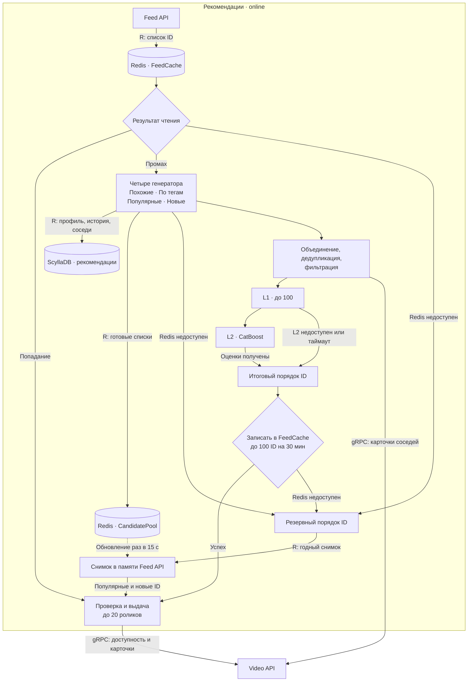

Генератор похожих читает соседей трёх недавних роликов (до 300), генератор интересов — списки пяти тегов (до 300). Популярные и новые добавляют до 200 каждый. На фильтрации исключаются дубли, просмотренное и недоступное. L1 сохраняет разнообразие источников, L2 сортирует по оценке содержательного просмотра. Для нового пользователя основа выдачи — популярные и новые ролики. Резервные ветки схемы описаны в [§10.3](#103-деградация-ленты-при-отказах).

**Подготовка данных.** Профиль и история обновляются по событиям (§9.5). Сборщик пула применяет события каталога и снимки счётчиков и каждые 15 секунд публикует списки в Redis. Суточная задача item-to-item читает выборку просмотров за 30 дней и сохраняет версию индекса соседей. Обучение CatBoost использует подготовленную offline-выборку (§7.1). Feed API использует готовую модель.

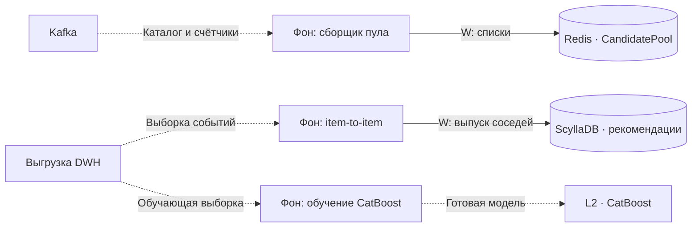

CandidatePool применяет версии карточек и счётчиков. Если локальное состояние сборщика утрачено, он восстанавливает его из каталога через Video API и сохранённых итогов через Statistics API, затем применяет хвост событий. Чтение для восстановления идёт в отдельном фоновом бюджете. Новый выпуск соседей становится доступен после завершения записи. Незаконченный расчёт оставляет активным прежний выпуск.

### 9.3. Загрузка, обработка и публикация видео

**Приём оригинала.** Video API управляет сессией и выдаёт подписанный адрес home. Части идут через выделенный пул загрузки. Номер части и upload_id сохраняются при повторе.

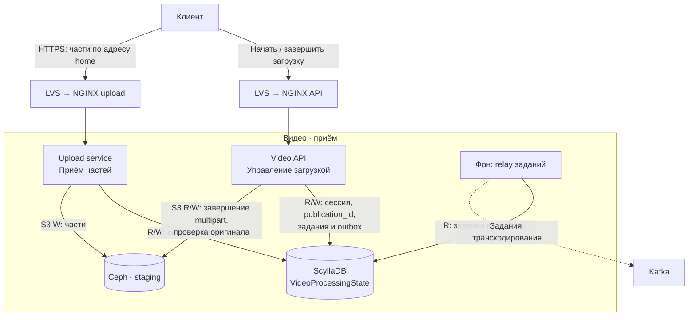

Подтверждение завершения загрузки означает, что оригинал принят и publication_id с заданиями сохранён. Для трёх качеств сохраняются устойчивые ID заданий. Relay читает исходящие записи, а Kafka переносит задания и ссылки на объекты.

**Фоновая обработка.** Worker по заданию читает оригинал, кодирует своё качество и записывает неизменяемый объект попытки. Состояние задания определяет, какой результат принят. Проверка копий фиксирует checksum и готовность по каждому качеству и региону. Из сохранённого прогресса обработка продолжает только незаконченные шаги.

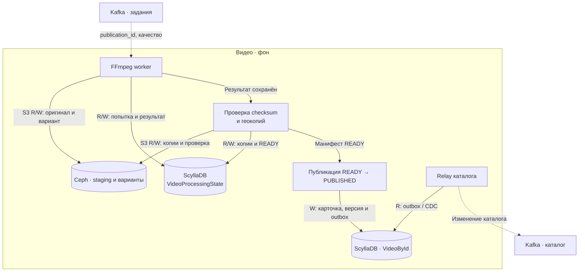

READY фиксируется после проверки девяти сочетаний «качество × регион» и временных копий оригинала в трёх регионах. Затем одна условная запись в партиции VideoById меняет статус на PUBLISHED и сохраняет версию и outbox (§7.2). При сбое после READY публикация продолжится по сохранённому манифесту. При повторе задания актуальный номер попытки защищает от запоздавшего worker. Оригинал очищается после подтверждения готовности вариантов и копий. Индексатор и сборщик CandidatePool получают событие после фиксации PUBLISHED.

### 9.4. Поиск

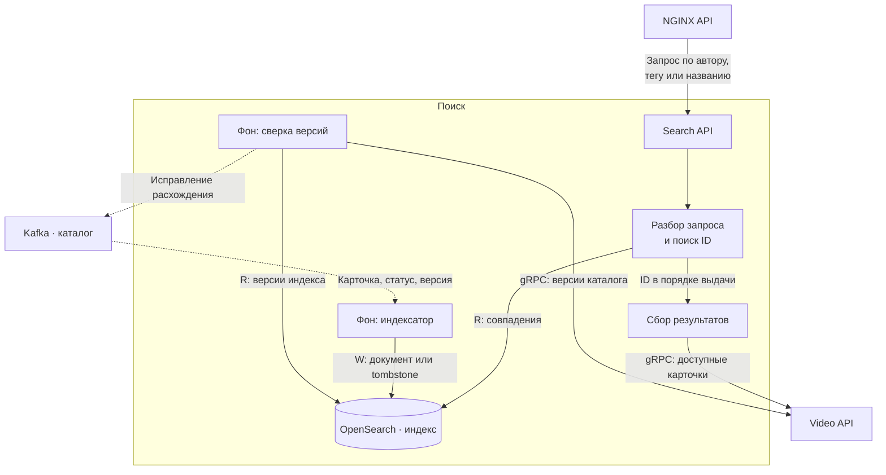

Search API извлекает ID из OpenSearch, запрашивает карточки у Video API пакетом и возвращает только доступные. Обновление индекса асинхронно. Индексатор применяет документ по video_id и версии, проверяет результаты Bulk и продвигает позицию после подтверждения обработки. Повтор той же версии даёт тот же документ. Старое событие не заменяет более новую карточку или отметку удаления. Фоновая сверка читает ID и версии через API каталога, сравнивает с индексом и отправляет актуальное состояние тем же путём.

## 10. Обеспечение надёжности

### 10.1. Резервирование компонентов

Расчётный сценарий — отказ одного ЦОДа. Трафик уходит в два оставшихся (ДЗ 3.3), а пулы NGINX выдерживают потерю ещё одного узла на пул (ДЗ 4.3). Запас приложений и хранилищ проверяем на стенде.

| Компонент | Резерв и обнаружение отказа | Что происходит |
| --- | --- | --- |
| PowerDNS / GeoDNS | По серверу в каждом ЦОДе, проверки API, TTL 30 с | Неисправный VIP убирается из новых DNS-ответов. Клиенты с кэшем переключаются позже |
| LVS, Keepalived и внешний NGINX | Пара LVS на регион, VRRP и проверки узлов. Для API, upload и origin отдельные пулы N+1 | Резервный LVS принимает VIP и обслуживает весь региональный поток. Неисправный NGINX исключается из пула |
| Внутренний NGINX и API | От двух экземпляров каждого сервиса на разных хостах, проверки готовности | Прокси выбирает здоровый экземпляр. Сессии и результаты операций хранятся вне процесса |
| ScyllaDB | По реплике в каждом ЦОДе, QUORUM 2/3. Для LWT — SERIAL + QUORUM | Два ЦОДа продолжают работу. При таймауте результат записи проверяется по ID операции |
| Kafka, Streams и приёмники снимков | RF=3, `acks=all`, минимум 2 реплики в ISR. Резерв Streams в другом ЦОДе, состояние в changelog | Kafka выбирает лидера из ISR. При ISR <2 подтверждения записи нет. Streams восстанавливает состояние из changelog [15], [26], [42] |
| Relay, сверка и фоновые задачи | Резервные исполнители, сохранённые позиции или шаги. Сигналы — отставание, возраст задания и ошибки | Новый исполнитель продолжает с сохранённой позиции. Для рекомендаций сохраняется предыдущая полная версия индекса и модели |
| ClickHouse / DWH и OpenSearch | По три геокопии каждого шарда. Контроль реплик, задержки обработки и ошибок записи | Чтение переключается на реплику. DWH догоняет журнал, индекс при необходимости строится из каталога |
| KRaft, Keeper и OpenSearch cluster-manager | У каждой системы по три голосующих узла, по одному в ЦОДе | При отказе одного узла остаётся большинство 2/3. Кворум проверяем отдельно от числа копий данных [28], [29], [31] |
| Redis и сборщик CandidatePool | В регионе от трёх primary, по две реплики на других хостах. Контроль ошибок и возраста списков | Redis выбирает реплику при большинстве primary. При недоступности кластера лента берёт локальный снимок [30] |
| Upload, FFmpeg и публикация | От двух исполнителей на разных хостах. Шаги хранятся в ScyllaDB, файлы — в Ceph | Незавершённые задания можно повторить. Загрузка в недоступный домашний ЦОД ждёт его восстановления |
| Ceph RGW и хранилище видео | Три геокопии, внутри ЦОДа EC 8+4. Проверки кворума, checksum и готовности копий | Готовое видео читается из другого ЦОДа. Новая публикация ждёт всех копий |
| CDN и origin | Несколько origin, проверки доступности и контроль доли попаданий в CDN | CDN повторяет GET через здоровый origin. При полном отказе CDN мощности origin не хватит на клиентский пик |
| Телеметрия | По два Prometheus на регион, три Alertmanager, несколько Collector и отдельный ClickHouse | При сбое приёмника события ждут в ограниченной очереди. Переполнение снижает полноту диагностики, API продолжает работать |
| Инфраструктура и резервные копии | Дубли питания и сети, региональные копии конфигураций, зашифрованные копии ключей. Резервные копии данных хранятся отдельно. Проверяем срок TLS и свежесть копий | При сбое CI/CD работает текущая версия. После порчи данных поднимаем отдельный кластер из копии и доступного журнала (ДЗ 6.6) |

### 10.2. Асинхронные потоки

| Паттерн и поток | Что подтверждаем и как повторяем |
| --- | --- |
| **Transactional outbox** · лайки, комментарии, каталог и задания видео | Лайк и комментарий подтверждаются после LWT, которая сохраняет изменение и outbox в одной партиции. Relay отмечает доставку после ack Kafka. Запись в ScyllaDB и отправка в Kafka подтверждаются отдельно. Если ack был, а отметку записать не успели, повтор уйдёт с тем же `event_id`. После истечения окна CDC задача повторно отправляет неподтверждённые записи из outbox. Повтор команды с тем же `operation_id` в окне идемпотентности возвращает прежний результат [15], [19] |
| **Сбор событий** · просмотр → Event API → Kafka | API отвечает после `acks=all`. Клиент при повторе сохраняет `event_id`. Streams отбрасывает дубли в пределах окна повтора |
| **Цепочка фоновых заданий** · загрузка → FFmpeg → геокопии → публикация | Приём оригинала подтверждаем после проверки файла и записи задания. Worker продолжает сохранённый шаг, а номер попытки защищает от опоздавшего результата. `PUBLISHED` ставится после проверки всех копий (ДЗ 7.2) |
| **Асинхронные модели чтения** · Kafka Streams → история, профиль и счётчики | Streams фиксирует позицию, состояние и выходные события одной транзакцией Kafka. Приёмник фиксирует позицию после записи более нового снимка в ScyllaDB или проверки его версии. Повтор абсолютного значения счётчика не даёт второго начисления [26] |
| **Событийное обновление поиска** · каталог → OpenSearch | Индексатор проверяет каждый ответ Bulk и сохраняет позицию, когда обновление прошло или в индексе уже есть более новая версия. Повтор версии безопасен, если она содержит то же полное состояние [41] |
| **Фоновые обновления** · CandidatePool, DWH и модели | Сборщик обновляет списки по версиям каталога и счётчиков. После сбоя начинает со снимка и догоняет журнал. Загрузчик DWH фиксирует позицию после записи пачки, выборка с `FINAL` убирает дубли по дате и ID. Новую модель включаем после готовности всего выпуска (ДЗ 9.2, ДЗ 9.5) |

**Сверка поиска.** Фоновый процесс сравнивает версии каталога и индекса и отправляет исправления через Kafka. Цель — суточный обход с лимитом 5 000 карточек/с. При нагрузке на каталог или поиск сверка замедляется и продолжает с сохранённой позиции. При удалении версия сохраняется в записи `deleted=true` минимум 30 дней, чтобы позднее событие не вернуло ролик в поиск. Старые повторы за пределами рабочего окна обрабатываются отдельно от текущих счётчиков и индекса.

### 10.3. Деградация ленты при отказах

**1. CatBoost не отвечает.** L2 работает в отдельном пуле. При ошибке, перегрузке или таймауте в 50 мс Feed API сохраняет порядок L1 в FeedCache. После серии ошибок L2 вызывается только для проверки восстановления. Пользователь получает ленту с более простым ранжированием. После восстановления CatBoost участвует в создании новых лент, порядок уже сохранённых страниц держится до истечения кэша.

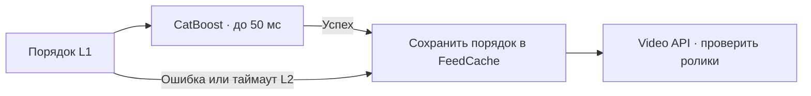

**2. Redis недоступен.** Сборщик CandidatePool публикует популярные и новые ID одним списком с версией. Feed API раз в 15 с читает этот список вне пользовательского запроса и целиком заменяет локальный снимок. При ошибке чтения оставляет последний полный снимок, в котором до 1 000 ID. Если Redis недоступен, экземпляр отдаёт общую ленту из последнего снимка возрастом до 15 минут. При обычном промахе кэша персональная лента строится штатно.

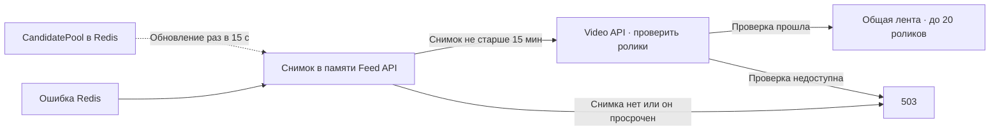

В обоих режимах Video API проверяет публикацию, удаление и права показа. Для резервной страницы Feed API отправляет один пакет до 40 ID, без повторов, с отдельным лимитом параллелизма. У общей ленты свой `feed_id` и смещение в снимке. При смене версии или возврате Redis выдача начинается заново. Кэш прогревается постепенно. При расчётном пике на регион приходится до 7 503 пакетных вызовов/с. Запас Video API проверяем вместе с остальным трафиком. Если лимит параллелизма исчерпан, Feed API отвечает 503.

### 10.4. Цели и проверка восстановления

За 30 дней цель для ленты, лайков и комментариев — 99,9% успешных ответов за 3 с. Для ленты целевой p95 — 500 мс. Для публикаций — 99% за 10 мин после приёма оригинала, для обновления счётчиков — 99% событий за 60 с. Долю страниц из L1 и локального снимка измеряем отдельно.

| Отказ | Что сохраняется | Цель восстановления |
| --- | --- | --- |
| Один ЦОД | Подтверждённые записи ScyllaDB и Kafka при исправных оставшихся копиях (RPO 0) | API ≤60с для 99% контрольных запросов, Kafka/Streams ≤5 мин |
| Один LVS, NGINX или API | Подтверждённые записи хранятся вне процесса | Переключение ≤30с |
| Один ЦОД с медиа | Опубликованные ролики с проверенными геокопиями (RPO 0) | Смена origin ≤60с. Публикация ждёт восстановления копий |
| Потеря Redis | Исходные данные остаются в хранилищах | Лента переключается на годный снимок. Полный прогрев кэша замеряем |
| Потеря индекса | Каталог сохраняется | Поиск восстанавливается из каталога. Время перестройки замеряем |
| Порча данных | Проверенная резервная копия и доступный журнал | Срок определяется пробным восстановлением |

## 11. Серверы и хостинг

Основные серверы размещаем в Ростелеком-ЦОД в Москве, Екатеринбурге и Новосибирске. Бэкап храним в отдельном ЦОДе Key Point в Новосибирске. Для раздачи видео выбираем Cloud.ru CDN, у которого есть публичный прайс. Второй вариант — NGENIX с Origin Shield [47–51].

### 11.1. Серверы

Количество указано в порядке **Москва / Екатеринбург / Новосибирск / бэкап**. Цена сервера с NVMe включает два системных SSD.

| Сервисы | Конфигурация одного сервера | M / E / N / Б | Цена, млн ₽ за сервер |
| --- | --- | ---: | ---: |
| Внешний NGINX (API, upload, origin) | 1U, 8 ядер, 32 GB, 2×480 GB SSD, 4×10GbE | 72 / 69 / 69 / 0 | 0,5 |
| LVS и Keepalived | 2U, 32 ядра, 128 GB, 2×480 GB SSD, 4×100GbE | 2 / 2 / 2 / 0 | 1,5 |
| PowerDNS и проверки GeoDNS | 1U, 8 ядер, 32 GB, 2×480 GB SSD, 2×10GbE | 1 / 1 / 1 / 0 | 0,45 |
| Go API: Auth, Users, Feed, Video, Search, Comments, Reactions, Event, Statistics | 2U, 64 ядра, 256 GB, 2×1,92 TB NVMe, 2×25GbE | 13 / 10 / 10 / 0 | 2,6 |
| Внутренний NGINX для gRPC | 1U, 16 ядер, 64 GB, 2×960 GB SSD, 2×25GbE | 9 / 8 / 8 / 0 | 0,85 |
| Upload service | 1U, 16 ядер, 64 GB, 2×960 GB SSD, 2×25GbE | 2 / 2 / 2 / 0 | 0,85 |
| ScyllaDB | 2U, 32 ядра, 256 GB, 2×3,84 TB NVMe, 2×25GbE | 34 / 34 / 34 / 0 | 2,1 |
| Kafka, брокеры | 2U, 32 ядра, 256 GB, 2×3,84 TB NVMe, 2×25GbE | 18 / 18 / 18 / 0 | 2,1 |
| Kafka Streams, приёмники снимков и загрузчики DWH | 2U, 32 ядра, 128 GB, 2×1,92 TB NVMe, 2×25GbE | 10 / 10 / 10 / 0 | 1,45 |
| ClickHouse, продуктовые события | 2U, 32 ядра, 256 GB, 4×3,84 TB NVMe, 2×25GbE | 8 / 8 / 8 / 0 | 2,4 |
| ClickHouse, логи и трассы | 2U, 32 ядра, 256 GB, 4×3,84 TB NVMe, 2×25GbE | 6 / 6 / 6 / 0 | 2,4 |
| OpenSearch, данные | 2U, 32 ядра, 256 GB, 4×3,84 TB NVMe, 2×25GbE | 7 / 5 / 5 / 0 | 2,4 |
| Redis Cluster | 1U, 16 ядер, 128 GB, 2×960 GB SSD, 2×25GbE | 9 / 9 / 9 / 0 | 1 |
| KRaft, Keeper и OpenSearch cluster-manager | 1U, 8 ядер, 32 GB, 2×480 GB SSD, 2×10GbE | 3 / 3 / 3 / 0 | 0,45 |
| FFmpeg | 2U, 32 ядра, 256 GB, 2×1,92 TB NVMe, 2×25GbE, 4×NVIDIA L4 | 36 / 19 / 19 / 0 | 4,2 |
| CatBoost, ранжирование | 2U, 32 ядра, 128 GB, 2×1,92 TB NVMe, 2×25GbE | 5 / 4 / 4 / 0 | 1,45 |
| Фоновые задачи: CandidatePool, рекомендации, relay, публикация и поиск | 2U, 32 ядра, 128 GB, 2×1,92 TB NVMe, 2×25GbE | 5 / 5 / 5 / 0 | 1,45 |
| Prometheus и Alertmanager | 2U, 32 ядра, 128 GB, 2×1,92 TB NVMe, 2×25GbE | 2 / 2 / 2 / 0 | 1,45 |
| OpenTelemetry Collector | 1U, 16 ядер, 64 GB, 2×960 GB SSD, 2×25GbE | 4 / 4 / 4 / 0 | 0,85 |
| Grafana, управление копиями, конфигурация и артефакты CI | 1U, 16 ядер, 64 GB, 2×960 GB SSD, 2×25GbE | 2 / 2 / 2 / 0 | 0,85 |
| Ceph OSD рабочих копий | 2U, 2×48 ядер, 256 GB, 24×15,36 TB NVMe, 2×100GbE | 25 / 25 / 25 / 0 | 27 |
| Ceph RGW | 2U, 32 ядра, 128 GB, 2×960 GB SSD, 2×100GbE | 9 / 9 / 9 / 0 | 1,6 |
| Ceph MON и MGR | 1U, 8 ядер, 32 GB, 2×480 GB SSD, 2×10GbE | 3 / 3 / 3 / 3 | 0,45 |
| Ceph OSD бэкапа | 4U, 48 ядер, 128 GB, 24×20 TB HDD, 2×25GbE | 0 / 0 / 0 / 23 | 3,5 |
| Ceph RGW бэкапа и синтетические проверки | 1U, 16 ядер, 64 GB, 2×960 GB SSD, 2×25GbE | 0 / 0 / 0 / 2 | 0,85 |
| **Всего 829 серверов** | | **285 / 258 / 258 / 28** | |

Число NGINX и LVS взято из §4.3–4.4. Для остальных узлов используем нагрузку из §2 и §5 и резервирование из §10. Скорость одного сервера — оценка до нагрузочного теста [43–45].

- **API.** В Москве после отказа другого ЦОДа — до 200 тыс. запросов/с. При 22,4 тыс. запросов/с на сервер и 25% на внутреннюю обработку нужно `ceil(200 000 × 1,25 / 22 400) + 1 = 13` машин с резервом.
- **Базы и очереди.** Для ScyllaDB закладываем 6,6 млн обращений к строкам/с на оставшийся ЦОД. При 200 тыс. на узел получаем 33 рабочих и один запасной. Для Kafka — 842 тыс. записей/с с учётом репликации и журнала Streams, 50 тыс. на брокер, итого 18 с резервом.
- **Видео.** У FFmpeg в Москве до 15,39 задачи/с по 1 800 кадров. При 800 кадрах/с на сервер получается 35 рабочих машин и одна запасная. Для Ceph нужно 8,59 ПБ сырых дисков на ЦОД с учётом EC 8+4, метаданных и заполнения до 70%. После отказа одного сервера остаётся 8,85 ПБ. Хранилище проверяем на выдаче 346 Гбит/с с параллельным восстановлением. Для бэкапа нужно 10,39 ПБ, после отказа узла остаётся 10,56 ПБ [18, 45, 46].

### 11.2. Смета на 30 дней

Всего 150 стоек, из них 7 для бэкапа. На каждый основной ЦОД берём восемь каналов по 100 Гбит/с. При отказе маршрутизатора остаётся 400 Гбит/с при потребности около 352 Гбит/с. Между основными ЦОДами — по два канала 200 Гбит/с на пару, для бэкапа — два по 25 Гбит/с.

Видео для CDN — **561 ПБ за 30 дней** по суточному объёму из §2.3. Цены на 18.11.2026. Для закрытых тарифов используем открытые цены похожих услуг. Ставки и выделяемую полосу нужно подтвердить у провайдеров [49–50, 52–59].

| Статья | Расчёт | Млн ₽/мес. |
| --- | --- | ---: |
| Серверы основных ЦОДов | 3 218,9 млн ₽ / 60 мес. | 53,65 |
| Серверы для бэкапа | 83,55 млн ₽ / 60 мес. | 1,39 |
| Коммутаторы и маршрутизаторы | 452,4 млн ₽ / 60 мес. [56] | 7,54 |
| Запчасти | 2% от стоимости оборудования / 60 мес. | 1,25 |
| Стойки и питание | 150 × 104,8–134,2 тыс. ₽ по тарифам MCN и DataHouse [57] | 15,72–20,13 |
| Интернет | 24 канала по 100 Гбит/с × 3,355–5 млн ₽ (тариф 10G IMAQLIQ × 10 и тариф 100G GalaxyData) [58] | 80,52–120 |
| Связь ЦОДов и бэкапа | 1 250 Гбит/с × 1–5 млн ₽ за каждые 100 Гбит/с, оценка [59] | 12,5–62,5 |
| CDN | 560,925 млн ГБ × 0,6039–0,854 ₽/ГБ (пакет 100 ТБ и цена за ГБ в прайсе Cloud.ru) + 0,1–0,5 млн ₽ на Origin Shield [50] | 338,84–479,53 |
| **Всего за 30 дней** | | **511,42–745,99** |

Зарплаты и разовое подключение площадок считаются отдельно.

## Источники

1. TikTok Newsroom. «Thanks a billion!», 27.09.2021: [официальное сообщение](https://newsroom.tiktok.com/1-billion-people-on-tiktok-my?lang=en-MY).
2. Mediascope Cross Web. [Рейтинги и правила описания измерений](https://mediascope.net/data/)
3. YouTube Help. [Recommended upload encoding settings](https://support.google.com/youtube/answer/1722171?hl=en).
4. Google Cloud. [Logs and metrics for caching](https://docs.cloud.google.com/cdn/docs/logging)
5. NGINX, 11.04.2019. [Testing the Performance of NGINX Ingress Controller for Kubernetes](https://blog.nginx.org/blog/testing-performance-nginx-ingress-controller-kubernetes).
6. NGINX, 24.08.2017. [Testing the Performance of NGINX and NGINX Plus Web Servers](https://blog.nginx.org/blog/testing-the-performance-of-nginx-and-nginx-plus-web-servers).
7. NGINX. [Upstream module](https://nginx.org/en/docs/http/ngx_http_upstream_module.html): least_conn, keepalive, max_fails/fail_timeout; активные health checks имеют отдельные условия доступности.
8. PowerDNS Authoritative. [Lua records](https://doc.powerdns.com/authoritative/lua-records/index.html), [HTTP API](https://doc.powerdns.com/authoritative/http-api/index.html): GeoIP, динамические ответы, фоновые проверки и управление конфигурацией.
9. Mediascope. [Медиапотребление 2024, 27.08.2024, слайд 11](https://mediascope.net/upload/iblock/f33/ual5i70kf7n9df7qzkq0gf238bidh3xv/%D0%9C%D0%B5%D0%B4%D0%B8%D0%B0%D0%BF%D0%BE%D1%82%D1%80%D0%B5%D0%B1%D0%BB%D0%B5%D0%BD%D0%B8%D0%B5%202024_%D0%9D%D0%90%D0%A2_27.08.2024.pdf): Cross Web, Россия 12+, desktop и mobile, январь–июль 2024.
10. Pew Research Center, 18.02.2025. [What we know about TikTok content creators](https://www.pewresearch.org/short-reads/2025/02/18/what-we-know-about-tiktok-content-creators/): авторы, на которых подписаны взрослые пользователи США.
11. Pew Research Center, 22.02.2024. [How U.S. Adults Use TikTok](https://www.pewresearch.org/internet/2024/02/22/how-u-s-adults-use-tiktok/): опрос взрослых пользователей США в августе 2023.
12. AWS MediaConvert. [Automated ABR](https://docs.aws.amazon.com/mediaconvert/latest/ug/auto-abr.html): подбор вариантов по исходному видео и качеству.
13. ScyllaDB. [Lightweight Transactions](https://docs.scylladb.com/manual/stable/features/lwt.html): условные записи, атомарный conditional batch в одной партиции, запрет межпартиционных batches и ограничение на смешивание LWT/non-LWT writes.
14. ScyllaDB. [Data Distribution with Tablets](https://docs.scylladb.com/manual/stable/architecture/tablets.html): отображение партиций на tablets, splitting и перенос tablet-реплик при изменении топологии.
15. Apache Kafka. [Design: Message Delivery Semantics](https://kafka.apache.org/42/design/design/), [Producer Configs](https://kafka.apache.org/42/configuration/producer-configs/): транзакции, idempotence, offsets и ограничения при внешних приемниках.
16. ClickHouse. [ReplacingMergeTree](https://clickhouse.com/docs/reference/engines/table-engines/mergetree-family/replacingmergetree), [ReplacingMergeTree guide](https://clickhouse.com/docs/guides/replacing-merge-tree): фоновая дедупликация и FINAL.
17. Redis. [Replication](https://redis.io/docs/latest/operate/oss_and_stack/management/replication/): асинхронность репликации и ограничения WAIT.
18. Ceph. [RGW Multisite](https://docs.ceph.com/en/latest/radosgw/multisite/), [S3 bucket operations](https://docs.ceph.com/en/latest/radosgw/s3/bucketops/), [Erasure coding](https://docs.ceph.com/en/latest/rados/operations/erasure-code/): геосинхронизация, versioning и избыточность. Страницы latest сверяются с выбранным стабильным релизом перед внедрением.
19. ScyllaDB. [Data Consistency in CDC](https://docs.scylladb.com/manual/stable/features/cdc/cdc-consistency.html), [CDC schema and TTL](https://docs.scylladb.com/manual/stable/cql/ddl.html#cdc-options), [CDC basics](https://docs.scylladb.com/manual/stable/features/cdc/cdc-basic-operations.html): совместная запись base table и CDC, уровни согласованности, настраиваемый конечный срок хранения и поведение TTL.
20. OpenSearch. [Creating a cluster: shard allocation awareness](https://docs.opensearch.org/latest/tuning-your-cluster/): primary/replica shards и размещение по зонам.
21. ScyllaDB. [Consistency Levels](https://docs.scylladb.com/manual/stable/cql/consistency.html), [NetworkTopologyStrategy](https://docs.scylladb.com/manual/stable/cql/ddl.html#networktopologystrategy): уровни подтверждения и размещение реплик по ЦОДам: по одной копии в M/E/N, глобальные QUORUM и SERIAL.
22. ClickHouse. [Backup and restore](https://clickhouse.com/docs/concepts/features/backup-restore/overview): независимые резервные копии и восстановление.
23. ScyllaDB. [ScyllaDB CQL Drivers](https://gocql-driver.docs.scylladb.com/stable/), [official ScyllaDB Go driver](https://github.com/scylladb/gocql): shard-aware routing по partition key.
24. ScyllaDB Manager. [Backup](https://manager.docs.scylladb.com/stable/backup/), [Restore](https://manager.docs.scylladb.com/stable/restore/): snapshots в S3/S3-compatible storage и последовательность восстановления.
25. ScyllaDB. [Announcing ScyllaDB 2025.4](https://www.scylladb.com/2026/01/08/announcing-scylladb-2025-4/): release notes указывают поддержку CDC и LWT для tablet-enabled tables с 2025.4.

26. Apache Kafka. [Kafka Streams Core Concepts](https://kafka.apache.org/35/documentation/streams/core-concepts/): state stores, changelog topics и exactly_once_v2 для входов, состояния и выходов внутри Kafka.
27. CatBoost. [Classification losses](https://catboost.ai/docs/en/concepts/loss-functions-classification): Logloss для бинарной классификации.

28. Apache Kafka. [KRaft](https://kafka.apache.org/42/operations/kraft/): кворум контроллеров отдельно от репликации topic.
29. ClickHouse. [Replicated table engines](https://clickhouse.com/docs/reference/engines/table-engines/mergetree-family/replication), [Keeper](https://clickhouse.com/docs/guides/sre/keeper/clickhouse-keeper): асинхронная репликация и координация.
30. Redis. [Cluster specification](https://redis.io/docs/latest/operate/oss_and_stack/reference/cluster-spec/): большинство primary и выбор реплики.
31. OpenSearch. [Shard allocation awareness](https://docs.opensearch.org/latest/tuning-your-cluster/availability-and-recovery/shard-allocation-awareness/), [Voting and quorum](https://docs.opensearch.org/latest/tuning-your-cluster/discovery-cluster-formation/voting-quorums/).
32. Ceph. [Monitor quorum](https://docs.ceph.com/en/latest/rados/operations/add-or-rm-mons/), [Pools and min_size](https://docs.ceph.com/en/latest/rados/operations/pools/): служебный кворум и границы I/O при деградации.
33. Prometheus. [Alertmanager](https://prometheus.io/docs/alerting/latest/alertmanager/): группировка, дедупликация и маршрутизация оповещений.
34. OpenSearch. [Snapshots](https://docs.opensearch.org/latest/tuning-your-cluster/availability-and-recovery/snapshots/index/): резервные копии индексов и состояния кластера.
35. Prometheus. [Storage](https://prometheus.io/docs/prometheus/latest/storage/): локальная TSDB, ограничения по времени и размеру.
36. OpenTelemetry. [Collector resiliency](https://opentelemetry.io/docs/collector/resiliency/): очереди, persistent storage, retry и условия потери телеметрии.
37. OpenTelemetry Collector Contrib. [Filelog receiver](https://github.com/open-telemetry/opentelemetry-collector-contrib/tree/main/receiver/filelogreceiver): чтение файлов и сохранение offsets.
38. OpenTelemetry Collector Contrib. [ClickHouse exporter](https://github.com/open-telemetry/opentelemetry-collector-contrib/tree/main/exporter/clickhouseexporter): доставка traces/logs в ClickHouse.
39. Grafana. [ClickHouse datasource](https://grafana.com/grafana/plugins/grafana-clickhouse-datasource/): подключение и визуализация данных ClickHouse.
40. Grafana k6. [Constant arrival rate](https://grafana.com/docs/k6/latest/using-k6/scenarios/executors/constant-arrival-rate/): открытая модель нагрузки и ограничения генератора.
41. OpenSearch. [Index Document API: external versioning](https://docs.opensearch.org/latest/api-reference/document-apis/index-document/): сравнение внешних версий при повторной доставке полного документа.
42. Apache Kafka. [Broker Configs](https://kafka.apache.org/42/configuration/broker-configs/): `min.insync.replicas` и взаимодействие с `acks=all`.
43. Курс Highload. [Базовый расчёт аппаратных ресурсов и выбор хостинга](https://github.com/init/highload/blob/main/highload_l11_hosting.md).
44. ScyllaDB. [Maximizing ScyllaDB Performance](https://docs.scylladb.com/manual/branch-2025.4/operating-scylla/procedures/tips/benchmark-tips.html), [тест смешанной нагрузки на AWS i4i](https://www.scylladb.com/2022/09/07/benchmarking-scylladb-5-0-on-aws-i4i-4xlarge/).
45. NVIDIA. [Производительность NVENC](https://docs.nvidia.com/video-technologies/video-codec-sdk/13.1/nvenc-application-note/), [характеристики L4](https://www.nvidia.com/en-sg/data-center/l4/).
46. Ceph. [Ресурсы на один OSD](https://docs.ceph.com/en/latest/start/minimum-hardware/). Supermicro. [Сервер 2U на 24 NVMe](https://www.supermicro.com/en/products/system/hyper/2u/as%20-2125hs-tnr).
47. Ростелеком-ЦОД. [ЦОДы в Москве, Екатеринбурге и Новосибирске](https://www.company.rt.ru/ir/news_calendar/d460740/), [размещение оборудования в Новосибирске](https://www.company.rt.ru/press/news_ir/news/d457923/).
48. Key Point. [Размещение оборудования в Новосибирске](https://www.keypoint-group.ru/cod/novosibirsk/).
49. Cloud.ru. [CDN и ёмкость сети](https://cloud.ru/products/cloud-cdn), [описание услуги и экранирования](https://cdn.cloud.ru/docs/legal/contracts/terms-of-service/crs/current-version/description-cdn.pdf).
50. Cloud.ru. [Прайс CDN](https://cdn.cloud.ru/docs/legal/tariffs/crs/current-version/cdn.pdf), строки 23 и 30.
51. NGENIX. [Каталог сервисов](https://help.ngenix.net/user-docs/services/), [Origin Shield](https://help.ngenix.net/user-docs/origin-shield-osd/).
52. B2Bay. [Сервер с Xeon E-2488](https://b2bay.ru/product/E-2488/). PORT-IT. [Пример цены сервера на 64 ядра и 256 GB](https://port-it.ru/index.php?code=R2D5F584&route=extension%2Fportit%2Fserver_builder.pdf).
53. Сервер Центр. [NVMe Samsung PM9A3 3,84 TB](https://server-center.ru/products/nakopitel-samsung-pm9a3-384tb-mzql23t8hcls-00a07). ITequip. [NVMe Samsung PM9D3a 15,36 TB](https://itequiprus.ru/catalog/drives/nvme-u-2-u-3/).
54. KNS. [HDD Toshiba 20 TB](https://www.kns.ru/product/zhestkii-disk-toshiba-20tb-mg10aca20te/). Olsys. [4U-платформа на 24 HDD](https://olsys.ru/product/servernaya-platforma-snr-sr4224re-4u-amd-epyc-ddr4-24xhdd-rezerviruemyj-bp/).
55. Compstone. [Открытая цена NVIDIA L4](https://compstone.ru/product/nvidia-900-2g193-0000-000/).
56. NVIDIA. [Порты и разветвление линий SN4700](https://networking-docs.nvidia.com/sn4000hw/cable-installation). ITequip. [Цены коммутаторов 25/100GbE](https://itequiprus.ru/kupit/kommutator-100g/), [цена SN4700](https://itequiprus.ru/vendor/mellanox/).
57. [Тарифы стоек MCN](https://datacenter.mcn.ru/arenda-stoek/) и [DataHouse](https://datahouse.ru/price/).
58. [Тарифы IMAQLIQ на гарантированный интернет](https://iqdata.center/channels-and-communication-lines/) и [GalaxyData](https://galaxydata.ru/colocation/).
59. [RETN Capacity: магистральные каналы](https://www.retn.ru/products/capacity), [РКК: прайс на каналы, пункт 1.10](https://rck.su/media/uploads/2025/12/12/perechen_i_stoimost_tarifov_s_01-01-2026_kTJBBIP.pdf).
