# Высоконагруженный сервис коротких вертикальных видео

## 1. Тема, аудитория и функционал

Сервис коротких вертикальных видео для пользователей России от 12 лет. Аналог — TikTok: более 1 млрд MAU в мире на сентябрь 2021 года [1]. Расчетная аудитория в России — **56,5 млн MAU и 27,7 млн DAU** [2].

MVP включает пять функций:

1. Загрузка и публикация готового видео длительностью до 3 минут.
2. Просмотр персонализированной ленты по истории и длительности просмотров.
3. Лайки и комментарии.
4. Поиск видео по автору, тегу и названию.
5. Регистрация и авторизация пользователей.

Сервис хранит видео в трех вариантах качества: 480p, 720p и 1080p. После подтверждения лайк сразу виден пользователю, который его поставил. Публичные счетчики могут обновляться с задержкой до минуты. Ролик становится доступен после обработки и сохранения копий во всех регионах. В MVP не входят трансляции, сообщения, реклама и видеоредактор.

## 2. Расчет нагрузки

### 2.1. Исходные параметры

Единицы десятичные: `1 KB = 10³ B`, `1 MB = 10⁶ B`, `1 GB = 10⁹ B`, `1 TB = 10¹² B`, `1 PB = 10¹⁵ B`; `1 B = 8 bit`. Расчеты выполняются до округления.

| Параметр | Значение | Основание |
| --- | ---: | --- |
| MAU / DAU | 56,5 / 27,7 млн | Целевая аудитория|
| Все зарегистрированные аккаунты | 113 млн | Допущение: 2 × MAU; неактивные аккаунты сохраняются |
| Воспроизведение на DAU в сутки | 60 мин | Mediascope: 73 мин использования TikTok среди пользователей, Россия 12+, январь–июль 2024 [9]. Из этого времени в модели отводим 60 мин на видео, остальное на другие действия |
| Длительность ролика / средний просмотр | 30 / 20 с | Допущения. Pew приводит среднюю длину 21 и 39 с для разных групп авторов [10]; это ориентир, а не среднее по платформе. 20 с просмотра источником не подтверждены |
| Авторы среди DAU / публикаций на автора в сутки | 2 % / 0,2 | Допущения: 554 тыс. авторов, в среднем один ролик за пять дней на автора. 2 % — доля авторов в аудитории, а не доля опубликовавших ролик именно сегодня |
| Оригинал, 30 с | 46,44 MB | Входной профиль 1080p60: 12 Mbit/s видео + 0,384 Mbit/s стереоаудио по рекомендации YouTube [3]; `(12 + 0,384) × 30 / 8`. Выбор этого профиля для среднего оригинала — допущение |
| Варианты 480p / 720p / 1080p | 0,75 / 1,5 / 3 Mbit/s | Проектные полные битрейты, включая аудио; три файла занимают 2,8125 / 5,625 / 11,25 MB |
| Производные варианты вместе | 19,6875 MB | `30 × (0,75 + 1,5 + 3) / 8` |
| Средний битрейт доставки | 1,5 Mbit/s | Допущение о долях времени 480p/720p/1080p — 40/40/20 %: `0,4 × 0,75 + 0,4 × 1,5 + 0,2 × 3` |
| Возраст каталога / срок хранения оригинала | 5 лет / до 1 суток | Для каталога — 1 825 дней постоянной нагрузки. Оригинал удаляем после успешной обработки и сохранения вариантов; сутки — расчетное окно временного буфера |
| Сырые продуктовые события / история | 30 дней / последние 100 просмотров | Общая аналитика действий MVP хранится в архиве; последние просмотры — списком по пользователю |
| Срок сессии | 10 дней | Допущение для расчета авторизации и временного хранения сессий |
| Репликация | 3 копии | По одной в Москве, Екатеринбурге и Новосибирске |
| CDN byte hit ratio | 98 % базовый; 90 % для мощности origin | Допущения о доле байтов, отданных из кэша; не статистика провайдера [4] |

Доля авторов 2 % не подтверждена источником: показатель Pew «52 % когда-либо публиковали видео» относится к взрослым пользователям США, а не к DAU [11]. Частота 0,2 публикации в сутки — допущение; ориентир Pew — от одного до нескольких постов в неделю у разных групп авторов [10].

Три готовых файла занимают 42,4 % оригинала: при перекодировании суммарный битрейт снижается с 12,384 до 5,25 Mbit/s. Принцип подбора вариантов описан в AWS MediaConvert [12]; качество выбранной лестницы нужно проверить пробным кодированием.

`Просмотры/DAU = 60 × 60 / 20 = 180`; `просмотры/сутки = 27,7 млн × 180 = 4 986 000 000`.
`Публикации/сутки = 27,7 млн × 0,02 × 0,2 = 110 800`.

| Действие | На одного DAU в сутки | Основание |
| --- | ---: | --- |
| Просмотр | 180 | 60 мин воспроизведения / 20 с |
| Получение страницы ленты | 9 | Допущение: 20 роликов на страницу |
| Открытие списка комментариев | 18 | В 10 % просмотров |
| Лайк | 18 | Допущение: в 10 % просмотров |
| Комментарий | 1,8 | Допущение: в 1 % просмотров |
| Поиск по автору, тегу или названию | 3 | Допущение: суммарно три запроса поиска, по 20 результатов |
| Авторизация | 0,1 | Допущение: один вход с созданием сессии за 10 дней для ежедневно активного пользователя |
| Регистрация | 0,001 | Допущение: 27 700 новых аккаунтов в сутки, около 10,1 млн за год |
| Публикация | 0,004 | 2 % авторов × 0,2 публикации |

Коэффициенты лайков и комментариев не подтверждены репрезентативными данными. Регистрации нормированы на DAU только для расчета нагрузки.

### 2.2. RPS

`RPS_средний = операций/сутки / 86 400`.
`RPS_пик = RPS_средний × K_пик`.
`RPS_с_запасом = RPS_пик × K_запас`, где `K_запас = 2`.

Принимаем обычный суточный пик ×2 для чтения, поиска, регистрации и авторизации, ×3 для реакций, ×4 для публикаций: в пиковый час приходится 1/12, 1/8 и 1/6 суточных операций. Запас ×2 покрывает всплеск сверх обычного пика. Это допущения; пики считаем одновременными, суточные объемы — по среднему.

| Метод / поток | Операций/сутки | Средний RPS | K_пик | Пиковый RPS | RPS с запасом ×2 |
| --- | ---: | ---: | ---: | ---: | ---: |
| Получение ленты | 249 300 000 | 2 885,42 | 2 | 5 770,83 | 11 541,67 |
| Чтение комментариев | 498 600 000 | 5 770,83 | 2 | 11 541,67 | 23 083,33 |
| Просмотр | 4 986 000 000 | 57 708,33 | 2 | 115 416,67 | 230 833,33 |
| Лайк | 498 600 000 | 5 770,83 | 3 | 17 312,50 | 34 625,00 |
| Комментарий | 49 860 000 | 577,08 | 3 | 1 731,25 | 3 462,50 |
| Поиск | 83 100 000 | 961,81 | 2 | 1 923,61 | 3 847,22 |
| Авторизация | 2 770 000 | 32,06 | 2 | 64,12 | 128,24 |
| Регистрация | 27 700 | 0,32 | 2 | 0,64 | 1,28 |
| Инициализация загрузки | 110 800 | 1,28 | 4 | 5,13 | 10,26 |
| Завершение загрузки | 110 800 | 1,28 | 4 | 5,13 | 10,26 |
| **Внешний API, всего** | **6 368 479 300** | **73 709,25** | — | **153 771,55** | **307 543,10** |
| Части оригинала, upload | 1 329 600 | 15,39 | 4 | 61,56 | 123,11 |
| Сегменты видео, CDN | 24 930 000 000 | 288 541,67 | 2 | 577 083,33 | 1 154 166,67 |

«Просмотр» — один API-запрос с результатом просмотра для рекомендаций; видео передается через CDN. Поиск объединяет все три признака. Проверка сессии внутри API-запроса не считается отдельным входом.

Одна публикация создает два API-запроса и `ceil(46,44 / 4) = 12` upload-частей. На просмотр приходится `20 / 4 = 5` сегментов по 4 с. При промахе FeedCache сервис вычисляет интересы по недавней истории, запрашивает векторный поиск и списки кандидатов. Метаданные и состояния лайков читает пакетами. Повторные страницы используют готовую ленту. Перекодирование в три качества — `332 400` задач в сутки, или `3,85 / 15,39 / 30,78` задач в секунду.

### 2.3. Сеть

`Объем_сутки = операций/сутки × байт/операцию`.
`Поток_средний = объем_сутки × 8 / 86 400`; `поток_пик = поток_средний × K_пик`.

Средняя одновременная аудитория: `27,7 млн × 3 600 / 86 400 = 1 154 166,67`. Средняя выдача видео — `1 731,25 Gbit/s`, пиковая — `3 462,5 Gbit/s`. За сутки: `4 986 000 000 × 20 × 1,5 / 8 = 18 697 500 000 MB = 18 697 500 GB`. Коэффициенты пика и запаса в суточный объем не входят.

| Направление | Пик, Gbit/s | С запасом ×2, Gbit/s | Объем, GB/сутки |
| --- | ---: | ---: | ---: |
| CDN -> зрители, видео | 3 462,50 | 6 925,00 | 18 697 500 |
| Origin -> CDN, 98 % попаданий | 69,25 | 138,50 | 373 950 |
| Origin -> CDN, 90 % попаданий | 346,25 | 692,50 | 1 869 750 |
| Клиенты -> upload, оригиналы | 1,906 | 3,812 | 5 145,552 |
| Внешний API, запросы + ответы | 4,522 | 9,045 | 23 872,359 |
| Между ЦОДами: две дополнительные копии медиа | 5,427 | 10,855 | 14 653,854 |
| Между ЦОДами: две дополнительные копии продуктовых событий | 0,492 | 0,984 | 2 547,347 |

Размер API-запроса с ответом, включая HTTP-заголовки: лента и поиск — 31 KB, список комментариев — 15 KB, просмотр — 1 KB, остальные операции — 2 KB. Суточный трафик — сумма `операций × размер`, пиковый — сумма `RPS_пик × размер × 8` с коэффициентом каждого метода. Сетевые накладные расходы и повторы покрываются запасом.

Снижение byte hit ratio на один процентный пункт добавляет origin `34,625 Gbit/s` на пике. При допущении 10 % request miss: `577 083,33 × 0,1 = 57 708,33 RPS`, с запасом — `115 416,67`. Совпадение долей промахов по байтам и запросам — допущение. Эффект origin shield не учитывается.

Репликация медиа: `2 × 110 800 × (46,44 + 19,6875) MB = 14 653,854 GB/сутки`, пик ×4; оригинал копируется временно. Репликация продуктовых событий: `2 × 6 368 368 500 × 200 B = 2 547,3474 GB/сутки`; пик — сумма потоков событий с коэффициентами их действий (см. ДЗ5). Репликация реакций и метаданных учитывается отдельно от этих потоков.

### 2.4. Хранение

Каталог рассчитан за пять лет постоянной нагрузки: `S₀ = объектов/сутки × 1 825 × размер × 3 копии`, `Δгод = объектов/сутки × 365 × размер × 3`. Для временных данных вместо 1 825 дней используем окно хранения.

Оригиналы удаляются после успешной обработки и сохранения копий всех вариантов. Их суточный буфер: `110 800 × 46,44 MB × 3 = 15,437 TB`; всплески загрузок и задержки обработки требуют дополнительной емкости.

| Данные сейчас | Объектов до репликации | Размер объекта, B | S₀, TB, 3 копии | Прирост за год, TB, 3 копии |
| --- | ---: | ---: | ---: | ---: |
| Три варианта, отдельные файлы, 5 лет | 606 630 000 | 6 562 500 в среднем | 11 943,028 | 2 388,606 |
| Метаданные роликов, включая название и теги, 5 лет | 202 210 000 | 2 000 | 1,213 | 0,243 |
| Поисковый индекс роликов, 5 лет | 202 210 000 | 1 000 | 0,607 | 0,121 |
| UserActivity: последние просмотры и полный набор лайков, 5 лет | До 113 000 000 строк; 909 945 000 000 ID лайков | 8 B/ID + 3 224 B на строку (24 B заголовок + 100 × 32 B просмотры) | 22,932 | 4,466 |
| Комментарии, 5 лет | 90 994 500 000 | 512 | 139,768 | 27,954 |
| Продуктовые события, окно 30 дней | 191 051 055 000 | 200 | 114,631 | 0 |
| Учетные записи и учетные данные | 113 000 000 | 1 000 | 0,339 | 0,030 |
| Сессии, окно 10 дней | 27 700 000 | 256 | 0,021 | 0 |
| Публичные счетчики видео, 5 лет | 202 210 000 | 40 | 0,024 | 0,005 |
| **Итого базового каталога, без временных оригиналов и производных рекомендаций** | — | — | **12 222,562** | **2 421,424** |

Векторы рекомендаций учитываются отдельно в §5.2 и добавляют 951,196 GB с тремя копиями. Таблица показывает полезные данные базового каталога. Для `UserActivity` одна копия занимает `909,945 млрд × 8 B + 113 млн × 3 224 B = 7,643872 TB`. Заголовок истории содержит `user_id`, версию и время обновления, всего 24 B. Физические ключи, журналы и индексы учитываются при расчёте хранилищ (§6, §11), резервные копии описаны в §6.6. Число аккаунтов растет на `27 700 × 365 = 10 110 500` в год. Для верхней оценки каждый лайк считается новым добавлением. События и сессии ограничены сроком хранения.

Каталог / текущий MAU, без реплик; это доля общего каталога, а не собственные публикации пользователя. Для хранения лайков здесь учитываются только ID, без 24 B заголовка и недавней истории `UserActivity`:

| Данные на одного MAU | Объектов | GB |
| --- | ---: | ---: |
| Готовые видео, файлы трех качеств | 10,737 | 0,070460 |
| Метаданные роликов | 3,579 | 0,00000716 |
| Поисковый индекс роликов | 3,579 | 0,00000358 |
| Лайки, ID в пользовательских наборах | 16 105,221 | 0,00012891 |
| Комментарии | 1 610,522 | 0,00082459 |

Общий объем базовых данных с тремя копиями, без временных оригиналов: **12 222,562 TB сейчас** и **14 643,986 TB через год**. Из них готовые видео занимают **11 943,028 / 14 331,634 TB**. С учетом суточного буфера оригиналов текущая оценка — **12 237,999 TB**.

## 3. Глобальная балансировка

### 3.1. Размещение и маршруты

ЦОДы размещаем в **Москве, Екатеринбурге и Новосибирске**. При отказе одного данные сохраняются в двух других. Распределение спроса **50/25/25 %** между западом России, Уралом и зоной «Сибирь и Дальний Восток» — допущение. Сравниваем с одним ЦОДом в Москве по четырем условным городам; долю восточной зоны делим поровну между Красноярском и Хабаровском:

| Точка сценария | Доля | До Москвы, км | До выбранного ЦОДа, км |
| --- | ---: | ---: | ---: |
| Нижний Новгород | 50 % | 400 | 400, Москва |
| Челябинск | 25 % | 1 490 | 190, Екатеринбург |
| Красноярск | 12,5 % | 3 350 | 640, Новосибирск |
| Хабаровск | 12,5 % | 6 140 | 3 580, Новосибирск |

Среднее расстояние с учетом долей аудитории уменьшается с **1 760 до 775 км (~56 %)**. Это расстояния по поверхности Земли, а не сетевые задержки: их нужно измерять отдельно. Видео отдается через ближайшие узлы CDN, API — через наши ЦОДы.

GeoDNS настроим на PowerDNS [8]: по одному DNS-серверу в регионе, с GeoIP и картой зон для выбора виртуального IP-адреса (VIP) API. HTTP-проверки отмечают недоступные адреса. Зоны и веса меняются оператором по задержке и загрузке и распространяются на DNS-серверы. Геолокация DNS-резолвера приблизительна.

| Домен | Назначение | Маршрут |
| --- | --- | --- |
| `api.service.example` | Лента, взаимодействия, события, управление upload | GeoDNS -> региональный API VIP |
| `upload.service.example` | Передача частей оригинала | Подписанный URL с региональным именем `upload-m/e/n.service.example` -> домашний регион автора |
| `video.service.example` | Сегменты и манифесты | CDN edge -> при miss shield -> origin выбранного здорового региона |
| `static.service.example` | Версионированная статика | CDN |

Метаданные и пользовательские записи ScyllaDB имеют три копии — по одной в каждом ЦОДе. Запись подтверждается двумя копиями (QUORUM); подтвержденные изменения переживают отказ одного ЦОДа, RPO=0 для этого сценария. Запросы к метаданным выполняются из ближайшего здорового региона и требуют межрегионального обмена. Домашний регион (home) используется для загрузки файла. Ролик публикуется только после готовности оригинала и вариантов во всех трех регионах; если один недоступен, публикация ждет [21].

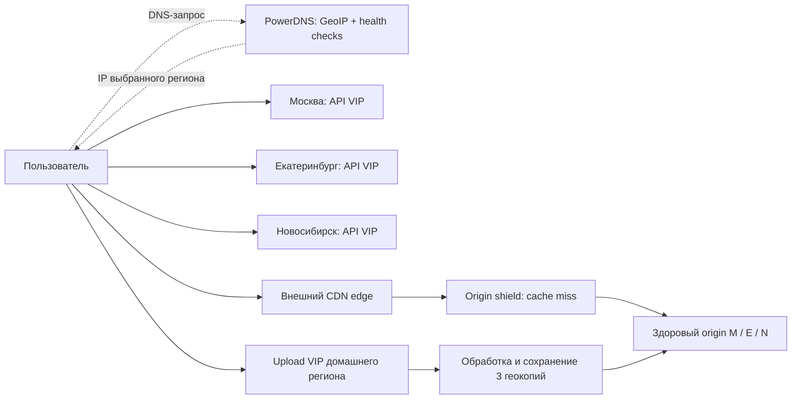

Для API и upload не используем BGP Anycast: такую схему сложнее сопровождать, а смена маршрута может оборвать активное соединение. Маршрут запросов к CDN выбирает сама CDN-платформа. Обычный DNS round-robin распределяет запросы по очереди и не учитывает ни местоположение пользователя, ни доступность приложения.

### 3.2. Распределение нагрузки

`RPS_региона = RPS_глобальный × доля региона`.

| Метод / поток | Москва, средний / пик RPS | Екатеринбург, средний / пик RPS | Новосибирск, средний / пик RPS |
| --- | ---: | ---: | ---: |
| Получение ленты | 1 442,71 / 2 885,42 | 721,35 / 1 442,71 | 721,35 / 1 442,71 |
| Чтение комментариев | 2 885,42 / 5 770,83 | 1 442,71 / 2 885,42 | 1 442,71 / 2 885,42 |
| Событие просмотра | 28 854,17 / 57 708,33 | 14 427,08 / 28 854,17 | 14 427,08 / 28 854,17 |
| Лайк | 2 885,42 / 8 656,25 | 1 442,71 / 4 328,12 | 1 442,71 / 4 328,12 |
| Комментарий | 288,54 / 865,62 | 144,27 / 432,81 | 144,27 / 432,81 |
| Поиск | 480,90 / 961,81 | 240,45 / 480,90 | 240,45 / 480,90 |
| Авторизация | 16,03 / 32,06 | 8,02 / 16,03 | 8,02 / 16,03 |
| Регистрация | 0,16 / 0,32 | 0,08 / 0,16 | 0,08 / 0,16 |
| Инициализация загрузки | 0,64 / 2,56 | 0,32 / 1,28 | 0,32 / 1,28 |
| Завершение загрузки | 0,64 / 2,56 | 0,32 / 1,28 | 0,32 / 1,28 |
| Части оригинала | 7,69 / 30,78 | 3,85 / 15,39 | 3,85 / 15,39 |
| Сегменты видео, CDN | 144 270,83 / 288 541,67 | 72 135,42 / 144 270,83 | 72 135,42 / 144 270,83 |

Таблица показывает средний поток и обычный суточный пик без коэффициента запаса. В ДЗ 4 мощность рассчитывается на этот пик **с запасом ×2** из ДЗ 2.2 и с аварийными долями ДЗ 3.3. Внутренние обращения ленты считаются отдельно по профилю ДЗ 5–7 и не суммируются с внешним ingress.

В обычном режиме пиковый поток API (запросы + ответы) для M/E/N составляет `2,261 / 1,131 / 1,131 Gbit/s`, upload — `0,953 / 0,477 / 0,477 Gbit/s`. Для origin при 90% попаданий CDN по объему — `173,125 / 86,563 / 86,563 Gbit/s`. CDN отдает зрителям `1 731,25 / 865,625 / 865,625 Gbit/s`; этот поток не проходит через API. Для выбора оборудования все эти пики дополнительно умножаются на 2; суточный трафик остается прежним.

### 3.3. Отказы и регулирование

| Состояние | Входящий API M/E/N | Origin miss M/E/N | Upload |
| --- | --- | --- | --- |
| Штатно | 50/25/25 % | 50/25/25 % | В home |
| Отказ M | 0/50/50 % | 0/50/50 % | Upload home M приостановлен |
| Отказ E | 65/0/35 % | 50/0/50 % | Upload home E приостановлен |
| Отказ N | 60/40/0 % | 50/50/0 % | Upload home N приостановлен |

API-нагрузка отказавшей Москвы делится поровну; Екатеринбурга — между Москвой и Новосибирском в пропорции 60/40; Новосибирска — между Москвой и Екатеринбургом в пропорции 40/60. Максимальные доли — **65/50/50 %**. Каждый из двух оставшихся origin должен выдерживать **50 %** общего потока при 90 % попаданий CDN. Upload остается в домашнем регионе.

TTL DNS-записи — 30 с; кэши DNS и открытые соединения могут задержать переключение. Проверки оценивают готовность API работать с кворумом ScyllaDB, а CDN отдельно исключает недоступный origin. Восстановленный регион возвращается в работу постепенно.

При отказе одного ЦОДа API переключается на здоровые регионы. Две оставшиеся копии ScyllaDB образуют кворум: чтение и запись метаданных продолжаются. Изолированный ЦОД без кворума не обслуживает авторитетные операции. Загрузка в отказавший home приостановлена, новые публикации ждут третьей копии файлов; уже опубликованные видео доступны через CDN и оставшиеся origin.

## 4. Локальная балансировка

### 4.1. Схема и резервирование

В каждом регионе работают физические Linux-серверы и пара LVS с Keepalived. Они обслуживают три VIP — для API, upload и origin. Один LVS активен, второй резервный (**2N при N = 1**); каждый рассчитан на весь входящий поток региона. IPVS выбирает пул NGINX по адресу назначения и порту. Пулы разделены, чтобы передача видео не отнимала ресурсы API.

В Direct Routing LVS меняет MAC-адрес назначения и направляет новое TCP-соединение на NGINX с наименьшим числом активных соединений (`least connections`). Метод учитывает длительность соединений, но не выравнивает точно загрузку CPU и объем трафика. LVS и NGINX должны находиться в одной L2-сети. VIP назначается loopback-интерфейсу, ARP-ответы для него подавляются. Запросы и TCP ACK проходят через LVS, ответы с VIP идут от NGINX напрямую, поэтому сетевые фильтры должны разрешать эту схему. Keepalived переносит VIP по VRRP и проверяет пул. Синхронизация IPVS может сохранить часть соединений при переключении, но не гарантирует их сохранность.

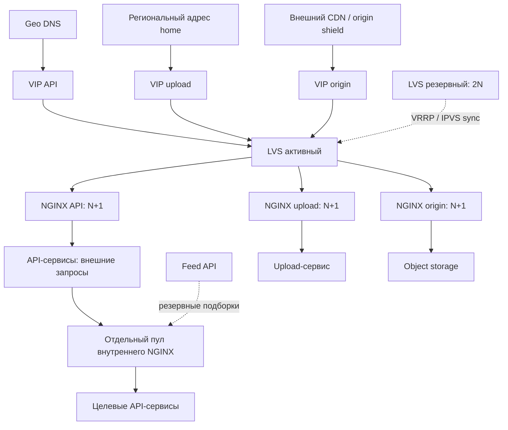

NGINX завершает TLS и распределяет HTTP-запросы через `least_conn` по числу активных соединений. Upstream-соединения переиспользуются. Состояние пользователя и загрузки хранится отдельно от API-сервера, поэтому sticky sessions не нужны.

Отдельный региональный пул внутреннего NGINX (§11.1) направляет gRPC-запросы к экземплярам нужного сервиса. Каждый сервис запущен как минимум в двух экземплярах на разных машинах. Точное количество определят нагрузочные испытания.

HTTP-проверки Keepalived убирают неисправный NGINX из пула LVS. Перед обновлением узел исключают из конфигурации и ждут завершения текущих запросов. После отказа одного узла остаются N серверов. Если переключился директор, клиент повторяет только безопасные запросы.

### 4.2. Производительность одного NGINX

Ориентир — тест 2019 года [5]: NGINX Ingress на Xeon Platinum 8168, 8 задействованных CPU, OpenSSL 1.1.0g. Отдельно измерены HTTPS RPS (ответ 1 KB), TLS TPS нового соединения (пустой ответ, без HT) и throughput (объекты 1 MB). Тест 2017 года [6] использует другую конфигурацию и также разделяет CPS и RPS.

| Ограничение | Ориентир [5] | 70 % для расчета |
| --- | ---: | ---: |
| HTTPS RPS | 236 703 | 165 692,1 |
| TLS CPS (SSL TPS), без HT | 31 485 | 22 039,5 |
| Поток | 8,6 Gbit/s | 6,048 Gbit/s |

На каждом узле — 8 физических ядер сопоставимой производительности, 32 GB RAM и отдельные интерфейсы 10GbE для клиентских и внутренних подключений. Предел 6,048 Gbit/s относится к каждому интерфейсу, но узким местом может стать общий канал. Память и допустимое число соединений нужно проверить испытаниями.

Запросы, TLS-соединения и сетевой поток одновременно нагружают процессор, поэтому их проверяют одним тестом с запасом 30 %. Консервативно принимаем `TLS_CPS = внешний RPS` (новое соединение на запрос); keep-alive и HTTP/2 снижают фактический CPS.

### 4.3. Число серверов

`N = ceil(max(RPS / 165 692,1; TLS_CPS / 22 039,5; Gbit/s / 6,048))`.
Здесь RPS/CPS и Gbit/s уже включают запас ×2 относительно пика ДЗ 2 и максимальные доли при отказе региона: API — 65/50/50%, origin — 50/50/50%, upload — штатные 50/25/25% без переноса из home. Запас 30% в производительности узла и дополнительный узел N+1 имеют другие назначения: ограничение загрузки и замена отказавшего узла.
В пуле устанавливаем `N+1` серверов, чтобы оставшиеся N выдерживали расчетный поток после отказа узла. Максимумы регионов относятся к разным авариям; их одновременный учет создает запас мощности.

| Пул / регион | Расчетный RPS = CPS, пик ×2 | Поток, Gbit/s, пик ×2 | N по RPS / TLS / сети | Установлено N+1 |
| --- | ---: | ---: | --- | ---: |
| API, Москва | 199 903,01 | 5,879 | 2 / 10 / 1 | 11 |
| API, Екатеринбург | 153 771,55 | 4,522 | 1 / 7 / 1 | 8 |
| API, Новосибирск | 153 771,55 | 4,522 | 1 / 7 / 1 | 8 |
| Upload, Москва | 61,56 | 1,906 | 1 / 1 / 1 | 2 |
| Upload, Екатеринбург | 30,78 | 0,953 | 1 / 1 / 1 | 2 |
| Upload, Новосибирск | 30,78 | 0,953 | 1 / 1 / 1 | 2 |
| Origin, Москва | 57 708,33 | 346,250 | 1 / 3 / 58 | 59 |
| Origin, Екатеринбург | 57 708,33 | 346,250 | 1 / 3 / 58 | 59 |
| Origin, Новосибирск | 57 708,33 | 346,250 | 1 / 3 / 58 | 59 |

Пулам NGINX требуется **72 / 69 / 69** серверов в M/E/N (**210** всего), LVS — **2 на регион** (**6** всего). DNS, приложения, хранилище, транскодирование и CDN сюда не включены. Origin ограничен сетью: `ceil(346,25 / 6,048) = 58`; после отказа одного узла остаются `58 × 6,048 = 350,784 Gbit/s`. Для API после отказа узла M дает `10 × 22 039,5 = 220 395 CPS > 199 903,02`, E/N — `7 × 22 039,5 = 154 276,5 CPS > 153 771,55`.

Входящий поток origin оценивается как 10% ответного для ACK и TLS/заголовков плюс 1 500 B на запрос: `34,625 + 57 708,33 × 1 500 × 8 / 10⁹ = 35,3175 Gbit/s`. Это обратное направление полнодуплексного канала; оно не складывается с исходящими 346,25 Gbit/s для проверки одного направления. Расчет покрывает прокси: региональные каналы и хранилище также должны выдержать этот поток плюс репликацию, repair и остальные сервисы.

### 4.4. Проверка L4 и условий отказа

У каждого LVS отдельные 100GbE front/back подключения с проектным пределом **70 Gbit/s на интерфейс и 100 млн pps**. Это требования к стенду, а не производительность, гарантируемая маркировкой сетевой карты.

Для верхней оценки M учитываем весь двунаправленный API из ДЗ 2.3, хотя ответы обходят LVS, upload и входящий origin: `5,8786 + 1,906 + 35,3175 = 43,1021 Gbit/s`. Для E/N — `4,522 + 0,953 + 35,3175 = 40,7925 Gbit/s`. Округляем до **44 Gbit/s**, ниже 70. При размере пакета 64 B верхняя оценка — `44 × 10⁹ / (64 × 8) = 85,9375 млн pps`; цель **100 млн pps** покрывает ее. Физические накладные расходы Ethernet проверяются на стенде отдельно.

CPS M: `199 903,02 + 61,56 + 57 708,33 = 257 672,91`; E/N — `153 771,55 + 30,78 + 57 708,33 = 211 510,66`. Тест пары при выключенном директоре должен подтвердить **260 тыс. новых соединений/с**, до **44 Gbit/s / 100 млн pps**, с проверкой IPVS, памяти, задержек и ошибок. Эти пределы проверяются одновременно на смешанном профиле; если цель не достигается, нужно разбить VIP между дополнительными независимыми парами или изменить конфигурацию и повторить расчет.

Схема рассчитана на отказ одного региона и одного NGINX в каждом оставшемся пуле либо на отказ одного LVS при исправной локальной сети. Два отказа в одном пуле превышают резерв N+1. Количество приложений и узлов хранения определяется отдельно, поэтому расчет балансировщиков не доказывает мощность всей системы.

### 4.5. Таймауты и повторы

Для API заданы connect timeout 0,5 с и read timeout 2 с. Чтение повторяется не более раза на другом upstream, общий лимит — 3 с. Загрузка прерывается после 60 с без прогресса; повтор части использует прежние upload ID и номер. Для origin заданы connect timeout 1 с и read inactivity 10 с; при ошибке CDN повторяет GET к другой копии. Значения уточнят по измеренным квантилям времени ответа.

Если ответ на POST лайка, комментария или завершения загрузки не пришел, клиент повторяет запрос с тем же ключом идемпотентности. Reactions API может вернуть `202`, если Kafka приняла команду и результат ещё не готов. Клиент проверяет результат по `video_id` и `operation_id` через Reactions API с ограниченной частотой. При проверке передаётся исходное действие, чтобы отличить результат от конфликта ключа.

## 5. Логическая схема БД

Схемы показывают данные и связи между ними. `PK`, `FK`, `UK` — первичный, внешний и уникальный ключи. Размещение по хранилищам описано в разделе 6.

**Аккаунты, контент, поиск и состояние**

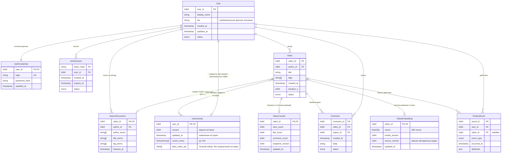

**Файлы, кэши и буферы**

```mermaid
erDiagram
    OriginalMedia {
        int64 video_id PK, FK
        string object_ref
        int64 size_bytes
        string checksum
        int64[] region_copies
        timestamp created_at
        timestamp expires_at
    }
    VideoVariant {
        int64 video_id PK, FK
        enum quality PK
        string object_ref
        int64 size_bytes
        enum status
        int64[] region_copies
        blob segment_ranges
    }
    UploadSession {
        int64 upload_id PK
        int64 user_id FK
        int64 video_id FK
        int64 publication_id "сохраняется при старте"
        timestamp created_at
        timestamp expires_at
        enum state
        string staging_ref
        blob received_parts
    }
    TranscodeTaskQueue {
        int64 task_id UK
        int64 video_id FK
        int64 publication_id PK
        enum quality PK
        timestamp created_at
        int64 attempt
        enum state
        timestamp expires_at
    }
    ProductEventBuffer {
        int64 event_id PK
        int64 user_id FK
        int64 video_id FK "nullable"
        enum event_type
        timestamp occurred_at
        json attributes
        enum state
        timestamp expires_at
    }
    CounterBuffer {
        string source_event_id PK
        int64 video_id FK
        enum counter_kind
        int64 delta
        timestamp created_at
        timestamp expires_at
        enum applied_state
    }
    CandidateEntry {
        int64 video_id FK
        string[] tags
        int64 popularity
        int32 duration_s
        timestamp published_at
        string eligibility "регион, возраст, модерация"
    }
    CandidatePool {
        string pool_key PK
        CandidateEntry[] candidates
        int64 version
        timestamp generated_at
    }
    FeedCache {
        int64 user_id PK, FK
        int64 feed_id PK
        int64[] video_ids
        timestamp created_at
        timestamp expires_at
    }
    IdempotencyRecord {
        int64 user_id PK, FK
        enum operation PK
        string target_ref PK
        string operation_id PK
        string request_hash
        string result_ref
        timestamp created_at
        timestamp expires_at
    }

    Video ||--o| OriginalMedia : "временный оригинал"
    Video ||--o{ VideoVariant : "до трех качеств"
    User ||--o{ UploadSession : "загружает"
    Video ||--o| UploadSession : "получает"
    Video ||--o{ TranscodeTaskQueue : "задачи обработки"
    User ||--o{ ProductEventBuffer : "действия"
    Video |o--o{ ProductEventBuffer : "объект действия"
    Video ||--o{ CounterBuffer : "изменения метрик"
    CandidatePool ||--o{ CandidateEntry : "теговые, популярные и свежие списки"
    Video ||--o{ CandidateEntry : "источник снимка ID и тегов"
    VideoCounter ||--o{ CandidateEntry : "источник популярности"
    UserActivity ||--o{ FeedCache : "источник интересов при сборке"
    User ||--o{ FeedCache : "страницы ленты"
    Video }o--o{ FeedCache : "ролики страницы"
    User ||--o{ IdempotencyRecord : "результат операции"
```

### 5.1. Назначение данных и потоков

| Данные | Назначение |
| --- | --- |
| User, AuthCredential, AuthSession | Публичный профиль, учетные данные и действующие сессии |
| Video, VideoCounter | Карточка ролика и публичные счетчики просмотров, лайков и комментариев |
| SearchDocument | Копия названия, тегов и данных автора для поиска |
| UserActivity | Последние 100 просмотров и полный набор лайкнутых роликов |
| VideoEmbedding | Вектор названия и тегов для поиска похожих роликов |
| Comment | Текст, автор, время и статус комментария |
| ProductEvent | События действий за 30 дней для аналитики и обучения |
| OriginalMedia, VideoVariant | Ссылки на оригинал и варианты качества, размеры, контрольные суммы и готовность копий |
| UploadSession, TranscodeTaskQueue | Прогресс загрузки, идентификатор публикации и задания по качествам |
| ProductEventBuffer, CounterBuffer | События, ожидающие доставки, и изменения счетчиков |
| CandidatePool, FeedCache | Общие списки кандидатов и готовый порядок персональной ленты |
| IdempotencyRecord | Результат запроса для безопасного повтора |

`UserActivity` создается при первом просмотре или лайке. Бэкенд сохраняет последние 100 просмотров, вытесняя самые старые. Каждая запись содержит ID ролика, время, длительность просмотра и ролика, с бюджетом 32 B. Версия и время обновления относятся к истории. Лайки хранятся независимо от нее, вытеснение просмотра сохраняет лайк. При сборке ленты сервис читает историю и текущие лайки, вычисляет веса тегов в памяти (§7.1).

`VideoEmbedding` содержит 384 числа, описывающих название и теги ролика. Вектор вычисляется при публикации или изменении текста. Поиск по векторам выполняется при сборке ленты. Версии модели и метаданных позволяют обновлять индекс и отбрасывать запоздавшие результаты.

`CandidateEntry` — вложенная запись `CandidatePool`. Она содержит ID, теги, популярность из `VideoCounter`, длительность, время публикации и ограничения показа. Сборщик исключает удаленные и неопубликованные видео. Эти поля позволяют отбирать кандидатов до получения полных карточек.

`object_ref` в `OriginalMedia` и `VideoVariant` — ключ файла в объектном хранилище. Staging содержит части загрузки, `segment_ranges` — диапазоны сегментов готового файла. При старте загрузки сохраняются сессия и `publication_id`. Состояние обработки содержит задания и готовность копий. До `PUBLISHED` ролик скрыт от поиска и ленты (§7.2).

Для оригиналов принимаем штатное окно хранения 24 ч. Принятый файл сохраняется до готовности вариантов и геокопий, включая ожидание при отказе ЦОДа. Сырые события хранятся 30 дней. История обновляется из потока событий независимо от загрузки аналитики.

### 5.2. Объемы и нагрузка

Объемы указаны для одной копии, нагрузка — на обычном пике из §2.2. В каждой строке названа единица чтения. Для верхней оценки принимаем, что все `G = 5 770,83` запросов ленты в секунду требуют новой сборки. Пакет из нескольких ID сокращает число сетевых вызовов, но сохраняет чтения отдельных записей.

**Постоянные данные**

| Данные | Количество × размер | Объем | Чтение/с | Запись/с |
| --- | --- | ---: | --- | --- |
| User | 113 млн × 488 B | 55,144 GB | 384 786,34 строк | 0,64 |
| AuthCredential | 113 млн × 512 B | 57,856 GB | 64,76 строк | 0,64 |
| Video, включая метаданные файлов | 202,21 млн × 2 000 B | 404,420 GB | 288 415,97 базовых чтений + до 577 083,33 для истории + 1 731 250 для кандидатов + 115 416,67 проверок выдачи | 15,39 |
| SearchDocument | 202,21 млн × 1 000 B | 202,210 GB | 1 923,61 поисковых запроса | 5,13 новых документов |
| VideoEmbedding | 202,21 млн × 1 568 B | 317,065 GB | До 17 312,50 векторов и 17 312,50 ANN-запросов | 5,13 новых векторов |
| VideoVariant, файлы | 606,63 млн × 6,5625 MB | 3 981,009 TB | 57 708,33 origin-запроса | 15,39 файлов |
| UserActivity | 113 млн × 3 224 B истории + 909,945 млрд × 8 B ID лайков | 7,644 TB | 5 770,83 списка истории, до 577 083,33 состояний лайка для ленты и 17 312,50 для обработки реакций | 115 416,67 просмотров, до 17 312,50 изменений лайка |
| Comment | 90,9945 млрд × 512 B | 46,589 TB | 230 833,33 строки | 1 731,25 |
| ProductEvent, 30 дней | 191,051055 млрд × 200 B | 38,210 TB | Аналитические выборки и обучение | 153 766,42 |
| VideoCounter | 202,21 млн × 40 B | 8,088 GB | 153 955,56 снимка | Пакетные снимки по активным видео |

Заголовок истории занимает 24 B, каждая из 100 записей — 32 B. Полный набор лайков учитывается по 8 B на ID. Для верхней оценки история заполнена у всех аккаунтов, каждый лайк считается новым добавлением. Физические ключи и служебные записи учитываются при выборе емкости (§6.5).

У `VideoEmbedding` вектор занимает `384 × 4 = 1 536 B`, ID и версии с временем — еще 32 B. Индекс HNSW требует дополнительной памяти (§11.1). Запись поисковых документов и векторов указана для новых публикаций. Изменения текста и удаления обновляют записи по версии каталога.

При сборке ленты требуется до 100 метаданных истории, 100 проверок лайка, трех векторов, трех ANN-запросов и 300 метаданных найденных кандидатов. Метаданные загружаются пакетами через Video API, лайки — максимум пятью пакетами по 20 ID. Для ANN можно объединить три поиска одним сетевым вызовом, объем поисковой работы остается прежним. Готовая лента читается из FeedCache, доступность проверяется перед каждой выдачей.

**Временные данные и кэши**

| Данные | Окно / размер | Объем на пике | Чтение/с | Запись/с |
| --- | --- | ---: | ---: | ---: |
| AuthSession | 10 дней / 256 B | 14,182 GB | 153 706,79 | 64,12 |
| OriginalMedia и staging | 24 ч / 46,44 MB | 20,582 TB | 15,39 оригиналов | 61,56 частей |
| UploadSession и состояние публикации | 24 ч / 256 B | 113,459 MB | 66,69 | 71,81 |
| TranscodeTaskQueue | 1 ч / 256 B | 14,182 MB | 15,39 | 30,78 |
| Топик команд лайка | 128 B на команду | 63,821 GB за сутки по средней нагрузке | 17 312,50 | 17 312,50 |
| ProductEventBuffer | 60 с / 200 B | 1,845 GB | 153 766,42 | 307 532,84 |
| CounterBuffer / входной журнал | 60 с / 64 B | 516,328 MB | 134 460,42 | 268 920,83 приемов и подтверждений |
| CandidatePool | 100 записей на тег, по 500 в popular/recent, TTL 60 с | `(19 232 × K + 192 064) B` | До 40 395,83 чтений ключей | `(K + 2) / 15` обновлений |
| FeedCache | 30 мин / 864 B, до 100 ID | 8,970 GB | 5 770,83 | 5 770,83 |
| IdempotencyRecord | 24 ч / 256 B | 421,458 GB | 19 054,65 | 19 054,65 |

`K` — число теговых списков. Запрос читает до пяти теговых и двух общих списков. Окна для файлов, заданий и буферов служат оценкой штатной емкости. Незавершенные принятые публикации и недоставленные события сохраняются до завершения обработки.

При отказе Redis с запасом до 7 503 новых сборок/с на регион требуется до 7 503 чтений истории, 22 509 ANN-запросов и чтений исходных векторов. Резервная сборка использует сходство и общие списки, проверка лайков для нее не требуется. Карточки проверяются при выдаче пакетом до 40 ID. Последующие страницы продолжают список по курсору (§10.3).

За час отставания топик команд лайков при 34 625 командах/с вырастет на 15,955 GB на копию. В дисковый бюджет входят обработанный хвост для повторов, три реплики и служебные данные. Квитанции хранятся до конца клиентского окна и очистки соответствующего участка журнала (§10.2).

Фоновая сверка поиска обходит в среднем 2 340,4 карточки/с, с лимитом 5 000 (§10.2). Она проверяет версии текстового и векторного индексов, восстанавливает отсутствующие документы. Служебные расходы индексов и телеметрия ДЗ 8.2 учитываются отдельно от полезных данных.

### 5.3. Консистентность и распределение нагрузки

- Логин уникален. Вход разрешен после завершения регистрации. Сессии хранятся по пользователю, отзыв проверяется при авторизации запроса.
- Подтвержденный лайк читается из актуального состояния пары `(user_id, video_id)`. Повтор команды использует прежний `operation_id` и сохраненную квитанцию. Комментарий и его исходящее событие сохраняются атомарно в одной партиции (§6.3).
- История обрабатывается по `user_id`, повторы просмотров отсекаются по `event_id`. В БД принимается более новая версия снимка. Целевая задержка истории — до 5 с. Веса интересов вычисляются при сборке ленты.
- Счетчики агрегируются по `video_id` и записываются абсолютным снимком с версией. Целевая задержка — до 25 с. Популярный ролик создает горячий ключ, поэтому события суммируются перед записью. Комментарии делятся на временные интервалы и полосы (§6.5), медиа раздает CDN.
- CandidatePool обновляется раз в 15 с. Текстовый и векторный индексы обновляются по событиям каталога с целевой задержкой до минуты. Удаления учитываются по версии, перед выдачей доступность дополнительно проверяет Video API. Кэш ленты действует до 30 минут.
- При пустой истории используются популярные и новые ролики. Отказ векторного поиска оставляет остальные генераторы. Отказ Redis включает резервную сборку (§10.3).

## 6. Физическая схема БД

### 6.1. Выбор хранилищ

ScyllaDB хранит оперативные записи по известному ключу, таблицы спроектированы под запросы. Kafka передаёт события и задания, ClickHouse хранит аналитику, OpenSearch — текстовый и векторный поиск, Ceph — файлы, Redis — кэши. Метаданные файлов хранятся в ScyllaDB. LWT — условная атомарная запись внутри одной таблицы и партиции [13]. Используется версия с поддержкой LWT и журнала изменений CDC для tablets [25].

### 6.2. Таблицы и ключи ScyllaDB

Схема показывает основные поля и логические связи, которые проверяет приложение. PK — ключ партиции, CK — порядок строк. `row_kind` различает состояние, квитанцию и outbox-событие.

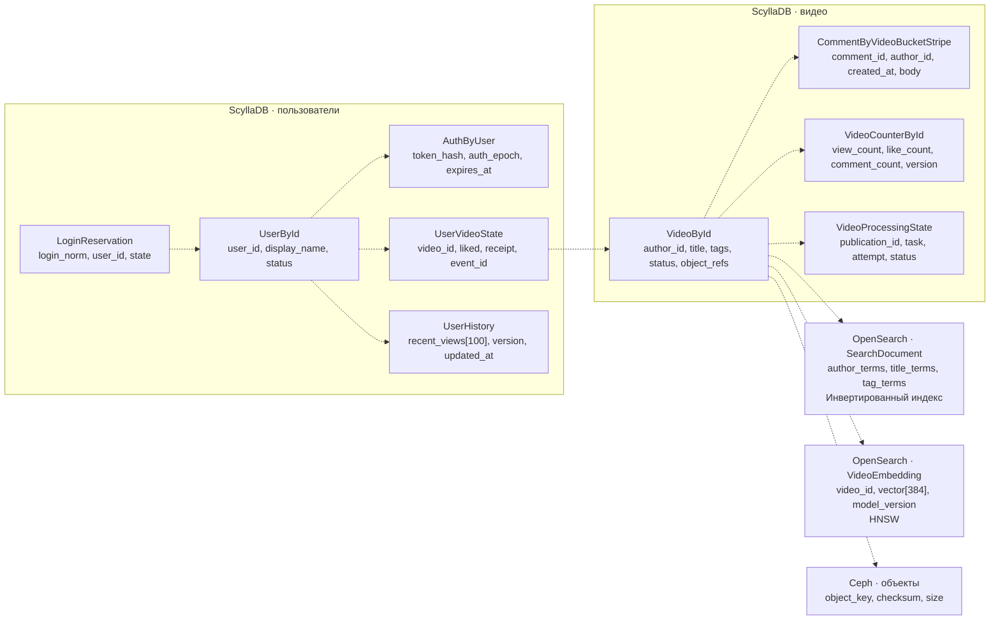

| Таблица | PK | CK | Основной доступ |
| --- | --- | --- | --- |
| UserById | `user_id` | `row_kind, row_id` | Карточка аккаунта, операции регистрации |
| LoginReservation | `login_norm` | — | Проверка и резервирование уникального логина |
| AuthByUser | `user_id` | `row_kind, token_hash` | Проверка и отзыв сессии |
| UserVideoState | `user_id, video_id` | `row_kind, row_id` | Состояние лайка и квитанция команды |
| UserHistory | `user_id` | `row_kind, row_id` | До 100 последних просмотров по пользователю |
| VideoById | `video_id` | `row_kind, item_id` | Карточка, ссылки на медиа и состояние публикации |
| VideoCounterById | `video_id` | `row_kind` | Текущий снимок счётчиков, версия — поле строки |
| CommentByVideoBucketStripe | `video_id, time_bucket, stripe` | `row_kind, created_at DESC, comment_id DESC, row_id` | Страница комментариев по ролику и времени |
| VideoProcessingState | `video_id` | `row_kind, item_id` | Сессия, попытки и копии. Ключ задания — `(publication_id, quality)` внутри `item_id` |

В OpenSearch поля `author_terms`, `title_terms`, `tag_terms` образуют полнотекстовый инвертированный индекс. Название и теги кодируются моделью `paraphrase-multilingual-MiniLM-L12-v2`, вектор и версии хранятся в отдельном индексе HNSW/Faiss (§7.1). Эти индексы восстанавливаются из `VideoById`. `CandidateEntry` — вложенная запись Redis со снимком тегов, популярности и доступности ролика.

### 6.3. Запись, повторы и производные данные

- Регистрация резервирует логин, создает PENDING-аккаунт и активирует обе записи. Каждый шаг сохраняется условно и продолжается при повторе. Хеш пароля хранится в `LoginReservation`.
- Reactions API отправляет лайки в Kafka по ключу `(user_id, video_id)`. Один обработчик LWT сохраняет состояние и квитанцию в `UserVideoState`, затем фиксирует позицию и событие транзакцией Kafka. Повтор использует квитанцию и `event_id`.
- Комментарий, результат и outbox записываются одной LWT в партиции комментариев. Подписанный `operation_id` закрепляет ID, время, интервал и полосу для повторов.
- API подтверждает просмотр после `acks=all`. Kafka Streams дедуплицирует события, обновляет историю и сохраняет состояние, снимок и позицию чтения одной транзакцией Kafka [26]. ScyllaDB принимает только снимок с более новой версией. Веса тегов вычисляются при сборке ленты.
- Обработчик счётчиков последовательно суммирует события по `video_id` и записывает абсолютные снимки с возрастающей версией.
- LWT сохраняет `PUBLISHED` и outbox-событие в `VideoById`. CDC передаёт изменения в Kafka, индексатор обновляет OpenSearch по версии карточки. Сверка описана в §10.2.

Outbox — исходящее событие рядом с изменением, которое хранится до подтверждения Kafka. Relay читает изменения CDC и доставляет события. При выходе за окно CDC повторно читает неподтвержденный outbox с QUORUM (§10.2). Потребители отсекают повторы по `event_id` [15], [19].

Обработчик каталога и счётчиков каждые 15 секунд обновляет Redis: top-100 по каждому тегу, top-500 популярных и 500 свежих роликов. После сбоя он восстанавливает состояние из каталога и доступного хвоста журнала. Удалённые и неопубликованные ролики исключаются.

### 6.4. Репликация и отказ ЦОДа

Каждая партиция ScyllaDB имеет по реплике в Москве, Екатеринбурге и Новосибирске (`M:1, E:1, N:1`). Запись и авторитетное чтение используют QUORUM, то есть две копии из трёх. LWT использует глобальный SERIAL и фиксацию QUORUM [21]. Кэш может отставать, поэтому лайки и сессии проверяются в ScyllaDB.

Проверки сессии, начатые после подтверждённого отзыва, читают актуальные данные с QUORUM. При неопределённом ответе LWT результат проверяется по ID операции.

При потере одного ЦОДа оставшиеся два продолжают работу, а изолированный ЦОД не может подтвердить запись. Подтверждённые данные переживают отказ. Межрегиональный кворум добавляет задержку и трафик.

Загрузка идёт в домашний регион. Публикация ждёт готовности вариантов во всех трёх ЦОДах. Опубликованные ролики доступны через CDN и здоровые origin.

### 6.5. Разбиение данных и расширение

ScyllaDB маршрутизирует запрос по ключу партиции через token к tablet и его репликам [14].

Комментарии разбиваются по суточным интервалам и полосам, чтобы ограничить горячие партиции. Чтение идёт по времени и курсору. Счётчики одного видео агрегируются одним последовательным обработчиком до записи снимка.

При добавлении узлов ScyllaDB переносит tablets и переключает карту размещения после догонки изменений. Новые ключи комментариев применяются со следующего интервала, старые читаются по прежней версии. Число разделов Kafka меняется с сохранением порядка ключа и позиции. Получатели игнорируют устаревшие снимки.

### 6.6. Остальные системы, клиенты и backup

| Система | Разделение и копии | Доступ и хранение |
| --- | --- | --- |
| Kafka | 256 разделов событий по `user_id`; счётчики и публикации по `video_id`; команды лайка по `(user_id, video_id)`; RF=3, по копии в M/E/N | `acks=all`, `min.insync.replicas=2`; события хранятся 24 ч, команды лайка удаляются по подтверждённой позиции (§10.2); состояние Streams восстанавливается из changelog [15] |
| ClickHouse | 16 шардов по `event_id`, реплика каждого шарда в M/E/N | Дневные секции, `ORDER BY (event_date,event_id)`, хранение 30 дней, `ReplicatedReplacingMergeTree` и `FINAL` [16], [29] |
| OpenSearch | 32 primary shards по `video_id`, две реплики, три копии разнесены по M/E/N | Текстовые и векторные индексы; обновления по версии [20] |
| Ceph | Три геокопии, EC 8+4 внутри региона | S3 multipart upload, чтение диапазонов, отдельный backup и версионные резервные подборки [18] |
| Redis | Cluster в каждом регионе, не менее трёх primary и двух реплик на primary | Карточки, `CandidatePool` с TTL 60 с и `FeedCache` с TTL 30 мин [17] |

| Система | Клиент | Маршрутизация и интеграция |
| --- | --- | --- |
| ScyllaDB | `gocql` | По partition key с shard-aware routing [23] |
| Kafka | `franz-go` | По лидеру раздела; позиция фиксируется после обработки |
| Kafka Streams | Java Streams API | `exactly_once_v2` для позиции, состояния и событий внутри Kafka |
| ClickHouse | `clickhouse-go/v2` | Пакетная запись и распределённые запросы |
| OpenSearch | `opensearch-go` | Bulk API через coordinating nodes |
| Redis | `go-redis/v9` | По hash slot |
| Ceph RGW | AWS SDK for Go v2 | Через региональный S3 endpoint |

Клиенты переиспользуют ограниченное число соединений, приложение ограничивает параллельность пакетных запросов. Резервные копии ScyllaDB снимаются ежедневно и хранятся четыре недели [24]. Архив Kafka/CDC с позициями хранится семь дней. ClickHouse и OpenSearch копируются ежедневно и хранятся семь дней. Видео имеет отдельные копии и checksum, удалённые версии — 30 дней. Redis восстанавливается из основных данных.

Восстановление выполняется в отдельный кластер. Сначала сверяются позиции, версии и квитанции, затем применяется доступный хвост журнала. Снимки не дают общей атомарной точки между всеми системами, поэтому непрерывность журнала нужна для восстановления подтверждённых изменений. Время восстановления проверяется на стенде.

## 7. Алгоритмы

### 7.1. Персональная лента

**Задача.** Сформировать для пользователя упорядоченный список релевантных опубликованных видео. На входе — последние действия пользователя и каталог видео. Система подбирает кандидатов из нескольких источников и оценивает вероятность содержательного просмотра каждого ролика.

**Подготовка каталога.** При публикации видео и изменении названия или тегов модель `paraphrase-multilingual-MiniLM-L12-v2` строит нормализованный вектор из 384 чисел по названию и тегам [60]. Вход обрезается до 128 токенов модели. Версия модели и версия исходных метаданных записываются вместе с вектором. Search API хранит эмбеддинги опубликованных видео в отдельном индексе OpenSearch и ищет ближайшие векторы методом HNSW/Faiss с косинусным сходством. Начальные параметры индекса — `m=16`, `ef_construction=128`, `ef_search=100` [62]. Их качество и задержку нужно проверить на каталоге проекта. Смена версии модели требует перестроить индекс и переключить его после проверки нового выпуска.

**Сбор кандидатов.** При промахе FeedCache Feed API читает до 100 последних просмотров из UserHistory, пакетом получает метаданные этих видео через Video API и проверяет актуальные лайки через Reactions API пакетами до 20 ID. Для каждого тега вычисляется сумма вкладов просмотров:

`min(1, watched_ms / (1000 × duration_s)) × (1 + liked)`.

Просмотры с отсутствующими метаданными, неположительной длительностью ролика или отрицательным watched_ms пропускаются. В памяти запроса остаются 20 тегов с наибольшим весом. Снятый лайк влияет на следующий пересчёт согласно текущему состоянию лайка.

Feed API выбирает до трёх последних уникальных видео, просмотренных не менее чем на 10%, с доступными эмбеддингами и через Search API запрашивает до 100 соседей каждого. Чтение векторов и поиск используют один выпуск индекса. Похожие кандидаты ранжируются по максимальному сходству с выбранными видео. Из CandidatePool по кругу берутся до 300 кандидатов из списков пяти наиболее весомых тегов, 200 популярных и 200 новых. Всего получается до 1 000 кандидатов. Метаданные найденных соседей запрашиваются пакетом через Video API, у остальных кандидатов они вложены в CandidateEntry. После объединения удаляются дубликаты, просмотренные и недоступные ролики. Пустая история дает популярные и новые ролики. Пока у нового видео готовится эмбеддинг, оно участвует через свежие и теговые списки.

**Ранжирование и выдача.** L1 по кругу отбирает из непустых источников до 100 кандидатов, сохраняя порядок каждого списка. CatBoost оценивает кандидатов по сходству с историей, совпадению тегов, популярности, свежести и длительности. Цель модели — предсказать содержательный просмотр. Просмотр не менее половины ролика служит положительным примером, просмотр менее 10% — отрицательным, промежуточные случаи не входят в обучение. Признаки строятся по данным, доступным до оцениваемого просмотра. Качество проверяется на более позднем временном периоде. Итоговый порядок определяется оценкой модели, при равенстве — video_id. При ошибке модели или превышении таймаута 50 мс Feed API сохраняет порядок L1.

Итоговый список до 100 ID хранится в FeedCache 30 минут. API выдаёт по 20 видео с тем же feed_id и смещением, перед выдачей Video API проверяет доступность. После исчерпания списка или срока кэша лента собирается заново по обновлённой истории. Число кандидатов и пороги просмотра — начальные параметры. Качество отбора оценивается по Recall@100, порядок — по NDCG, производительность — по задержке и нагрузке поиска. Популярная лента дешевле, но одинаково ранжирует видео для всех пользователей. Предварительные списки соседей устаревают между пересчётами, поэтому похожие видео ищутся по текущему индексу.

**Влияние на хранение и нагрузку.** UserHistory хранит последние просмотры, UserVideoState — актуальные лайки. CandidatePool и FeedCache размещены в Redis, веса тегов вычисляются в памяти запроса. Эмбеддинги и ANN-индекс хранятся отдельно в OpenSearch. На промах FeedCache приходятся чтение истории, метаданных её видео, пакетная проверка лайков, до трёх обращений к векторному поиску, чтение CandidatePool и ранжирование до 100 кандидатов. Объёмы и частоты этих операций указаны в §5.2 и §6.

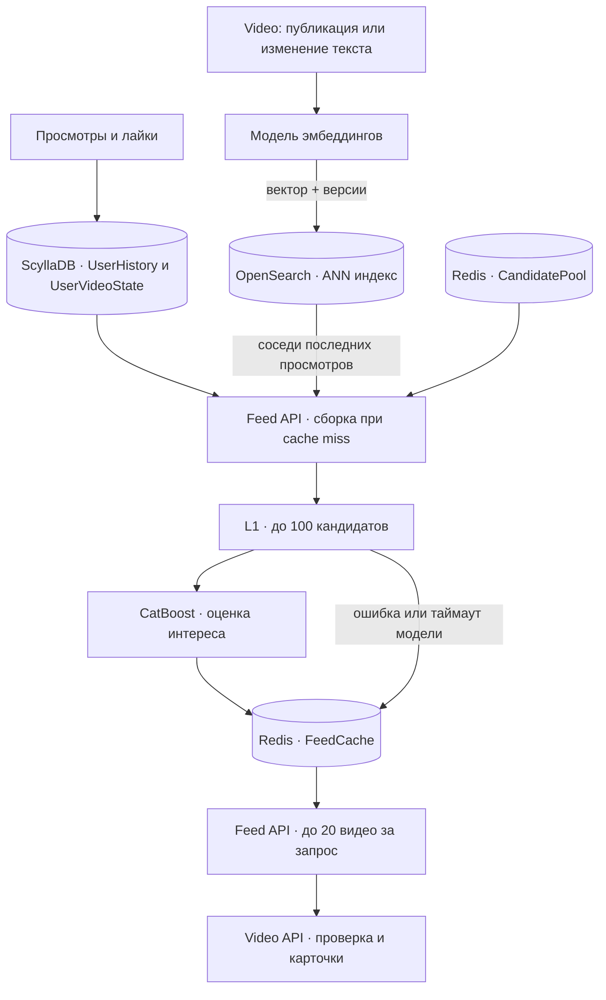

### 7.2. Возобновляемая публикация видео

**Задача.** Принять готовый ролик до трёх минут, создать варианты 480p, 720p и 1080p и включить видео в каталог после проверки копий во всех трёх регионах. До статуса PUBLISHED видео не показывается в поиске и ленте.

При открытии сессии сервис сохраняет постоянные `video_id` и `publication_id`, ключ оригинала в Ceph и состояние загрузки. Повтор запроса открытия с тем же ключом идемпотентности возвращает ту же сессию. После передачи частей Ceph собирает объект по сохранённому ключу. Если сервис упал до фиксации завершения в ScyllaDB, повтор проверяет объект по этому ключу и его checksum, затем продолжает ту же публикацию.

| Этап | Условие перехода | Действие при ошибке |
| --- | --- | --- |
| Приём | Части собраны, checksum и формат оригинала проверены | При временной ошибке повторить проверку. Некорректный файл перевести в FAILED и очистить. Просроченную незавершённую сессию закрыть и удалить её части |
| Принятие публикации | Одной условной записью в `VideoProcessingState(video_id)` сохранены ACCEPTED, манифест, три задания и их outbox-события | До сохранения не подтверждать приём. Повтор завершения использует прежние ID и не создаёт вторые логические задания |
| Транскодирование | Для каждого качества получены файл и checksum, результат зафиксирован для текущего номера попытки | Повторить только незавершённое задание. Каждая попытка пишет по отдельному неизменяемому ключу. Устаревшая попытка не может заменить принятую |
| Копирование | Проверенный вариант скопирован и сверён по checksum во всех трёх регионах | Повторить только отсутствующую или не прошедшую проверку копию. При временной недоступности региона сохранить состояние и продолжить после восстановления |
| Публикация | Готовы все девять сочетаний «качество × регион» и временные копии оригинала во всех регионах | Сначала зафиксировать READY. Затем условной записью в партиции `VideoById(video_id)` установить PUBLISHED, версию и outbox-событие каталога |

Для каждого качества создаётся одно логическое задание с постоянным ключом `(publication_id, quality)`. Повторная доставка относится к тому же заданию. Повторное выполнение после сбоя может создать новую попытку, но в состояние принимается только результат актуальной попытки.

Изменения состояния заданий и outbox сохраняются в ScyllaDB. После записи outbox relay передаёт задание в Kafka, а Worker читает оригинал из Ceph, запускает FFmpeg и сохраняет результат. Переходы между этапами подтверждаются по состоянию ScyllaDB и проверенным объектам Ceph. После окончательного сбоя ставится FAILED, фон очищает части и объекты публикации. Опоздавшие результаты попыток также удаляются. Принятый оригинал и выбранные результаты сохраняются на время ожидания региона. После успешной публикации очищаются оригинал и лишние объекты попыток.

Асинхронная обработка позволяет повторить отдельный этап и не держит клиентский запрос во время транскодирования и копирования. Публикация после готовности копий во всех регионах соответствует требованию MVP и задерживается при отказе региона. Очередь и состояние этапов размещены в `VideoProcessingState`, файлы и попытки — в Ceph, опубликованная карточка и событие каталога — в `VideoById`. Подробные потоки компонентов и обработка отказов приведены в §9.3 и §10.

## 8. Технологии

### 8.1. Выбор инструментов

Таблица фиксирует выбранные технологии и их роли. Альтернативы сравниваются на одном уровне; производительность проверяется на расчетном профиле нагрузки.

| Технология | Область применения | Обоснование выбора |
| --- | --- | --- |
| PowerDNS Authoritative, GeoIP, health checks | GeoDNS для API (ДЗ 3) | Управляет региональными ответами с учетом доступности API; TTL и кэши ограничивают скорость переключения. |
| Linux IPVS/LVS, Keepalived, NGINX | L4, перенос VIP, TLS и HTTP-балансировка (ДЗ 4) | LVS распределяет трафик, Keepalived переносит VIP, NGINX направляет HTTP-запросы в отдельные пулы. |
| Go, `net/http`, gRPC; HTTP/JSON | Клиентский API на HTTP/JSON; внутренние синхронные вызовы на gRPC | Один язык для сетевых сервисов; gRPC задает типизированные контракты между сервисами, HTTP/JSON — простой формат клиентского API. |
| ScyllaDB | Авторитетные записи по ключу | Таблицы и партиции соответствуют запросам; LWT обеспечивает условные переходы внутри партиции (ДЗ 6). |
| Kafka, Kafka Streams | Команды лайков, журнал событий, задания и потоковые агрегации | Повторное чтение поддерживает восстановление обработки. Состояние лайка фиксируется отдельно в ScyllaDB. |
| ClickHouse | Продуктовая аналитика и отдельное хранилище телеметрии | Пакетная запись и запросы по временным диапазонам подходят аналитике; кластеры продукта и телеметрии изолированы. |
| OpenSearch | Текстовый поиск и поиск похожих видео | Отдельные текстовый и векторный индексы восстанавливаются из каталога. ANN-поиск выполняется при сборке ленты [62], [63]. |
| Ceph RGW, S3 API | Видеообъекты, multipart upload и резервные подборки | Хранилище поддерживает range-чтения, EC и геокопии. Общие подборки читаются независимо от Redis. |
| Redis Cluster | FeedCache, CandidatePool, кэш карточек | TTL и структуры данных подходят коротким спискам; подтвержденные изменения хранятся вне кэша. |
| FFmpeg | Фоновые задания трех качеств видео | Кодирование запускается отдельно от HTTP-запроса; шаги повторяются по сохраненному состоянию (ДЗ 7.2). |
| CatBoost, Sentence Transformers, Python и SQL ClickHouse | Ранжирование, эмбеддинги и обучение | Готовая текстовая модель вычисляет векторы по событиям каталога [60]. CatBoost оценивает до 100 кандидатов, обучение идет в фоне (§7.1). |
| Внешний CDN с origin shield | Доставка видео зрителям | Edge обслуживает основной поток, origin — запросы при промахе кэша; емкость сверяется с расчетом ДЗ 2.3. |
| systemd, Ansible | Запуск и обновление процессов | Соответствуют выбранным физическим серверам: локальный перезапуск и применение конфигурации по одному узлу с drain. |
| Git, GitHub Actions, Go testing, k6 | Версии, CI, функциональные и нагрузочные проверки | CI собирает артефакт и проверяет обработчики; k6 проверяет задержки и ошибки на расчетной нагрузке [40]. |
| Prometheus, Grafana, Alertmanager, OpenTelemetry Collector | Метрики, трассы, логи и оповещения | Разделяют сбор, хранение, просмотр и доставку оповещений; пути телеметрии приведены в ДЗ 8.2 [33], [35]–[39]. |

### 8.2. Наблюдаемость: от сбора до просмотра

| Данные | Путь | Проектный срок хранения |
| --- | --- | --- |
| Метрики | Приложения и exporters -> Prometheus (сбор и хранение) -> Grafana; правила -> Alertmanager | 35 дней, чтобы покрыть 30-дневное окно SLO [35] |
| Трассы | OpenTelemetry SDK -> Collector -> отдельный ClickHouse -> Grafana | 3 дня; выборка 1% запросов [36], [38], [39] |
| Логи | Структурированные логи приложения -> Collector с локальным буфером -> отдельный ClickHouse -> Grafana | 7 дней [36]–[39] |

При переполнении буфера диагностические данные могут теряться; это не задерживает ответ API. Бизнес-события и outbox идут отдельным надежным путем. В метках метрик не используются user_id/video_id.

Prometheus работает на резервируемых узлах региона. Глобальный SLI считается по суммам числителей и знаменателей регионов, без усреднения региональных процентов; пробел сбора отмечается как отсутствие данных. Телеметрический ClickHouse изолирован от продуктовой аналитики по ресурсам.

## 9. Схема проекта

### 9.1. Обзор сервисов

На входе в регион LVS распределяет соединения по пулам NGINX для API, загрузки и origin. Публичные вызовы API идут по HTTPS с JSON, внутренние вызовы сервисов — по gRPC через внутренние upstream NGINX (§4.1, §8.1). Внутренний NGINX выбирает экземпляр целевого сервиса. На схемах каждый такой вызов показан одной стрелкой. Владельцы данных показаны рядом с сервисами по принципу Database per Service из лекции 9 (слайды 14, 16, 18, 20).

**Легенда.** Рамка объединяет компоненты одного сервиса. Сплошная стрелка показывает вызов, операцию с хранилищем или следующий шаг обработки. Пунктир показывает доставку событий, фоновых заданий и результатов пакетных расчётов. Если ответ API ждёт подтверждения записи в Kafka, это указано на стрелке. R — чтение, W — запись, R/W — оба действия. Стрелки к хранилищу направлены от вызывающего компонента. Фоновые компоненты помечены словом «фон». Kafka, Ceph и области данных с одинаковыми именами на разных схемах обозначают одни и те же ресурсы.

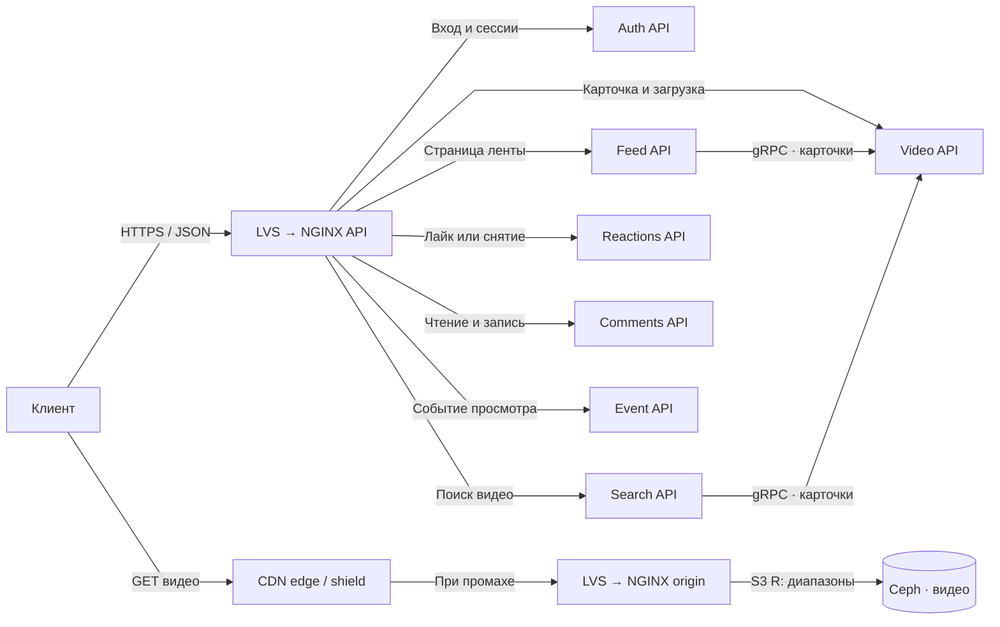

**Вход и регистрация.** Auth API проверяет учётные данные и сессии. Создание и активацию аккаунта выполняет Users API.

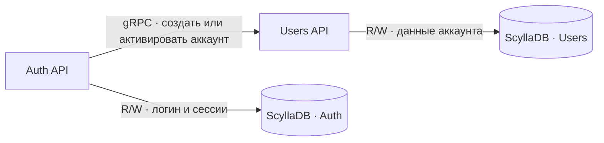

Потоки действий и связи с Kafka, статистикой и DWH показаны в [§9.5](#95-действия-пользователя-счётчики-и-dwh). Для защищённых операций сервисы проверяют сессию через Auth API. Клиент получает видео через CDN по ссылке из карточки и отдельно сообщает о просмотре в Event API.

При регистрации Auth резервирует нормализованный логин, вызывает Users для создания аккаунта PENDING с тем же user_id, затем активирует резерв и аккаунт. Повтор продолжает незавершённый шаг. Вход разрешён после активации обеих записей. Auth проверяет пароль по хешу из LoginReservation и выдаёт сессию. Выпуск и отзыв сессии используют LWT, проверка читает AuthByUser с QUORUM (§6.3–6.4).

| Владелец | Область данных | Как данные доступны другим сервисам |
| --- | --- | --- |
| Авторизация | ScyllaDB: LoginReservation, AuthByUser | Auth API проверяет сессии и права |
| Пользователи | ScyllaDB: UserById | Users API управляет аккаунтом |
| Видео | ScyllaDB: VideoById, VideoProcessingState. Redis: кэш карточек. Ceph: оригиналы и варианты | Video API отдаёт карточки и статус. Каталог публикует изменения. Origin читает опубликованные медиа |
| Реакции | ScyllaDB: UserVideoState | Reactions API читает собственный лайк и результат команды. Обработчик реакций публикует события смены состояния в Kafka |
| Комментарии | ScyllaDB: CommentByVideoBucketStripe | Comments API отдаёт страницы. Изменения доставляются в Kafka через outbox и relay |
| Рекомендации | ScyllaDB — UserHistory. Redis — FeedCache, CandidatePool. Ceph — резервные подборки | Feed API вычисляет интересы, объединяет кандидатов и ранжирует их |
| Статистика | ScyllaDB: VideoCounterById | Statistics API отдаёт публичные счётчики. Снимки из Kafka обновляют CandidatePool |
| Поиск | OpenSearch — текстовый индекс и VideoEmbedding | Search API выполняет текстовые и векторные запросы, индексаторы обновляют документы по событиям каталога |
| DWH | ClickHouse: ProductEvent | Контур выгрузки DWH готовит выборки для пакетных задач |

ScyllaDB и региональный Redis физически могут обслуживать несколько сервисов. Области таблиц и ключей имеют владельца. Только компоненты владельца обращаются к своей области напрямую. Например, поиск и лента читают карточки пакетным gRPC-вызовом Video API, а сборщик CandidatePool получает изменения каталога и счётчиков из Kafka. Relay и приёмники снимков работают в контурах соответствующих владельцев.

### 9.2. Рекомендации

**Запрос ленты.** Feed API проверяет FeedCache. При промахе читает историю, пакетами получает метаданные и лайки через Video API и Reactions API, вычисляет веса тегов. Search API возвращает векторных кандидатов, Redis — общие списки. После фильтров и ранжирования итоговый порядок записывается в кэш (§7.1). Перед выдачей карточки проверяет Video API. Ошибка Redis включает резервную сборку с курсором (§10.3).

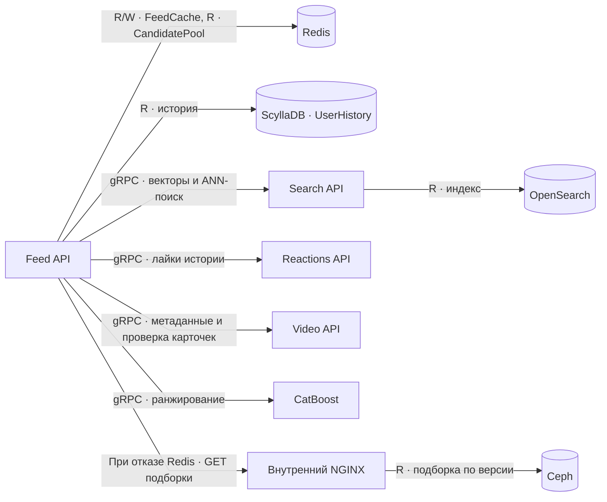

**Подготовка данных.** Поток просмотров обновляет историю (§9.5). Сборщик поддерживает CandidatePool в Redis и публикует региональные подборки в Ceph. По событиям каталога обработчик поиска вычисляет или обновляет эмбеддинг. Обучение CatBoost использует события из DWH.

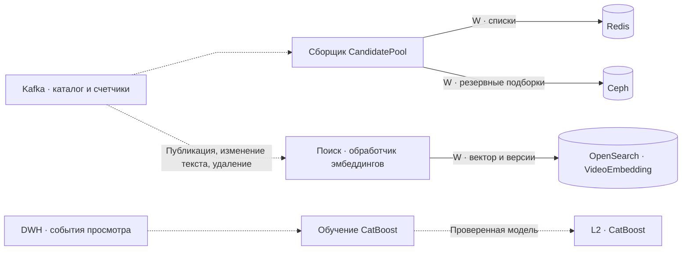

Сборщик CandidatePool применяет версии карточек и счетчиков. После потери своего состояния восстанавливается из каталога через Video API и итогов через Statistics API, затем догоняет журнал. Обработчик эмбеддингов принимает более новую версию метаданных. При смене модели строится новый индекс по снимку каталога и изменениям после него. После догонки и проверки переключается alias. Запрос фиксирует конкретный индекс для чтения векторов и поиска. Старый индекс удаляется после завершения начатых запросов. CatBoost переключается на полностью записанную и проверенную модель.

### 9.3. Загрузка, обработка и публикация видео

**Приём оригинала.** До выдачи адреса загрузки Video API сохраняет сессию, video_id, publication_id и ключ оригинала. Части идут в домашний регион через выделенный пул загрузки. Повтор сохраняет upload_id и номер части.

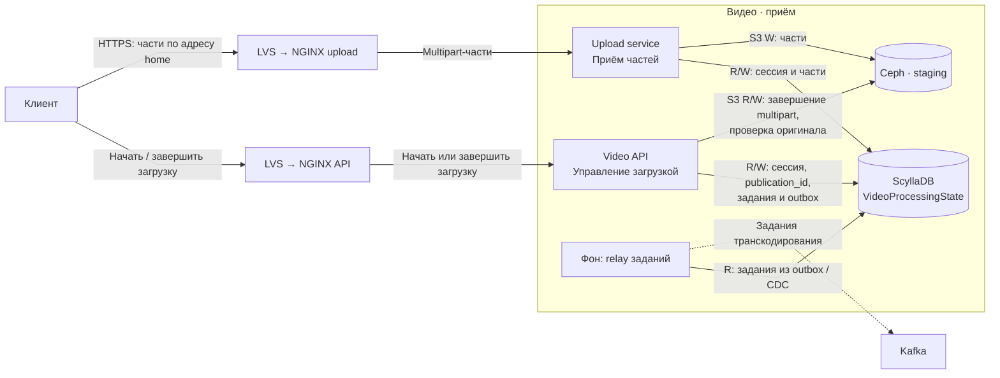

Подтверждение завершения означает, что оригинал проверен, состояние ACCEPTED, три задания и outbox сохранены одной условной записью в VideoProcessingState. publication_id берется из сессии. Повтор находит те же задания по паре (publication_id, качество). Если Ceph уже собрал файл до сбоя API, сервис проверяет его по сохраненному ключу. Relay передает задания в Kafka.

**Фоновая обработка.** Worker по заданию читает оригинал, кодирует своё качество и записывает неизменяемый объект попытки. Состояние задания определяет, какой результат принят. Проверка копий фиксирует checksum и готовность по каждому качеству и региону. Из сохранённого прогресса обработка продолжает только незаконченные шаги.

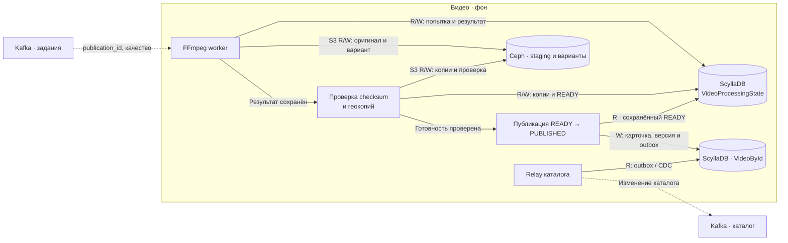

READY фиксируется после проверки девяти сочетаний «качество × регион» и временных копий оригинала в трёх регионах. Затем одна условная запись в партиции VideoById меняет статус на PUBLISHED и сохраняет версию и outbox (§7.2). При сбое после READY публикация продолжится по сохранённому манифесту. При повторе задания актуальный номер попытки защищает от запоздавшего worker. Оригинал очищается после подтверждения готовности вариантов и копий. Индексатор и сборщик CandidatePool получают событие после фиксации PUBLISHED.

### 9.4. Поиск

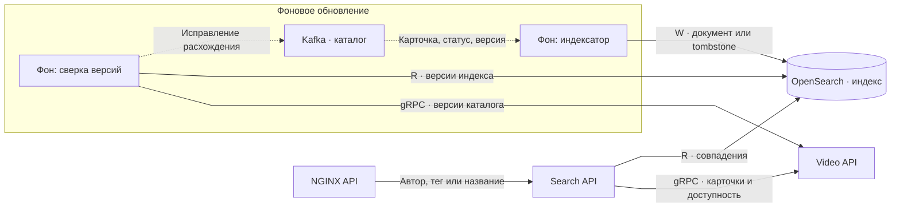

Search API извлекает ID из OpenSearch, запрашивает карточки у Video API пакетом и возвращает только доступные. Обновление индекса асинхронно. Индексатор применяет документ по video_id и версии, проверяет результаты Bulk и продвигает позицию после подтверждения обработки. Повтор той же версии даёт тот же документ. Старое событие не заменяет более новую карточку или отметку удаления. Фоновая сверка читает ID и версии через API каталога, сравнивает с индексом и отправляет актуальное состояние тем же путём.

### 9.5. Действия пользователя, счётчики и DWH

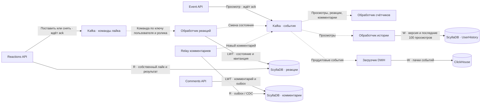

Просмотр подтверждается после ack Kafka. Для лайка ack означает приём команды, окончательный успех требует записи состояния. Комментарий подтверждается после записи в ScyllaDB. История обновляется по `user_id`, счётчики — по `video_id`. Границы подтверждения и повторы описаны в [§10.2](#102-асинхронные-потоки).
## 10. Обеспечение надёжности

### 10.1. Резервирование компонентов

Расчётный сценарий — отказ одного ЦОДа. Трафик уходит в два оставшихся (ДЗ 3.3), а пулы NGINX выдерживают потерю ещё одного узла на пул (ДЗ 4.3). Запас приложений и хранилищ проверяем на стенде.

| Компонент | Резерв и обнаружение отказа | Что происходит |
| --- | --- | --- |
| PowerDNS / GeoDNS | По серверу в каждом ЦОДе, проверки API, TTL 30 с | Неисправный VIP убирается из новых DNS-ответов. Клиенты с кэшем переключаются позже |
| LVS, Keepalived и внешний NGINX | Пара LVS на регион, VRRP и проверки узлов. Для API, upload и origin отдельные пулы N+1 | Резервный LVS принимает VIP и обслуживает весь региональный поток. Неисправный NGINX исключается из пула |
| Внутренний NGINX и API | Отдельный пул прокси (§11.1), от двух экземпляров каждого API на разных хостах. Проверки готовности | Прокси выбирает здоровый экземпляр. Сессии и результаты операций хранятся вне процесса |
| ScyllaDB | По реплике в каждом ЦОДе, QUORUM 2/3. Для LWT — SERIAL + QUORUM | Два ЦОДа продолжают работу. При таймауте результат записи проверяется по ID операции |
| Kafka, Streams и приёмники снимков | RF=3, `acks=all`, минимум 2 реплики в ISR. Резерв Streams в другом ЦОДе, состояние в changelog | Kafka выбирает лидера из ISR. При ISR <2 подтверждения записи нет. Streams восстанавливает состояние из changelog [15], [26], [42] |
| Relay, сверка и фоновые задачи | Резервные исполнители, сохранённые позиции или шаги. Сигналы — отставание, возраст задания и ошибки | Новый исполнитель продолжает с сохранённой позиции. Для рекомендаций сохраняется предыдущая полная версия индекса и модели |
| ClickHouse / DWH и OpenSearch | По три геокопии каждого шарда. Контроль реплик, задержки обработки и ошибок записи | Чтение переключается на реплику. DWH догоняет журнал, индекс при необходимости строится из каталога |
| KRaft, Keeper и OpenSearch cluster-manager | У каждой системы по три голосующих узла, по одному в ЦОДе | При отказе одного узла остаётся большинство 2/3. Кворум проверяем отдельно от числа копий данных [28], [29], [31] |
| Redis и сборщик CandidatePool | В регионе от трёх primary, по две реплики на других хостах. Контроль ошибок и возраста списков | Redis выбирает реплику при большинстве primary [30]. При недоступности кластера Feed API использует историю ScyllaDB, векторный поиск и подборки Ceph |
| Upload, FFmpeg и публикация | От двух исполнителей на разных хостах. Шаги хранятся в ScyllaDB, файлы — в Ceph | Обработка продолжается с сохранённого шага. При отказе ЦОДа приём в здоровых регионах ограничен ёмкостью staging |
| Ceph RGW и хранилище видео | Три геокопии, внутри ЦОДа EC 8+4. Проверки кворума, checksum и готовности копий | Готовое видео читается из другого ЦОДа. Новая публикация ждёт всех копий |
| CDN и origin | Несколько origin, проверки доступности и контроль доли попаданий в CDN | CDN повторяет GET через здоровый origin. При полном отказе CDN мощности origin не хватит на клиентский пик |
| Телеметрия | По два Prometheus на регион, три Alertmanager, несколько Collector и отдельный ClickHouse | При сбое приёмника события ждут в ограниченной очереди. Переполнение снижает полноту диагностики, API продолжает работать |
| Инфраструктура и резервные копии | Дубли питания и сети, региональные копии конфигураций, зашифрованные копии ключей. Резервные копии данных хранятся отдельно. Проверяем срок TLS и свежесть копий | При сбое CI/CD работает текущая версия. После порчи данных поднимаем отдельный кластер из копии и доступного журнала (ДЗ 6.6) |

### 10.2. Асинхронные потоки

| Паттерн и поток | Что подтверждаем и как повторяем |
| --- | --- |
| **Очередь команд** · лайки | API ждёт `acks=all` и проверяет квитанцию в ScyllaDB. Применённая команда возвращает `200`, принятая без результата — `202`, несовпадение хеша — `409`. Обработчик одной LWT записывает состояние и квитанцию, затем транзакция Kafka фиксирует позицию и событие смены состояния. Повтор использует ту же квитанцию и `event_id` (§6.3) |
| **Transactional outbox** · комментарии, каталог и задания видео | Изменение и outbox фиксируются одной LWT в партиции. Комментарий подтверждается после LWT. Relay отмечает доставку после ack Kafka. Если отметка потерялась, повтор уйдёт с тем же `event_id`. После истечения окна CDC отдельная задача берёт неподтверждённые записи из outbox [15], [19] |
| **Сбор событий** · просмотр → Event API → Kafka | API отвечает после `acks=all`. Клиент при повторе сохраняет `event_id`. Streams отбрасывает дубли в пределах окна повтора |
| **Цепочка фоновых заданий** · загрузка → FFmpeg → геокопии → публикация | Приём оригинала подтверждаем после проверки файла и записи задания. Worker продолжает сохранённый шаг, а номер попытки защищает от опоздавшего результата. `PUBLISHED` ставится после проверки всех копий (ДЗ 7.2) |
| **Асинхронные модели чтения** · Kafka Streams → история и счётчики | Streams фиксирует позицию, состояние и выходные события одной транзакцией Kafka. Приёмник фиксирует позицию после записи более нового снимка в ScyllaDB или проверки его версии. Повтор абсолютного значения счётчика не даёт второго начисления [26] |
| **Событийное обновление поиска** · каталог → OpenSearch | Индексатор проверяет каждый ответ Bulk и сохраняет позицию, когда обновление прошло или в индексе уже есть более новая версия. Повтор версии безопасен, если она содержит то же полное состояние [41] |
| **Фоновые обновления** · CandidatePool, DWH и модели | Сборщик обновляет списки по версиям каталога и счётчиков. После сбоя начинает со снимка и догоняет журнал. Загрузчик DWH фиксирует позицию после записи пачки, выборка с `FINAL` убирает дубли по дате и ID. Новую модель CatBoost и индекс эмбеддингов включаем после подготовки и проверки (§9.2, §9.5) |

**Хранение команд лайков.** Автоудаление в отдельном топике отключаем. Удаляем только обработанный префикс до подтверждённой позиции с запасом 24 ч на технический повтор [61]. Квитанции ScyllaDB храним до очистки соответствующего участка журнала и конца клиентского окна. Лимит диска и возраст очереди контролируем до записи. При исчерпании запаса API временно отклоняет новые команды. Клиент повторяет запрос с прежним `operation_id`.

**Сверка поиска.** Фоновый процесс сравнивает версии каталога с текстовым и векторным индексами и отправляет исправления через Kafka. Для вектора также проверяет версию модели. Пустой текст исключает ролик из векторного индекса, а свежие и популярные списки сохраняют его доступность в рекомендациях. Цель — суточный обход с лимитом 5 000 карточек/с. При нагрузке на каталог или поиск сверка замедляется и продолжает с сохранённой позиции. При удалении в обоих индексах сохраняется запись `deleted=true` с версией минимум на 30 дней. Вектор из нее удаляется, запросы исключают такие документы. Позднее событие с меньшей версией отбрасывается. Старые повторы за пределами рабочего окна обрабатываются отдельно от текущих счётчиков и индекса.

### 10.3. Деградация при отказах

**1. ЦОД недоступен до READY.** Зрители смотрят опубликованные ролики через CDN и здоровые origin. Загрузка в недоступный домашний ЦОД приостанавливается. В здоровых регионах при открытии сессии резервируем место для оригинала и промежуточных файлов. При заполнении квоты API ограничивает новые загрузки. Принятые оригиналы и результаты обработки хранятся до готовности копий. Автор видит «ожидает копирования». После восстановления обработчик продолжает с сохранённого шага и дозирует копирование. `RPO 0` для медиа относится к опубликованным роликам с проверенными геокопиями. Принятый оригинал без геокопии при отказе домашнего ЦОДа ждёт восстановления площадки.

**2. Redis недоступен.** Feed API читает историю из ScyllaDB и через Search API ищет соседей до трех недавних роликов с эмбеддингами по правилам §7.1. Штатное ранжирование заменяется порядком сходства, затем добавляются общие кандидаты. При пустой истории, нехватке кандидатов или отказе векторного поиска используются популярные и новые видео региона. Сборщик CandidatePool раз в 15 с публикует полную версию общих списков в Ceph отдельной записью. Внутренний NGINX кэширует версионные подборки на диске. Подборка пригодна до 15 минут с момента публикации.

Feed API исключает дубли и просмотренные видео. Подписанный и зашифрованный курсор связывает с пользователем до 100 упорядоченных ID, позицию и срок до 15 минут, ограниченный сроком использованной подборки. На страницу Feed API передаёт одним вызовом до 40 ID в Video API и возвращает до 20 роликов после проверки публикации, удаления и прав показа. Позиция продвигается до 20-го допущенного ролика или до конца проверенного пакета, если допущенных меньше. При возврате Redis новые ленты собираются штатно, действующий резервный курсор сохраняет порядок до истечения срока. Если источники резерва недоступны, проверку нельзя выполнить или лимит параллельных вызовов исчерпан, Feed API отвечает `503`.

Пик с запасом после перераспределения нагрузки — `ceil(11 541,67 × 65%) = 7 503` пакетных вызова/с на регион, до 300 120 проверяемых ID/с. Замеряем Video API под остальным трафиком с отключённым Redis, включая промахи его кэша карточек и чтения из ScyllaDB.

### 10.4. Цели и проверка восстановления

За 30 дней цель для ленты и комментариев — 99,9% успешных ответов за 3 с. Для лайков измеряем время до приёма команды в Kafka и отдельно ставим цель 99,9% команд, применённых в ScyllaDB, за 3 с от запроса. Для ленты целевой p95 — 500 мс, отдельно измеряем долю резервных страниц и `503`. Цель публикации 99% за 10 мин действует при штатной доступности трёх ЦОДов. При отказе ЦОДа измеряем возраст очереди и время её разбора. Для счётчиков — 99% событий за 60 с.

| Отказ | Что сохраняется | Цель восстановления |
| --- | --- | --- |
| Один ЦОД | Подтверждённые записи ScyllaDB и Kafka при исправных оставшихся копиях (RPO 0) | API ≤60с для 99% контрольных запросов, Kafka/Streams ≤5 мин |
| Один LVS, NGINX или API | Подтверждённые записи хранятся вне процесса | Переключение ≤30с |
| Один ЦОД с медиа | Опубликованные ролики с проверенными геокопиями (RPO 0) | Смена origin ≤60с. Публикация ждёт восстановления копий |
| Потеря Redis | История, векторный поиск и региональные подборки доступны независимо от Redis | Лента переключается на резервный путь. Измеряем переключение и постепенный прогрев кэша |
| Потеря индекса | Каталог сохраняется, лента использует доступные генераторы | Текстовый индекс и эмбеддинги восстанавливаются из каталога. Время перестройки замеряем |
| Порча данных | Проверенная резервная копия и доступный журнал | Срок определяется пробным восстановлением |

## 11. Серверы и хостинг

Серверы размещаем в Ростелеком-ЦОД в Москве, Екатеринбурге и Новосибирске. Для раздачи видео выбираем Cloud.ru CDN, у которого есть публичный прайс. Второй вариант — NGENIX с Origin Shield [47, 49–51].

### 11.1. Серверы

Количество указано в порядке **Москва / Екатеринбург / Новосибирск**. Цена сервера с NVMe включает два системных SSD.

| Сервисы | Конфигурация одного сервера | M / E / N | Цена, млн ₽ за сервер |
| --- | --- | ---: | ---: |
| Внешний NGINX (API, upload, origin) | 1U, 8 ядер, 32 GB, 2×480 GB SSD, 4×10GbE | 72 / 69 / 69 | 0,5 |
| LVS и Keepalived | 2U, 32 ядра, 128 GB, 2×480 GB SSD, 4×100GbE | 2 / 2 / 2 | 1,5 |
| PowerDNS и проверки GeoDNS | 1U, 8 ядер, 32 GB, 2×480 GB SSD, 2×10GbE | 1 / 1 / 1 | 0,45 |
| Go API: Auth, Users, Feed, Video, Search, Comments, Reactions, Event, Statistics | 2U, 64 ядра, 256 GB, 2×1,92 TB NVMe, 2×25GbE | 13 / 10 / 10 | 2,6 |
| Внутренний NGINX для gRPC и резервных подборок | 1U, 16 ядер, 64 GB, 2×960 GB SSD, 2×25GbE | 9 / 8 / 8 | 0,85 |
| Upload service | 1U, 16 ядер, 64 GB, 2×960 GB SSD, 2×25GbE | 2 / 2 / 2 | 0,85 |
| ScyllaDB | 2U, 32 ядра, 256 GB, 2×3,84 TB NVMe, 2×25GbE | 34 / 34 / 34 | 2,1 |
| Kafka, брокеры | 2U, 32 ядра, 256 GB, 2×3,84 TB NVMe, 2×25GbE | 19 / 19 / 19 | 2,1 |
| Обработчики реакций, Kafka Streams, приёмники снимков и загрузчики DWH | 2U, 32 ядра, 128 GB, 2×1,92 TB NVMe, 2×25GbE | 10 / 10 / 10 | 1,45 |
| ClickHouse, продуктовые события | 2U, 32 ядра, 256 GB, 4×3,84 TB NVMe, 2×25GbE | 8 / 8 / 8 | 2,4 |
| ClickHouse, логи и трассы | 2U, 32 ядра, 256 GB, 4×3,84 TB NVMe, 2×25GbE | 6 / 6 / 6 | 2,4 |
| OpenSearch, данные | 2U, 32 ядра, 256 GB, 4×3,84 TB NVMe, 2×25GbE | 7 / 5 / 5 | 2,4 |
| Redis Cluster | 1U, 16 ядер, 128 GB, 2×960 GB SSD, 2×25GbE | 9 / 9 / 9 | 1 |
| KRaft, Keeper и OpenSearch cluster-manager | 1U, 8 ядер, 32 GB, 2×480 GB SSD, 2×10GbE | 3 / 3 / 3 | 0,45 |
| FFmpeg | 2U, 32 ядра, 256 GB, 2×1,92 TB NVMe, 2×25GbE, 4×NVIDIA L4 | 36 / 19 / 19 | 4,2 |
| CatBoost, ранжирование | 2U, 32 ядра, 128 GB, 2×1,92 TB NVMe, 2×25GbE | 5 / 4 / 4 | 1,45 |
| Фоновые задачи — CandidatePool, эмбеддинги, обучение, relay, публикация и поиск | 2U, 32 ядра, 128 GB, 2×1,92 TB NVMe, 2×25GbE | 5 / 5 / 5 | 1,45 |
| Prometheus и Alertmanager | 2U, 32 ядра, 128 GB, 2×1,92 TB NVMe, 2×25GbE | 2 / 2 / 2 | 1,45 |
| OpenTelemetry Collector | 1U, 16 ядер, 64 GB, 2×960 GB SSD, 2×25GbE | 4 / 4 / 4 | 0,85 |
| Grafana, конфигурация и артефакты CI | 1U, 16 ядер, 64 GB, 2×960 GB SSD, 2×25GbE | 2 / 2 / 2 | 0,85 |
| Ceph OSD рабочих копий | 2U, 2×48 ядер, 256 GB, 24×15,36 TB NVMe, 2×100GbE | 25 / 25 / 25 | 27 |
| Ceph RGW | 2U, 32 ядра, 128 GB, 2×960 GB SSD, 2×100GbE | 9 / 9 / 9 | 1,6 |
| Ceph MON и MGR | 1U, 8 ядер, 32 GB, 2×480 GB SSD, 2×10GbE | 3 / 3 / 3 | 0,45 |
| **Всего 804 сервера** | | **286 / 259 / 259** | |

### 11.2. Смета на 30 дней

Всего 143 стойки. На каждый основной ЦОД берём восемь каналов по 100 Гбит/с. При отказе маршрутизатора остаётся 400 Гбит/с при потребности около 352 Гбит/с.

Видео для CDN — **561 ПБ за 30 дней** по суточному объёму из ДЗ 2.3.

| Статья | Расчёт | Млн ₽/мес. |
| --- | --- | ---: |
| Серверы основных ЦОДов | 3 225,2 млн ₽ / 60 мес. | 53,75 |
| Стойки и питание | 143 × 104,8–134,2 тыс. ₽ по тарифам MCN и DataHouse [57] | 14,99–19,19 |
| Интернет | 24 канала по 100 Гбит/с × 3,355–5 млн ₽ (тариф 10G IMAQLIQ × 10 и тариф 100G GalaxyData) [58] | 80,52–120 |
| CDN | 560,925 млн ГБ × 0,6039–0,854 ₽/ГБ (пакет 100 ТБ и цена за ГБ в прайсе Cloud.ru [50]) | 338,74–479,03 |
| **Всего за 30 дней** | | **488,00–671,97** |

### 11.3. Покупка или аренда

При покупке серверы стоят **3 225,2 млн ₽** сразу. Если разделить эту сумму на 60 месяцев, получаем **53,75 млн ₽ в месяц**. Вместе с размещением, интернетом и CDN — **488,00–671,97 млн ₽ в месяц**.

Для аренды берём публичные цены Cloud.ru и Selectel [64, 65].

| Что арендуем | Расчёт | Млн ₽/мес. |
| --- | --- | ---: |
| Ceph OSD | 375 серверов Cloud.ru с 10×7,68 TB NVMe: по пять вместо каждого из 75 серверов с 24×15,36 TB; 375 × 1 084 994,312 ₽ | 406,87 |
| Go API | 33 сервера Cloud.ru с 64 ядрами: 33 × 668 873,906 ₽ | 22,07 |
| FFmpeg | 296 серверов Selectel с одной NVIDIA L4: по четыре вместо каждого из 74 серверов с четырьмя L4; 296 × 58 500 ₽ | от 17,32 |
| Остальные сервисы | 622 сервера Cloud.ru с 56 ядрами: 622 × 225 199,80 ₽ | 140,07 |
| **Всего серверы** | | **около 586,34** |
| Интернет и CDN | Те же оценки, что в смете покупки | 419,26–599,03 |
| **Всего аренда** | | **около 1 005,60–1 185,37** |

## Источники

1. TikTok Newsroom. «Thanks a billion!», 27.09.2021: [официальное сообщение](https://newsroom.tiktok.com/1-billion-people-on-tiktok-my?lang=en-MY).
2. Mediascope Cross Web. [Рейтинги и правила описания измерений](https://mediascope.net/data/)
3. YouTube Help. [Recommended upload encoding settings](https://support.google.com/youtube/answer/1722171?hl=en).
4. Google Cloud. [Logs and metrics for caching](https://docs.cloud.google.com/cdn/docs/logging)
5. NGINX, 11.04.2019. [Testing the Performance of NGINX Ingress Controller for Kubernetes](https://blog.nginx.org/blog/testing-performance-nginx-ingress-controller-kubernetes).
6. NGINX, 24.08.2017. [Testing the Performance of NGINX and NGINX Plus Web Servers](https://blog.nginx.org/blog/testing-the-performance-of-nginx-and-nginx-plus-web-servers).
7. NGINX. [Upstream module](https://nginx.org/en/docs/http/ngx_http_upstream_module.html): least_conn, keepalive, max_fails/fail_timeout; активные health checks имеют отдельные условия доступности.
8. PowerDNS Authoritative. [Lua records](https://doc.powerdns.com/authoritative/lua-records/index.html), [HTTP API](https://doc.powerdns.com/authoritative/http-api/index.html): GeoIP, динамические ответы, фоновые проверки и управление конфигурацией.
9. Mediascope. [Медиапотребление 2024, 27.08.2024, слайд 11](https://mediascope.net/upload/iblock/f33/ual5i70kf7n9df7qzkq0gf238bidh3xv/%D0%9C%D0%B5%D0%B4%D0%B8%D0%B0%D0%BF%D0%BE%D1%82%D1%80%D0%B5%D0%B1%D0%BB%D0%B5%D0%BD%D0%B8%D0%B5%202024_%D0%9D%D0%90%D0%A2_27.08.2024.pdf): Cross Web, Россия 12+, desktop и mobile, январь–июль 2024.
10. Pew Research Center, 18.02.2025. [What we know about TikTok content creators](https://www.pewresearch.org/short-reads/2025/02/18/what-we-know-about-tiktok-content-creators/): авторы, на которых подписаны взрослые пользователи США.
11. Pew Research Center, 22.02.2024. [How U.S. Adults Use TikTok](https://www.pewresearch.org/internet/2024/02/22/how-u-s-adults-use-tiktok/): опрос взрослых пользователей США в августе 2023.
12. AWS MediaConvert. [Automated ABR](https://docs.aws.amazon.com/mediaconvert/latest/ug/auto-abr.html): подбор вариантов по исходному видео и качеству.
13. ScyllaDB. [Lightweight Transactions](https://docs.scylladb.com/manual/stable/features/lwt.html): условные записи, атомарный conditional batch в одной партиции, запрет межпартиционных batches и ограничение на смешивание LWT/non-LWT writes.
14. ScyllaDB. [Data Distribution with Tablets](https://docs.scylladb.com/manual/stable/architecture/tablets.html): отображение партиций на tablets, splitting и перенос tablet-реплик при изменении топологии.
15. Apache Kafka. [Design: Message Delivery Semantics](https://kafka.apache.org/42/design/design/), [Producer Configs](https://kafka.apache.org/42/configuration/producer-configs/): транзакции, idempotence, offsets и ограничения при внешних приемниках.
16. ClickHouse. [ReplacingMergeTree](https://clickhouse.com/docs/reference/engines/table-engines/mergetree-family/replacingmergetree), [ReplacingMergeTree guide](https://clickhouse.com/docs/guides/replacing-merge-tree): фоновая дедупликация и FINAL.
17. Redis. [Replication](https://redis.io/docs/latest/operate/oss_and_stack/management/replication/): асинхронность репликации и ограничения WAIT.
18. Ceph. [RGW Multisite](https://docs.ceph.com/en/latest/radosgw/multisite/), [S3 bucket operations](https://docs.ceph.com/en/latest/radosgw/s3/bucketops/), [Erasure coding](https://docs.ceph.com/en/latest/rados/operations/erasure-code/): геосинхронизация, versioning и избыточность. Страницы latest сверяются с выбранным стабильным релизом перед внедрением.
19. ScyllaDB. [Data Consistency in CDC](https://docs.scylladb.com/manual/stable/features/cdc/cdc-consistency.html), [CDC schema and TTL](https://docs.scylladb.com/manual/stable/cql/ddl.html#cdc-options), [CDC basics](https://docs.scylladb.com/manual/stable/features/cdc/cdc-basic-operations.html): совместная запись base table и CDC, уровни согласованности, настраиваемый конечный срок хранения и поведение TTL.
20. OpenSearch. [Creating a cluster: shard allocation awareness](https://docs.opensearch.org/latest/tuning-your-cluster/): primary/replica shards и размещение по зонам.
21. ScyllaDB. [Consistency Levels](https://docs.scylladb.com/manual/stable/cql/consistency.html), [NetworkTopologyStrategy](https://docs.scylladb.com/manual/stable/cql/ddl.html#networktopologystrategy): уровни подтверждения и размещение реплик по ЦОДам: по одной копии в M/E/N, глобальные QUORUM и SERIAL.
22. ClickHouse. [Backup and restore](https://clickhouse.com/docs/concepts/features/backup-restore/overview): независимые резервные копии и восстановление.
23. ScyllaDB. [ScyllaDB CQL Drivers](https://gocql-driver.docs.scylladb.com/stable/), [official ScyllaDB Go driver](https://github.com/scylladb/gocql): shard-aware routing по partition key.
24. ScyllaDB Manager. [Backup](https://manager.docs.scylladb.com/stable/backup/), [Restore](https://manager.docs.scylladb.com/stable/restore/): snapshots в S3/S3-compatible storage и последовательность восстановления.
25. ScyllaDB. [Announcing ScyllaDB 2025.4](https://www.scylladb.com/2026/01/08/announcing-scylladb-2025-4/): release notes указывают поддержку CDC и LWT для tablet-enabled tables с 2025.4.

26. Apache Kafka. [Kafka Streams Core Concepts](https://kafka.apache.org/35/documentation/streams/core-concepts/): state stores, changelog topics и exactly_once_v2 для входов, состояния и выходов внутри Kafka.
27. CatBoost. [Classification losses](https://catboost.ai/docs/en/concepts/loss-functions-classification): Logloss для бинарной классификации.

28. Apache Kafka. [KRaft](https://kafka.apache.org/42/operations/kraft/): кворум контроллеров отдельно от репликации topic.
29. ClickHouse. [Replicated table engines](https://clickhouse.com/docs/reference/engines/table-engines/mergetree-family/replication), [Keeper](https://clickhouse.com/docs/guides/sre/keeper/clickhouse-keeper): асинхронная репликация и координация.
30. Redis. [Cluster specification](https://redis.io/docs/latest/operate/oss_and_stack/reference/cluster-spec/): большинство primary и выбор реплики.
31. OpenSearch. [Shard allocation awareness](https://docs.opensearch.org/latest/tuning-your-cluster/availability-and-recovery/shard-allocation-awareness/), [Voting and quorum](https://docs.opensearch.org/latest/tuning-your-cluster/discovery-cluster-formation/voting-quorums/).
32. Ceph. [Monitor quorum](https://docs.ceph.com/en/latest/rados/operations/add-or-rm-mons/), [Pools and min_size](https://docs.ceph.com/en/latest/rados/operations/pools/): служебный кворум и границы I/O при деградации.
33. Prometheus. [Alertmanager](https://prometheus.io/docs/alerting/latest/alertmanager/): группировка, дедупликация и маршрутизация оповещений.
34. OpenSearch. [Snapshots](https://docs.opensearch.org/latest/tuning-your-cluster/availability-and-recovery/snapshots/index/): резервные копии индексов и состояния кластера.
35. Prometheus. [Storage](https://prometheus.io/docs/prometheus/latest/storage/): локальная TSDB, ограничения по времени и размеру.
36. OpenTelemetry. [Collector resiliency](https://opentelemetry.io/docs/collector/resiliency/): очереди, persistent storage, retry и условия потери телеметрии.
37. OpenTelemetry Collector Contrib. [Filelog receiver](https://github.com/open-telemetry/opentelemetry-collector-contrib/tree/main/receiver/filelogreceiver): чтение файлов и сохранение offsets.
38. OpenTelemetry Collector Contrib. [ClickHouse exporter](https://github.com/open-telemetry/opentelemetry-collector-contrib/tree/main/exporter/clickhouseexporter): доставка traces/logs в ClickHouse.
39. Grafana. [ClickHouse datasource](https://grafana.com/grafana/plugins/grafana-clickhouse-datasource/): подключение и визуализация данных ClickHouse.
40. Grafana k6. [Constant arrival rate](https://grafana.com/docs/k6/latest/using-k6/scenarios/executors/constant-arrival-rate/): открытая модель нагрузки и ограничения генератора.
41. OpenSearch. [Index Document API: external versioning](https://docs.opensearch.org/latest/api-reference/document-apis/index-document/): сравнение внешних версий при повторной доставке полного документа.
42. Apache Kafka. [Broker Configs](https://kafka.apache.org/42/configuration/broker-configs/): `min.insync.replicas` и взаимодействие с `acks=all`.
43. Курс Highload. [Базовый расчёт аппаратных ресурсов и выбор хостинга](https://github.com/init/highload/blob/main/highload_l11_hosting.md).
44. ScyllaDB. [Maximizing ScyllaDB Performance](https://docs.scylladb.com/manual/branch-2025.4/operating-scylla/procedures/tips/benchmark-tips.html), [тест смешанной нагрузки на AWS i4i](https://www.scylladb.com/2022/09/07/benchmarking-scylladb-5-0-on-aws-i4i-4xlarge/).
45. NVIDIA. [Производительность NVENC](https://docs.nvidia.com/video-technologies/video-codec-sdk/13.1/nvenc-application-note/), [характеристики L4](https://www.nvidia.com/en-sg/data-center/l4/).
46. Ceph. [Ресурсы на один OSD](https://docs.ceph.com/en/latest/start/minimum-hardware/). Supermicro. [Сервер 2U на 24 NVMe](https://www.supermicro.com/en/products/system/hyper/2u/as%20-2125hs-tnr).
47. Ростелеком-ЦОД. [ЦОДы в Москве, Екатеринбурге и Новосибирске](https://www.company.rt.ru/ir/news_calendar/d460740/), [размещение оборудования в Новосибирске](https://www.company.rt.ru/press/news_ir/news/d457923/).
48. Key Point. [Размещение оборудования в Новосибирске](https://www.keypoint-group.ru/cod/novosibirsk/).
49. Cloud.ru. [CDN и ёмкость сети](https://cloud.ru/products/cloud-cdn), [описание услуги и экранирования](https://cdn.cloud.ru/docs/legal/contracts/terms-of-service/crs/current-version/description-cdn.pdf).
50. Cloud.ru. [Прайс CDN](https://cdn.cloud.ru/docs/legal/tariffs/crs/current-version/cdn.pdf), строки 23 и 30.
51. NGENIX. [Каталог сервисов](https://help.ngenix.net/user-docs/services/), [Origin Shield](https://help.ngenix.net/user-docs/origin-shield-osd/).
52. B2Bay. [Сервер с Xeon E-2488](https://b2bay.ru/product/E-2488/). PORT-IT. [Пример цены сервера на 64 ядра и 256 GB](https://port-it.ru/index.php?code=R2D5F584&route=extension%2Fportit%2Fserver_builder.pdf).
53. Сервер Центр. [NVMe Samsung PM9A3 3,84 TB](https://server-center.ru/products/nakopitel-samsung-pm9a3-384tb-mzql23t8hcls-00a07). ITequip. [NVMe Samsung PM9D3a 15,36 TB](https://itequiprus.ru/catalog/drives/nvme-u-2-u-3/).
54. KNS. [HDD Toshiba 20 TB](https://www.kns.ru/product/zhestkii-disk-toshiba-20tb-mg10aca20te/). Olsys. [4U-платформа на 24 HDD](https://olsys.ru/product/servernaya-platforma-snr-sr4224re-4u-amd-epyc-ddr4-24xhdd-rezerviruemyj-bp/).
55. Compstone. [Открытая цена NVIDIA L4](https://compstone.ru/product/nvidia-900-2g193-0000-000/).
56. NVIDIA. [Порты и разветвление линий SN4700](https://networking-docs.nvidia.com/sn4000hw/cable-installation). ITequip. [Цены коммутаторов 25/100GbE](https://itequiprus.ru/kupit/kommutator-100g/), [цена SN4700](https://itequiprus.ru/vendor/mellanox/).
57. [Тарифы стоек MCN](https://datacenter.mcn.ru/arenda-stoek/) и [DataHouse](https://datahouse.ru/price/).
58. [Тарифы IMAQLIQ на гарантированный интернет](https://iqdata.center/channels-and-communication-lines/) и [GalaxyData](https://galaxydata.ru/colocation/).
59. [RETN Capacity: магистральные каналы](https://www.retn.ru/products/capacity), [РКК: прайс на каналы, пункт 1.10](https://rck.su/media/uploads/2025/12/12/perechen_i_stoimost_tarifov_s_01-01-2026_kTJBBIP.pdf).
60. Sentence Transformers. [paraphrase-multilingual-MiniLM-L12-v2](https://huggingface.co/sentence-transformers/paraphrase-multilingual-MiniLM-L12-v2) — текстовая модель, размерность 384, mean pooling и ограничение входа 128 токенами.
61. Apache Kafka. [RecordsToDelete](https://kafka.apache.org/43/javadoc/org/apache/kafka/clients/admin/RecordsToDelete.html): удаление префикса партиции по позиции.
62. OpenSearch. [Methods and engines](https://docs.opensearch.org/latest/mappings/supported-field-types/knn-methods-engines/) — HNSW, Faiss, параметры поиска и оценка памяти индекса.
63. OpenSearch. [Creating a vector index](https://docs.opensearch.org/latest/vector-search/creating-vector-index/) — хранение готовых векторов в поле `knn_vector`.

64. Cloud.ru. [Тарифы Evolution Bare Metal](https://cdn.cloud.ru/docs/legal/tariffs/evolution/current-version/evolution-bare-metal.pdf), цены с НДС.
65. Selectel. [Аренда сервера с NVIDIA L4](https://selectel.ru/services/gpu/), цена от 58 500 ₽/мес.
