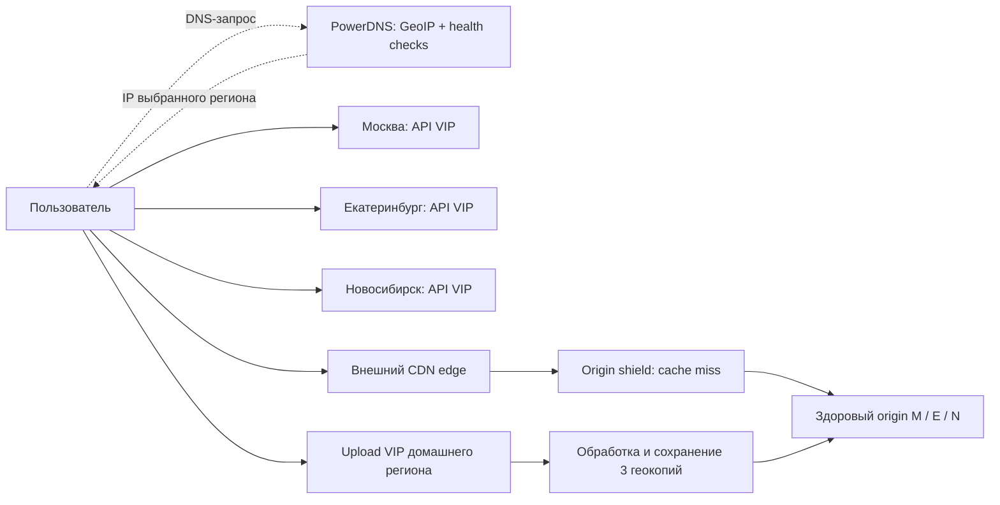
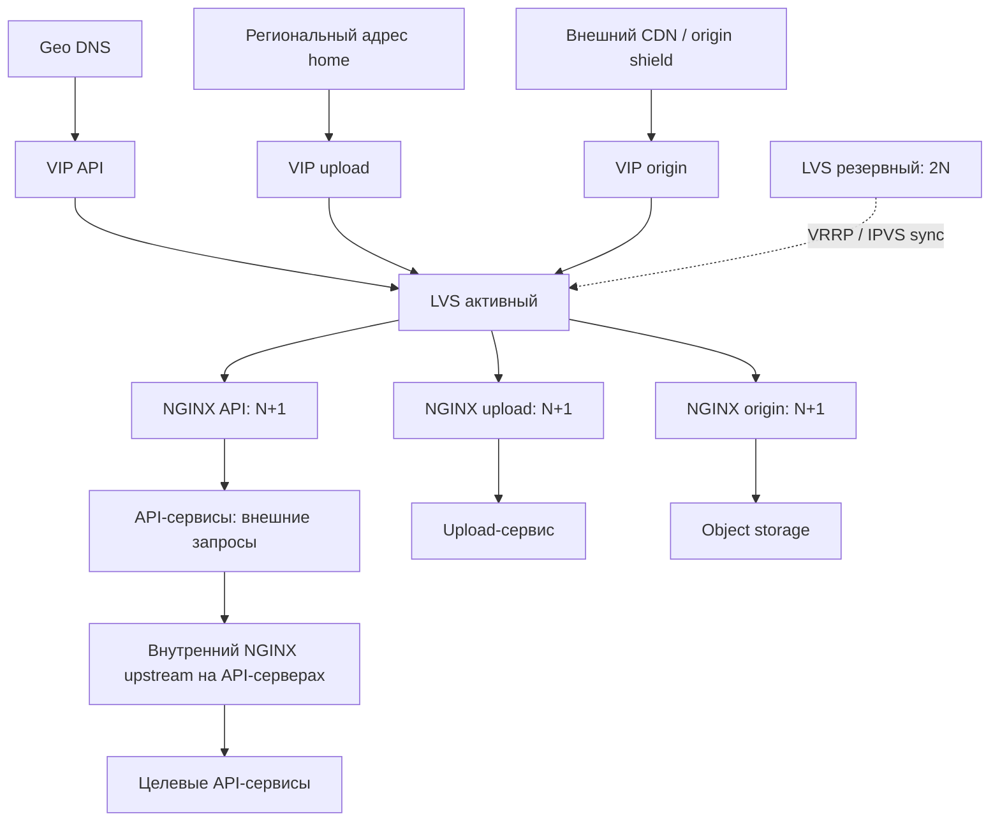
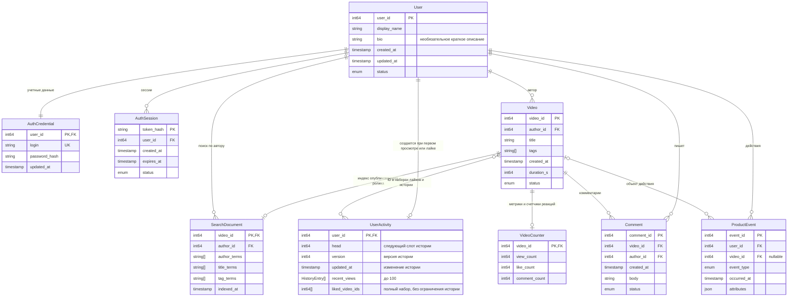
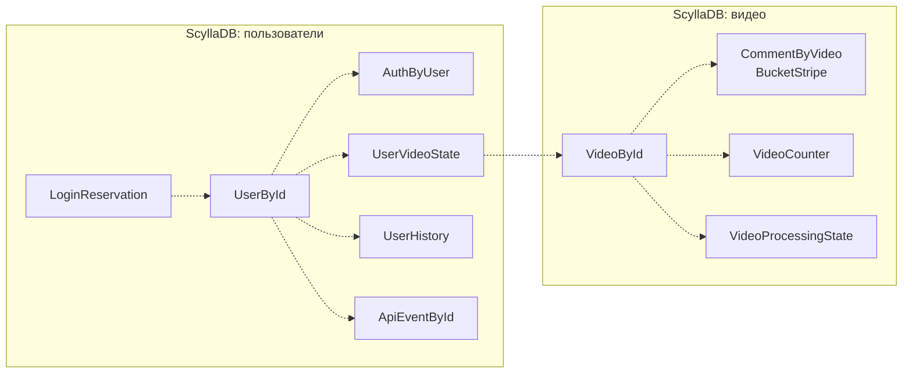

# Высоконагруженный сервис коротких вертикальных видео

## 1. Тема, аудитория и функционал

Сервис коротких вертикальных видео для пользователей России от 12 лет. Аналог — TikTok: более 1 млрд MAU в мире на сентябрь 2021 года [1]. Расчетная аудитория в России — **56,5 млн MAU и 27,7 млн DAU** [2].

MVP включает пять функций:

1. Загрузка и публикация готового видео длительностью до 3 минут.
2. Просмотр персонализированной ленты по истории и длительности просмотров.
3. Лайки и комментарии.
4. Поиск видео по автору, тегу и названию.
5. Регистрация и авторизация пользователей.

Сервис хранит видео в трех вариантах качества: 480p, 720p и 1080p. После подтверждения лайк сразу виден пользователю, который его поставил. Публичные счетчики могут обновляться с задержкой до минуты. Ролик становится доступен после обработки и сохранения копий во всех регионах. В MVP не входят трансляции, сообщения, реклама и видеоредактор.

## 2. Расчет нагрузки

### 2.1. Исходные параметры

Единицы десятичные: `1 KB = 10³ B`, `1 MB = 10⁶ B`, `1 GB = 10⁹ B`, `1 TB = 10¹² B`, `1 PB = 10¹⁵ B`; `1 B = 8 bit`. Расчеты выполняются до округления.

| Параметр | Значение | Основание |
| --- | ---: | --- |
| MAU / DAU | 56,5 / 27,7 млн | Целевая аудитория|
| Все зарегистрированные аккаунты | 113 млн | Допущение: 2 × MAU; неактивные аккаунты сохраняются |
| Воспроизведение на DAU в сутки | 60 мин | Mediascope: 73 мин использования TikTok среди пользователей, Россия 12+, январь–июль 2024 [9]. Из этого времени в модели отводим 60 мин на видео, остальное на другие действия |
| Длительность ролика / средний просмотр | 30 / 20 с | Допущения. Pew приводит среднюю длину 21 и 39 с для разных групп авторов [10]; это ориентир, а не среднее по платформе. 20 с просмотра источником не подтверждены |
| Авторы среди DAU / публикаций на автора в сутки | 2 % / 0,2 | Допущения: 554 тыс. авторов, в среднем один ролик за пять дней на автора. 2 % — доля авторов в аудитории, а не доля опубликовавших ролик именно сегодня |
| Оригинал, 30 с | 46,44 MB | Входной профиль 1080p60: 12 Mbit/s видео + 0,384 Mbit/s стереоаудио по рекомендации YouTube [3]; `(12 + 0,384) × 30 / 8`. Выбор этого профиля для среднего оригинала — допущение |
| Варианты 480p / 720p / 1080p | 0,75 / 1,5 / 3 Mbit/s | Проектные полные битрейты, включая аудио; три файла занимают 2,8125 / 5,625 / 11,25 MB |
| Производные варианты вместе | 19,6875 MB | `30 × (0,75 + 1,5 + 3) / 8` |
| Средний битрейт доставки | 1,5 Mbit/s | Допущение о долях времени 480p/720p/1080p — 40/40/20 %: `0,4 × 0,75 + 0,4 × 1,5 + 0,2 × 3` |
| Возраст каталога / срок хранения оригинала | 5 лет / до 1 суток | Для каталога — 1 825 дней постоянной нагрузки. Оригинал удаляем после успешной обработки и сохранения вариантов; сутки — расчетное окно временного буфера |
| Сырые продуктовые события / история | 30 дней / последние 100 просмотров | Общая аналитика действий MVP хранится в архиве; последние просмотры — списком по пользователю |
| Срок сессии | 10 дней | Допущение для расчета авторизации и временного хранения сессий |
| Репликация | 3 копии | По одной в Москве, Екатеринбурге и Новосибирске |
| CDN byte hit ratio | 98 % базовый; 90 % для мощности origin | Допущения о доле байтов, отданных из кэша; не статистика провайдера [4] |

Доля авторов 2 % не подтверждена источником: показатель Pew «52 % когда-либо публиковали видео» относится к взрослым пользователям США, а не к DAU [11]. Частота 0,2 публикации в сутки — допущение; ориентир Pew — от одного до нескольких постов в неделю у разных групп авторов [10].

Три готовых файла занимают 42,4 % оригинала: при перекодировании суммарный битрейт снижается с 12,384 до 5,25 Mbit/s. Принцип подбора вариантов описан в AWS MediaConvert [12]; качество выбранной лестницы нужно проверить пробным кодированием.

`Просмотры/DAU = 60 × 60 / 20 = 180`; `просмотры/сутки = 27,7 млн × 180 = 4 986 000 000`.
`Публикации/сутки = 27,7 млн × 0,02 × 0,2 = 110 800`.

| Действие | На одного DAU в сутки | Основание |
| --- | ---: | --- |
| Просмотр | 180 | 60 мин воспроизведения / 20 с |
| Получение страницы ленты | 9 | Допущение: 20 роликов на страницу |
| Открытие списка комментариев | 18 | В 10 % просмотров |
| Лайк | 18 | Допущение: в 10 % просмотров |
| Комментарий | 1,8 | Допущение: в 1 % просмотров |
| Поиск по автору, тегу или названию | 3 | Допущение: суммарно три запроса поиска, по 20 результатов |
| Авторизация | 0,1 | Допущение: один вход с созданием сессии за 10 дней для ежедневно активного пользователя |
| Регистрация | 0,001 | Допущение: 27 700 новых аккаунтов в сутки, около 10,1 млн за год |
| Публикация | 0,004 | 2 % авторов × 0,2 публикации |

Коэффициенты лайков и комментариев не подтверждены репрезентативными данными. Регистрации нормированы на DAU только для расчета нагрузки.

### 2.2. RPS

`RPS_средний = операций/сутки / 86 400`.
`RPS_пик = RPS_средний × K_пик`.
`RPS_с_запасом = RPS_пик × K_запас`, где `K_запас = 2`.

Принимаем обычный суточный пик ×2 для чтения, поиска, регистрации и авторизации, ×3 для реакций, ×4 для публикаций: в пиковый час приходится 1/12, 1/8 и 1/6 суточных операций. Запас ×2 покрывает всплеск сверх обычного пика. Это допущения; пики считаем одновременными, суточные объемы — по среднему.

| Метод / поток | Операций/сутки | Средний RPS | K_пик | Пиковый RPS | RPS с запасом ×2 |
| --- | ---: | ---: | ---: | ---: | ---: |
| Получение ленты | 249 300 000 | 2 885,42 | 2 | 5 770,83 | 11 541,67 |
| Чтение комментариев | 498 600 000 | 5 770,83 | 2 | 11 541,67 | 23 083,33 |
| Просмотр | 4 986 000 000 | 57 708,33 | 2 | 115 416,67 | 230 833,33 |
| Лайк | 498 600 000 | 5 770,83 | 3 | 17 312,50 | 34 625,00 |
| Комментарий | 49 860 000 | 577,08 | 3 | 1 731,25 | 3 462,50 |
| Поиск | 83 100 000 | 961,81 | 2 | 1 923,61 | 3 847,22 |
| Авторизация | 2 770 000 | 32,06 | 2 | 64,12 | 128,24 |
| Регистрация | 27 700 | 0,32 | 2 | 0,64 | 1,28 |
| Инициализация загрузки | 110 800 | 1,28 | 4 | 5,13 | 10,26 |
| Завершение загрузки | 110 800 | 1,28 | 4 | 5,13 | 10,26 |
| **Внешний API, всего** | **6 368 479 300** | **73 709,25** | — | **153 771,55** | **307 543,10** |
| Части оригинала, upload | 1 329 600 | 15,39 | 4 | 61,56 | 123,11 |
| Сегменты видео, CDN | 24 930 000 000 | 288 541,67 | 2 | 577 083,33 | 1 154 166,67 |

«Просмотр» — один API-запрос с результатом просмотра для рекомендаций; видео передается через CDN. Поиск объединяет все три признака. Проверка сессии внутри API-запроса не считается отдельным входом.

Одна публикация создает два API-запроса и `ceil(46,44 / 4) = 12` upload-частей. На просмотр приходится `20 / 4 = 5` сегментов по 4 с. На страницу ленты приходится до 10 логических групповых вызовов: четыре исходных группы чтения, одна пакетная группа метаданных до 100 просмотренных роликов и до пяти групп проверки лайков по 20 ID. Это `28 854,17 / 57 708,33 / 115 416,67` логических групповых вызовов в секунду (среднее / пик / с запасом). Это не число физических запросов к БД: группы могут распасться на обращения к нескольким шардам. Перекодирование в три качества — `332 400` задач в сутки, или `3,85 / 15,39 / 30,78` задач в секунду.

### 2.3. Сеть

`Объем_сутки = операций/сутки × байт/операцию`.
`Поток_средний = объем_сутки × 8 / 86 400`; `поток_пик = поток_средний × K_пик`.

Средняя одновременная аудитория: `27,7 млн × 3 600 / 86 400 = 1 154 166,67`. Средняя выдача видео — `1 731,25 Gbit/s`, пиковая — `3 462,5 Gbit/s`. За сутки: `4 986 000 000 × 20 × 1,5 / 8 = 18 697 500 000 MB = 18 697 500 GB`. Коэффициенты пика и запаса в суточный объем не входят.

| Направление | Пик, Gbit/s | С запасом ×2, Gbit/s | Объем, GB/сутки |
| --- | ---: | ---: | ---: |
| CDN → зрители, видео | 3 462,50 | 6 925,00 | 18 697 500 |
| Origin → CDN, 98 % попаданий | 69,25 | 138,50 | 373 950 |
| Origin → CDN, 90 % попаданий | 346,25 | 692,50 | 1 869 750 |
| Клиенты → upload, оригиналы | 1,906 | 3,812 | 5 145,552 |
| Внешний API, запросы + ответы | 4,522 | 9,045 | 23 872,359 |
| Между ЦОДами: две дополнительные копии медиа | 5,427 | 10,855 | 14 653,854 |
| Между ЦОДами: две дополнительные копии продуктовых событий | 0,492 | 0,984 | 2 547,347 |

Размер API-запроса с ответом, включая HTTP-заголовки: лента и поиск — 31 KB, список комментариев — 15 KB, просмотр — 1 KB, остальные операции — 2 KB. Суточный трафик — сумма `операций × размер`, пиковый — сумма `RPS_пик × размер × 8` с коэффициентом каждого метода. Сетевые накладные расходы и повторы покрываются запасом.

Снижение byte hit ratio на один процентный пункт добавляет origin `34,625 Gbit/s` на пике. При допущении 10 % request miss: `577 083,33 × 0,1 = 57 708,33 RPS`, с запасом — `115 416,67`. Совпадение долей промахов по байтам и запросам — допущение. Эффект origin shield не учитывается.

Репликация медиа: `2 × 110 800 × (46,44 + 19,6875) MB = 14 653,854 GB/сутки`, пик ×4; оригинал копируется временно. Репликация продуктовых событий: `2 × 6 368 368 500 × 200 B = 2 547,3474 GB/сутки`; пик — сумма потоков событий с коэффициентами их действий (см. ДЗ5). Репликация профилей, реакций и метаданных в эти строки не включена.

### 2.4. Хранение

Каталог рассчитан за пять лет постоянной нагрузки: `S₀ = объектов/сутки × 1 825 × размер × 3 копии`, `Δгод = объектов/сутки × 365 × размер × 3`. Для временных данных вместо 1 825 дней используем окно хранения.

Оригиналы удаляются после успешной обработки и сохранения копий всех вариантов. Их суточный буфер: `110 800 × 46,44 MB × 3 = 15,437 TB`; всплески загрузок и задержки обработки требуют дополнительной емкости.

| Данные сейчас | Объектов до репликации | Размер объекта, B | S₀, TB, 3 копии | Прирост за год, TB, 3 копии |
| --- | ---: | ---: | ---: | ---: |
| Три варианта, отдельные файлы, 5 лет | 606 630 000 | 6 562 500 в среднем | 11 943,028 | 2 388,606 |
| Метаданные роликов, включая название и теги, 5 лет | 202 210 000 | 2 000 | 1,213 | 0,243 |
| Поисковый индекс роликов, 5 лет | 202 210 000 | 1 000 | 0,607 | 0,121 |
| UserActivity: последние просмотры и полный набор лайков, 5 лет | До 113 000 000 строк; 909 945 000 000 ID лайков | 8 B/ID + 3 232 B на строку (32 B заголовок + 100 × 32 B просмотры) | 22,934 | 4,466 |
| Комментарии, 5 лет | 90 994 500 000 | 512 | 139,768 | 27,954 |
| Продуктовые события, окно 30 дней | 191 051 055 000 | 200 | 114,631 | 0 |
| Учетные записи и учетные данные | 113 000 000 | 1 000 | 0,339 | 0,030 |
| Сессии, окно 10 дней | 27 700 000 | 256 | 0,021 | 0 |
| **Итого, без временных оригиналов** | — | — | **12 222,541** | **2 421,419** |

Оценен полезный объем без служебных расходов СУБД, физических ключей и представлений, журналов и резервных копий. Для `UserActivity` объем одной копии равен `909,945 млрд × 8 B + 113 млн × 3 232 B = 7,644776 TB`; три копии дают 22,934 TB. Бюджет 32 B на `user_id` и служебные поля истории сохранен для сопоставимости логической оценки; физические ключи и версии записей лайков в эти 8 B/ID не входят и рассчитываются отдельно в ДЗ6. При постоянных DAU и частотах действий число аккаунтов растет на `27 700 × 365 = 10 110 500` в год: увеличиваются строки User и емкость истории. Объемы событий и сессий ограничены окнами хранения. Сессии: `2 770 000 входов/сутки × 10 дней`. Для верхней оценки хранения лайков все 18 изменений в сутки считаются новыми добавлениями; снятие лайков не уменьшает прогноз.

Каталог / текущий MAU, без реплик; это доля общего каталога, а не собственные публикации пользователя. Для хранения лайков здесь учитываются только ID, без 32 B заголовка и недавней истории `UserActivity`:

| Данные на одного MAU | Объектов | GB |
| --- | ---: | ---: |
| Готовые видео, файлы трех качеств | 10,737 | 0,070460 |
| Метаданные роликов | 3,579 | 0,00000716 |
| Поисковый индекс роликов | 3,579 | 0,00000358 |
| Лайки, ID в пользовательских наборах | 16 105,221 | 0,00012891 |
| Комментарии | 1 610,522 | 0,00082459 |

Общий объем с тремя копиями, без временных оригиналов: **12 222,541 TB сейчас** и **14 643,960 TB через год**. Из них готовые видео занимают **11 943,028 / 14 331,634 TB**. С учетом суточного буфера оригиналов текущая оценка — **12 237,977 TB**.

## 3. Глобальная балансировка

### 3.1. Размещение и маршруты

ЦОДы размещаем в **Москве, Екатеринбурге и Новосибирске**. При отказе одного данные сохраняются в двух других. Распределение спроса **50/25/25 %** между западом России, Уралом и зоной «Сибирь и Дальний Восток» — допущение. Сравниваем с одним ЦОДом в Москве по четырем условным городам; долю восточной зоны делим поровну между Красноярском и Хабаровском:

| Точка сценария | Доля | До Москвы, км | До выбранного ЦОДа, км |
| --- | ---: | ---: | ---: |
| Нижний Новгород | 50 % | 400 | 400, Москва |
| Челябинск | 25 % | 1 490 | 190, Екатеринбург |
| Красноярск | 12,5 % | 3 350 | 640, Новосибирск |
| Хабаровск | 12,5 % | 6 140 | 3 580, Новосибирск |

Среднее расстояние с учетом долей аудитории уменьшается с **1 760 до 775 км (~56 %)**. Это расстояния по поверхности Земли, а не сетевые задержки: их нужно измерять отдельно. Видео отдается через ближайшие узлы CDN, API — через наши ЦОДы.

GeoDNS настроим на PowerDNS [8]: по одному DNS-серверу в регионе, с GeoIP и картой зон для выбора виртуального IP-адреса (VIP) API. HTTP-проверки отмечают недоступные адреса. Зоны и веса меняются оператором по задержке и загрузке и распространяются на DNS-серверы. Геолокация DNS-резолвера приблизительна.

| Домен | Назначение | Маршрут |
| --- | --- | --- |
| `api.service.example` | Лента, взаимодействия, события, управление upload | GeoDNS → региональный API VIP |
| `upload.service.example` | Передача частей оригинала | Подписанный URL с региональным именем `upload-m/e/n.service.example` → домашний регион автора |
| `video.service.example` | Сегменты и манифесты | CDN edge → при miss shield → origin выбранного здорового региона |
| `static.service.example` | Версионированная статика | CDN |

Метаданные и пользовательские записи ScyllaDB имеют три копии — по одной в каждом ЦОДе. Запись подтверждается двумя копиями (QUORUM); подтвержденные изменения переживают отказ одного ЦОДа, RPO=0 для этого сценария. Запросы к метаданным выполняются из ближайшего здорового региона и требуют межрегионального обмена. Домашний регион (home) используется для загрузки файла. Ролик публикуется только после готовности оригинала и вариантов во всех трех регионах; если один недоступен, публикация ждет [21].

Для API и upload не используем BGP Anycast: такую схему сложнее сопровождать, а смена маршрута может оборвать активное соединение. Маршрут запросов к CDN выбирает сама CDN-платформа. Обычный DNS round-robin распределяет запросы по очереди и не учитывает ни местоположение пользователя, ни доступность приложения.

### 3.2. Распределение нагрузки

`RPS_региона = RPS_глобальный × доля региона`.

| Метод / поток | Москва, средний / пик RPS | Екатеринбург, средний / пик RPS | Новосибирск, средний / пик RPS |
| --- | ---: | ---: | ---: |
| Получение ленты | 1 442 / 2 885 | 721 / 1 442 | 721 / 1 442 |
| Чтение комментариев | 2 885 / 5 770 | 1 442 / 2 885 | 1 442 / 2 885 |
| Событие просмотра | 28 854 / 57 708 | 14 427 / 28 854 | 14 427 / 28 854 |
| Лайк | 961 / 2 885 | 480 / 1 442 | 480 / 1 442 |
| Комментарий | 32,0 / 96,1 | 16,0 / 48,0 | 16,0 / 48,0 |
| Инициализация загрузки | 0,32 / 1,2 | 0,16 / 0,64 | 0,16 / 0,64 |
| Завершение загрузки | 0,32 / 1,2 | 0,16 / 0,64 | 0,16 / 0,64 |
| Части оригинала | 3,8 / 15,3 | 1,9 / 7,6 | 1,9 / 7,6 |
| Сегменты видео, CDN | 144 270 / 288 541 | 72 135 / 144 270 | 72 135 / 144 270 |
| Внутренние групповые чтения ленты | 5 770 / 11 541 | 2 885 / 5 770 | 2 885 / 5 770 |

В обычном режиме пиковый поток API для Москвы, Екатеринбурга и Новосибирска (M/E/N) составляет `1,9 / 0,95 / 0,95 Gbit/s`, а upload — `0,46 / 0,23 / 0,23 Gbit/s`. Для origin при 90 % попаданий CDN по объему данных значения равны `173 / 86,5 / 86,5 Gbit/s`. CDN отдает зрителям `1 731 / 865 / 865 Gbit/s` в тех же регионах. Этот трафик распределен по географии аудитории и не проходит через наши API-серверы.

### 3.3. Отказы и регулирование

| Состояние | Входящий API M/E/N | Origin miss M/E/N | Upload |
| --- | --- | --- | --- |
| Штатно | 50/25/25 % | 50/25/25 % | В home |
| Отказ M | 0/50/50 % | 0/50/50 % | Upload home M приостановлен |
| Отказ E | 65/0/35 % | 50/0/50 % | Upload home E приостановлен |
| Отказ N | 60/40/0 % | 50/50/0 % | Upload home N приостановлен |

API-нагрузка отказавшей Москвы делится поровну; Екатеринбурга — между Москвой и Новосибирском в пропорции 60/40; Новосибирска — между Москвой и Екатеринбургом в пропорции 40/60. Максимальные доли — **65/50/50 %**. Каждый из двух оставшихся origin должен выдерживать **50 %** общего потока при 90 % попаданий CDN. Upload остается в домашнем регионе.

TTL DNS-записи — 30 с; кэши DNS и открытые соединения могут задержать переключение. Проверки оценивают готовность API работать с кворумом ScyllaDB, а CDN отдельно исключает недоступный origin. Восстановленный регион возвращается в работу постепенно.

При отказе одного ЦОДа API переключается на здоровые регионы. Две оставшиеся копии ScyllaDB образуют кворум: чтение и запись метаданных продолжаются. Изолированный ЦОД без кворума не обслуживает авторитетные операции. Загрузка в отказавший home приостановлена, новые публикации ждут третьей копии файлов; уже опубликованные видео доступны через CDN и оставшиеся origin.

## 4. Локальная балансировка

### 4.1. Схема и резервирование

В каждом регионе работают физические Linux-серверы и пара LVS с Keepalived. Они обслуживают три VIP — для API, upload и origin. Один LVS активен, второй резервный (**2N при N = 1**); каждый рассчитан на весь входящий поток региона. IPVS выбирает пул NGINX по адресу назначения и порту. Пулы разделены, чтобы передача видео не отнимала ресурсы API.

В Direct Routing LVS меняет MAC-адрес назначения и направляет новое TCP-соединение на NGINX с наименьшим числом активных соединений (`least connections`). Метод учитывает длительность соединений, но не выравнивает точно загрузку CPU и объем трафика. LVS и NGINX должны находиться в одной L2-сети. VIP назначается loopback-интерфейсу, ARP-ответы для него подавляются. Запросы и TCP ACK проходят через LVS, ответы с VIP идут от NGINX напрямую, поэтому сетевые фильтры должны разрешать эту схему. Keepalived переносит VIP по VRRP и проверяет пул. Синхронизация IPVS может сохранить часть соединений при переключении, но не гарантирует их сохранность.

NGINX завершает TLS и распределяет HTTP-запросы через `least_conn` по числу активных соединений. Upstream-соединения переиспользуются. Состояние пользователя и загрузки хранится отдельно от API-сервера, поэтому sticky sessions не нужны.

На API-серверах внутренний NGINX направляет запросы к нужному сервису напрямую. Каждый сервис запущен как минимум в двух экземплярах на разных машинах. Точное количество определят нагрузочные испытания.

HTTP-проверки Keepalived убирают неисправный NGINX из пула LVS. Перед обновлением узел исключают из конфигурации и ждут завершения текущих запросов. После отказа одного узла остаются N серверов. Если переключился директор, клиент повторяет только безопасные запросы.

### 4.2. Производительность одного NGINX

Ориентир — тест 2019 года [5]: NGINX Ingress на Xeon Platinum 8168, 8 задействованных CPU, OpenSSL 1.1.0g. Отдельно измерены HTTPS RPS (ответ 1 KB), TLS TPS нового соединения (пустой ответ, без HT) и throughput (объекты 1 MB). Тест 2017 года [6] использует другую конфигурацию и также разделяет CPS и RPS.

| Ограничение | Ориентир [5] | 70 % для расчета |
| --- | ---: | ---: |
| HTTPS RPS | 236 703 | 165 692,1 |
| TLS CPS (SSL TPS), без HT | 31 485 | 22 039,5 |
| Поток | 8,6 Gbit/s | 6,048 Gbit/s |

На каждом узле — 8 физических ядер сопоставимой производительности, 32 GB RAM и отдельные интерфейсы 10GbE для клиентских и внутренних подключений. Предел 6,048 Gbit/s относится к каждому интерфейсу, но узким местом может стать общий канал. Память и допустимое число соединений нужно проверить испытаниями.

Запросы, TLS-соединения и сетевой поток одновременно нагружают процессор, поэтому их проверяют одним тестом с запасом 30 %. Консервативно принимаем `TLS_CPS = внешний RPS` (новое соединение на запрос); keep-alive и HTTP/2 снижают фактический CPS.

### 4.3. Число серверов

`N = ceil(max(RPS / 165 692,1; TLS_CPS / 22 039,5; Gbit/s / 6,048))`.
В пуле устанавливаем `N+1` серверов, чтобы оставшиеся N выдерживали расчетный поток после отказа узла. Максимумы регионов относятся к разным авариям; их одновременный учет создает запас мощности.

| Пул / регион | Расчетный пик RPS = CPS | Поток, Gbit/s | N по RPS / TLS / сети | Установлено N+1 |
| --- | ---: | ---: | --- | ---: |
| API, Москва | 90 153 | 2,4 | 1 / 5 / 1 | 6 |
| API, Екатеринбург | 69 348 | 1,9 | 1 / 4 / 1 | 5 |
| API, Новосибирск | 69 348 | 1,9 | 1 / 4 / 1 | 5 |
| Upload, Москва | 15,3 | 0,46 | 1 / 1 / 1 | 2 |
| Upload, Екатеринбург | 7,6 | 0,23 | 1 / 1 / 1 | 2 |
| Upload, Новосибирск | 7,6 | 0,23 | 1 / 1 / 1 | 2 |
| Origin, Москва | 28 854 | 173 | 1 / 2 / 29 | 30 |
| Origin, Екатеринбург | 28 854 | 173 | 1 / 2 / 29 | 30 |
| Origin, Новосибирск | 28 854 | 173 | 1 / 2 / 29 | 30 |

Пулам NGINX требуется **38 / 37 / 37** серверов в M/E/N (**112** всего), LVS — **2 на регион** (**6** всего). DNS, приложения, хранилище, транскодирование и CDN не включены. Origin ограничен сетью: `ceil(173 / 6,048) = 29` серверов; после отказа одного узла оставшиеся обеспечат `29 × 6,048 = 175 Gbit/s`. API также выдержит пик после отказа сервера: Москва — `110 197,5 CPS > 90 153`, Екатеринбург и Новосибирск — `88 158 CPS > 69 348`.

Входящий трафик origin оценивается как 10 % ответного потока для ACK и TLS/заголовков плюс 1 500 B на запрос: `17,3 + 0,34 = 17,6 Gbit/s`. Он идет в обратном направлении полнодуплексного канала и не суммируется с исходящими 173 Gbit/s; 29 интерфейсов его выдерживают. Расчет покрывает только прокси. Каналы регионов и хранилище нужно отдельно проверить на этот поток при отказе региона.

### 4.4. Проверка L4 и условий отказа

У каждого LVS отдельные 100GbE front/back подключения с проектным пределом 70 Gbit/s на интерфейс и около 50 млн pps.

Для верхней оценки M складываем двунаправленный API (хотя ответы обходят LVS), upload и входящий origin:
`2,4 + 0,46 + 17,3 + 0,34 = 20,6 Gbit/s`.
Для E/N верхняя оценка — `19,8 Gbit/s`; округляем до **21 Gbit/s**, что ниже 70. При размере пакета 64 B это `21 × 10⁹ / (64 × 8) = 41,0 млн pps`, меньше целевых 50 млн.

CPS M: `90 153 + 15,3 + 28 854 = 119 022`; E/N — около `98 210`. Тест пары при выключенном директоре должен подтвердить **120 тыс. новых соединений/с**, до **21 Gbit/s / 50 млн pps**, с проверкой IPVS, памяти, задержек и ошибок. Если целевые параметры не достигнуты, конфигурацию меняют: 100GbE само по себе не гарантирует pps/CPS.

Схема рассчитана на отказ одного региона и одного NGINX в каждом оставшемся пуле либо на отказ одного LVS при исправной локальной сети. Два отказа в одном пуле уже превышают резерв N+1.

### 4.5. Таймауты и повторы

Для API заданы connect timeout 0,5 с и read timeout 2 с. Чтение повторяется не более раза на другом upstream, общий лимит — 3 с. Загрузка прерывается после 60 с без прогресса; повтор части использует прежние upload ID и номер. Для origin заданы connect timeout 1 с и read inactivity 10 с; при ошибке CDN повторяет GET к другой копии. Значения уточнят по измеренным квантилям времени ответа.

Если ответ на POST лайка, комментария или завершения загрузки не пришел, клиент повторяет запрос с тем же ключом идемпотентности: приложение возвращает сохраненный результат, не создавая дубль. ID события позволяет отбросить повтор. События обрабатываются отдельно от формирования ответа ленты.

## 5. Логическая схема БД

Схемы показывают сущности, поля и логические связи без привязки к СУБД и шардингу. `PK`, `FK`, `UK` — первичный, внешний и уникальный ключи. Состав бизнес-данных отделен от физического представления в разделе 6; технические гарантии обработки уточнены при переходе на ScyllaDB.

**Аккаунты, контент, поиск и состояние**

**Файлы, кэши и буферы**

```mermaid
erDiagram
    OriginalMedia {
        int64 video_id PK, FK
        string object_ref
        int64 size_bytes
        string checksum
        int64[] region_copies
        timestamp created_at
        timestamp expires_at
    }
    VideoVariant {
        int64 video_id PK, FK
        enum quality PK
        string object_ref
        int64 size_bytes
        enum status
        int64[] region_copies
        blob segment_ranges
    }
    UploadSession {
        int64 upload_id PK
        int64 user_id FK
        int64 video_id FK
        timestamp created_at
        timestamp expires_at
        enum state
        string staging_ref
        blob received_parts
    }
    TranscodeTaskQueue {
        int64 task_id PK
        int64 video_id FK
        enum quality
        timestamp created_at
        int64 attempt
        enum state
        timestamp expires_at
    }
    ProductEventBuffer {
        int64 event_id PK
        int64 user_id FK
        int64 video_id FK "nullable"
        enum event_type
        timestamp occurred_at
        json attributes
        enum state
        timestamp expires_at
    }
    CounterBuffer {
        string source_event_id PK
        int64 video_id FK
        enum counter_kind
        int64 delta
        timestamp created_at
        timestamp expires_at
        enum applied_state
    }
    CandidateEntry {
        int64 video_id FK
        string[] tags
        int64 popularity
    }
    CandidatePool {
        string pool_key PK
        CandidateEntry[] candidates
        int64 version
        timestamp generated_at
    }
    FeedCache {
        int64 user_id PK, FK
        int64 feed_id PK
        int64[] video_ids
        timestamp created_at
        timestamp expires_at
    }
    IdempotencyRecord {
        int64 user_id PK, FK
        enum operation PK
        string target_ref PK
        string operation_id PK
        string request_hash
        string result_ref
        timestamp created_at
        timestamp expires_at
    }

    Video ||--o| OriginalMedia : "временный оригинал"
    Video ||--o{ VideoVariant : "до трех качеств"
    User ||--o{ UploadSession : "загружает"
    Video ||--o| UploadSession : "получает"
    Video ||--o{ TranscodeTaskQueue : "задачи обработки"
    User ||--o{ ProductEventBuffer : "действия"
    Video |o--o{ ProductEventBuffer : "объект действия"
    Video ||--o{ CounterBuffer : "изменения метрик"
    CandidatePool ||--o{ CandidateEntry : "до 1 000 вложенных значений"
    Video ||--o{ CandidateEntry : "источник снимка ID и тегов"
    VideoCounter ||--o{ CandidateEntry : "источник популярности"
    User ||--o{ FeedCache : "страницы ленты"
    Video }o--o{ FeedCache : "ролики страницы"
    User ||--o{ IdempotencyRecord : "результат операции"
```

### 5.1. Назначение данных и потоков

`CandidateEntry` — вложенное значение снимка `CandidatePool`, а не самостоятельная таблица или сущность физического хранения. Связи с `Video` и `VideoCounter` обозначают логические ссылки и источники данных; физическая проверка FK здесь не задается. `video_id` копируется из `Video`, `tags` содержит его теги без повторов, `popularity` — снимок `VideoCounter.view_count`. При сборке пула пропускаются удаленные и неопубликованные ролики.

`Video` хранит название, теги и длительность; `SearchDocument` — перестраиваемую копию для поиска по ролику и автору. Обработчик просмотров обновляет историю в `UserActivity` и дельту счетчика; лайк сразу меняет полный набор лайков и асинхронно обновляет счетчик. Публичные счетчики хранятся в `VideoCounter`.

`UserActivity.recent_views` — кольцевой список до 100 просмотров, а `liked_video_ids` сохраняется полностью и независимо от лимита истории. Логическое состояние возникает при первом просмотре или лайке; отсутствие истории означает пустой список, отсутствие лайка — отсутствие ID в наборе. `head`, `version` и `updated_at` описывают только недавнюю историю; общей атомарной версии истории и всего набора лайков нет. Количество лайков отдельно не хранится. Физическое представление определено в разделе 6.

Запись просмотра содержит `video_id`, время `watched_at` и длительность `watched_ms`; на нее сохраняется консервативный бюджет 32 B, включая 8 B запаса сверх трех 64-битных полей.

При сборке новой персональной ленты сервис читает до 100 недавних просмотров, пакетно получает метаданные `Video` для этих ID и проверяет лайки только для них через не более пяти пакетных обращений по 20 ID. Для каждого тега вес равен сумме по просмотрам `min(1, watched_ms / (1000 × duration_s)) × (1 + liked)`, где `liked` равно 1 при наличии лайка и 0 иначе; отсутствующие/удаленные ролики и `duration_s ≤ 0` пропускаются. В запросной памяти остаются только 20 тегов с наибольшим весом. Интересы не сохраняются и не кэшируются отдельно.

`CandidatePool` хранит обновляемые раз в 15 с списки по ключам `tag:{tag}`, `popular` и `recent`. Для пользователя до 1 000 кандидатов собираются из списков по пяти наиболее интересным тегам, свежих и общепопулярных видео по правилам §7.1. После объединения удаляются повторы и ID из последних 100 просмотров. Для каждого кандидата `interest_score` равен сумме вычисленных весов тегов пользователя, присутствующих в `CandidateEntry.tags`; отсутствующий вес считается равным нулю. Кандидаты сортируются по `interest_score` по убыванию, затем по `popularity` по убыванию и `video_id` по возрастанию. Если история пуста или не дает пригодных просмотров, все оценки равны нулю и порядок определяется популярностью с тем же правилом разрешения равенства. `FeedCache` хранит неизменяемый список до 1 000 ID на 30 минут; попадание в кэш возвращает готовый список без повторного чтения истории и пересчета весов, а продолжение выдачи использует тот же `feed_id` и смещение.

`ProductEvent` хранит сырые события действий MVP за 30 дней для аналитики; более старую пользовательскую статистику MVP не обещает. Обработчик истории читает поток событий независимо от загрузки в DWH; онлайн-сборка ленты не сканирует `ProductEvent` в ClickHouse и не отправляет туда запросы за историей пользователя.

Публикация — отдельное состояние `VideoProcessingState`: готовность трех качеств и их копий по регионам не выводится из наличия одного объекта. До отметки `PUBLISHED` видео не попадает в поиск и CandidatePool.

Файлы хранятся как объекты по `object_ref`; staging содержит части загрузки. После сборки объем оригинала учитывается один раз. Оригинал удаляется после готовности вариантов и их региональных копий; штатное окно — до 24 ч. `segment_ranges` описывает диапазоны внутри варианта видео.

### 5.2. Объемы и нагрузка

Объемы — для одной копии, без расходов СУБД. Нагрузка — пик без запаса ×2. Чтение считается по строкам, кроме запросов поиска, списков истории/ленты и пакетов лайков до 20 ID. Запись — логические изменения, для очередей — добавление и подтверждение сообщений.

**Постоянные данные**

| Данные | Количество × размер | Объем | Чтение/с | Запись/с |
| --- | --- | ---: | --- | --- |
| User | 113 млн × 488 B | 55,144 GB | 384 786,34 | 0,64 |
| AuthCredential | 113 млн × 512 B | 57,856 GB | 64,76 | 0,64 |
| Video | 202,21 млн × 2 000 B | 404,420 GB | 288 415,97 + до 577 083,33 | 15,39 |
| SearchDocument | 202,21 млн × 1 000 B | 202,210 GB | 1 923,61 запросов | 5,13 |
| VideoVariant, файлы | 606,63 млн × 6,5625 MB | 3 981,009 TB | 57 708,33 origin-запросов | 15,39 файлов |
| UserActivity | 113 млн × 3 232 B + 909,945 млрд × 8 B | 7,645 TB | 5 770,83 истории; 36 548,61 пакетов лайков | 115 416,67 просмотров; 17 312,50 лайков |
| Comment | 90,9945 млрд × 512 B | 46,589 TB | 230 833,33 | 1 731,25 |
| ProductEvent, 30 дней | 191,051055 млрд × 200 B | 38,210 TB | Аналитика отдельно | 153 766,42 |
| VideoCounter | 202,21 млн × 32 B | 6,471 GB | 153 955,56 | 134 465,55 |

User — средний бюджет 488 B, включая имя и bio. UserActivity: 32 B заголовка + 100 × 32 B просмотров на аккаунт; лайки учитываются по 8 B/ID, без отдельного счетчика. Оценка предполагает заполненную историю у всех аккаунтов и считает каждый лайк новым добавлением.

Дополнительные чтения Video нужны для 100 просмотренных роликов при сборке новой ленты. Пакеты лайков: `7 694,44 + 28 854,17 = 36 548,61` в секунду, включая проверки этих же ID.

**Временные данные и кэши**

| Данные | Окно / размер | Объем на пике | Чтение/с | Запись/с |
| --- | --- | ---: | ---: | ---: |
| AuthSession | 10 дней / 256 B | 14,182 GB | 153 706,79 | 64,12 |
| OriginalMedia и staging | 24 ч / 46,44 MB | 20,582 TB | 15,39 оригиналов | 61,56 частей |
| UploadSession | 24 ч / 256 B | 113,459 MB | 66,69 | 71,81 |
| TranscodeTaskQueue | 1 ч / 256 B | 14,182 MB | 15,39 | 30,78 |
| ProductEventBuffer | 60 с / 200 B | 1,845 GB | 153 766,42 | 307 532,84 |
| CounterBuffer | 60 с / 64 B | 516,328 MB | 134 460,42 | 268 920,83 |
| CandidatePool: списки кандидатов | 60 с / 100 записей на тег, по 500 в popular/recent | `(19 232 × K + 192 064) B` | До 40 395,83 чтений ключей | `(K + 2) / 15` |
| FeedCache | 30 мин / 8 064 B, до 1 000 ID | 83,765 GB | 5 770,83 | 5 770,83 |
| IdempotencyRecord | 24 ч / 256 B | 421,458 GB | 19 054,65 | 19 054,65 |

CandidatePool содержит `K` непустых списков по тегам и два общих списка; 192 B на CandidateEntry включают ID, теги и популярность, заголовок списка — 32 B. `K` — число тегов с кандидатами; его значение пока не оценено; общий объем кэша больше не считается размером одного списка. При создании ленты читаются целиком до семи списков (до 1 500 исходных записей): пять теговых и два общих, или `5 770,83 × 7 = 40 395,83` чтений ключей/с на пике без запаса; повторные страницы используют FeedCache. Это уточнение внутренних чтений пула к групповой оценке §2.2, без изменения внешнего API RPS. Источник состояния по всему каталогу — changelog/материализованное состояние обработчика: минимум `202,21 млн × 192 B = 38,824 GB` полезных данных на копию, без индексов и служебных расходов. Объем временных данных равен потоку новых объектов × окну × размеру. Окна очередей — штатное время обработки: при отставании объем растет, незавершенные записи по TTL не удаляются.

### 5.3. Консистентность и распределение нагрузки

- Логин уникален; незавершенная регистрация не дает права входа. Регистрация имеет восстанавливаемое состояние: повтор продолжает ту же операцию, успех возвращается после готовности аккаунта и учетных данных. Одновременная атомарная запись разных сущностей не требуется. Токены хранятся в виде хеша; сессия действует до истечения срока или отзыва.
- Изменение лайка/комментария согласовано с результатом операции и исходящим событием. Ключ идемпотентности имеет область `(user_id, operation, target_ref, operation_id)`, где `target_ref` обозначает целевой объект; повтор с теми же параметрами в течение 24 ч возвращает сохраненный результат, с другим содержимым — конфликт. Повторная доставка события не создает вторую дельту в пределах поддерживаемого окна повторов.
- Обработчик истории применяет просмотры по порядку потока для пользователя. История, локальная отметка применения входного события и дельта просмотра сохраняются согласованно. Позиция чтения потока подтверждается после сохранения состояния; повтор после сбоя безопасен благодаря локальной отметке. История и полный набор лайков обновляются независимо; отдельные агрегаты интересов и дневной активности не создаются.
- Просмотры/реакции могут обновлять горячие агрегаты пользователя и счетчики популярных роликов. Счетчики не вычисляются сканированием лайков; чтение медиа обслуживается CDN. Ключи `user_id` и `video_id` могут иметь перекос из-за активных пользователей и популярных роликов.
- Обработчик истории применяет события и обновляет `UserActivity` с задержкой до 5 с; счетчики — до 25 с, пул — до 15 с; поисковый индекс может отставать до минуты. Интересы вычисляются при сборке новой ленты и не являются отдельным материализованным состоянием. Готовая страница ленты сохраняет снимок до 30 минут. При отставании используются последние состояния и готовый кэш; оригинал нельзя удалять до готовности вариантов.

## 6. Физическая схема БД

### 6.1. Выбор хранилищ

ScyllaDB хранит оперативные данные: аккаунты, лайки, историю, карточки видео и комментарии. Основные запросы обращаются по известному ключу, поэтому таблицы строятся под эти запросы. LWT — условная атомарная запись — объединяет изменения только внутри одной таблицы и партиции [13]. Используется версия с поддержкой LWT и CDC для tablets [25].

Kafka передает события и задания, ClickHouse хранит аналитику, OpenSearch обслуживает поиск, Ceph — видеофайлы, Redis — восстанавливаемый кэш. В ScyllaDB находятся метаданные файлов и ссылки на объекты.

### 6.2. Таблицы и ключи ScyllaDB

Схема показывает таблицы и их связи; ключи приведены ниже. Связи проверяет приложение.

PK — ключ партиции; CK — порядок строк внутри нее. row_kind различает состояние, результат операции и исходящее событие.

| Таблица | PK | CK |
| --- | --- | --- |
| UserById | user_id | row_kind, row_id |
| LoginReservation | login_norm | — |
| AuthByUser | user_id | row_kind, token_hash |
| ApiEventById | user_id, event_id | row_kind |
| UserVideoState | user_id, video_id | row_kind, row_id |
| UserHistory | user_id | row_kind, row_id |
| VideoById | video_id | row_kind, item_id |
| VideoCounter | video_id, layout_version, counter_stripe | row_kind, event_id |
| CommentByVideoBucketStripe | video_id, time_bucket, stripe | row_kind, created_at DESC, comment_id DESC, row_id |
| VideoProcessingState | video_id | row_kind, item_id |

Бизнес-поля описаны в ДЗ5. Дополнительно хранятся версии, request_hash, результат операции и состояние доставки события. Незавершенные события не удаляются по TTL.

UserActivity физически состоит из истории до 100 просмотров и независимых лайков; head/version относятся только к истории. VideoById объединяет карточку, метаданные оригинала и качеств, каталог интервалов комментариев. VideoProcessingState хранит загрузку и задания обработки; сами файлы находятся в Ceph.

### 6.3. Запись, повторы и производные данные

- **Регистрация:** LWT резервирует нормализованный логин, затем создается аккаунт PENDING, активируется резерв и аккаунт. Незавершенный шаг можно продолжить; вход разрешен только после завершения. Хеш пароля хранится в LoginReservation.
- **Лайк и комментарий:** состояние, результат запроса и исходящее событие сохраняются одной LWT в своей таблице и партиции. Ключ повтора — `(user_id, operation, target_ref, operation_id)`, срок — 24 ч. Другой payload с тем же ключом отклоняется. Подписанный operation_id комментария закрепляет его ID, время, интервал и полосу: повтор не меняет маршрут.
- **Просмотр:** ApiEventById принимает событие со стабильным ID. Обработчик истории вместе сохраняет кольцо, отметку применения и дельту просмотра; затем подтверждает Kafka offset. Позиции групп обработчиков хранит сама Kafka; отдельной таблицы для них в ScyllaDB нет. Только обработчик истории выпускает дельту просмотра, чтобы счетчик не увеличился дважды.
- **Счетчики:** событие получает стабильный `event_id`, а полоса — по `hash(event_id) mod stripe_count` и версии раскладки. Kafka key для дельты — `(video_id, layout_version, counter_stripe)`, поэтому порядок сохраняется внутри полосы, а события горячего видео расходятся по разделам. В одной полосовой партиции LWT атомарно проверяет маркер `event_id` и применяет дельту; повтор уже учтенного события ничего не прибавляет. Публичное значение видео — сумма полос. Квитанции событий хранятся 8 суток при семидневном окне повторного чтения; более старый архив не прибавляется к работающим счетчикам.
- **Доставка:** CDC читает исходящие записи с QUORUM и передает их в Kafka. Возможны повторы; потребители проверяют event_id. При отставании за пределы хранения CDC отдельная задача повторно отправляет неподтвержденные исходящие записи. Единой транзакции ScyllaDB–Kafka нет [15], [19].
- **Авторизация:** сессии и auth_epoch находятся в одной пользовательской партиции. Выпуск и отзыв используют LWT; проверки, начатые после подтвержденного отзыва, читают актуальное состояние с QUORUM. При неопределенном результате LWT выполняется SERIAL-чтение и повтор по исходному ключу.

`CandidatePool` формирует отдельный обработчик: поддерживает опубликованные видео по тегам, популярности и времени публикации. Раз в 15 с он кладет в Redis top-100 по популярности для каждого непустого тега, общий top-500 и 500 самых свежих видео за последние 24 часа. Временные рамки и размеры — допущения. Поисковый индекс по тегам здесь — служебное состояние обработчика, его память и стоимость обновлений растут с числом связей «видео–тег» и требуют отдельного учета сверх базового объема записей каталога. Состояние по всем видео восстанавливается из Kafka changelog; при обходе исходных данных последующие события догоняются по offsets и версиям до публикации нового пула. Запрос ленты использует готовый пул и не сканирует каталог. Это дополнительное представление; его объем не ограничен размером опубликованной тысячи кандидатов.

### 6.4. Репликация и отказ ЦОДа

NetworkTopologyStrategy задает число копий отдельно по ЦОДам: `M: 1, E: 1, N: 1` (Москва, Екатеринбург, Новосибирск). Итого три копии каждой партиции, по одной в каждом ЦОДе. Запись и авторитетное чтение используют QUORUM — две копии из трех. LWT использует глобальный SERIAL и фиксацию QUORUM [21]. Кэш применяется для карточек с допустимым отставанием, но не заменяет проверку собственного лайка или сессии.

При отказе одного ЦОДа оставшиеся два продолжают чтение и запись. Изолированный ЦОД не может подтвердить запись в одиночку. Подтвержденные данные переживают потерю одного ЦОДа (RPO=0 для этого сценария); при таймауте исход операции проверяется по ее ID. Для отказного режима в оставшихся ЦОДах предусматривается запас ресурсов. Межрегиональный кворум добавляет задержку и служебный трафик — это цена выбранной сохранности.

Домашний регион сохраняется для загрузки файлов. Новые ролики публикуются после готовности файлов во всех трех ЦОДах; при недоступности одного публикация ждет. Уже опубликованные видео доступны через CDN и оставшиеся origin.

### 6.5. Разбиение данных и расширение

Маршрут: **ключ партиции → token → tablet → узлы с копиями**. Tablets — переносимые диапазоны таблицы, а не серверы [14].

Полезный объем на копию: аккаунты — 113 GB, метаданные видео — 404 GB, история и лайки — 7,64 TB, комментарии — 46,59 TB. Для каждой таблицы отдельно учитываем ключи, версии, квитанции за 8 суток и рост, затем три копии, журналы, backup и резерв при отказе/переносе. Число диапазонов зависит от объема и нагрузки; число узлов — от емкости и производительности оборудования.

Комментарии делятся на суточные интервалы и полосы; число полос определяется пиком одного популярного видео. Чтение объединяет результаты по времени и курсору. Счетчики тоже распределяются по полосам. Tablets не делят одну горячую партицию — для нее меняется ключ хранения.

**Добавление серверов:** ScyllaDB копирует выбранные tablets, догоняет изменения и переключает карту размещения; затем освобождает старые копии. Запросы продолжаются через драйвер, хеш ID не меняется. Прерванный перенос повторяется с сохранением действующих реплик и согласованной карты.

**Изменение ключей:** новая раскладка комментариев вводится со следующего интервала; старые читаются по прежней версии. У счетчиков новые события получают новую версию маршрута, повторы — исходную. Чтение учитывает обе версии до завершения обработки и переноса итогов. Число Kafka-разделов меняется отдельно, с сохранением порядка событий по ключу.

### 6.6. Остальные системы, клиенты и backup

| Система | Разделение и копии | Доступ и хранение |
| --- | --- | --- |
| Kafka | 256 разделов пользовательских событий по user_id; разделы счетчиков по `(video_id, layout_version, counter_stripe)`; задания публикации по `video_id`; RF=3 | acks=all, min.insync.replicas=2; сообщения 24 ч, позиции групп; compacted changelog [15]. Число полос и разделов — проектные параметры, подлежат нагрузочной проверке |
| ClickHouse | 16 шардов по event_id, три копии | Секции по дням; ORDER BY (event_date,event_id); 30 дней; ReplacingMergeTree + FINAL [16] |
| OpenSearch | 32 primary shards по video_id, две реплики | Поиск по автору, названию и тегам; обновление по версии [20] |
| Ceph | Три геокопии; EC 8+4 внутри региона | S3 multipart upload и чтение диапазонов [18] |
| Redis | Cluster в регионе; primary + две реплики | Карточки, CandidatePool (60 с), FeedCache (30 мин) [17] |

На шард ClickHouse приходится около 2,39 TB полезных событий, OpenSearch — 6,32 GB документов. Это начальная оценка; их расширение не связано с tablets ScyllaDB.

| Система | Go-клиент | Маршрутизация |
| --- | --- | --- |
| ScyllaDB | gocql | Partition key и карта кластера, shard-aware routing [23] |
| Kafka | franz-go | Лидер раздела; commit после сохранения состояния; ключ счетчика включает полосу горячего видео |
| ClickHouse | clickhouse-go/v2 | Пакетная запись и распределенные выборки |
| OpenSearch | opensearch-go | Bulk API и coordinating nodes |
| Redis | go-redis/v9 | По hash slot |
| Ceph RGW | AWS SDK for Go v2 | Региональный S3 endpoint |

Драйверы переиспользуют ограниченное число соединений; приложение ограничивает параллелизм пакетных чтений.

**Backup:** ежедневные снимки ScyllaDB Manager за 4 недели [24]; архив Kafka/CDC с позициями — 7 дней; ежедневные backup/snapshot ClickHouse и OpenSearch — 7 дней. Видео имеет независимую копию и checksum, удаленные версии сохраняются 30 дней. Redis пересобирается.

Восстановление идет в отдельный кластер: проверка позиций, версий и квитанций, затем доступный хвост журнала. Снимки не дают общей атомарной точки всех таблиц; непокрытый журналом разрыв восстановить до последнего события нельзя. Производительность и время восстановления требуют проверки на оборудовании.

## 7. Алгоритмы

Параметры ниже — проектные допущения, а не измеренные характеристики. Нагрузочные оценки используют профиль раздела 2; производительность и число полос требуется проверить нагрузочным тестом.

### 7.1. Сборка персональной ленты из истории и пула

**Блок и задача.** Feed API выбирает релевантные видео для ленты «Для вас» и выдает их страницами. Запрос не должен сканировать весь каталог. Вход — до 100 последних просмотров с длительностью просмотра, метаданные этих видео, лайки только на этих ID и списки `CandidatePool`, из которых собирается до 1 000 опубликованных роликов под пользователя. Выход — стабильный для пагинации упорядоченный список ID.

**Последовательность.**

1. При наличии действующего `feed_id` вернуть страницу из `FeedCache` по сохраненному offset. При промахе получить историю пользователя, до 100 записей `Video` и состояние лайка для них пакетами до 20 ID (не более пяти групп).
2. Для каждого тега сложить по истории `min(1, watched_ms / (1000 × duration_s)) × (1 + liked)`, где `liked` равен 1 при наличии лайка и 0 иначе. Удаленные видео и записи с `duration_s ≤ 0` пропустить; сохранить 20 тегов с наибольшими весами. Если пригодных просмотров нет, все веса равны нулю.
3. Собрать до 1 000 кандидатов: до 100 роликов по каждому из пяти тегов с наибольшим весом (до 500), до 250 свежих и до 250 общепопулярных. Внутри тегового списка отбор идет по популярности, при равенстве — по ID; свежие упорядочены по времени публикации. Если тегов меньше пяти или список неполон, недостающую квоту добрать из уже прочитанных общих списков: сначала свежих, затем популярных, не превышая 1 000 выбранных записей. При пустой истории взять до 500 свежих и до 500 популярных. Удалить дубликаты и просмотренные ID; результат может быть короче 1 000, без дополнительных обходов каталога. Затем вычислить сумму весов совпавших тегов и упорядочить по оценке и популярности по убыванию, затем по `video_id` по возрастанию. Квоты и окно свежести 24 часа — начальные допущения, а не проверенное качество рекомендаций.
4. Сохранить до 1 000 ID в `FeedCache` на 30 минут. Страница и продолжение используют тот же `feed_id` и offset; при следующем запросе интересы не пересчитываются.

**Структуры и связь с БД.** История и лайки читаются из таблиц `UserHistory` и `UserVideoState`, метаданные — из `VideoById`. `CandidatePool` — набор готовых списков в Redis с ключами по тегу, популярности и свежести (§6.3); при создании ленты читается не более семи ключей. Благодаря теговым спискам подходящие ролики могут попасть в кандидаты, даже если их нет в общем top-500. Источник состояния по всему каталогу восстанавливается из Kafka changelog с догонкой по offsets и версиям. `FeedCache` хранит готовый порядок, чтобы продолжение страницы не меняло результаты между запросами. Объем состояния каталога и снимка указан в §5.2; ключи и хранилища — в §6.

**Альтернативы и выбор.** Полный проход по каталогу давал бы широкий набор кандидатов, но при каталоге в сотни миллионов видео резко увеличивал бы работу запроса. Предварительная материализация интересов пользователя уменьшила бы чтения при запросе, но добавила бы отдельное состояние и поток его согласованного обновления. ML-ранжирование потребовало бы обучающих данных, вычислительных ресурсов и метрик качества, которых в проекте нет. Поэтому для MVP выбраны детерминированный расчет на ограниченной истории и пуле, а готовый список кэшируется. История в 100 роликов ограничивает чтение и представляет около 33 минут просмотра при среднем 20 с на ролик; top-20 тегов ограничивает персональные признаки; ограничение 1 000 задает бюджет ранжирования. Единый глобальный top-1 000 был бы дешевле по хранению и чтениям, но мог бы вообще не содержать видео по интересам пользователя. Поэтому выбран смешанный отбор; свежие ролики получают возможность попасть в кандидаты, хотя их показ после ранжирования не гарантируется. Качество ранжирования и доля cache miss не измерены.

**Сложность и нагрузка.** Пусть `H≤100` — просмотры, `P≤1 000` — кандидаты, `T` — число тегов. Расчет весов и кандидатов — `O(H×T + P×T)`, сортировка — `O(P log P)`, память — `O(H+P)` без учета входных метаданных. На пике расчет раздела 2 дает 5 770,83 запросов ленты/с без запаса ×2. Если каждый запрос создает максимальную запись 8 064 B, живую 30 минут, верхняя оценка кэша равна `5 770,83 × 1 800 × 8 064 = 83,765 GB` (§5.2). Это оценка одновременного объема при консервативном промахе на каждом запросе; фактическое число пересчетов зависит от неизвестного hit ratio. Дополнительные чтения истории, метаданных и лайков учтены в §2.2 и §5.2.

### 7.2. Возобновляемая публикация видео

**Блок и задача.** Pipeline принимает готовый ролик до трех минут, создает варианты 480p, 720p и 1080p и делает его видимым только после сохранения копий во всех трех регионах. Вход — завершенная multipart-загрузка, `video_id`, checksum и версия публикации. Выход — подтвержденные метаданные и девять сочетаний «качество × регион», после которых статус видео становится `PUBLISHED`.

**Последовательность.**

1. После завершения загрузки сохранить неизменный `publication_id` и три идемпотентных задания транскодирования. Повтор завершения с тем же ID возвращает текущее состояние той же публикации.
2. Для каждого качества выполнить транскодирование и сохранить объект с `object_ref`, checksum, размером и статусом. Попытки получают отдельные неизменяемые object key; актуальность результата определяется сохраненным номером попытки, чтобы опоздавшая попытка не заменила выбранный объект.
3. Проверить результат и скопировать готовые варианты в два остальных региона. `VideoProcessingState` хранит состояние каждого качества и каждой из девяти копий; ошибка или таймаут повторяет только незавершенный шаг. При недоступности региона публикация ожидает его восстановления.
4. Когда готовы все девять копий, зафиксировать READY-манифест. Затем условно перевести `VideoById` в `PUBLISHED` и выпустить событие для обновления поиска и пула. Если процесс упал между этими шагами, повтор продолжает его по сохраненному состоянию. Оригинал удаляется только после подтверждения готовности производных объектов и их копий.

**Структуры и связь с БД.** `UploadSession` и staging хранят состояние приема частей; `VideoProcessingState` — задания, версии попыток, статусы и копии; `VideoById` — пользовательскую карточку, ссылки и статус публикации. Сами файлы находятся в Ceph. Общей транзакции между ScyllaDB и Ceph нет: идемпотентные шаги и сохраненное состояние позволяют повторить незаконченные действия. До `PUBLISHED` видео не включается в поиск и `CandidatePool`. Связанные записи и очередь заданий отражены в §§5–6.

**Альтернативы и выбор.** Синхронно транскодировать и копировать внутри запроса клиента означало бы держать соединение на время нескольких тяжелых операций, а сбой потребовал бы начать сценарий заново. Асинхронная цепочка разделяет шаги на задания и сохраняет результаты каждого; поэтому можно повторить конкретный незавершенный шаг. Публикация после готовности всех региональных копий следует принятому требованию доступности во всех регионах, хотя при сетевом сбое увеличивает время ожидания. Идемпотентность и immutable object keys предотвращают конфликт от повторных или запоздавших попыток.

**Сложность и нагрузка.** На одну публикацию приходится три задачи кодирования и до девяти проверок региональных копий; вычислительная цена кодирования зависит от длительности, кодека и разрешения. По расчету §2 это 110 800 публикаций и 332 400 variant-задач в сутки, или `3,85 / 15,39 / 30,78` задач/с (среднее / пик / запас ×2). Поток копирования оригинала и вариантов в два удаленных региона оценивается в 14 653,854 GB/сутки с расчетным пиком ×4 (§2.3). Длительность обработки, очередь при отказе региона и доля повторов не измерены; окно оригинала 24 часа — оценка временной емкости, а не гарантия публикации за сутки.

### 7.3. Полосатые счетчики с дедупликацией

**Блок и задача.** Обработчик обновляет просмотры, лайки и комментарии популярных видео без одной горячей партиции на `video_id`. Повторно доставленное событие не должно повторно менять счетчик. Вход — дельта с устойчивыми `event_id`, `video_id`, типом счетчика и целым приращением. Выход — сумма полос для публичного счетчика; она может отставать в пределах принятого срока обновления.

**Последовательность.**

1. Источник сохраняет событие и исходящую запись. CDC передает событие в Kafka; только обработчик истории выпускает дельту просмотра. Идентификатор события остается тем же при повторах.
2. Для события выбрать `counter_stripe = hash(event_id) mod stripe_count`. Ключ маршрутизации включает `(video_id, layout_version, counter_stripe)`, поэтому события одного горячего видео распределяются по полосам и разделам Kafka. Повтор использует сохраненную версию раскладки и полосу.
3. В полосовой партиции LWT проверяет наличие маркера `event_id` и применяет дельту вместе с записью маркера. Если событие уже обработано, новое приращение не выполняется. Offset Kafka подтверждается после сохранения состояния.
4. Публичное значение вычисляется как сумма полос. При смене числа полос новые события используют новую версию, а повторные — исходную; чтение учитывает старую и новую раскладки до завершения переноса данных.

**Структуры и связь с БД.** Kafka распределяет дельты по ключу с полосой; ScyllaDB хранит целый итог каждой полосы и маркеры событий в той же партиции, чтобы LWT могла связать проверку повтора с обновлением. `CounterBuffer` учитывает временный поток, а окно квитанций — в §6.3. Эта схема добавляет записи и маркеры поверх полезного бюджета `VideoCounter`, поэтому потребность в хранении уточняется отдельно от размера итогов.

**Альтернативы и выбор.** Одна строка на видео была бы проще и быстрее для чтения, но популярное видео превратилось бы в горячую партицию. Локальные приблизительные счетчики уменьшили бы число синхронных записей, но итог был бы приблизительным, а повторное чтение могло бы задвоить результат. Полосы позволяют распределить запись; маркер в той же партиции защищает от повторов. `stripe_count` выбирается по измеренному пику одного горячего видео и безопасной производительности одной полосы. Эти измерения отсутствуют, поэтому фиксированное число полос пока не заявляется.

**Сложность и нагрузка.** Одна запись требует выбора полосы и условного обновления, то есть ожидаемо `O(1)`; чтение — сумма `N` полос, `O(N)`. Расчет §5.2 дает 134 460,42 дельты/с на пике без запаса: 115 416,67 просмотров + 17 312,50 лайков + 1 731,25 комментариев. `CounterBuffer` показывает 268 920,83 операций/с на добавление и подтверждение сообщений, а не емкость хранилища и не измеренную производительность ScyllaDB. Полосы снижают нагрузку одной партиции примерно пропорционально только при равномерном hash и достаточном числе разделов Kafka. Публичная свежесть счетчика допускает до минуты; штатная задержка обработки заложена до 25 с (§5.3), ее достижимость требует нагрузочного теста.

## Источники

1. TikTok Newsroom. «Thanks a billion!», 27.09.2021: [официальное сообщение](https://newsroom.tiktok.com/1-billion-people-on-tiktok-my?lang=en-MY).
2. Mediascope Cross Web. [Рейтинги и правила описания измерений](https://mediascope.net/data/)
3. YouTube Help. [Recommended upload encoding settings](https://support.google.com/youtube/answer/1722171?hl=en).
4. Google Cloud. [Logs and metrics for caching](https://docs.cloud.google.com/cdn/docs/logging)
5. NGINX, 11.04.2019. [Testing the Performance of NGINX Ingress Controller for Kubernetes](https://blog.nginx.org/blog/testing-performance-nginx-ingress-controller-kubernetes).
6. NGINX, 24.08.2017. [Testing the Performance of NGINX and NGINX Plus Web Servers](https://blog.nginx.org/blog/testing-the-performance-of-nginx-and-nginx-plus-web-servers).
7. NGINX. [Upstream module](https://nginx.org/en/docs/http/ngx_http_upstream_module.html): least_conn, keepalive, max_fails/fail_timeout; активные health checks имеют отдельные условия доступности.
8. PowerDNS Authoritative. [Lua records](https://doc.powerdns.com/authoritative/lua-records/index.html), [HTTP API](https://doc.powerdns.com/authoritative/http-api/index.html): GeoIP, динамические ответы, фоновые проверки и управление конфигурацией.
9. Mediascope. [Медиапотребление 2024, 27.08.2024, слайд 11](https://mediascope.net/upload/iblock/f33/ual5i70kf7n9df7qzkq0gf238bidh3xv/%D0%9C%D0%B5%D0%B4%D0%B8%D0%B0%D0%BF%D0%BE%D1%82%D1%80%D0%B5%D0%B1%D0%BB%D0%B5%D0%BD%D0%B8%D0%B5%202024_%D0%9D%D0%90%D0%A2_27.08.2024.pdf): Cross Web, Россия 12+, desktop и mobile, январь–июль 2024.
10. Pew Research Center, 18.02.2025. [What we know about TikTok content creators](https://www.pewresearch.org/short-reads/2025/02/18/what-we-know-about-tiktok-content-creators/): авторы, на которых подписаны взрослые пользователи США.
11. Pew Research Center, 22.02.2024. [How U.S. Adults Use TikTok](https://www.pewresearch.org/internet/2024/02/22/how-u-s-adults-use-tiktok/): опрос взрослых пользователей США в августе 2023.
12. AWS MediaConvert. [Automated ABR](https://docs.aws.amazon.com/mediaconvert/latest/ug/auto-abr.html): подбор вариантов по исходному видео и качеству.
13. ScyllaDB. [Lightweight Transactions](https://docs.scylladb.com/manual/stable/features/lwt.html): условные записи, атомарный conditional batch в одной партиции, запрет межпартиционных batches и ограничение на смешивание LWT/non-LWT writes.
14. ScyllaDB. [Data Distribution with Tablets](https://docs.scylladb.com/manual/stable/architecture/tablets.html): отображение партиций на tablets, splitting и перенос tablet-реплик при изменении топологии.
15. Apache Kafka. [Design: Message Delivery Semantics](https://kafka.apache.org/42/design/design/), [Producer Configs](https://kafka.apache.org/42/configuration/producer-configs/): транзакции, idempotence, offsets и ограничения при внешних приемниках.
16. ClickHouse. [ReplacingMergeTree](https://clickhouse.com/docs/reference/engines/table-engines/mergetree-family/replacingmergetree), [ReplacingMergeTree guide](https://clickhouse.com/docs/guides/replacing-merge-tree): фоновая дедупликация и FINAL.
17. Redis. [Replication](https://redis.io/docs/latest/operate/oss_and_stack/management/replication/): асинхронность репликации и ограничения WAIT.
18. Ceph. [RGW Multisite](https://docs.ceph.com/en/latest/radosgw/multisite/), [S3 bucket operations](https://docs.ceph.com/en/latest/radosgw/s3/bucketops/), [Erasure coding](https://docs.ceph.com/en/latest/rados/operations/erasure-code/): геосинхронизация, versioning и избыточность. Страницы latest сверяются с выбранным стабильным релизом перед внедрением.
19. ScyllaDB. [Data Consistency in CDC](https://docs.scylladb.com/manual/stable/features/cdc/cdc-consistency.html), [CDC schema and TTL](https://docs.scylladb.com/manual/stable/cql/ddl.html#cdc-options), [CDC basics](https://docs.scylladb.com/manual/stable/features/cdc/cdc-basic-operations.html): совместная запись base table и CDC, уровни согласованности, настраиваемый конечный срок хранения и поведение TTL.
20. OpenSearch. [Creating a cluster: shard allocation awareness](https://docs.opensearch.org/latest/tuning-your-cluster/): primary/replica shards и размещение по зонам.
21. ScyllaDB. [Consistency Levels](https://docs.scylladb.com/manual/stable/cql/consistency.html), [NetworkTopologyStrategy](https://docs.scylladb.com/manual/stable/cql/ddl.html#networktopologystrategy): уровни подтверждения и размещение реплик по ЦОДам: по одной копии в M/E/N, глобальные QUORUM и SERIAL.
22. ClickHouse. [Backup and restore](https://clickhouse.com/docs/concepts/features/backup-restore/overview): независимые резервные копии и восстановление.
23. ScyllaDB. [ScyllaDB CQL Drivers](https://gocql-driver.docs.scylladb.com/stable/), [official ScyllaDB Go driver](https://github.com/scylladb/gocql): shard-aware routing по partition key.
24. ScyllaDB Manager. [Backup](https://manager.docs.scylladb.com/stable/backup/), [Restore](https://manager.docs.scylladb.com/stable/restore/): snapshots в S3/S3-compatible storage и последовательность восстановления.
25. ScyllaDB. [Announcing ScyllaDB 2025.4](https://www.scylladb.com/2026/01/08/announcing-scylladb-2025-4/): release notes указывают поддержку CDC и LWT для tablet-enabled tables с 2025.4.
